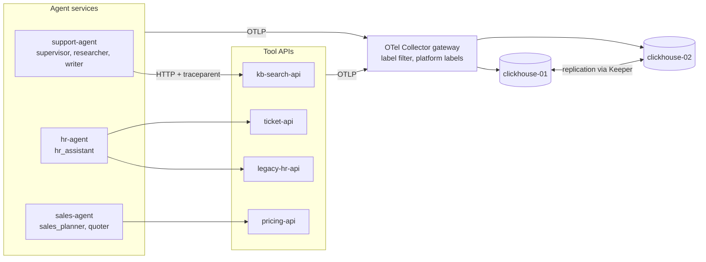

# Agent tracing with LangGraph, OpenTelemetry and ClickHouse

A runnable demo of tracing a fleet of LangGraph agents with the OpenTelemetry SDK. Every user turn becomes one trace that shows the agents handing off to each other, their model calls, their tool calls, and the downstream HTTP APIs those tools hit. Traces flow through an OpenTelemetry Collector gateway into a two-replica ClickHouse cluster, where you can query them with SQL.

[](https://codespaces.new/mdfarooqii/agent-tracing-otel-clickhouse?quickstart=1)

New to OpenTelemetry, LangGraph or ClickHouse? The [5-hour tutorial](docs/tutorial/README.md) explains every layer of this repo, with hands-on labs that break it on purpose.

## Try it in your browser

1. Click **Open in GitHub Codespaces** above, then **Create codespace**.
2. Wait 3–4 minutes. The codespace pulls the images, starts the stack, and starts sending agent traffic.
3. The ClickHouse UI opens in a new tab. If it doesn't, open the **Ports** tab and click the globe icon next to **ClickHouse UI (8123)**.
4. Enter user `default` and password `demo` in the top-right fields.
5. Paste a query and press **Ctrl/Cmd + Enter**. For example, the span tree of the latest turn:

   ```sql
   SELECT SpanName, ServiceName, StatusCode, round(Duration / 1e6) AS ms
   FROM otel.otel_traces
   WHERE TraceId = (SELECT argMax(TraceId, Timestamp) FROM otel.otel_traces WHERE SpanName = 'agent_turn')
   ORDER BY Timestamp
   ```

New traffic arrives every 30 seconds. In the codespace terminal, `./stack.sh queries` prints every saved query in [`queries.sql`](queries.sql), including an indented span tree.

Codespaces is free for personal accounts up to a monthly quota, and this demo runs on the smallest machine type (2 cores, 8 GB). Stop the codespace when you're done.

## What you'll see

One turn of the sales agent, as stored in ClickHouse. The pricing API failed once, and the agent's tool retried:

```text
agent_turn                              sales-agent  Ok          787 ms
  invoke_workflow sales_quoting         sales-agent
    invoke_agent sales_planner          sales-agent
      chat fake-planner                 sales-agent
    invoke_agent quoter                 sales-agent
      execute_tool get_price            sales-agent
        GET /v1/prices/{sku}            sales-agent  Error  500
          GET /v1/prices/{sku}          pricing-api  Error  500
        GET /v1/prices/{sku}            sales-agent         200
          GET /v1/prices/{sku}          pricing-api         200
      execute_tool get_price            sales-agent
        GET /v1/prices/{sku}            sales-agent         200
          GET /v1/prices/{sku}          pricing-api         200
      chat fake-quoter                  sales-agent
    invoke_agent sales_planner          sales-agent
      chat fake-planner                 sales-agent
```

And which agent depends on which API, from a single SQL join of client spans to server spans:

```text
caller         callee         endpoint              calls  errors  p95_ms
hr-agent       ticket-api     POST /v1/tickets          3       0      81
sales-agent    pricing-api    GET /v1/prices/{sku}     10       4     121
support-agent  kb-search-api  GET /v1/search            3       1     188
```

## Architecture



| Component | What it does | Address |
|---|---|---|
| Agent services | Three LangGraph apps, each its own process and OTel service | n/a |
| Tool APIs | Four small HTTP services the agents' tools call | `127.0.0.1:18081`–`18084` |
| OTel gateway | Receives OTLP, drops spans missing mandatory labels, adds platform labels, writes to ClickHouse | OTLP HTTP `localhost:14318`, gRPC `localhost:14317` |
| ClickHouse | One shard, two replicas, coordinated by ClickHouse Keeper | UI `localhost:8123/play` and `localhost:8124/play` |

## Run it locally

You need Docker (Docker Desktop, Colima or similar) with about 4 GB of memory, and Python 3.10 or newer.

```bash
git clone https://github.com/mdfarooqii/agent-tracing-otel-clickhouse.git
cd agent-tracing-otel-clickhouse
./stack.sh up
```

The first run creates a Python virtualenv in `agent/.venv`, pulls the images and starts everything; later runs take about 10 seconds. Then open <http://localhost:8123/play> (user `default`, password `demo`).

Stop everything with:

```bash
./stack.sh down
```

| Command | What it does |
|---|---|
| `./stack.sh up` | Start ClickHouse, the gateway and the background traffic loop |
| `./stack.sh up --no-traffic` | Start without the traffic loop |
| `./stack.sh demo` | Run one round of traffic in the foreground (with `--no-traffic`) |
| `./stack.sh queries` | Run the saved queries in [`queries.sql`](queries.sql) |
| `./stack.sh status` | Show containers, the traffic loop, and spans per service |
| `./stack.sh logs` | Follow the traffic loop's output |
| `./stack.sh traffic off` / `on` | Pause or resume the traffic loop; containers keep running |
| `./stack.sh down` | Stop everything; data is kept |
| `./stack.sh down --wipe` | Stop everything and delete the ClickHouse data |

`TRAFFIC_INTERVAL` (seconds, default 30) and `TRAFFIC_TURNS` (default 3) tune the loop, for example `TRAFFIC_INTERVAL=10 ./stack.sh up`.

**Behind a corporate network?** Put `REGISTRY=<your Docker Hub mirror>` in a `.env` file next to `compose.yaml`, and export `PIP_INDEX_URL` pointing at your PyPI mirror before the first `./stack.sh up`.

## How the instrumentation works

### Turns and agents

[`agent/telemetry.py`](agent/telemetry.py) has a LangChain callback handler that turns LangGraph's callback events into OpenTelemetry spans. Span names and attributes follow the [OpenTelemetry GenAI semantic conventions](https://opentelemetry.io/docs/specs/semconv/gen-ai/):

| Span | Created when | Key attributes |
|---|---|---|
| `agent_turn` | One per user message, by the caller | `gen_ai.conversation.id`, `org.agent.turn.index`, `org.request_id`, `org.agent.interface` |
| `invoke_workflow <graph>` | The LangGraph run starts | `gen_ai.operation.name=invoke_workflow` |
| `invoke_agent <node>` | A graph node that is an agent runs | `gen_ai.agent.name`, `gen_ai.agent.id`, `gen_ai.agent.version`, `org.agent.role` |
| `chat <model>` | A chat model is called | `gen_ai.provider.name`, `gen_ai.request.model`, `gen_ai.response.model`, `gen_ai.usage.*` tokens, finish reasons |
| `execute_tool <tool>` | A tool is called | `gen_ai.tool.name`, `gen_ai.tool.type`, and the calling agent |
| `GET /v1/...` (client, then server) | A tool calls an API | `http.request.method`, `http.route`, `http.response.status_code` |

LangGraph also emits callbacks for internal plumbing such as channel writes and routing functions. Those get no span, so the tree only shows agents, models and tools. Each conversation keeps one `gen_ai.conversation.id` across its turns, while every turn is a separate trace.

The tool span is made the current span while the tool runs, so HTTP calls from inside a tool become its children. The trace context and W3C baggage travel in the request headers, and each API continues the same trace.

Prompt and completion text is never recorded.

### Labels

Every span carries `org.*` ownership labels, so traces can be filtered by team, service and tenant. Each label has exactly one place where it lives:

| Label | Lives on | Set by | Required |
|---|---|---|---|
| `org.owner`, `org.service` | Resource | The service, in its SDK setup | Yes: the gateway drops spans without them |
| `org.region`, `org.platform`, `org.cluster`, `org.env` | Resource | The gateway | Added to every span |
| `org.tenant` | Span | The service, per request | Optional |
| `org.request_id`, `org.agent.interface` | Entry span | The service | Optional |

The agents put `org.tenant` and `org.request_id` into W3C baggage, and each API copies them onto its own entry span. That way one request id ties together all the work for one request across services.

The APIs deliberately send different label sets, so you can see each case in the data:

| Service | Labels it sends | What happens |
|---|---|---|
| `kb-search-api` | All mandatory labels, plus tenant and request id | Stored with every label column filled |
| `ticket-api` | Mandatory labels and request id; no tenant | Stored; the tenant column is empty |
| `pricing-api` | Mandatory labels plus `org.cost_center`, which isn't in the label schema | Stored; the extra label stays in the attribute map with no column. Fails 30% of calls |
| `legacy-hr-api` | `org.owner` and `org.service` on the span instead of the resource | Dropped by the gateway; only the agent's outgoing call appears |

### Storage

[`clickhouse/schema.sql`](clickhouse/schema.sql) extends the stock OTel ClickHouse exporter table, so existing tools that read `otel_traces` keep working:

- **`otel_traces`**: one row per span. Every `org.*` label and core `gen_ai.*` attribute is also a real column (`org_owner`, `gen_ai_agent_name`, `gen_ai_tokens_in` and so on), filled automatically on insert. Request, tenant and conversation ids have bloom-filter indexes. Raw spans are kept for 72 hours.
- **`trace_entry`**: one row per trace, for looking up a trace by request id, tenant or interface.
- **`span_red_1m`**: per-minute calls, errors and p50/p95/p99 latency per service and operation, kept for a year.

All tables are replicated across both ClickHouse nodes.

## Use a real model

The agents use an offline fake chat model with simulated latency and token counts, so the demo needs no API keys. To use a real model, replace `chat_model()` in [`agent/graph.py`](agent/graph.py) with any LangChain chat model, for example `ChatOpenAI(model="gpt-4o-mini")`. The tracing handler needs no changes; it reads token usage, response model and finish reasons from whatever the provider returns.

## Project layout

```text
.devcontainer/        Codespaces setup: starts the stack on launch
agent/
  agents.py           The three agent services, their labels and graphs
  graph.py            The support agent's supervisor graph and the fake chat model
  tools.py            Tools; most call the APIs over HTTP
  apis.py             The four tool APIs, each sending a different label set
  telemetry.py        OTel setup, the LangGraph callback handler, the HTTP client span
  run.py              Runs one agent service for N turns
  simulate.py         Starts the APIs and runs all agents, once or in a loop
clickhouse/           Cluster, Keeper and macros config, the schema, the /play redirect
compose.yaml          ClickHouse Keeper, two ClickHouse replicas, schema init, OTel gateway
docs/tutorial/        The 5-hour tutorial and its lab files
otel-gateway-config.yaml
queries.sql           Saved queries: turns, agents, tools, errors, dependencies, span tree
stack.sh              up / down / status / demo / queries / logs / traffic
```

## Troubleshooting

- **No new spans.** Run `./stack.sh status` and `./stack.sh logs`. The gateway's logs are in `docker logs otel-gateway`.
- **Port already in use.** The stack uses 8123, 8124, 9000, 9001, 13133, 14317, 14318 and 18081–18084. Stop whatever holds the port, or change the host side of the mapping in `compose.yaml`.
- **Start from scratch.** `./stack.sh down --wipe && ./stack.sh up`.
