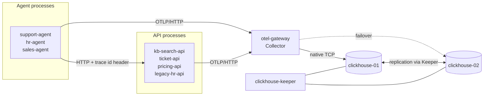

# Module 0: Setup and the mental model (25 min)

## Why this matters

Before learning any one piece in depth, you need a map of the whole system:
what each component is, why it's there, and how data moves between them. By
the end of this module you'll be able to name every part of the stack, say
whether it runs as Python or in Docker, and follow one user question from the
Python code to a row you can query in ClickHouse.

## Key terms

| Term | Plain meaning |
|---|---|
| **Process** | One running program. Each agent and each API in this repo is its own process |
| **Port** | A numbered "door" on a machine that a program listens on, such as `18081` for the search API |
| **Host** | Your machine (or your Codespace), as opposed to the containers running on it |
| **Container** | A program packaged with everything it needs, running isolated from the rest of the machine. Docker runs them |
| **Docker Compose** | A Docker feature that starts several containers together from one file, `compose.yaml` |
| **Port mapping** | A rule that forwards a port on the host to a port inside a container, such as host `14318` to gateway `4318` |
| **`stack.sh`** | This repo's control script: `up`, `down`, `status` and other commands |
| **Agent turn** | One user message and everything the agent does to answer it |
| **Trace** | The full record of one request (here, one turn), made of spans |
| **Span** | The record of one timed step inside a request, such as one model call or one HTTP call |

Other words are explained in the module that teaches them. If you meet one
you've forgotten, the [glossary in module 13](13-cheat-sheet.md#glossary-a-to-z) has them all.

## Idea

### The question tracing answers

Tracing answers one question: **"where did the time go, and what went wrong,
for this one request?"**

A request often crosses many processes. If each process only writes its own
logs, you end up with five separate stories and no way to line them up. With
tracing, each process writes down what it did, tags every note with **the same
request id**, and ships the notes to one place where they're stitched back
together in order.

In this repo, one request is one **agent turn**: a user asks a question, the
agent runs a few LLM calls and tool calls, and some tools call HTTP APIs that
run as separate processes. One turn becomes one trace.

### The cast: every component, and why it's there

**The agent services** (Python, on the host). Three agents built with
LangGraph (a Python library for agents, [module 2](02-langgraph.md)), each run
as its own process by `agent/run.py`:

- `support-agent`: a supervisor that sends the question to a researcher (which
  searches a knowledge base) and then a writer. It answers questions like
  *"What is a trace?"*.
- `hr-agent`: an HR assistant that looks up employee records and opens IT
  tickets, for questions like *"I need a new laptop."*.
- `sales-agent`: a planner and a quoter that look up prices, for questions
  like *"Quote two items for a new customer."*.

The LLM (large language model, the AI that writes replies) is a fake, offline
model in `agent/graph.py` with random delays, so nothing needs an API key. The
agents are where most spans are created.

**The tool APIs** (Python, on the host). Four tiny HTTP services in
`agent/apis.py`, each its own process on its own port:

| API | Port | Called by | Special behavior |
|---|---|---|---|
| `kb-search-api` | 18081 | support-agent's search tool | Sends every label |
| `ticket-api` | 18082 | hr-agent's ticket tool | No tenant label |
| `pricing-api` | 18083 | sales-agent's price tool | Fails 30% of calls; sends one extra label |
| `legacy-hr-api` | 18084 | hr-agent's employee lookup | Puts its labels in the wrong place, so the gateway drops its spans |

They exist so you can see a trace cross from one process to another, the way
real agents call real services. Each one creates its own spans, which join the
agent's trace.

**The OpenTelemetry SDK** (a Python library inside every agent and API).
OpenTelemetry is the open standard this repo uses for tracing; its SDK creates
spans, holds them in memory briefly, and sends them out in batches. It's set
up in `setup_tracing` in `agent/telemetry.py`. [Module 1](01-otel-core.md)
covers it.

**The gateway**, `otel-gateway` (Docker). An OpenTelemetry Collector: a
separate program that every service sends its spans to. Why not write straight
to the database? Because a central checkpoint can enforce rules for everyone
(drop spans with missing labels, add platform labels), group spans into big
efficient inserts, and retry when the database is briefly down. Its config is
`otel-gateway-config.yaml`. [Module 4](04-collector.md) covers it.

**ClickHouse**, `clickhouse-01` and `clickhouse-02` (Docker). The database
where spans end up, one row per span, in the table `otel.otel_traces`. The two
servers hold identical copies (**replicas**), so you can stop either one and
still have every span. The tables are defined in `clickhouse/schema.sql`.
Modules [7](07-clickhouse.md) to [11](11-s3-tiering.md) cover it.

**ClickHouse Keeper**, `clickhouse-keeper` (Docker). Two copies of a table only
stay identical if the servers agree on what has been written. Keeper keeps that
shared to-do list: "clickhouse-01 wrote new data; clickhouse-02, please fetch
it". Without Keeper, the replicated tables become read-only.

**`clickhouse-init`** (Docker, runs once). Creates the `otel` database and its
tables from `schema.sql`, waits until both replicas accept writes, then exits.
The gateway only starts after it has finished.

**Docker Compose.** `compose.yaml` describes the five containers above, their
ports and their data volumes. `docker compose up -d` starts them all in the
background.

**`stack.sh`.** The one script you use. `./stack.sh up` makes sure Docker is
running, creates a Python virtualenv (a private folder of packages, in
`agent/.venv`) the first time, runs `docker compose up -d`, waits until the
gateway answers its health check, and starts the background traffic loop. The
loop is `agent/simulate.py`: it starts the four APIs and runs every agent for
3 turns, every 30 seconds.

### Where each piece runs

This matters when something breaks, and it explains the odd port numbers.

```text
 Your machine (host)                          Docker network "agent-tracing-demo"
 ───────────────────                          ───────────────────────────────────
 agent processes ──OTLP──▶ localhost:14318 ──▶ otel-gateway:4318
 API processes   ──OTLP──▶ localhost:14318 ──▶ otel-gateway:4318
                                               otel-gateway ──▶ clickhouse-01:9000 (or -02)
 your browser ───────────▶ localhost:8123  ──▶ clickhouse-01:8123  (Play UI, SQL)
 your browser ───────────▶ localhost:8124  ──▶ clickhouse-02:8123
                                               clickhouse-01/02 ──▶ clickhouse-keeper:9181
 agent processes ──HTTP──▶ 127.0.0.1:18081-18084 (the APIs, also on the host)
```

OTLP (OpenTelemetry Protocol) is simply the format spans are sent in. The
agents and APIs are on the host, so they reach the gateway through a **port
mapping**: host port `14318` forwards to port `4318` inside the gateway
container. The containers talk to each other by name (`clickhouse-01`,
`clickhouse-keeper`) on their own Docker network.

### Follow one question from Python to a ClickHouse row

Here is a single support-agent turn, the question *"What is a trace?"*, in
five steps. Each step is one sentence or two here and a whole module later.

1. **Make spans.** The agent process starts a span called `agent_turn` for the
   turn. It's the first span, so it gets a new random **trace id**. Each step
   the agent takes (the supervisor deciding, an LLM call, a tool call) becomes
   a span inside it, sharing that trace id.
   ([Module 1](01-otel-core.md), [module 2](02-langgraph.md).)
2. **Cross into the API.** The `search_knowledge_base` tool calls
   `kb-search-api` over HTTP and sends the trace id along in a request header.
   The API reads it and records its own span under the **same trace id**.
   ([Module 1](01-otel-core.md).)
3. **Ship.** When spans finish, each process sends them in batches over OTLP
   to `localhost:14318`, the gateway. ([Module 1](01-otel-core.md).)
4. **Sort.** The gateway drops spans that lack owner labels, adds labels saying
   where it runs, and inserts the spans into ClickHouse.
   ([Module 4](04-collector.md).)
5. **Shelve.** ClickHouse stores one row per span in `otel.otel_traces`, and
   the second replica copies the new rows. ([Module 7](07-clickhouse.md).)

After a few seconds (up to about 10, because both the SDK and the gateway wait
to fill a batch), you can see the API's span. This query picks the newest
`kb-search-api` span; `FORMAT Vertical` prints one column per line:

```sql
SELECT Timestamp, TraceId, SpanId, ParentSpanId, SpanName, SpanKind, ServiceName,
       Duration, StatusCode, http_status, org_owner, org_service, org_tenant, org_env, org_region
FROM otel.otel_traces
WHERE ServiceName = 'kb-search-api'
ORDER BY Timestamp DESC LIMIT 1
FORMAT Vertical
```

```text
Timestamp:    2026-11-21 05:32:34.227963000
TraceId:      386d73b95ebe85beba3ae0906345d043
SpanId:       2b82646cf09c0fad
ParentSpanId: 9d8147dae245aec6
SpanName:     GET /v1/search
SpanKind:     Server
ServiceName:  kb-search-api
Duration:     230084000
StatusCode:   Unset
http_status:  200
org_owner:    search-platform
org_service:  kb-search-api
org_tenant:   globex
org_env:      dev
org_region:   local
```

What to notice:

- `TraceId` is the turn's trace id, the same one the agent's spans have
  (step 2).
- `ParentSpanId` is the id of the agent's span for this HTTP call: that's the
  link from the API back to the agent.
- `Duration` is in nanoseconds: 230,084,000 ns is about 230 ms.
- `org_owner` and `org_service` were set by the API itself, `org_tenant`
  travelled with the request from the agent (step 2), and `org_env` and
  `org_region` were added by the gateway (step 4).

## Remember it: the parcel route

> **Make it, label it, ship it, sort it, shelve it.**

Think of a parcel: someone packs it, writes a label, hands it to a courier, it
goes through a sorting center, and it ends up on a shelf where you can find it.
Spans take the same route:

| Step | Who | In this repo |
|---|---|---|
| Make | The OpenTelemetry **SDK** creates spans in each process | `agent/telemetry.py`, `agent/apis.py` |
| Label | Labels on each span say who sent it and what it did | `org.owner`, `org.service`, `gen_ai.*` |
| Ship | The SDK sends batches over OTLP | to `localhost:14318` |
| Sort | The **gateway** filters, adds labels, batches, retries | `otel-gateway-config.yaml` |
| Shelve | **ClickHouse** stores spans as rows; **Keeper** keeps the replicas in step | `clickhouse/schema.sql` |

The same picture as a diagram. Arrows show which way data flows:



## In this repo

| Path | What it is |
|---|---|
| `agent/run.py` | One agent service: one trace per turn, starting with the `agent_turn` span |
| `agent/telemetry.py` | Tracing setup (`setup_tracing`), HTTP client spans (`call_api`), the LangGraph span handler |
| `agent/graph.py`, `agent/agents.py` | The three agents, their owners, tenants and sample questions; the fake LLM |
| `agent/tools.py` | The tools the agents call; most call an API over HTTP |
| `agent/apis.py` | The four HTTP APIs, each sending a different set of labels |
| `agent/simulate.py` | Starts the APIs and runs all agents at once, once or in a loop |
| `otel-gateway-config.yaml` | The gateway's configuration |
| `clickhouse/schema.sql` | The database, tables and derived tables |
| `clickhouse/cluster.xml`, `keeper.xml`, `macros-0*.xml` | Which servers form the cluster, Keeper's settings, and each server's name |
| `compose.yaml` | The five containers, their ports and volumes |
| `stack.sh` | The one-command control: `up`, `down`, `status`, `queries`, `logs`, `traffic`, `health` |
| `queries.sql` | Saved example queries, run by `./stack.sh queries` |

## Lab (10 min)

1. **Check everything is up.** This lists the containers, says whether the
   traffic loop is running, and counts spans per service:

   ```bash
   ./stack.sh status
   ```

   You should see something like this (your counts will differ):

   ```text
   clickhouse-01       Up 12 hours (healthy)
   clickhouse-02       Up 12 hours (healthy)
   clickhouse-init     Exited (0) 12 hours ago
   clickhouse-keeper   Up 12 hours
   otel-gateway        Up 12 hours
   Traffic loop: running (pid 12345)
      ┌─ServiceName───┬─spans─┬────────────────────────latest─┐
   1. │ hr-agent      │ 10864 │ 2026-11-21 05:32:32.545736000 │
   2. │ kb-search-api │  1388 │ 2026-11-21 05:32:34.227963000 │
   3. │ pricing-api   │  3405 │ 2026-11-21 05:32:32.300933000 │
   4. │ sales-agent   │ 16186 │ 2026-11-21 05:32:32.699714000 │
   5. │ support-agent │ 17000 │ 2026-11-21 05:32:35.776513000 │
   6. │ ticket-api    │  2718 │ 2026-11-21 05:32:32.547356000 │
      └───────────────┴───────┴───────────────────────────────┘
   ```

   What to notice:
   - `clickhouse-init` says `Exited (0)`. That's correct: it creates the
     tables and stops. `0` means it succeeded.
   - Six services are listed, and if you run the command again after 30
     seconds, the counts grow.
   - `legacy-hr-api` is missing on purpose: the gateway drops every one of its
     spans. You'll find out exactly why in [module 4](04-collector.md).
   - If it says `Traffic loop: stopped`, run `./stack.sh traffic on`.

2. **Look at one complete turn.** Open <http://localhost:8123/play>, enter user
   `default` and password `demo`, and run the query below. The `WITH` line
   finds the trace id of the latest successful support-agent turn; the main
   query lists every span in that trace, oldest first. `Duration / 1e6`
   converts nanoseconds to milliseconds.

   ```sql
   WITH (SELECT TraceId FROM otel.otel_traces
         WHERE ServiceName = 'support-agent' AND SpanName = 'agent_turn' AND StatusCode != 'Error'
         ORDER BY Timestamp DESC LIMIT 1) AS t
   SELECT ServiceName, SpanKind, SpanName, round(Duration / 1e6) AS ms,
          SpanAttributes['gen_ai.operation.name'] AS op
   FROM otel.otel_traces WHERE TraceId = t ORDER BY Timestamp;
   ```

   You should see something like this (16 spans, two services):

   ```text
   support-agent  Internal agent_turn                          1517
   support-agent  Internal invoke_workflow support_supervisor  1517 invoke_workflow
   support-agent  Internal invoke_agent supervisor               80 invoke_agent
   support-agent  Client   chat fake-supervisor                  80 chat
   support-agent  Internal invoke_agent researcher              785 invoke_agent
   support-agent  Internal execute_tool search_knowledge_base   180 execute_tool
   support-agent  Client   GET /v1/search                       180
   kb-search-api  Server   GET /v1/search                       178
   support-agent  Client   chat fake-researcher                 604 chat
   ...
   ```

   What to notice:
   - It's the turn in time order: the supervisor, then the researcher with its
     tool call, then the writer.
   - Two services appear in **one** trace. The `Client` span in
     `support-agent` and the `Server` span in `kb-search-api` are the two ends
     of the same HTTP call.
   - The server span is slightly shorter than the client span (178 ms inside
     180 ms). The gap is network and HTTP overhead.
   - `agent_turn` lasts as long as everything inside it, because every other
     span is nested inside it.

3. **See one row in full.** Run the `FORMAT Vertical` query from "Follow one
   question" above and match each column to the step that produced it. In the
   Play UI, drop the `FORMAT Vertical` line.

4. **Run all the saved queries once**, just to see what's possible. Each one is
   explained in later modules:

   ```bash
   ./stack.sh queries
   ```

## Explain it back

> "Each process uses the OpenTelemetry SDK to record spans: timed steps that
> share a trace id. Spans are batched and sent over OTLP to a gateway, which
> drops unlabelled spans, adds platform labels, and writes to ClickHouse.
> ClickHouse keeps two replicas in sync through Keeper. One agent turn is one
> trace, and when a tool calls an API, the trace id travels in an HTTP header,
> so the API's spans join the same trace."

## Recap

- One user question (an agent turn) is one trace; each step in it is a span.
- The agents and APIs are Python processes on your machine. The gateway,
  ClickHouse, Keeper and the init job run in Docker.
- Spans are made by the SDK, sent over OTLP to the gateway on port `14318`,
  checked and labelled there, and inserted into `otel.otel_traces`.
- A trace crosses from the agent to an API because the trace id travels in an
  HTTP header.
- Two ClickHouse replicas hold the same data; Keeper keeps them in agreement.
- `./stack.sh status`, `queries`, `logs` and `traffic on|off` are your main
  controls.

## Check yourself

<details><summary>Why is one turn one trace, and not one whole conversation?</summary>

A trace answers "where did the time go for this one request?", so it needs a
clear start and end. A turn has both: `agent_turn` starts when the question
arrives and ends when the answer is ready, so its duration is the time the user
waited, and the spans inside it show which step was slow. A conversation can
last hours with long idle gaps; one trace for all of it would have a
meaningless duration and would mix many questions together.
</details>

<details><summary>Which processes produce spans, and which only move or store them?</summary>

The agents and the APIs produce spans (through the SDK). The gateway and
ClickHouse never create the application's spans; they filter, label, buffer
and store them.
</details>

<details><summary>The agents send to <code>localhost:14318</code>, but the gateway config listens on <code>4318</code>. Why do both work?</summary>

The agents run on the host; the gateway runs in a container. `compose.yaml`
maps host port `14318` to container port `4318`, so traffic to
`localhost:14318` arrives at the gateway's `4318`.
</details>

<details><summary>You stop <code>clickhouse-01</code>. Can you still see yesterday's spans?</summary>

Yes. `clickhouse-02` is a full replica with the same rows; query it at
<http://localhost:8124/play>. The gateway also switches to inserting into
`clickhouse-02`, because both servers are listed in its exporter endpoint.
</details>

<details><summary>What does Keeper do, in one sentence?</summary>

It keeps the shared record of what data each replicated table should contain,
so that each ClickHouse replica knows which new data it still needs to fetch
from the other.
</details>

## Next

You've seen that the API's span lands in the same trace as the agent's. But
how does a span know its parent, and how does the trace id get from one
process to another? [Module 1](01-otel-core.md) answers that with the core
OpenTelemetry ideas: spans, context, propagation, resources and the SDK.

## Read more

- [OpenTelemetry: What is OpenTelemetry?](https://opentelemetry.io/docs/what-is-opentelemetry/)
- [Observability primer](https://opentelemetry.io/docs/concepts/observability-primer/)
- [ClickHouse: Observability with OpenTelemetry](https://clickhouse.com/docs/observability/integrating-opentelemetry)
- [Docker Compose overview](https://docs.docker.com/compose/)
