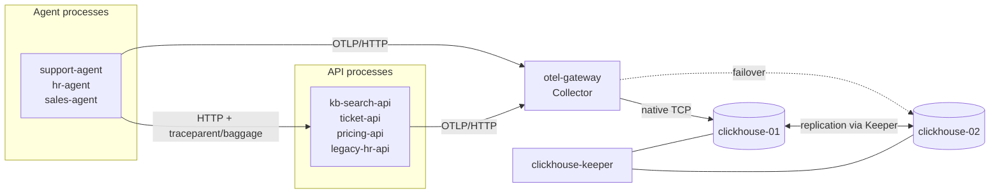

# Module 0: Setup and the mental model (25 min)

## Why this matters

Before learning any one piece in depth, you need a map of the whole system:
what each component is, why it's there, and how data moves between them. By
the end of this module you'll be able to name every part of the stack, say
whether it runs as Python or in Docker, and follow one user question from the
Python code all the way to a row you can query in ClickHouse.

## Key terms

These are the words this module needs. The section after this one,
"Words you'll meet in this tutorial", previews the rest.

| Term | Plain meaning |
|---|---|
| **Process** | One running program. Each agent and each API in this repo is its own process |
| **Port** | A numbered "door" on a machine that a program listens on, such as `18081` for the search API |
| **Host** | Your machine (or your Codespace), as opposed to the containers running on it |
| **Container** | A program packaged with everything it needs, running isolated from the rest of the machine |
| **Docker** | The tool that runs containers |
| **Docker Compose** | A Docker feature that starts several containers together from one file, `compose.yaml` |
| **Port mapping** | A rule that forwards a port on the host to a port inside a container, such as host `14318` to gateway `4318` |
| **`stack.sh`** | This repo's control script: `up`, `down`, `status` and other commands |
| **Virtualenv** | A private folder of Python packages for one project. `stack.sh` creates one in `agent/.venv` |
| **Agent turn** | One user message and everything the agent does to answer it |
| **Trace** | The full record of one request (here, one turn), made of spans |
| **Span** | The record of one timed step inside a request, such as one model call or one HTTP call |

## Words you'll meet in this tutorial

You don't need to learn these now. Skim the list so that nothing is a complete
surprise later. Each word gets a full explanation, with examples, in the
module listed next to it.

**Tracing words** (module 1)

| Word | In one line |
|---|---|
| Telemetry | Data a program sends out about its own behavior: traces, metrics and logs |
| Span | One timed operation: a name, a start and end time, and some facts about it |
| Trace | All the spans of one request, joined into a tree |
| Trace id | A random id shared by every span in one trace, like a parcel's tracking number |
| Parent span | The span that "called" this one. Each span points to its parent, which makes the tree |
| Attribute | A key-value fact on a span, such as `http.response.status_code = 504` |
| Resource | Key-value facts about *who* produced a span: service name, owner, version |
| Context | The "current span" a program is inside right now, so new spans know their parent |
| Propagation | Copying the trace id and parent span id into a request's headers, so the next service can continue the trace |
| Header | A `name: value` line sent along with an HTTP request, such as `traceparent: 00-...` |
| Baggage | Extra key-value data (like a tenant name) that travels with a request between services |
| Labels | This repo's name for the `org.*` attributes that say who owns a span and who it was for |

**OpenTelemetry words** (modules 1 and 4)

| Word | In one line |
|---|---|
| OpenTelemetry (OTel) | An open, vendor-neutral standard and set of libraries for producing and moving telemetry |
| API | The part of OpenTelemetry that code calls to create spans; does nothing on its own |
| SDK | The library that does the real work behind the API: collects, samples and sends spans |
| Exporter | The SDK or Collector component that sends spans somewhere else |
| OTLP | OpenTelemetry Protocol: the standard way to send telemetry over the network |
| Collector | A separate program that receives telemetry, processes it, and sends it on |
| Gateway | A Collector that runs centrally, so every service sends to it |
| Receiver, processor, exporter | The Collector's three kinds of building block: take data in, change it, send it out |
| Pipeline | One wired-up path inside a Collector: receivers, then processors, then exporters |
| Sampling | Deciding which traces to keep and which to drop, to save cost (module 5) |

**Agent words** (modules 2 and 3)

| Word | In one line |
|---|---|
| LLM | Large language model: the AI model that reads text and writes a reply |
| Agent | A program that uses an LLM to decide what to do next, and can call tools |
| Tool | An ordinary function the agent can call, such as "search the knowledge base" |
| LangChain | A Python library of building blocks for LLM apps |
| LangGraph | A library built on LangChain where an agent is a graph of steps (nodes) |
| Callback | A function LangChain calls each time something starts or ends; this repo turns those into spans |
| Token | A chunk of text (roughly a word) that LLM providers count and charge for |
| Semantic conventions (semconv) | Agreed, standard attribute names, such as `gen_ai.request.model`, so every tool reads them the same way |

**ClickHouse words** (modules 6, 7 and 10)

| Word | In one line |
|---|---|
| ClickHouse | A database designed to store and scan very large tables quickly |
| Replica | A full copy of a table on another server, kept in sync, so one server can fail safely |
| Keeper | ClickHouse Keeper: a small service the replicas use to agree on what data exists |
| Shard | A slice of the data. Different shards hold different rows (this repo has one shard) |
| Partition | A group of rows, here one per day, that can be dropped or moved as a unit |
| Part | A chunk of rows written to disk by one insert; ClickHouse merges small parts into bigger ones |
| MergeTree | ClickHouse's main table engine, which stores data in parts and merges them in the background |
| Materialized view | A rule that runs on every insert and writes derived rows into another table |
| TTL | Time to live: how long data is kept before ClickHouse deletes or moves it |
| Index | Extra data that lets a query skip over rows that can't match |
| Cardinality | How many different values a field has. `service.name` has few; `request_id` has millions |

## Idea

### The question tracing answers

Tracing answers one question: **"where did the time go, and what went wrong,
for this one request?"**

A request often crosses many processes. If each process only writes its own
logs, you end up with five separate stories and no way to line them up. With
tracing, each process writes down what it did, tags every note with **the same
request id**, and ships the notes to one place where they're stitched back
together in order.

In this repo, one request is one **agent turn**: a user asks a question, the
agent's graph runs a few LLM calls and tool calls, and some tools call HTTP
APIs that run as separate processes. One turn becomes one trace.

### The cast: every component, and why it's there

Here is each component, what problem it solves, and where it lives.

**The agent services** (Python, on the host). Three LangGraph agents, each run
as its own process by `agent/run.py`:

- `support-agent`: a supervisor that sends the question to a researcher (which
  searches a knowledge base) and then a writer. It answers questions like
  *"What is a trace?"*.
- `hr-agent`: one HR assistant that looks up employee records and opens IT
  tickets, for questions like *"I need a new laptop."*.
- `sales-agent`: a planner and a quoter that look up prices, for questions
  like *"Quote two items for a new customer."*.

The LLM they use is a fake, offline model (in `agent/graph.py`) with random
delays and word-count "tokens", so nothing needs an API key. The agents are
where most spans are created.

**The tool APIs** (Python, on the host). Four tiny HTTP services in
`agent/apis.py`, each its own process on its own port:

| API | Port | Called by | Special behavior |
|---|---|---|---|
| `kb-search-api` | 18081 | support-agent's search tool | Sends every label |
| `ticket-api` | 18082 | hr-agent's ticket tool | No tenant label |
| `pricing-api` | 18083 | sales-agent's price tool | Fails 30% of calls; sends one extra label |
| `legacy-hr-api` | 18084 | hr-agent's employee lookup | Puts its labels in the wrong place, so the gateway drops its spans |

They exist so you can see a trace cross from one process to another, the way
real agents call real services. Each one creates its own spans, which join the
agent's trace.

**The OpenTelemetry SDK** (a Python library inside every agent and API). It
creates spans, keeps them in memory briefly, and sends them out in batches.
Without it, nothing is recorded. It's set up in `setup_tracing` in
`agent/telemetry.py`.

**The gateway**, `otel-gateway` (Docker). An OpenTelemetry Collector: a
separate program that every service sends its spans to. Why not write straight
to the database? Because a central checkpoint can enforce rules for everyone
(drop spans with missing labels, add platform labels), group spans into big
efficient inserts, and retry when the database is briefly down. Its config is
`otel-gateway-config.yaml`. Module 4 covers it.

**ClickHouse**, `clickhouse-01` and `clickhouse-02` (Docker). The database
where spans end up, one row per span, in the table `otel.otel_traces`. There
are two servers holding identical copies (**replicas**), so you can stop
either one and still have every span. The tables are defined in
`clickhouse/schema.sql`. Modules 6, 7 and 10 cover it.

**ClickHouse Keeper**, `clickhouse-keeper` (Docker). Two copies of a table only
stay identical if the servers agree on what has been written. Keeper is the
small service that keeps that shared to-do list: "clickhouse-01 wrote a new
chunk of data; clickhouse-02, please fetch it". Without Keeper, replicated
tables become read-only.

**`clickhouse-init`** (Docker, runs once). Creates the `otel` database and its
tables from `schema.sql`, waits until both replicas are ready to accept writes,
then exits. The gateway only starts after it has finished.

**Docker and Docker Compose.** `compose.yaml` describes the five containers
above (Keeper, two ClickHouse servers, the init job, the gateway), their ports,
and their data volumes. `docker compose up -d` starts them all in the
background.

**`stack.sh`.** The one script you use. `./stack.sh up` makes sure Docker is
running, creates the Python virtualenv the first time, runs
`docker compose up -d`, waits until the gateway's health check answers, and
then starts the background traffic loop. The loop is `agent/simulate.py`: it
starts the four APIs and runs every agent for 3 turns, every 30 seconds.

### Where each piece runs

This matters when something breaks, and it explains the odd port numbers.

```text
 Your machine (host)                          Docker network "agent-tracing-demo"
 ───────────────────                          ───────────────────────────────────
 agent processes ──OTLP──▶ localhost:14318 ──▶ otel-gateway:4318
 API processes   ──OTLP──▶ localhost:14318 ──▶ otel-gateway:4318
                                               otel-gateway ──▶ clickhouse-01:9000 (or -02)
 your browser ───────────▶ localhost:8123  ──▶ clickhouse-01:8123  (Play UI, SQL)
 your browser ───────────▶ localhost:8124  ──▶ clickhouse-02:8123
                                               clickhouse-01/02 ──▶ clickhouse-keeper:9181
 agent processes ──HTTP──▶ 127.0.0.1:18081-18084 (the APIs, also on the host)
```

The agents and APIs are on the host, so they reach the gateway through a
**port mapping**: host port `14318` forwards to port `4318` inside the gateway
container. The containers talk to each other by name (`clickhouse-01`,
`clickhouse-keeper`) on their own Docker network.

### Follow one question from Python to a ClickHouse row

Let's follow a single support-agent turn, the question *"What is a trace?"*,
through every step. The numbers below are the real path in the code.

**1. The process starts and sets up tracing.** `simulate.py` runs
`run.py --agent support-agent`. That calls `setup_tracing` in
`agent/telemetry.py`, which:

- builds a **resource**, the "who am I" labels for this process:
  `service.name=support-agent`, `org.owner=ai-platform`,
  `org.service=support-agent`, and a few more,
- creates the SDK's span pipeline, ending in an exporter that sends to
  `http://localhost:14318`.

**2. The turn begins.** `run.py` makes a fresh request id and picks a tenant
(a customer name such as `globex`). It puts both into **baggage**, so they'll
travel with any HTTP call made during this turn. Then it starts a span called
`agent_turn`. Because no span is running yet, this is the **root span** and
it gets a brand-new random **trace id**. Every other span in this turn will
share that id.

**3. The graph runs, and each step becomes a span.** `run.py` calls
`graph.invoke(...)` and passes in `LangGraphTracer`, a callback handler.
LangGraph calls it every time a step starts or ends, and the handler opens or
closes a span for each one:

```text
agent_turn
  invoke_workflow support_supervisor     the whole graph run
    invoke_agent supervisor              the supervisor decides: researcher
      chat fake-supervisor               its LLM call
    invoke_agent researcher
      execute_tool search_knowledge_base the researcher calls a tool...
      chat fake-researcher
    ...
```

**4. A tool makes an HTTP call.** The `search_knowledge_base` tool calls
`call_api(...)` in `telemetry.py`. That function:

- starts a **client span** named `GET /v1/search`, a child of the tool span,
- writes two headers into the outgoing request: `traceparent` (the trace id
  plus this client span's id) and `baggage` (the tenant and request id),
- sends `GET http://127.0.0.1:18081/v1/search?q=...`.

**5. The API continues the same trace.** `kb-search-api` is a different
process. Its request handler in `apis.py` reads the `traceparent` header and
starts a **server span**, also named `GET /v1/search`, with the **same trace
id** and with the agent's client span as its parent. It copies `org.tenant`
and `org.request_id` out of the baggage onto this span. Then it searches, waits
50 to 250 ms, and replies.

**6. Spans end and wait in a queue.** When a span ends, the SDK puts it in an
in-memory queue in that process. A background thread sends the queue's
contents in **batches**: every 5 seconds, or sooner if 512 spans pile up. The
agent and the API each send their own spans separately; nothing joins them yet
except the shared trace id.

**7. Spans travel over OTLP to the gateway.** The batch is encoded with
**OTLP** (the OpenTelemetry Protocol) and sent by HTTP `POST` to
`localhost:14318`, which Docker forwards to the gateway's port `4318`.

**8. The gateway checks, labels and batches.** Inside the gateway, every span
passes through four steps, in order:

1. `memory_limiter`: refuses new data if the gateway is about to run out of
   memory.
2. `filter/require_org_labels`: drops the span if its resource lacks
   `org.owner` or `org.service`. Our spans have both, so they pass.
   (`legacy-hr-api`'s spans don't, and are dropped here.)
3. `resource/org_platform`: adds four platform labels, `org.region`,
   `org.platform`, `org.cluster` and `org.env`, which describe where the
   gateway runs.
4. `batch`: groups spans into bigger batches (up to 5 seconds or 1,000 spans)
   for efficient inserts.

Then the `clickhouse` exporter inserts the batch into `otel.otel_traces` on
`clickhouse-01` using ClickHouse's own network protocol on port `9000`. If
`clickhouse-01` can't be reached, it connects to `clickhouse-02` instead, and
if neither answers it retries for up to 5 minutes.

**9. ClickHouse stores the rows.** Each span becomes one row. As the row is
inserted, ClickHouse fills in extra columns from the attributes, such as
`org_owner`, `org_tenant` and `http_status`, so they're quick to filter on.
Small **materialized views** (rules that run on every insert) also write a
one-row-per-trace summary into `otel.trace_entry`, and per-minute call, error
and latency figures into `otel.span_red_1m`.

**10. The second replica catches up.** `clickhouse-01` writes the new rows to
disk as a new chunk (a **part**) and records "new part" in Keeper.
`clickhouse-02` sees that entry and downloads the part from `clickhouse-01`.
Now both servers have the row.

**11. You query it.** About 10 seconds after the turn (up to 5 seconds of
waiting in the SDK, plus up to 5 in the gateway), you can see the API's span:

```sql
SELECT Timestamp, TraceId, SpanId, ParentSpanId, SpanName, SpanKind, ServiceName,
       Duration, StatusCode, http_status, org_owner, org_service, org_tenant, org_env, org_region
FROM otel.otel_traces
WHERE ServiceName = 'kb-search-api'
ORDER BY Timestamp DESC LIMIT 1
FORMAT Vertical
```

```text
Timestamp:    2026-11-21 05:32:34.227963000
TraceId:      386d73b95ebe85beba3ae0906345d043
SpanId:       2b82646cf09c0fad
ParentSpanId: 9d8147dae245aec6
SpanName:     GET /v1/search
SpanKind:     Server
ServiceName:  kb-search-api
Duration:     230084000
StatusCode:   Unset
http_status:  200
org_owner:    search-platform
org_service:  kb-search-api
org_tenant:   globex
org_env:      dev
org_region:   local
```

What to notice:

- `TraceId` is the turn's trace id, the same one the agent's spans have.
- `ParentSpanId` is the span id of the agent's client span: that's the link
  from the API back to the agent.
- `Duration` is in nanoseconds: 230,084,000 ns is about 230 ms.
- `org_owner` and `org_service` came from the API's resource (step 1),
  `org_tenant` came from baggage (step 5), and `org_env` and `org_region` were
  added by the gateway (step 8).

## Remember it: the parcel route

> **Make it, label it, ship it, sort it, shelve it.**

Think of a parcel: someone packs it, writes a label, hands it to a courier, it
goes through a sorting center, and it ends up on a shelf where you can find it.
Spans take the same route:

| Step | Who | In this repo |
|---|---|---|
| Make | The OTel **SDK** creates spans in each process | `agent/telemetry.py`, `agent/apis.py` |
| Label | The **resource** and attributes say who and what | `org.owner`, `org.service`, `gen_ai.*` |
| Ship | The **OTLP exporter** sends batches over HTTP | `BatchSpanProcessor` to `localhost:14318` |
| Sort | The **Collector** (gateway) filters, enriches, batches, retries | `otel-gateway-config.yaml` |
| Shelve | **ClickHouse** stores spans as rows, replicated by **Keeper** | `clickhouse/schema.sql` |

The same picture as a diagram. Arrows show which way data flows:



## In this repo

| Path | What it is |
|---|---|
| `agent/run.py` | One agent service: one trace per turn. Sets baggage and starts the `agent_turn` span |
| `agent/telemetry.py` | SDK setup (`setup_tracing`), HTTP client spans (`call_api`), the LangGraph callback handler |
| `agent/graph.py`, `agent/agents.py` | The three LangGraph agents, their owners, tenants and sample questions; the fake LLM |
| `agent/tools.py` | The tools the agents call; most call an API over HTTP |
| `agent/apis.py` | The four HTTP APIs, each sending a different set of labels |
| `agent/simulate.py` | Starts the APIs and runs all agents at once, once or in a loop |
| `otel-gateway-config.yaml` | The Collector's configuration: receivers, processors, exporters |
| `clickhouse/schema.sql` | The database, tables and materialized views |
| `clickhouse/cluster.xml`, `keeper.xml`, `macros-0*.xml` | Which servers form the cluster, Keeper's settings, and each server's name |
| `compose.yaml` | The five containers, their ports and volumes |
| `stack.sh` | The one-command control: `up`, `down`, `status`, `queries`, `logs`, `traffic`, `health` |
| `queries.sql` | Saved example queries, run by `./stack.sh queries` |

## Lab (10 min)

1. **Check everything is up.** This lists the containers, says whether the
   traffic loop is running, and counts spans per service:

   ```bash
   ./stack.sh status
   ```

   You should see something like this (your counts will differ):

   ```text
   clickhouse-01       Up 12 hours (healthy)
   clickhouse-02       Up 12 hours (healthy)
   clickhouse-init     Exited (0) 12 hours ago
   clickhouse-keeper   Up 12 hours
   otel-gateway        Up 12 hours
   Traffic loop: running (pid 12345)
      ┌─ServiceName───┬─spans─┬────────────────────────latest─┐
   1. │ hr-agent      │ 10864 │ 2026-11-21 05:32:32.545736000 │
   2. │ kb-search-api │  1388 │ 2026-11-21 05:32:34.227963000 │
   3. │ pricing-api   │  3405 │ 2026-11-21 05:32:32.300933000 │
   4. │ sales-agent   │ 16186 │ 2026-11-21 05:32:32.699714000 │
   5. │ support-agent │ 17000 │ 2026-11-21 05:32:35.776513000 │
   6. │ ticket-api    │  2718 │ 2026-11-21 05:32:32.547356000 │
      └───────────────┴───────┴───────────────────────────────┘
   ```

   What to notice:
   - `clickhouse-init` says `Exited (0)`. That's correct: it creates the
     tables and stops. `0` means it succeeded.
   - Six services are listed, and if you run the command again after 30
     seconds, the counts grow.
   - `legacy-hr-api` is missing on purpose: it puts its labels on its spans
     instead of its resource, so the gateway drops every one of its spans.
     You'll find out exactly why in module 4.
   - If it says `Traffic loop: stopped`, run `./stack.sh traffic on`.

2. **Look at one complete turn.** Open <http://localhost:8123/play>, enter user
   `default` and password `demo`, and run the query below. The `WITH` line
   finds the trace id of the latest successful support-agent turn; the main
   query lists every span in that trace, oldest first. `Duration / 1e6`
   converts nanoseconds to milliseconds.

   ```sql
   WITH (SELECT TraceId FROM otel.otel_traces
         WHERE ServiceName = 'support-agent' AND SpanName = 'agent_turn' AND StatusCode != 'Error'
         ORDER BY Timestamp DESC LIMIT 1) AS t
   SELECT ServiceName, SpanKind, SpanName, round(Duration / 1e6) AS ms,
          SpanAttributes['gen_ai.operation.name'] AS op
   FROM otel.otel_traces WHERE TraceId = t ORDER BY Timestamp;
   ```

   You should see something like this (16 spans, two services):

   ```text
   support-agent  Internal agent_turn                          1517
   support-agent  Internal invoke_workflow support_supervisor  1517 invoke_workflow
   support-agent  Internal invoke_agent supervisor               80 invoke_agent
   support-agent  Client   chat fake-supervisor                  80 chat
   support-agent  Internal invoke_agent researcher              785 invoke_agent
   support-agent  Internal execute_tool search_knowledge_base   180 execute_tool
   support-agent  Client   GET /v1/search                       180
   kb-search-api  Server   GET /v1/search                       178
   support-agent  Client   chat fake-researcher                 604 chat
   ...
   ```

   What to notice:
   - It's the story from "Follow one question" above, in time order: the
     supervisor, then the researcher with its tool call, then the writer.
   - Two services appear in **one** trace. The `Client` span in
     `support-agent` and the `Server` span in `kb-search-api` are the two ends
     of the same HTTP call.
   - The server span is slightly shorter than the client span (178 ms inside
     180 ms). The gap is network and HTTP overhead.
   - `agent_turn` lasts as long as everything inside it, because it's the
     parent of all the other spans.

3. **See one row in full.** Run the `FORMAT Vertical` query from step 11 above
   and match each column to the step that produced it. In the Play UI, drop
   the `FORMAT Vertical` line.

4. **Run all the saved queries once**, just to see what's possible. Each one is
   explained in later modules:

   ```bash
   ./stack.sh queries
   ```

## Explain it back

> "Each process uses the OpenTelemetry SDK to record spans: timed operations
> that share a trace id. Spans are batched and sent over OTLP to a Collector
> gateway, which drops unlabelled spans, adds platform labels, and writes to
> ClickHouse. ClickHouse keeps two replicas in sync through Keeper. One agent
> turn is one trace, and when a tool calls an API, the trace id travels in the
> `traceparent` header, so the API's spans join the same trace."

## Recap

- One user question (an agent turn) is one trace; each step in it is a span.
- The agents and APIs are Python processes on your machine. The gateway,
  ClickHouse, Keeper and the init job run in Docker.
- Spans are made by the SDK, sent over OTLP to the gateway on port `14318`,
  checked and labelled there, and inserted into `otel.otel_traces`.
- A trace crosses from the agent to an API because the trace id travels in
  the `traceparent` HTTP header.
- Two ClickHouse replicas hold the same data; Keeper keeps them in agreement.
- `./stack.sh status`, `queries`, `logs` and `traffic on|off` are your main
  controls.

## Check yourself

<details><summary>Why is one turn one trace, and not one conversation?</summary>

A trace should cover one unit of work with a clear start and end. A
conversation can last hours; a trace that never ends can't be sampled, viewed
or measured sensibly. Turns are linked instead through a shared
`gen_ai.conversation.id` attribute.
</details>

<details><summary>Which processes produce spans, and which only move or store them?</summary>

The agents and the APIs produce spans (through the SDK). The gateway and
ClickHouse never create the application's spans; they filter, enrich, buffer
and store them.
</details>

<details><summary>The agents send to <code>localhost:14318</code>, but the gateway config listens on <code>4318</code>. Why do both work?</summary>

The agents run on the host; the gateway runs in a container. `compose.yaml`
maps host port `14318` to container port `4318`, so traffic to
`localhost:14318` arrives at the gateway's `4318`.
</details>

<details><summary>You stop <code>clickhouse-01</code>. Can you still see yesterday's spans?</summary>

Yes. `clickhouse-02` is a full replica with the same rows; query it at
<http://localhost:8124/play>. The gateway also switches to inserting into
`clickhouse-02`, because both servers are listed in its exporter endpoint.
</details>

<details><summary>What does Keeper do, in one sentence?</summary>

It keeps the shared record of what data each replicated table should contain,
so that each ClickHouse replica knows which new parts it still needs to fetch
from the other.
</details>

## Read more

- [OpenTelemetry: What is OpenTelemetry?](https://opentelemetry.io/docs/what-is-opentelemetry/)
- [Observability primer](https://opentelemetry.io/docs/concepts/observability-primer/)
- [ClickHouse: Observability with OpenTelemetry](https://clickhouse.com/docs/observability/integrating-opentelemetry)
- [Docker Compose overview](https://docs.docker.com/compose/)
