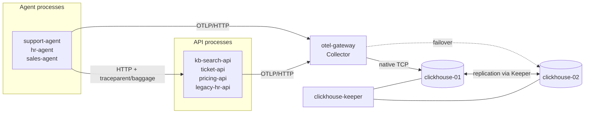

# Module 0: Setup and the mental model (15 min)

## Idea

Tracing answers one question: **"where did the time go, and what went wrong,
for this one request?"** A request crosses many processes. Each process writes
down what it did, with a shared id, and ships those notes to one place where
they are stitched back together.

In this repo, one *request* is one **agent turn**: a user asks a question,
the agent's graph runs a few LLM calls and tool calls, and some tools call
HTTP APIs that run as separate processes.

## Remember it: the parcel route

> **Make it, label it, ship it, sort it, shelve it.**

| Step | Who | In this repo |
|---|---|---|
| Make | The OTel **SDK** creates spans in each process | `agent/telemetry.py`, `agent/apis.py` |
| Label | The **resource** and attributes say who and what | `org.owner`, `org.service`, `gen_ai.*` |
| Ship | The **OTLP exporter** sends batches over HTTP | `BatchSpanProcessor` to `localhost:14318` |
| Sort | The **Collector** (gateway) filters, enriches, batches, retries | `otel-gateway-config.yaml` |
| Shelve | **ClickHouse** stores spans as rows, replicated by **Keeper** | `clickhouse/schema.sql` |



## In this repo

| Path | What it is |
|---|---|
| `agent/run.py` | One agent service: one trace per turn |
| `agent/telemetry.py` | SDK setup, HTTP client spans, the LangGraph callback handler |
| `agent/graph.py`, `agent/agents.py` | The three LangGraph agents |
| `agent/tools.py`, `agent/apis.py` | Tools, and the HTTP APIs they call |
| `agent/simulate.py` | Starts the APIs and runs all agents at once |
| `otel-gateway-config.yaml` | The Collector pipeline |
| `clickhouse/` | Cluster, Keeper and schema |
| `compose.yaml`, `stack.sh` | Containers, and the one-command control |

## Lab (10 min)

1. Check everything is up:

   ```bash
   ./stack.sh status
   ```

   Six services should be listed with growing span counts. `legacy-hr-api` is
   missing on purpose; you'll find out why in module 4.

2. Look at one complete turn. In the Play UI, run:

   ```sql
   WITH (SELECT TraceId FROM otel.otel_traces
         WHERE ServiceName = 'support-agent' AND SpanName = 'agent_turn' AND StatusCode != 'Error'
         ORDER BY Timestamp DESC LIMIT 1) AS t
   SELECT ServiceName, SpanKind, SpanName, round(Duration / 1e6) AS ms,
          SpanAttributes['gen_ai.operation.name'] AS op
   FROM otel.otel_traces WHERE TraceId = t ORDER BY Timestamp;
   ```

   You should see something like this (16 spans, two services):

   ```text
   support-agent  Internal agent_turn                          1517
   support-agent  Internal invoke_workflow support_supervisor  1517 invoke_workflow
   support-agent  Internal invoke_agent supervisor               80 invoke_agent
   support-agent  Client   chat fake-supervisor                  80 chat
   support-agent  Internal invoke_agent researcher              785 invoke_agent
   support-agent  Internal execute_tool search_knowledge_base   180 execute_tool
   support-agent  Client   GET /v1/search                       180
   kb-search-api  Server   GET /v1/search                       178
   support-agent  Client   chat fake-researcher                 604 chat
   ...
   ```

3. Run all the saved queries once, just to see what's possible:

   ```bash
   ./stack.sh queries
   ```

## Explain it back

> "Each process uses the OpenTelemetry SDK to record spans: timed operations
> that share a trace id. Spans are batched and sent over OTLP to a Collector
> gateway, which drops unlabelled spans, adds platform labels, and writes to
> ClickHouse. ClickHouse keeps two replicas in sync through Keeper. One agent
> turn is one trace, and when a tool calls an API, the trace id travels in the
> `traceparent` header, so the API's spans join the same trace."

## Check yourself

<details><summary>Why is one turn one trace, and not one conversation?</summary>

A trace should cover one unit of work with a clear start and end. A
conversation can last hours; a trace that never ends can't be sampled, viewed
or measured sensibly. Turns are linked instead through a shared
`gen_ai.conversation.id` attribute.
</details>

<details><summary>Which processes produce spans, and which only move or store them?</summary>

The agents and the APIs produce spans (through the SDK). The gateway and
ClickHouse never create the application's spans; they filter, enrich, buffer
and store them.
</details>

## Read more

- [OpenTelemetry: What is OpenTelemetry?](https://opentelemetry.io/docs/what-is-opentelemetry/)
- [Observability primer](https://opentelemetry.io/docs/concepts/observability-primer/)
- [ClickHouse: Observability with OpenTelemetry](https://clickhouse.com/docs/observability/integrating-opentelemetry)
