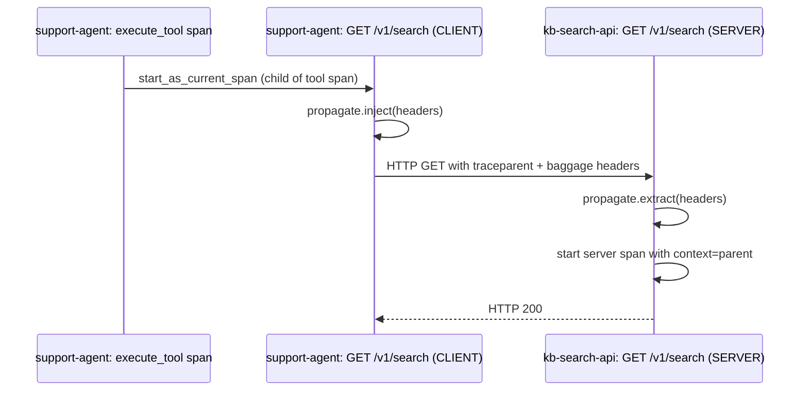

# Module 1: OpenTelemetry core (55 min)

## Why this matters

Every other module builds on the words in this one. When the gateway drops a
span, when a trace is "broken" between two services, or when a ClickHouse
query joins a client span to a server span, the explanation is always one of
the ideas here: spans, trace ids, context, propagation, resources, or the
SDK's export pipeline. Get these clear and the rest of the tutorial is just
details.

What you'll be able to do after this module:

- Look at one span and say what each of its fields means.
- Explain how a span knows its parent, inside one program and across an HTTP
  call, and read a `traceparent` header by eye.
- Say whether a fact belongs on the resource, on a span attribute, or in
  baggage.
- Follow a finished span through the SDK (tracer provider, span processor,
  exporter) and out over OTLP, and say what happens when that path is blocked.

## Key terms

| Term | Plain meaning |
|---|---|
| **OpenTelemetry (OTel)** | An open standard plus a set of libraries for producing telemetry (traces, metrics, logs) and sending it somewhere |
| **Span** | The record of one timed operation: a name, a start time, an end time, and facts about it |
| **Trace** | All the spans of one request, joined into a tree |
| **Trace id** | A random 16-byte id shared by every span in one trace, like a parcel's tracking number |
| **Span id** | A random 8-byte id unique to one span |
| **Parent span** | The span that was running when this span started. Each span stores its parent's span id |
| **Root span** | The first span of a trace. It has no parent. Here it's `agent_turn` |
| **Span kind** | Which role the span plays: internal work, calling out (`CLIENT`), or being called (`SERVER`), and two messaging kinds |
| **Status** | Whether the operation failed: `UNSET` (default, no failure recorded), `OK`, or `ERROR` |
| **Attribute** | A key-value fact about one span, such as `http.response.status_code = 504` |
| **Event** | A timestamped note inside a span, such as an `exception` with a stack trace |
| **Cardinality** | How many different values a field can have. A route template has few; a SKU or request id has many |
| **Context** | An invisible "which span am I inside right now?" value that OpenTelemetry carries through your code |
| **Propagation** | Writing the context into an outgoing request, and reading it back on the other side, so a trace can cross processes |
| **Header** | A `name: value` line sent with an HTTP request |
| **`traceparent`** | The standard HTTP header that carries the trace id and the caller's span id |
| **Baggage** | Key-value pairs (such as a tenant name) that travel with a request to downstream services, in the `baggage` header |
| **Resource** | Key-value facts about *who* produced the spans: service name, version, owner. Set once per process |
| **Labels** | This repo's word for the `org.*` attributes and resource attributes, such as `org.owner` and `org.tenant` |
| **API** | The OpenTelemetry package that code calls to create spans. Does nothing on its own |
| **SDK** | The OpenTelemetry package that actually records, samples, buffers and sends spans |
| **Tracer provider** | The SDK object that holds the configuration (resource, sampler, processors) for a whole process |
| **Tracer** | The object you call to start spans. You get one from the tracer provider |
| **Sampler** | The SDK part that decides, when a span starts, whether to record it (module 5) |
| **Span processor** | The SDK part that is told about every span that ends, and passes it on |
| **Batch span processor** | A span processor that queues finished spans and sends them in groups from a background thread |
| **Exporter** | The SDK part that sends spans out of the process, for example over the network |
| **OTLP** | OpenTelemetry Protocol: the standard format and protocol for sending telemetry over the network |

## Idea

### The running example

We'll follow one request through every concept. The background traffic runs
the **support agent** (`agent/run.py --agent support-agent`). On one turn the
user asks *"What is a trace?"*. During that turn:

1. `run.py` starts a span called `agent_turn` for the whole turn.
2. The LangGraph graph runs (module 2). Its supervisor and researcher nodes
   each make an LLM call.
3. The researcher calls the tool `search_knowledge_base`, which sends
   `GET /v1/search` to `kb-search-api`, a separate Python process on port
   `18081`.
4. `kb-search-api` searches, replies, and records its own span.
5. Both processes send their spans, separately, to the gateway at
   `localhost:14318`, which writes them to ClickHouse.

The puzzle this module solves: two different processes record spans on their
own, yet in ClickHouse they show up as **one** trace, with the API's span
correctly nested under the agent's HTTP call. How?

### Trace and span

**Why.** "The turn took 2 seconds" doesn't tell you *where* the 2 seconds
went. You want each step timed separately, and you want to know which step was
inside which, so you can find the slow or broken one.

**What.** A **span** is the record of one timed operation. Think of it as one
line on a restaurant order ticket: "grill steak, started 19:02:10, finished
19:09:40, table 12". A **trace** is the whole ticket: every line for one
order. In OpenTelemetry, the thing that ties the lines together is the
**trace id**: every span of one request carries the same one.

The tree shape comes from the **parent span id**. Each span remembers which
span was running when it started. A good picture is a family tree: the trace
id is the family surname (everyone shares it), the span id is each person's
own first name, and the parent span id says who their parent is. The one span
with no parent is the **root span**.

Here are the fields every span has:

| Field | Example | Note |
|---|---|---|
| `trace_id` | `12d64ae6b9afa411e15ca3a7c1726609` | 16 bytes (32 hex characters), same for every span in the trace |
| `span_id` | `01aa4e70b23ff052` | 8 bytes (16 hex characters), unique per span |
| `parent_span_id` | `2d1b1ef9f9ccc966` | Empty for the root span |
| `name` | `execute_tool search_knowledge_base` | Low cardinality: no ids in names |
| `kind` | `INTERNAL`, `CLIENT`, `SERVER`, `PRODUCER`, `CONSUMER` | Who is calling whom |
| `status` | `UNSET`, `OK`, `ERROR` | Only set `ERROR` for failures |
| start and end time | `2026-11-21T17:32:03.144649Z` | Duration is end minus start |
| attributes | `http.response.status_code=504` | Facts about this operation |
| events | `exception` with a stack trace | Timestamped points inside a span |
| links | Pointer to a span in another trace | For batches and fan-in, not parent/child |

A few of these need a closer look.

**Name and cardinality.** The name says *what kind* of operation this is, so
you can group "all searches" together. It must not contain ids. The number of
distinct values a field can take is its **cardinality**: `GET /v1/search` is
one value, but a name with a SKU in it would be a new value for every SKU, and
grouping by name would stop working. Specific values go in attributes instead.
This repo names HTTP spans after the **route template**, the URL pattern with
placeholders. `pricing-api`'s span is called `GET /v1/prices/{sku}`, not
`GET /v1/prices/SKU-200`.

**Kind.** The kind says what role the span plays:

- `INTERNAL`: work inside one process. `agent_turn`, `invoke_agent ...` and
  `execute_tool ...` are internal.
- `CLIENT`: this process is calling something else and waiting for the
  answer. `call_api` creates a `CLIENT` span for each HTTP call. The `chat`
  spans for LLM calls are `CLIENT` too, and so is `ticket-api`'s
  `INSERT tickets` database span.
- `SERVER`: this process is handling a call from someone else. Every API
  request handler in `apis.py` creates a `SERVER` span.
- `PRODUCER` and `CONSUMER`: the two ends of a message queue. This repo
  doesn't use them.

**Status.** Status answers one question: did this operation fail? It starts
as `UNSET`, which means "nothing went wrong that we know of". Code sets
`ERROR` when it fails. In `apis.py`, the server span is set to `ERROR` only for
5xx responses: a 404 is the caller's mistake, not a failure of the API.
`run.py` sets `OK` on `agent_turn` when the turn succeeds.

**Attributes.** Key-value facts about this one span: the HTTP method, the
response code, the model name, the tenant. Standard names such as
`http.request.method` come from the **semantic conventions** (semconv), an
agreed list of attribute names so every tool reads them the same way. The
`gen_ai.*` ones are the subject of [module 3](03-genai-semconv.md).

**Events and links.** An **event** is a timestamped note inside a span. When
a tool fails, `LangGraphTracer` calls `span.record_exception(error)`, which
adds an `exception` event with the error message and stack trace. A **link**
points to a span in a *different* trace, for cases such as one batch job
processing messages from many requests. Links are not parent-child
relationships; this repo doesn't create any.

**Worked example: the client/server pair.** When the researcher's tool calls
`kb-search-api`, two spans describe the same HTTP call, one in each process:

```text
support-agent process                       kb-search-api process
─────────────────────                       ─────────────────────
GET /v1/search  kind=CLIENT                 GET /v1/search  kind=SERVER
  trace_id = 386d73b9...                      trace_id = 386d73b9...   (same)
  span_id  = 9d8147da...  ◀──────────────────  parent_span_id = 9d8147da...
                                              span_id  = 2b82646c...
```

The server span's parent is the client span. The client span measures the
whole call from the agent's side, including the network. The server span
measures only the time the API spent handling it. That pair is how a backend
draws an edge between two services: query 7 in `queries.sql` joins every
server span to the client span that is its parent, and reports "which service
calls which".

### Context: the current span inside one process

**Why.** When `call_api` starts its client span, how does it know its parent
is the tool span? Passing a "parent" argument through every function would be
tedious, and libraries you don't control couldn't do it.

**What.** OpenTelemetry keeps a **context**: an invisible value that holds
"the current span" (plus the current baggage) for the code that's running
right now. Think of it as a name badge you're wearing: anyone who meets you
can see which team you're on without asking.

`start_as_current_span(...)` does two things: it starts a span whose parent
is the current span, and it makes the new span current until the `with` block
ends. So nesting `with` blocks makes nesting spans, with no extra arguments.
This is the core of `docs/tutorial/labs/hello_span.py`:

```python
with tracer.start_as_current_span("parent"):
    with tracer.start_as_current_span("child", attributes={"step": 1}):
        ...
```

`child` is started while `parent` is current, so `child`'s parent span id is
`parent`'s span id, and both get the same trace id. `parent` started when no
span was current, so it became a root span and got a brand-new random trace
id. The same thing happens in `run.py`: `agent_turn` starts with nothing
current, so it is the root of the turn's trace.

There's a second way to start spans: `start_span(...)` with an explicit
`context=` argument. It records a span but does *not* make it current.
`LangGraphTracer` uses that, because LangChain's callbacks tell it the parent
directly. [Module 2](02-langgraph.md) explains the one place this matters:
the tool span has to be made current with `context.attach(...)`, or the HTTP
calls inside the tool would get the wrong parent.

### Propagation: carrying context across the network

**Why.** Context lives in memory, inside one process. `kb-search-api` is a
different process; it can't see the agent's memory. Without help, its server
span would start with no current span, become a root span, and get its *own*
new trace id. You'd have two unrelated traces and no way to join them.

**What.** **Propagation** copies the context into the outgoing request, and
copies it back out on the other side. For HTTP, it travels in **headers**:
the `name: value` lines sent before the body of an HTTP request (like
`Content-Type: application/json`). OpenTelemetry uses two standard headers
from the W3C (the web standards body):

- `traceparent`: the trace id and the caller's span id.
- `baggage`: the baggage key-value pairs.

The analogy: when you visit another office, you carry a letter of
introduction that says "this visitor belongs to case 386d73b9, sent by person
9d8147da". The receiving office files its own notes under the same case and
names the sender as the parent.

**How it looks in this repo.** Two calls do the work:

- `propagate.inject(headers)` reads the current context and writes the
  headers into a dictionary. `call_api` in `agent/telemetry.py` calls it
  *inside* its client span, so the span id it writes is the client span's id:

  ```python
  with get_tracer().start_as_current_span(f"{method} {route}", kind=SpanKind.CLIENT, ...) as span:
      headers = {"Content-Type": "application/json"}
      propagate.inject(headers)
  ```

- `propagate.extract(headers)` reads those headers on the receiving side and
  returns a context. `apis.py` passes that context when it starts its server
  span, so the server span becomes a child of the agent's client span:

  ```python
  parent = propagate.extract({key.lower(): value for key, value in self.headers.items()})
  ...
  with tracer.start_as_current_span(name, context=parent, kind=SpanKind.SERVER, ...) as span:
  ```

  The header names are lower-cased first. Python's `urllib` sends the header
  as `Traceparent` with a capital T, and the extractor looks up the
  lower-case key `traceparent`.

**Reading a `traceparent` header.** Here is a real pair of headers, printed by
the lab script:

```text
traceparent: 00-12d64ae6b9afa411e15ca3a7c1726609-01aa4e70b23ff052-03
             │  │                                │                └ flags (01 = sampled)
             │  │                                └ span id of the caller (the new parent)
             │  └ trace id
             └ version
baggage:     org.tenant=acme_corp
```

Four parts separated by dashes: the format version (`00`), the trace id (32
hex characters), the span id of the span that sent the request (16 hex
characters), and flags. The receiver keeps the trace id and uses the span id
as its parent. The flags are explained in "Check yourself" below.



### Baggage: request-wide values you carry along

**Why.** Some facts belong to the whole request, not to one span: which
customer (tenant) it's for, or a request id that support staff can search for.
The API needs them too, but the agent's attributes stay in the agent's
process.

**What.** **Baggage** is a set of key-value pairs stored in the context and
sent in the `baggage` header with every outgoing call. The key point:
baggage is *not* automatically added to spans. It's like luggage you carry on
a trip: it goes everywhere with you, but nobody unpacks it unless they choose
to. Each receiver decides which keys, if any, to copy onto its own spans.

**How it looks in this repo.**

1. `agent/run.py`, before each turn, puts a fresh request id and (if the
   agent has tenants) a tenant into baggage, and attaches that context:

   ```python
   ctx = baggage.set_baggage("org.request_id", request_id)
   if tenant:
       ctx = baggage.set_baggage("org.tenant", tenant, ctx)
   token = context.attach(ctx)
   ```

   `run.py` also puts the same two values on `agent_turn` as attributes,
   because baggage alone wouldn't make them show up there.

2. `propagate.inject(...)` in `call_api` writes them into the `baggage`
   header of every API call made during the turn.

3. `apis.py` reads the keys listed in each service's `span_labels` out of the
   extracted context and copies them onto its server span:

   ```python
   for label in service.span_labels:
       value = baggage.get_baggage(label, parent)
       if value:
           attributes[label] = value
   ```

   `kb-search-api` and `pricing-api` copy `org.tenant` and `org.request_id`.
   `ticket-api` copies only `org.request_id`, so its spans have no tenant even
   though the header carried one.

### Resource: who produced the spans

**Why.** A span that says "GET /v1/search took 230 ms" is useless if you
don't know which service sent it, which version, or which team to call. You
could add `service.name` to every span by hand, but you'd forget some, and
you'd repeat the same values millions of times.

**What.** The **resource** describes the producer: `service.name`,
`service.version`, `deployment.environment.name`, and in this repo also
`org.owner` and `org.service`. It's set once, when the process sets up
tracing, and attached to every span the process exports. Rule of thumb:
**resource = who, attributes = what**. The resource is the return address on
an envelope; attributes are what's written in the letter.

**How it looks in this repo.** `setup_tracing` in `agent/telemetry.py` builds
it from the service name plus whatever attributes the caller passes:

```python
resource = Resource.create({"service.name": service_name, **attributes}, schema_url=SCHEMA_URL)
```

`run.py` passes `service.namespace`, `service.version`,
`deployment.environment.name`, `org.service` and `org.owner` (for
support-agent, `org.owner=ai-platform`). `apis.py` passes the shared
`COMMON_RESOURCE` plus each API's own labels. `Resource.create` also adds
`telemetry.sdk.*` attributes (the SDK's language, name and version) and
merges in anything from the `OTEL_RESOURCE_ATTRIBUTES` environment variable,
which is how lab step 2 changes the resource without editing code.

### Labels: resource labels and span labels

"Labels" is this repo's word for the ownership and context attributes in the
`org.*` namespace. Which kind a label is depends on where it lives:

| Kind | Lives on | Describes | Examples | Set by |
|---|---|---|---|---|
| Resource label | The resource, once per process | Who sent the span, and where it runs | `org.owner`, `org.service`; `org.env`, `org.region` | The service; the gateway stamps the platform ones |
| Span label | Each span | This particular request | `org.tenant`, `org.request_id`, `org.agent.interface` | The service, per request, often copied from baggage |

Where a label lives matters. The gateway drops spans whose **resource** lacks
`org.owner` and `org.service`. `legacy-hr-api` puts those two labels on its
spans (through `span_attributes` in `apis.py`) and leaves its resource empty,
so every one of its spans is dropped. Same keys, wrong place.
[Module 4](04-collector.md) shows the filter that does it.

A quick way to decide where a fact goes:

| Question | Put it on | Example |
|---|---|---|
| Is it the same for every span this process sends? | The resource | `org.owner=search-platform` |
| Does it describe this one operation? | A span attribute | `http.response.status_code=504` |
| Does a *downstream* service need it too? | Baggage, then copy it onto spans where wanted | `org.tenant=globex` |

### Spans from non-agentic services

An HTTP API, a database or a batch job with no LLM joins the agent's trace the
same way: it **continues the trace id** it receives in `traceparent`. There is
no merge step later. If the service extracts the context, its server span gets
the caller's trace id, with the caller's client span as its parent. Nothing
about the API in `apis.py` is AI-specific; it's an ordinary HTTP server with
four lines of propagation code. [Module 8](08-cross-environment.md) lists
everything that has to hold for that to work across environments, and
`apis.py` can simulate a proxy that strips the headers
(`STRIP_TRACE_HEADERS=1`).

### API and SDK: why there are two packages

**Why.** A library author (say, of an HTTP client) wants to add spans to their
library. But they can't force every user to send telemetry, or pick where it
goes. So OpenTelemetry splits the job in two.

**What.**

- The **API** (`opentelemetry-api`) is the set of calls that create spans:
  `trace.get_tracer(...)`, `start_as_current_span(...)`,
  `propagate.inject(...)`. Libraries depend only on this. If no SDK tracer
  provider has been set up, every call is a **no-op** (it does nothing and
  records nothing), so instrumented libraries cost almost nothing.
- The **SDK** (`opentelemetry-sdk`) is the real implementation, chosen by the
  application owner: `TracerProvider`, samplers, span processors, exporters.

It's like a wall socket and a power plant. Appliances (libraries) are built to
the socket standard (the API). Until someone connects the house to a power
plant (installs and configures the SDK), plugging in does nothing.

In this repo, `get_tracer()` and the span code use the API. `setup_tracing`
is the only place that touches the SDK, and it runs once at process start.

### The SDK pipeline: from a span to the network

Here is the path a span takes inside one process:

```text
Tracer ─start_span─▶ Sampler ─▶ Span ─end()─▶ SpanProcessor ─▶ Exporter ─OTLP─▶ Collector
          (API)       (keep?)                  (Batch: queue)     (HTTP/gRPC)
```

The analogy is a post office. You write letters (spans) at your desk. When a
letter is finished, you drop it in the out-tray (the span processor). A clerk
collects the tray every few minutes, or sooner if it fills up, and drives the
bundle to the sorting center (the exporter sends it to the Collector).

Each piece, as `setup_tracing` builds it:

```python
os.environ.setdefault("OTEL_EXPORTER_OTLP_ENDPOINT", "http://localhost:14318")  # 1
resource = Resource.create({"service.name": service_name, **attributes}, ...)   # 2
provider = TracerProvider(resource=resource)                                    # 3
provider.add_span_processor(BatchSpanProcessor(OTLPSpanExporter()))            # 4
trace.set_tracer_provider(provider)                                             # 5
```

1. Sets the default address to send to, unless the environment variable is
   already set.
2. Builds the resource ("who am I").
3. Creates the **tracer provider**: the one object per process that holds the
   resource, the sampler and the processors. No sampler is passed, so the
   SDK's default is used unless `OTEL_TRACES_SAMPLER` says otherwise. The
   default records every root span, and follows the caller's decision for
   child spans ([module 5](05-sampling.md)).
4. Adds a **batch span processor** that feeds an **OTLP exporter**.
5. Registers the provider globally, so every API call in the process now
   goes to the SDK instead of being a no-op.

After that, `get_tracer()` asks the provider for a **tracer**, the object
with `start_as_current_span`. The tracer's name and version
(`"agent-tracing"`, `"0.1.0"`) identify the code that made the spans.

**The batch span processor.** `BatchSpanProcessor` keeps finished spans in an
in-memory queue and exports them in batches from a background thread, so your
code never waits for the network. Defaults: queue 2048 spans, batch 512,
every 5 s. Two consequences:

- **If the queue is full, new spans are dropped.** The queue is in memory; it
  is not a durable buffer.
- Spans still in the queue when the process exits are lost, unless you call
  `provider.shutdown()`, which flushes whatever is left. That's why `run.py`
  and `apis.py` both call it before exiting.

The lab script uses the simpler `SimpleSpanProcessor` instead, which exports
each span immediately when it ends. That's handy for printing, but too slow
for real services because the code waits for every export.

**The exporter and OTLP.** The exporter turns spans into bytes and sends them.
This repo uses `OTLPSpanExporter` from the
`opentelemetry.exporter.otlp.proto.http` package. **OTLP** is the
OpenTelemetry Protocol: spans encoded with protobuf (a compact binary format)
and sent either over HTTP (port 4318) or over gRPC (a binary RPC protocol
built on HTTP/2, port 4317). This repo maps them to 14318 and 14317 on the
host; the Python code uses HTTP. The lab uses `ConsoleSpanExporter`, which
prints spans as JSON instead of sending them.

**Configuration without code changes.** Almost everything can be set through
environment variables: `OTEL_EXPORTER_OTLP_ENDPOINT` (where to send),
`OTEL_RESOURCE_ATTRIBUTES` (extra resource attributes), `OTEL_TRACES_SAMPLER`
(which sampler), `OTEL_BSP_MAX_QUEUE_SIZE` and `OTEL_BSP_SCHEDULE_DELAY` (the
batch processor's queue size and delay; BSP stands for batch span processor).

### Putting it together

The running example, end to end, with each concept named:

```text
run.py         setup_tracing: resource + TracerProvider + BatchSpanProcessor + OTLP exporter
run.py         baggage: org.request_id, org.tenant       (context now holds baggage)
run.py         agent_turn                ROOT, new trace id, INTERNAL
                 ...graph spans (module 2)...
telemetry.py     execute_tool search_knowledge_base      made current
telemetry.py       GET /v1/search  CLIENT  propagate.inject -> traceparent + baggage headers
apis.py              GET /v1/search  SERVER  propagate.extract, same trace id,
                                             parent = client span, copies baggage labels
both processes   spans end -> batch queue -> OTLP/HTTP -> localhost:14318 -> gateway
```

## Remember it

> **A trace is a family tree. The trace id is the surname, the span id is
> the first name, the parent id says who your parent is. `traceparent` is the
> letter of introduction you carry when you visit another service.**

And: **resource = who, attributes = what, baggage = luggage you carry but
don't unpack unless you choose to.**

And for the SDK: **API = the socket, SDK = the power plant, batch processor =
the out-tray, exporter = the courier, OTLP = the shape of the parcel.**

## In this repo

- `agent/telemetry.py`, `setup_tracing`: resource, `TracerProvider`,
  `BatchSpanProcessor`, `OTLPSpanExporter`. The endpoint defaults to
  `http://localhost:14318`.
- `agent/telemetry.py`, `get_tracer`: the tracer every span in the repo is
  started from.
- `agent/telemetry.py`, `call_api`: a `CLIENT` span per HTTP call, and
  `propagate.inject(headers)`.
- `agent/apis.py`, the request handler: `propagate.extract(...)` and a
  `SERVER` span whose parent is the caller's client span. Note the header
  names are lower-cased first, because Python's `urllib` sends
  `Traceparent` with a capital T, and the extractor looks up lower-case keys.
  `SERVICES` shows each API's resource labels and which baggage keys it copies
  (`span_labels`).
- `agent/run.py`: puts `org.request_id` and `org.tenant` into baggage before
  each turn, starts the root `agent_turn` span, and calls
  `provider.shutdown()` at the end.
- `agent/agents.py`: each agent's `owner` (which becomes the `org.owner`
  resource label) and `tenants` (which `run.py` picks from for baggage).
  `sales-agent` has no tenants, so its requests carry no `org.tenant`.
- `docs/tutorial/labs/hello_span.py`: the smallest possible example: two
  nested spans, baggage, and the headers `inject` writes.

## Lab (15 min)

1. **Make spans and print them, without any backend.** The script sets up a
   tracer provider with a console exporter, puts `org.tenant` in baggage,
   starts `parent` and then `child` inside it, and prints the headers that
   `propagate.inject` would send:

   ```bash
   cd agent && .venv/bin/python ../docs/tutorial/labs/hello_span.py
   ```

   You should see something like this (ids are random, and the output is
   shortened):

   ```text
   Headers a client would send: {'traceparent': '00-979bfbd9d471a3865291b978e75b8e35-d90841a00167415a-03', 'baggage': 'org.tenant=acme_corp'}
   {
       "name": "child",
       "context": {
           "trace_id": "0x979bfbd9d471a3865291b978e75b8e35",
           "span_id": "0xd90841a00167415a",
           ...
       },
       "kind": "SpanKind.INTERNAL",
       "parent_id": "0x321b58bf3d7e32fa",
       ...
       "attributes": {
           "step": 1
       },
       ...
       "resource": {
           "attributes": {
               "telemetry.sdk.language": "python",
               "telemetry.sdk.name": "opentelemetry",
               "telemetry.sdk.version": "...",
               "service.instance.id": "...",
               "service.name": "hello",
               "org.owner": "me"
           },
           ...
       }
   }
   {
       "name": "parent",
       "context": {
           "trace_id": "0x979bfbd9d471a3865291b978e75b8e35",
           "span_id": "0x321b58bf3d7e32fa",
           ...
       },
       "parent_id": null,
       ...
   }
   ```

   Look for:
   - The `Headers a client would send:` line, with `traceparent` and `baggage`.
     The span id inside `traceparent` is `child`'s span id, because `inject`
     ran while `child` was current.
   - `child` printed **before** `parent`: spans are exported when they *end*,
     and the inner `with` block ends first.
   - `child.parent_id` equals `parent.context.span_id`, and both share a
     `trace_id`. `parent` has `parent_id: null`: it's the root.
   - The resource block: your attributes plus `telemetry.sdk.*` added by the
     SDK. It's identical on both spans, because it belongs to the process.
   - `org.tenant` is in the `baggage` header but **not** in either span's
     attributes: baggage isn't copied onto spans unless code does it.

2. **Change the resource without changing code.** `OTEL_RESOURCE_ATTRIBUTES`
   adds resource attributes from the environment; `grep` keeps only the
   matching lines:

   ```bash
   OTEL_RESOURCE_ATTRIBUTES=deployment.environment.name=lab .venv/bin/python ../docs/tutorial/labs/hello_span.py | grep environment
   ```

   ```text
               "deployment.environment.name": "lab",
               "deployment.environment.name": "lab",
   ```

   One line per span, because the resource is attached to every span the
   process exports. The same variable works for the agents and APIs, since
   `setup_tracing` uses `Resource.create`.

3. **Find the client/server pair in ClickHouse.** Open
   <http://localhost:8123/play> (user `default`, password `demo`). This query
   joins the table to itself: for each `Client` span `c`, it finds a `Server`
   span `s` in the same trace whose parent is `c`, then counts the pairs:

   ```sql
   SELECT c.ServiceName AS caller, s.ServiceName AS callee, c.SpanName, count() AS calls
   FROM otel.otel_traces AS c
   JOIN otel.otel_traces AS s ON s.TraceId = c.TraceId AND s.ParentSpanId = c.SpanId
   WHERE c.SpanKind = 'Client' AND s.SpanKind = 'Server'
   GROUP BY caller, callee, c.SpanName;
   ```

   You should see something like this (counts will differ):

   ```text
   hr-agent       ticket-api     POST /v1/tickets       1355
   sales-agent    pricing-api    GET /v1/prices/{sku}   3391
   support-agent  kb-search-api  GET /v1/search         1373
   ```

   What to notice:
   - Each row is one edge in a service map, found purely from trace ids and
     parent span ids. Nothing else tells ClickHouse that these services talk.
   - The span names are route templates (`{sku}`), so all prices group into
     one row.
   - `hr-agent` also calls `legacy-hr-api`, but there's no row for it: the
     gateway dropped `legacy-hr-api`'s server spans, so the join finds no
     partner.

## Explain it back

> "A span is a timed operation with attributes and a status; spans with the
> same trace id form a tree through parent ids. Inside a process, the current
> span lives in the context, so nested spans become children. Between
> processes, the client injects the W3C `traceparent` header, and the server
> extracts it and starts its span as a child of the client span. Baggage rides
> along for request-wide values like tenant. The SDK samples, buffers spans in
> a batch processor, and exports them over OTLP; the resource tells the backend
> which service sent them."

## Recap

- A span is one timed step; a trace is every span of one request, tied
  together by a shared trace id and arranged into a tree by parent span ids.
- Span names stay low cardinality (route templates, not ids); specific values
  go in attributes.
- A `CLIENT` span in the caller and a `SERVER` span in the callee describe the
  same call; the server span's parent is the client span.
- Context holds the current span inside a process. `start_as_current_span`
  uses it and updates it, so nested blocks make nested spans.
- Propagation carries context across HTTP: `inject` writes `traceparent` and
  `baggage` headers, `extract` reads them.
- Baggage travels with the request but only lands on spans when code copies
  it, as `apis.py` does for `org.tenant` and `org.request_id`.
- Resource = who (once per process), attributes = what (per span). The
  gateway requires `org.owner` and `org.service` on the resource.
- The API is a no-op until the SDK is set up. The SDK's tracer provider holds
  the resource, sampler and processors; the batch processor queues spans; the
  exporter sends them over OTLP; `shutdown()` flushes the queue.

## Check yourself

<details><summary>A span's name is <code>GET /v1/prices/sku-123</code>. What's wrong?</summary>

The name contains an id, so it has unbounded cardinality: every SKU becomes a
different span name, which breaks grouping and indexing. Use the route
template (`GET /v1/prices/{sku}`) and put the SKU in an attribute if needed.
This repo does that through `url.template` on the client span (and
`http.route` on the server span).
</details>

<details><summary>What happens to spans if the collector is down for 10 minutes?</summary>

The exporter fails and retries; meanwhile the `BatchSpanProcessor` queue fills
up (2048 spans by default) and then **drops new spans**. The SDK is not a
durable buffer. That's one reason to run a Collector close to the app.
</details>

<details><summary>Why doesn't baggage show up as span attributes by itself?</summary>

Baggage is propagated data, not telemetry; copying it everywhere could leak
data or blow up cardinality. Each service decides which baggage keys to copy
onto its spans (or uses a baggage span processor to do it for all spans).
</details>

<details><summary>What do the flags <code>03</code> in <code>traceparent</code> mean?</summary>

The flags are two hex digits holding bits. `03` is bits `01` and `02` both set.
Bit `01` is "sampled": the caller recorded this trace, so a parent-based
sampler downstream will record it too. Bit `02` is the newer "random" flag
(W3C Trace Context level 2): the trace id was generated randomly, which lets
ratio samplers make consistent decisions from it.
</details>

<details><summary><code>kb-search-api</code> forgets to call <code>propagate.extract</code>. What does the trace look like?</summary>

The agent's trace still has its `GET /v1/search` client span, but it has no
child. The API's server span starts with no current span, so it becomes a
root span with a new trace id: a separate, one-span trace. The query in lab
step 3 would find no pair for it. You can see this effect with
`STRIP_TRACE_HEADERS=1`, which makes `apis.py` extract from empty headers.
</details>

<details><summary><code>legacy-hr-api</code> sends <code>org.owner</code> and <code>org.service</code>. Why are its spans dropped anyway?</summary>

It sends them as span attributes, not as resource attributes. The gateway's
filter checks only the resource, so to the gateway these spans have no owner
or service, and it drops them.
</details>

<details><summary>Why does <code>run.py</code> call <code>provider.shutdown()</code> at the end?</summary>

The batch processor sends spans every 5 seconds from a background thread. When
`run.py` finishes its last turn, the most recent spans are probably still in
the queue. `shutdown()` flushes them to the exporter before the process exits;
without it, the last turn would often be missing.
</details>

<details><summary>A library you use is instrumented with OpenTelemetry, but you never call <code>setup_tracing</code>. Do you get spans?</summary>

No. The library calls the API, and with no SDK tracer provider registered,
those calls are no-ops. Nothing is recorded or sent.
</details>

## Read more

- [Traces](https://opentelemetry.io/docs/concepts/signals/traces/)
- [Context propagation](https://opentelemetry.io/docs/concepts/context-propagation/)
- [Resources](https://opentelemetry.io/docs/concepts/resources/)
- [Python instrumentation guide](https://opentelemetry.io/docs/languages/python/instrumentation/)
- [SDK environment variables](https://opentelemetry.io/docs/specs/otel/configuration/sdk-environment-variables/)
- [W3C Trace Context](https://www.w3.org/TR/trace-context/) and [W3C Baggage](https://www.w3.org/TR/baggage/)
- [OTLP specification](https://opentelemetry.io/docs/specs/otlp/)
