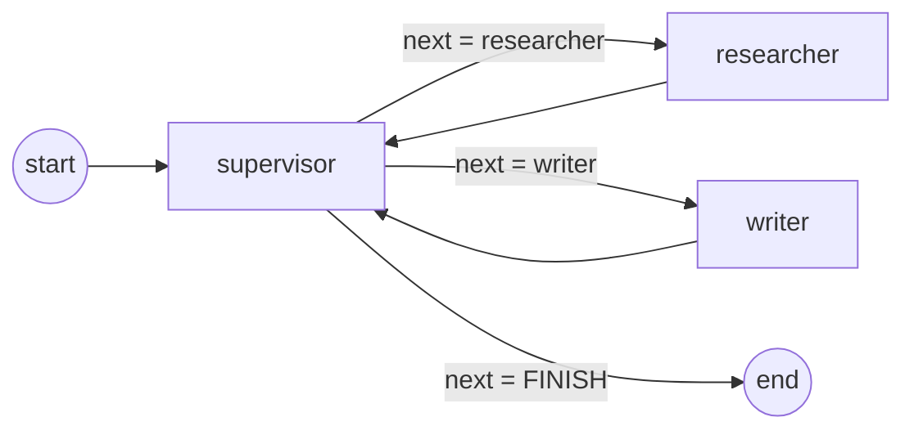

# Module 2: LangChain, LangGraph and callbacks (55 min)

## Why this matters

An AI agent can feel like a black box: a question goes in, an answer comes
out, and everything in between is a blur of model calls and tool calls. This
module opens the box. You'll learn what the moving parts of an agent are, how
the LangGraph library wires them together, and how this repo listens to them
and writes one span for each step that matters.

What you'll be able to do after this module:

- Explain what an LLM call, a tool, an agent, a graph, a node, an edge, a
  supervisor and a sub-agent are, using the repo's support agent as the example.
- Explain what a callback is and why it's the right place to hook in tracing.
- Read the span tree of one agent turn and say which line of code produced
  each span.

## Key terms

Spans, parent spans and the context (the "which span am I inside right now?"
value) were covered in [module 1](01-otel-core.md). These are the new words.

| Term | Plain meaning |
|---|---|
| LLM call (chat call) | One request to a large language model (LLM): you send a list of messages, you get one reply back, plus a count of **tokens** (word pieces, the unit providers charge for). |
| Tool | An ordinary function the agent is allowed to run, such as "search the knowledge base" or "open a ticket". |
| Agent | Code that uses an LLM to decide what to do next, then does it (often by calling tools). |
| LangChain, LangGraph | LangChain gives LLMs, tools and prompts one common interface. LangGraph, built on it, wires several steps or agents into a graph. |
| Graph, node, edge | A set of steps (nodes, each a Python function) joined by arrows (edges) that say which step runs next. A conditional edge picks its target at run time. |
| State | A shared dictionary that every node reads from and writes to. |
| Supervisor, sub-agent (worker) | The supervisor node only decides who runs next; sub-agents do the work and hand control back. |
| Checkpointer | Storage that saves the state after each step, so a conversation can continue on the next turn. |
| Runnable | LangChain's common interface. Anything you can `.invoke(...)`: a model, a tool, a node, a whole graph. |
| Callback | A function you hand to a library so it can call you back when something happens ("tell me when you start and finish"). |
| Run, `run_id`, `parent_run_id` | One execution of a Runnable, its unique id, and the id of the run that called it. |

## Idea

### The running example

We'll keep following the request from modules 0 and 1: a user asks the
**support agent** *"What is a trace?"*. It's the first turn of a
conversation, and it always succeeds. The agent:

1. decides it needs to look something up,
2. searches an internal knowledge base (an HTTP API, `kb-search-api`),
3. summarizes what it found,
4. writes a short answer and counts its words,
5. decides it's done.

Every numbered step involves either an LLM call or a tool. Keep this request
in mind; every concept below is a piece of it.

### Building blocks, from zero

**LLM call.** An LLM is a text-in, text-out program. You call it with a list
of **messages**: usually a **system message** (standing instructions such as
"Summarise the notes for the writer.") and a **human message** (the user's
words). It returns one reply message and reports how many tokens it read and
wrote. That's one LLM call, also called a **chat call**. In this repo the
model is a fake one (`FakeChatModel` in `agent/graph.py`) that waits a little,
returns a canned reply, and reports word counts as token counts. The stack
runs with no API key and no cost, yet the rest of the code can't tell it from
a real model.

**Tool.** An LLM can only produce text. It can't search a database or open a
ticket. A tool is a normal Python function that the agent may run to act on
the world. In `agent/tools.py`, each tool is a function marked with `@tool`.
For example, `search_knowledge_base` sends `GET /v1/search` to the
knowledge-base API, and `count_words` counts words in a draft.

**Agent.** An agent is code that combines the two: it asks an LLM what to do,
then does it, often by calling a tool, and repeats until it has an answer.

> In this demo the decisions are plain Python ("no notes yet, so go to the
> researcher"), with an LLM call alongside; in a real agent the model's reply
> drives the decision. The tracing is the same either way.

**Graph, node, edge, state.** When one agent isn't enough, you split the work
into steps and draw arrows between them. That drawing is a **graph**. Each
step is a **node** (a Python function), each arrow is an **edge**. A
**conditional edge** is a fork in the road: the next node is picked at run
time. The nodes share a **state**, a dictionary that works like a whiteboard:
each node reads it and returns only the fields it wants to change. For the
support agent the state is `TurnState`, with `messages` (the conversation),
`notes` (what the researcher found), `answer` (what the writer wrote), `next`
(the supervisor's decision) and `fail_tool` (a switch the labs use to force a
failure).

**Supervisor and sub-agents.** A common shape is one boss and a few
specialists. The **supervisor** node looks at the progress so far and picks
who goes next. The **sub-agents** (also called workers) do the actual work and
then hand control back. This is like a restaurant: the head waiter (supervisor)
reads the order ticket and sends it to the kitchen (researcher), then to
plating (writer), then decides the order is complete.

Here's the support agent's graph, exactly as `build_graph()` in
`agent/graph.py` wires it:



For our request, the path is: supervisor, researcher, supervisor, writer,
supervisor, end. The supervisor runs three times; each worker runs once.
How state is merged and saved between turns comes
[after the span tree](#under-the-hood-steps-and-the-checkpointer).

> **Quick check:** You add a `reviewer` worker between `writer` and
> `supervisor` (writer -> reviewer -> supervisor). How many node runs does
> turn 1 now have?
>
> <details><summary>Answer</summary>
>
> Six: the supervisor still decides three times (researcher, writer, FINISH),
> plus researcher, writer and reviewer once each.
> </details>

### LangChain: everything is a Runnable

LangChain's big idea is that every building block has the same interface,
the **Runnable**. A chat model, a tool, a node, and the whole compiled graph
can all be called the same way: `.invoke(input, config)`.

The `config` argument is the important part for us. It's passed down from
each Runnable to every Runnable it calls, like a luggage tag that follows a
bag through every transfer. Look at the researcher node in `agent/graph.py`:
it receives `config` and passes it on to the tool and the chat model:

```python
def researcher(state: TurnState, config: RunnableConfig) -> dict[str, Any]:
    question = _question(state)
    notes = search_knowledge_base.invoke(
        {"query": question, "simulate_failure": state.get("fail_tool", False)}, config
    )
    summary = chat_model("fake-researcher", f"Relevant notes: {notes}", 0.4).invoke(
        [SystemMessage("Summarise the notes for the writer."), HumanMessage(f"{question}\n\n{notes}")],
        config,
    )
    return {"notes": summary.content, "messages": [AIMessage(summary.content, name="researcher")]}
```

What to notice: `config` is passed to both `.invoke(...)` calls. One of the
things `config` carries is the list of **callbacks**, so passing it on is what
lets the tracer see the tool call and the chat call inside this node. The
return value is the state update: new `notes`, plus one message for the
conversation.

### What a callback is

**Why.** We want a span for each model call and tool call, but we don't want
to write tracing code inside every node and every tool. That would be
repetitive and easy to forget.

**What.** A callback is a function you hand to someone else, so they can call
you when something happens. It's like leaving your phone number at a
restaurant: "call me when my table is ready". You don't stand at the door; the
restaurant tells you.

In LangChain, a callback handler is a class with methods such as
`on_chain_start` and `on_tool_end`. Every time any Runnable starts, finishes
or fails, LangChain calls the matching method on every handler in `config`,
and passes two ids:

- `run_id`: a unique id for this run,
- `parent_run_id`: the `run_id` of whoever called it (or none for the
  outermost run).

Those two ids are all you need to draw a family tree. Each run points to its
parent, exactly as each span points to its parent span. That's why callbacks
map so neatly onto spans.

| Callback | Fired for | Span the tracer creates |
|---|---|---|
| `on_chain_start` / `on_chain_end` | The whole graph, each node, and internal plumbing | `invoke_workflow` for the graph, `invoke_agent` for agent nodes, nothing for plumbing |
| `on_chat_model_start` / `on_llm_end` | Each chat model call | `chat <model>`, with token usage added at the end |
| `on_tool_start` / `on_tool_end` | Each tool call | `execute_tool <tool>` |
| `on_chain_error`, `on_llm_error`, `on_tool_error` | Any failure | The same span, marked with status `ERROR` and an `exception` event |

A "chain" here is LangChain's word for any Runnable that isn't a model or a
tool: the graph and each node count as chains. The `invoke_workflow`,
`invoke_agent`, `chat` and `execute_tool` names come from the GenAI semantic
conventions, the subject of [module 3](03-genai-semconv.md).

### How callbacks become spans

`LangGraphTracer` in `agent/telemetry.py` is a callback handler. It keeps a
dictionary from `run_id` to span. For each event:

1. **On start**, it looks up the span of the `parent_run_id`. If there is none
   (the outermost run), it uses the turn span that `run.py` created (next
   section). It starts a new child span under that parent and stores it under
   the new `run_id`.
2. **For plumbing runs**, it creates no span. LangGraph also reports small
   internal runs, such as the routing function that reads `state["next"]`.
   A span for those would be noise. But their children still need a parent, so
   the tracer stores the *parent's* span under the plumbing run's `run_id`
   (the `_alias` method). Anything started inside the plumbing run then
   attaches to the nearest real span.
3. **On end**, it ends the span. **On error**, it first records the exception
   on the span, sets `error.type`, and sets the span status to `ERROR`.

How does it tell an agent node from plumbing? LangGraph adds **metadata** to
every callback: `langgraph_node` (which node this run belongs to) and
`langgraph_step` (the step number). The tracer creates an `invoke_agent` span
only when the run's name equals its `langgraph_node` and that node is listed in
the agent's roles. The routing function also has `langgraph_node=supervisor`
in its metadata, but its name is `RunnableCallable`, not `supervisor`, so it's
treated as plumbing. Here's that decision in `on_chain_start`:

```python
if parent_run_id is None:              # outermost run: the graph itself
    ...  # start "invoke_workflow <graph name>"
elif node in self._agents and name == node:   # the node's own run
    ...  # start "invoke_agent <node>"
else:                                  # plumbing
    self._alias(run_id, parent_run_id)
```

> **Quick check:** Why not simply create a span for every `on_chain_start`?
>
> <details><summary>Answer</summary>
>
> LangGraph also reports plumbing runs, such as the routing function. Spans
> for those add noise and storage cost and say nothing about the agent. The
> tracer skips them but keeps their children attached to the nearest real span.
> </details>

### Lab 1 (5 min): see the raw callbacks

This script attaches a handler that only prints events (it exports no spans)
and starts the knowledge-base API for the researcher's tool. It asks its own
question, *"What is a span?"*, but the path through the graph is the same as
for *"What is a trace?"*. Pause the background traffic first so port 18081 is
free:

```bash
./stack.sh traffic off
cd agent && .venv/bin/python ../docs/tutorial/labs/print_callbacks.py
```

```text
on_chain_start         #1 parent=   -  node=            support_supervisor
on_chain_start         #2 parent=  #1  node=supervisor  supervisor
on_chat_model_start    #3 parent=  #2  node=supervisor  fake-supervisor
on_chain_start         #4 parent=  #2  node=supervisor  RunnableCallable
on_chain_start         #5 parent=  #1  node=researcher  researcher
on_tool_start          #6 parent=  #5  node=researcher  search_knowledge_base
on_chat_model_start    #7 parent=  #5  node=researcher  fake-researcher
on_chain_start         #8 parent=  #1  node=supervisor  supervisor
on_chat_model_start    #9 parent=  #8  node=supervisor  fake-supervisor
on_chain_start        #10 parent=  #8  node=supervisor  RunnableCallable
on_chain_start        #11 parent=  #1  node=writer      writer
on_chat_model_start   #12 parent= #11  node=writer      fake-writer
on_tool_start         #13 parent= #11  node=writer      count_words
on_chain_start        #14 parent=  #1  node=supervisor  supervisor
on_chat_model_start   #15 parent= #14  node=supervisor  fake-supervisor
on_chain_start        #16 parent= #14  node=supervisor  RunnableCallable
```

How to read it: `#N` is a short number for each `run_id`, and `parent=` is
the short number of its `parent_run_id`.

- `#1` has no parent: `invoke_workflow support_supervisor`.
- `#2`, `#5`, `#8`, `#11`, `#14` have a name equal to their node:
  `invoke_agent` spans. `#4`, `#10`, `#16` are routing plumbing: no span.
- There's no line for the HTTP request: that's not a LangChain Runnable.
  It's the `call_api` span, which the tracer places under the tool span
  (see [below](#the-tricky-part-tools-that-make-http-calls)).

Leave the traffic off for now; Lab 2 turns it back on.

### Where does the trace start?

Not in LangGraph. `agent/run.py` opens one `agent_turn` span for each user
turn; that's the root of the trace. Before that, it puts the tenant and a
request id into **baggage**, the key-value pairs that travel with the request
to downstream services ([module 1](01-otel-core.md#baggage-request-wide-values-you-carry-along)).
Then it calls the graph with the tracer as a callback:

```python
handler = LangGraphTracer(tracer, turn, conversation_id=conversation_id, ...)
result = graph.invoke(
    {**spec.turn_state, "messages": [HumanMessage(question)], "fail_tool": ...},
    config={"callbacks": [handler], "configurable": {"thread_id": conversation_id}},
)
```

What to notice:

- `turn` is the `agent_turn` span. The tracer uses it as the parent of the
  outermost run, so `invoke_workflow` hangs under `agent_turn`.
- `"callbacks": [handler]` is how the tracer gets every event.
- `"thread_id": conversation_id` tells LangGraph which saved conversation
  this turn belongs to, and `{**spec.turn_state, ...}` clears a few fields
  before the turn starts. Both are explained in
  [Under the hood](#under-the-hood-steps-and-the-checkpointer).

### The tricky part: tools that make HTTP calls

**The problem.** The researcher's tool calls the knowledge-base API over HTTP.
We want that HTTP request, and the API's own span on the other side, to appear
*under* `execute_tool search_knowledge_base`. Otherwise you can't tell which
tool made which call.

> Remember from [module 1](01-otel-core.md): the context is the "current
> span" badge; a new span started with `start_as_current_span` takes whoever
> wears the badge as its parent.

**Why it doesn't happen by itself.** The tracer creates spans with
`start_span(...)`, which does *not* hand over the badge. That's fine for chat
spans, because nothing inside the fake model starts spans. But `call_api` in
`agent/telemetry.py` starts its HTTP span with `start_as_current_span(...)`.
If the tool span isn't current, the HTTP span's parent is whatever *is*
current: the `agent_turn` span from the previous section.

**The fix.** In `on_tool_start`, the tracer makes the tool span current with
`context.attach(...)`, and undoes it with `context.detach(...)` in
`on_tool_end` or `on_tool_error`. The code comment explains why it's done
there: LangChain runs the tool body in a copy of the current context, so the
tool span must already be current when the tool starts.

From there, it's ordinary propagation, exactly as in
[module 1](01-otel-core.md#propagation-carrying-context-across-the-network):
`call_api` starts `GET /v1/search` as a child of the tool span and writes the
`traceparent` header, and `kb-search-api` continues the trace from it.

```text
execute_tool search_knowledge_base          (made current by context.attach)
└── GET /v1/search        support-agent     client span, writes traceparent
    └── GET /v1/search    kb-search-api     server span, reads traceparent
```

> **Quick check:** What would the trace look like without `context.attach`
> in `on_tool_start`?
>
> <details><summary>Answer</summary>
>
> Both `GET /v1/search` spans would hang under `agent_turn` instead of
> `execute_tool search_knowledge_base`. Still one connected trace, but you
> couldn't tell which tool made which call.
> </details>

### The full span tree

Here is every span of our request: 16 spans, from two services. The step
numbers are LangGraph's (`langgraph_step`), copied onto each agent span.

```text
agent_turn                                     run.py
└── invoke_workflow support_supervisor         the graph run
    ├── invoke_agent supervisor                step 1: "go to researcher"
    │   └── chat fake-supervisor
    ├── invoke_agent researcher                step 2
    │   ├── execute_tool search_knowledge_base
    │   │   └── GET /v1/search                 client (support-agent)
    │   │       └── GET /v1/search             server (kb-search-api)
    │   └── chat fake-researcher
    ├── invoke_agent supervisor                step 3: "go to writer"
    │   └── chat fake-supervisor
    ├── invoke_agent writer                    step 4
    │   ├── chat fake-writer
    │   └── execute_tool count_words           no HTTP call, so no children
    └── invoke_agent supervisor                step 5: "FINISH"
        └── chat fake-supervisor
```

### Under the hood: steps and the checkpointer

Now that you've seen the spans, here are the LangGraph details behind them.

- **Reducers.** A node returns only the fields it changes, and a **reducer**
  says how each returned field is merged into the state. Most fields are
  simply replaced. `messages` uses the `add_messages` reducer, so new
  messages are appended to the list instead of overwriting it. That's why
  the researcher can return a one-item `messages` list without losing the
  question.
- **Edges in code.** `researcher -> supervisor` and `writer -> supervisor`
  are fixed edges. The supervisor's conditional edge reads `state["next"]`
  and maps `researcher`, `writer` or `FINISH` (which means `END`) to the next
  node. That reading function is the `RunnableCallable` plumbing run from
  Lab 1.
- **Steps (supersteps).** LangGraph runs a graph in rounds it calls
  supersteps. In each round, every node that is ready runs, and nodes that
  are ready at the same time run in parallel. The support graph is a simple
  chain, so only one node is ever ready, and each step is exactly one node
  run: steps 1 to 5 in the tree above. In a graph with parallel branches,
  several `invoke_agent` spans could share one step number.
- **Checkpointer and `thread_id`.** A **checkpointer** saves the state after
  every step, filed under a **`thread_id`** (one id per conversation). On the
  next turn of the same conversation, LangGraph loads that saved state and
  continues. This repo uses `InMemorySaver`, which keeps it in memory, and
  passes the conversation id as the `thread_id`.
- **Step numbers continue across turns.** The step count belongs to the
  conversation, not the turn. Turn 1 always has steps 1 to 5; later turns of
  the same conversation carry on from there (in one stored conversation,
  turn 3 ran steps 11 to 15). So don't expect `org.agent.step` to restart
  at 1 on every turn.
- **Resetting per-turn fields.** The checkpointer would also carry last
  turn's `notes` and `answer` into the new turn, and the supervisor would
  think it was already done. So `agent/agents.py` lists per-turn fields in
  `turn_state` (for the support agent, `{"notes": "", "answer": ""}`), and
  `run.py` resets them at the start of every turn with
  `{**spec.turn_state, ...}`. `messages` is not reset, so the conversation
  history persists.

> **Quick check:** A graph starts two workers at the same time. Do their two
> `invoke_agent` spans get different `org.agent.step` values?
>
> <details><summary>Answer</summary>
>
> No. Both are ready in the same superstep, so they run in parallel and share
> one step number. The support graph only ever has one ready node, which is
> why its steps and agent spans line up one to one.
> </details>

## Remember it

> **LangChain shouts "I started, I finished" with a run id and a parent id.
> The tracer just listens and writes a span for each shout that matters.**

And: **state = whiteboard, node = worker, edge = "who's next", supervisor =
head waiter, checkpointer = saving the whiteboard between turns.**

## In this repo

- `agent/graph.py`: the support agent. `StateGraph(TurnState)`, three nodes
  (`supervisor`, `researcher`, `writer`), conditional edges out of the
  supervisor, and `InMemorySaver` as the checkpointer. `FakeChatModel` fakes
  latency and token usage (`usage_metadata`), so the graph runs without an LLM
  key. `AGENTS` maps node names to roles (`supervisor` or `worker`).
- `agent/agents.py`: all three agent services (`support-agent`, `hr-agent`,
  `sales-agent`), each with an owner, an interface, tenants, sample
  questions, node roles and the `turn_state` fields to reset each turn. The
  HR agent is a single node with no supervisor; the sales agent has its own
  supervisor (`sales_planner`) and one worker (`quoter`).
- `agent/tools.py`: the tools. Most call the small HTTP APIs in `agent/apis.py`
  through `call_api`.
- `agent/telemetry.py`, `LangGraphTracer`: the callbacks-to-spans mapping, the
  plumbing alias, and the `context.attach` for tools. `call_api`: the HTTP
  client span and header injection.
- `agent/run.py`: the `agent_turn` span, baggage, and `graph.invoke(...)` with
  the tracer as a callback.

## Principal engineer's notes

**Touch points**

- *LangChain callback API.* Method signatures and the metadata keys
  `langgraph_node`, `langgraph_step`, `ls_model_name`, `ls_provider` are a
  contract LangChain owns. Rename one and nothing crashes: agent spans vanish
  or models read `unknown`. That's why `requirements.txt` pins exact versions.
- *Tracer to `call_api`.* HTTP spans nest only while `on_tool_start` makes
  the tool span current. *`run.py`* creates one tracer per turn, so its
  `run_id -> span` dictionary can't grow across turns.

**At scale**

- Spans per turn grow with steps x (1 + LLM calls + tools + HTTP calls):
  16 for turn 1 here, easily 150 for a 30-step graph. Long conversations
  don't lengthen traces (one per turn) but do grow prompts
  ([module 3](03-genai-semconv.md)).
- Knobs, cheapest first: skip more plumbing, record trivial tools as span
  events, then sample ([module 5](05-sampling.md)).
- Streaming fires `on_llm_new_token` per token. Never span per token; record
  time to first token once on the `chat` span (this tracer doesn't).

**Operational issues**

- *Handlers run inline.* In a sync `graph.invoke` each callback runs on the
  agent's thread, so a slow handler slows every step. Keep handlers to
  lookups and `start_span`; the `BatchSpanProcessor` exports later.
- *Handler exceptions are swallowed.* LangChain logs `Error in
  LangGraphTracer.on_... callback` and carries on (`raise_error` defaults to
  `False`). The agent survives; the spans don't. Alert on that log line.
- *Async graphs.* Under `graph.ainvoke`, a sync handler runs in a thread pool
  inside a *copy* of the context, so `context.attach` never reaches the tool
  and HTTP spans fall back to `agent_turn`. Use an async handler (or
  `run_inline = True`) and test it.
- *Thread pools.* Parenting by `run_id` works on any thread (hence the
  tracer's lock); context-based parenting doesn't. A tool with its own
  `ThreadPoolExecutor` must submit via `contextvars.copy_context().run`.
- *Upgrades* change callback shapes. Keep a golden-trace test that runs one
  turn and asserts the span tree.

**Design trade-offs**

- *Callbacks (this repo)*: full control of names and what counts, but you
  maintain code that tracks the framework. *A ready-made LangChain
  instrumentation package*: less code, but its names, choices and release
  cadence; pick it for many repos and no tracer owner. *Manual spans*:
  explicit but easy to forget; use them for business steps callbacks can't see.

## Lab 2 (10 min)

Run SQL with
`docker exec clickhouse-01 clickhouse-client --password demo -q "..."` or in
<http://localhost:8123/play> (user `default`, password `demo`).

1. Run a short round yourself and find the agent spans. From the `agent`
   folder (where Lab 1 left you), `simulate.py` starts the APIs and runs all
   three agent services for two turns each:

   ```bash
   .venv/bin/python simulate.py --turns 2
   ```

   Then count the `invoke_agent` spans per service from the last two minutes:

   ```sql
   SELECT ServiceName, SpanName, count() FROM otel.otel_traces
   WHERE Timestamp > now() - INTERVAL 2 MINUTE AND SpanName LIKE 'invoke_agent%'
   GROUP BY ServiceName, SpanName ORDER BY ServiceName;
   ```

   What to notice: each service has its own node names. `support-agent` has
   more `invoke_agent supervisor` spans than researcher or writer spans,
   because the supervisor runs three times per turn. `hr-agent` has only
   `invoke_agent hr_assistant`. The counts may include background traffic
   from just before you paused it.

   Then turn the background traffic back on:

   ```bash
   cd .. && ./stack.sh traffic on
   ```

2. See a failed tool. This is the one place we leave the running example: the
   background loop makes turn 2 of every support-agent conversation
   (*"What does the collector do?"*) fail its knowledge-base search, because
   it runs with `--fail-turn 2`. List recent error spans:

   ```sql
   SELECT ServiceName, SpanName, StatusMessage, SpanAttributes['error.type'] AS error
   FROM otel.otel_traces WHERE StatusCode = 'Error'
   ORDER BY Timestamp DESC LIMIT 10;
   ```

   Now list every span of the most recent failed support-agent turn:

   ```sql
   WITH (SELECT TraceId FROM otel.otel_traces
         WHERE ServiceName = 'support-agent' AND SpanName = 'agent_turn' AND StatusCode = 'Error'
         ORDER BY Timestamp DESC LIMIT 1) AS t
   SELECT ServiceName, SpanName, StatusCode, SpanAttributes['error.type'] AS error, StatusMessage
   FROM otel.otel_traces WHERE TraceId = t ORDER BY Timestamp;
   ```

   ```text
   support-agent  agent_turn                          Error  ApiError
   support-agent  invoke_workflow support_supervisor  Error  ApiError
   support-agent  invoke_agent supervisor             Unset
   support-agent  chat fake-supervisor                Unset
   support-agent  invoke_agent researcher             Error  ApiError
   support-agent  execute_tool search_knowledge_base  Error  ApiError
   support-agent  GET /v1/search                      Error  504
   kb-search-api  GET /v1/search                      Error  504     search backend timed out
   ```

   How to read it, from the bottom up:

   - The API returned HTTP 504 ("search backend timed out"), so both HTTP
     spans have `error.type = 504`.
   - `call_api` turned that into a Python `ApiError`. The exception travelled
     up through the tool, the researcher node and the graph. Each layer's
     error callback (`on_tool_error`, then `on_chain_error`) marked its own
     span `Error` with `error.type = ApiError`. Finally `run.py` caught the
     exception and marked `agent_turn` the same way.
   - The earlier supervisor step finished before the failure, so it stays
     `Unset` (OpenTelemetry's default "no status set", which means it didn't
     fail).
   - The turn stopped at the failure: there are no writer spans. Compare with
     the 16-span tree of the successful turn 1 above.

## Explain it back

> "LangGraph wires agents into a graph: nodes are functions, edges pick the
> next node, a supervisor routes work to workers, and a checkpointer keeps
> state per conversation. Every node, model and tool is a Runnable that reports
> start and end to callbacks with a run id and parent run id. Our handler maps
> those to spans under `agent_turn`: `invoke_workflow`, `invoke_agent`, `chat`,
> `execute_tool`, and nothing for plumbing. The tool span is made current so
> its HTTP calls, and the APIs behind them, nest under it."

## Recap

- An LLM call sends messages and gets a reply and a token count; a tool is a
  plain function; an agent combines them to reach an answer.
- LangGraph runs a graph of nodes over shared state. A supervisor routes;
  workers do the work and hand back control. A checkpointer saves state per
  `thread_id`, and step numbers continue across the turns of a conversation.
- Everything in LangChain is a Runnable, and `config` (which carries the
  callbacks) is passed down to every nested call.
- Callbacks report start, end and error with a `run_id` and `parent_run_id`:
  a ready-made call tree.
- `LangGraphTracer` turns that tree into spans and skips plumbing runs, while
  keeping their children attached.
- The trace root is `agent_turn`, created in `run.py`, one per user turn.
- The tool span is made current so HTTP calls, and the APIs behind them, nest
  under the tool that made them.

## Check yourself

<details><summary>What's the difference between an agent and a tool?</summary>

A tool is a plain function that does one thing when called, such as
searching the knowledge base. It doesn't decide anything. An agent decides
what to do next (with the help of an LLM) and may call tools to do it. In this
repo, `search_knowledge_base` is a tool; the `researcher` node is an agent that
calls it.
</details>

<details><summary>In the support agent, why does the supervisor run three times per turn?</summary>

It makes one routing decision each time control comes back to it: first "go
to the researcher" (no notes yet), then "go to the writer" (notes but no
answer), then "FINISH" (an answer exists). The edges `researcher -> supervisor`
and `writer -> supervisor` bring control back after each worker.
</details>

<details><summary>Why does the tracer need <code>parent_run_id</code> at all?</summary>

Without it, the tracer couldn't tell which span a new span belongs under. Every
span would hang directly off the turn span, and you'd lose the information
that, for example, `chat fake-researcher` ran inside the researcher and not
inside the writer.
</details>

<details><summary>If you swap <code>FakeChatModel</code> for a real OpenAI or Anthropic model, what changes in the tracer?</summary>

Nothing. The tracer reads the model name, provider and token usage from the
callback's metadata and the `LLMResult`, which real LangChain chat models fill
in the same way. You'd see real values in `gen_ai.provider.name` (the fake
model reports `fakechatmodel`) and real token counts instead of word counts.
</details>

<details><summary>Mixing with module 1: the tracer links chat spans by <code>run_id</code>, but the kb-search-api span is in another process. What links that one?</summary>

Propagation, not callbacks. `call_api` writes the `traceparent` header
(trace id plus the client span's id), and kb-search-api starts its server
span from it. Callbacks can only build the tree inside one process; headers
carry it across the network.
</details>

<details><summary>Your tracing handler has a bug and raises in <code>on_tool_start</code>. What does the user see, and what do you see?</summary>

The user sees a normal answer: LangChain logs the handler error as a warning
and continues, because `raise_error` defaults to `False`. You see a trace
with a missing or misplaced tool span (its HTTP spans fall back under
`agent_turn`), plus an
`Error in LangGraphTracer.on_tool_start callback` warning in the agent's logs.
</details>

<details><summary>Why does <code>run.py</code> reset <code>notes</code> and <code>answer</code> at the start of each turn?</summary>

The checkpointer restores the whole saved state for the conversation's
`thread_id`, including last turn's notes and answer. If they weren't cleared,
the supervisor would see an answer already present and finish immediately
without doing any work.
</details>

## Next

You've seen the span names `invoke_agent`, `chat` and `execute_tool`, and
labels such as token counts and agent names. [Module 3](03-genai-semconv.md)
answers where those names come from: the GenAI semantic conventions, the
shared rulebook that says which attributes belong on which span.

## Read more

- [LangChain callbacks reference: `BaseCallbackHandler`](https://github.com/langchain-ai/langchain/blob/master/libs/core/langchain_core/callbacks/base.py)
- [LangGraph overview](https://docs.langchain.com/oss/python/langgraph/overview)
- [LangGraph graph API (state, nodes, edges, reducers)](https://docs.langchain.com/oss/python/langgraph/graph-api)
- [LangGraph persistence (checkpointers and threads)](https://docs.langchain.com/oss/python/langgraph/persistence)
- [LangGraph multi-agent systems](https://docs.langchain.com/oss/python/langchain/multi-agent)
- [OpenTelemetry Python: context](https://opentelemetry-python.readthedocs.io/en/latest/api/context.html)
