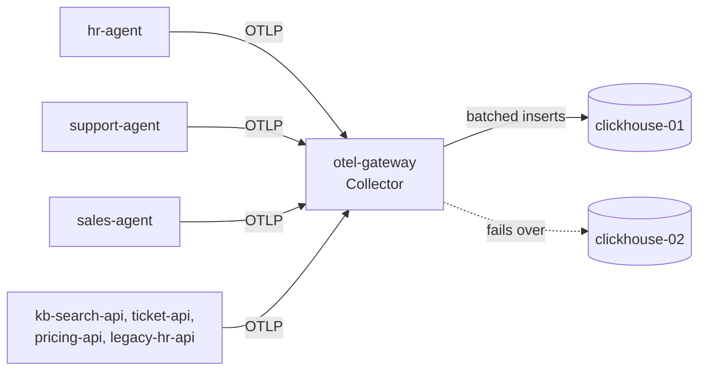

# Module 4: The Collector as a gateway (55 min)

## Why this matters

So far, the agents and APIs have produced spans. Something has to carry those
spans to ClickHouse safely, check them, and label them. In this repo, that
something is the **OpenTelemetry Collector**, running as a central **gateway**.
By the end of this module, you'll be able to read `otel-gateway-config.yaml`
line by line, say what happens to a span inside the gateway, and predict what
gets lost when the gateway or ClickHouse goes down.

## Key terms

From [module 1](01-otel-core.md) you need: a **span** (one timed operation),
a **resource** (the labels saying who produced a span), the **SDK** (the
library in the app that records and sends spans) and **OTLP** (the
OpenTelemetry Protocol it sends them with). The gateway sits between touch
points 2 and 3 of the [module 0 map](00-setup.md#the-touch-points-map).

| Term | Plain meaning |
|---|---|
| **Collector** | A separate program that receives telemetry, processes it, and sends it on |
| **Gateway** | A Collector that runs centrally, and that every app sends to |
| **Receiver** | The part of a Collector that accepts incoming data |
| **Processor** | A step that changes, drops, groups or samples data on its way through |
| **Exporter** | The part of a Collector that sends data out, for example to ClickHouse |
| **Pipeline** | One wired-up path: receivers, then processors in order, then exporters |
| **Extension** | A helper that isn't on the data path, such as a health check endpoint |
| **Sending queue** | A waiting area in front of an exporter, holding batches of spans until they're sent |
| **Back-pressure** | Telling senders "not now, I'm full", so they hold on to data and retry |
| **OTTL** | OpenTelemetry Transformation Language: short conditions and statements that processors use |

## Idea

### Why put anything between the apps and the database?

The SDK in each app could, in theory, write spans straight into ClickHouse.
For the three agents and four APIs in this repo, that would mean:

- **Every app holds the database password.** Rotate it, and you redeploy all.
- **Every app batches its own inserts.** ClickHouse wants few, large inserts
  (module 7).
- **Every app rides out outages.** Short-lived processes, like our agents,
  often exit before their retries succeed.
- **No single place for rules** such as "every span says which team owns it".
- **Changing the backend** (where telemetry is finally stored and queried;
  here, ClickHouse) means touching every app.

A Collector solves this by sitting in the middle. Apps send OTLP to one
address and stop caring what's behind it. The Collector owns the database
credentials, batching, retries, filtering, labeling and routing.

Think of a company mailroom. Staff (the agents and APIs) drop letters (spans)
in one tray. The mailroom sorts them, throws out junk, stamps them, bundles
them, and hands them to the courier (the connection to ClickHouse). Nobody at
a desk needs to know the courier's schedule.



### What the Collector is

The **OpenTelemetry Collector** is a separate program (a single binary, here
a Docker container) that receives telemetry, changes it, and sends it on,
whatever language your app is written in. Here it accepts only OTLP; other
receivers accept formats such as Prometheus, Jaeger or Zipkin.

### The five building blocks

A Collector config is a list of components, grouped by kind:

| Component | Job | In this repo |
|---|---|---|
| **Receivers** | Accept data. *Push*: apps send to the Collector. *Pull*: the Collector fetches, as with Prometheus scraping | `otlp`, listening on port 4317 (gRPC) and 4318 (HTTP) |
| **Processors** | Change, drop, group or sample data, one after another, in order | `memory_limiter`, `filter/require_org_labels`, `resource/org_platform`, `batch` |
| **Exporters** | Send data out | `clickhouse` (the real destination) and `debug` (prints a summary to the log) |
| **Connectors** | Act as the exporter of one pipeline *and* the receiver of another, for example turning spans into metrics | none |
| **Extensions** | Things that aren't data: health checks, authentication, disk storage | `health_check` on port 13133 |

gRPC and HTTP are two ways to carry OTLP over the network. The Python SDK in
this repo uses HTTP (`OTLPSpanExporter` from the `...proto.http...` package in
`agent/telemetry.py`). Your laptop reaches the gateway on `localhost:14318`,
because `compose.yaml` maps host port 14318 to container port 4318.

### Pipelines: nothing runs until it's wired

Defining a component does nothing by itself. It's like buying kitchen
appliances and leaving them in boxes. A **pipeline**, under `service:`, says
which ones are plugged in and in what order:

```yaml
service:
  pipelines:
    traces:                     # this pipeline handles spans (not metrics or logs)
      receivers: [otlp]         # where spans come in
      processors: [memory_limiter, filter/require_org_labels, resource/org_platform, batch]
      exporters: [clickhouse, debug]   # every span goes to both
```

Two things to notice:

- **Names are `type/name`.** `filter/require_org_labels` is a processor of type
  `filter`, with the name `require_org_labels`. The name lets you have several
  of the same type, for example two different filters.
- **Processor order matters.** Data flows left to right. The rules of thumb:
  - `memory_limiter` goes **first**, so it can refuse data before any other
    step spends memory on it.
  - Things that **drop** data (`filter`) go **early**, so later steps don't
    waste work on spans that will be thrown away.
  - `batch` goes **last**, after everything that drops or rewrites spans, so
    batches contain only the final spans.

> **Quick check:** Someone moves `batch` to the front of the processor list.
> Do spans still reach ClickHouse correctly?
>
> <details><summary>Answer</summary>
>
> Yes, the result is the same, but the work isn't. Batches are built from
> spans the filter later throws away, so they leave uneven, and
> `memory_limiter` now runs after spans are already held in batches, too late
> to protect that memory.
> </details>

### One span's trip through the gateway

From here on, the running example is the HR agent's "I need a new laptop."
It crosses into other services, so it shows how the gateway treats spans from
several owners.

A user asks the HR agent "I need a new laptop." The agent looks up the
employee with its `lookup_employee` tool, which calls
`GET /employees/{employee_id}` on `legacy-hr-api`, and then opens a ticket
with `create_ticket`, which calls `ticket-api`. Among others, the lookup
produces these two spans:

- a **client** span from `hr-agent`: "I called the HR API". Its resource has
  `org.owner = people-tech` and `org.service = hr-agent`.
- a **server** span from `legacy-hr-api`: "I answered that call". This old
  service puts `org.owner` and `org.service` on the *span attributes*, not on
  the *resource*.

Both arrive at the gateway. Here is what happens to each:

```text
                       hr-agent client span          legacy-hr-api server span
                       --------------------          -------------------------
otlp receiver          accepted                      accepted
memory_limiter         memory OK, passes             memory OK, passes
filter/require_org_    resource has owner and        resource has no owner or service
  labels               service: passes               label: DROPPED here
resource/org_platform  stamped org.env=dev,
                       org.region=local, ...
batch                  waits with other spans until
                       1000 are waiting or 5 s pass
clickhouse exporter    written as one row in
                       otel.otel_traces
debug exporter         counted in a log line
```

The `ticket-api` server span from the same request takes the left-hand path:
`ticket-api` puts its labels on the resource, so it's kept. You'll see this in
the lab.

### OTTL: the condition language

Some processors, such as `filter`, `transform` and `routing`, take rules written
in **OTTL**, the OpenTelemetry Transformation Language. A rule reads like a
line of code:

```yaml
filter/require_org_labels:
  error_mode: ignore                 # if a rule can't be evaluated, log it and keep going
  traces:
    span:                            # evaluate this rule once per span
      - resource.attributes["org.owner"] == nil or resource.attributes["org.service"] == nil
```

Read it piece by piece:

- `resource.attributes["org.owner"]` is the value of the `org.owner` label on
  the span's resource.
- `== nil` means "is missing".
- The whole rule is true when **either** label is missing.

In the `filter` processor, **a span that matches a rule is dropped**. That's
easy to get backwards, so say it out loud: "drop spans whose resource lacks the
owner or the service label". That's why `legacy-hr-api` server spans never
reach ClickHouse: its labels are on the span, not on the resource.

> **Quick check:** A teammate adds the rule
> `resource.attributes["org.owner"] == "people-tech"` to this filter, meaning
> "only accept people-tech's spans". What actually happens?
>
> <details><summary>Answer</summary>
>
> The opposite: every `people-tech` span (the HR agent's) is dropped, because
> a span that matches a filter rule is thrown away. To keep only one team, the
> rule must match everyone else (`!= "people-tech"`).
> </details>

### Batching

Sending spans one at a time would mean thousands of tiny network requests and
thousands of tiny inserts. ClickHouse writes every insert as a new **part** (a
chunk of files on disk) and merges parts together later in the background
(module 7). Many tiny inserts mean many tiny parts and a lot of merging.

Remember from module 1: the SDK's `BatchSpanProcessor` already batches inside
each app. The gateway batches again, across all apps, which is what makes
inserts big.

The `batch` processor collects spans and sends them as a group when **either**
1000 spans are waiting **or** 5 seconds have passed, whichever comes first.
On a quiet system, the 5-second timer usually fires first. On a busy system,
the size does.

`send_batch_size: 1000` is a trigger, not a cap. If one app sends 3,000 spans
in a single request, they leave as one batch of 3,000. Only
`send_batch_max_size` would split it, and this repo doesn't set it.

Newer Collector versions can also batch inside the exporter's sending queue
(described next), and the project is moving batching there. This repo still
uses the `batch` processor.

### When ClickHouse is down: queue, retries and back-pressure

Networks fail and databases restart. The Collector handles that with settings
that every exporter shares, called the **exporter helper**:

| Setting | What it does | In this repo |
|---|---|---|
| `timeout` | How long one send may take before it counts as failed | `10s` |
| `retry_on_failure` | Retry failed sends, waiting longer each time (exponential backoff) | First wait 5 s, growing to at most 30 s between tries; give up on a batch after 300 s in total |
| `sending_queue` | A waiting area between the pipeline and the exporter. Several workers ("consumers") take batches from it and send them | Not set, so the defaults apply: on, in memory, up to 1000 batches, 10 consumers |
| `sending_queue.storage` | Keep the queue on disk (via a `file_storage` extension), so it survives a restart | Not used |

Here's the whole story when ClickHouse stops answering:

1. **The exporter retries** each failed batch with backoff: 5 s, then longer,
   up to 30 s between tries.
2. **The queue fills, and the apps don't notice.** The `batch` processor hands
   each batch to the sending queue and moves on, so the apps' sends to the
   gateway keep succeeding.
3. **Two silent drops.** A batch still failing after 300 s of retries is
   dropped (`otelcol_exporter_send_failed_spans_total`). Once the queue holds
   1000 batches, each new batch is dropped on arrival
   (`otelcol_exporter_enqueue_failed_spans_total`). Nothing is pushed back to
   the apps.
4. **Only `memory_limiter` pushes back.** If the gateway's memory passes its
   limit, the receiver answers the SDK with a "try again later" error
   (`otelcol_receiver_refused_spans_total`). That's **back-pressure**. A
   refusal is not yet a loss: the SDK still has the spans and retries. They're
   lost only if the SDK gives up, its own queue (2048 spans by default in the
   Python SDK) fills, or the app exits first.
5. **ClickHouse comes back.** The consumers drain the queue, and batches still
   inside their 300 s retry window go through.

```text
app SDK ──▶ receiver ──▶ memory_limiter ──▶ filter ──▶ resource ──▶ batch ──▶ [ sending queue ] ──▶ exporter ──X  ClickHouse down
   ▲                          │                                                    │                    │
   │                          │ memory high:                                       │ full: new batch    │ retries 5 s ... 30 s;
   └── "try again later" ─────┘ refuse                                             │ dropped silently   │ after 300 s, dropped
   SDK keeps the spans and retries                                                 ▼ (enqueue_failed)   ▼ (send_failed)
```

One more case: everything waiting in the `batch` processor and in the sending
queue lives in memory. **If the gateway restarts or crashes, that data is
lost**, even if ClickHouse is fine. A queue on disk (`sending_queue.storage`)
fixes that.

So data can be lost in three places, each with its own fix:

| Where | How | Fix |
|---|---|---|
| The app's SDK | It gives up retrying, its queue fills, or the process exits before sending. Our agents are short-lived, so this matters here | A local Collector agent next to the app, or a longer SDK flush on exit |
| The gateway's memory | The sending queue is full, or the gateway restarts | A bigger queue, a disk queue, more gateway replicas |
| The exporter | A batch's 300 s retry window (`max_elapsed_time`) runs out | A longer `max_elapsed_time`, plus a queue big enough to hold that long |

> **Quick check:** ClickHouse is healthy, and the gateway container restarts.
> What's lost, and will the apps resend it?
>
> <details><summary>Answer</summary>
>
> Whatever sat in gateway memory: spans waiting in `batch` (up to 5 s worth)
> and anything in the sending queue. The apps won't resend: the gateway
> already accepted those spans. A disk queue (`sending_queue.storage`) is the fix.
> </details>

### Distributions: which Collector binary

The Collector comes in several builds, called **distributions**. The core build,
`otelcol`, has only a few components. **`otelcol-contrib`**, used here, has
hundreds, including the ClickHouse exporter and the tail sampling processor
(module 5). In production, teams often build a slim distribution with only the
components they use, using the **OpenTelemetry Collector Builder** (`ocb`):
a smaller binary with fewer things to patch.

### Agent and gateway patterns

Collectors can run in two places, and big systems often use both:

| Pattern | Where it runs | Good for |
|---|---|---|
| **Agent** (a sidecar container next to each app, or one per machine, which Kubernetes calls a DaemonSet) | Next to the app | Fast local hand-off, so the app can offload spans and exit quickly; adding host details |
| **Gateway** | A central pool of Collectors behind a load balancer | Credentials, org-wide rules, tail sampling, one place to change the backend |

This repo runs only a **gateway**, a single container called `otel-gateway`.
"Agent" here is a Collector deployment style, nothing to do with the AI agents.

### Config tricks used in this repo

- **`${env:ORG_ENV}`** is replaced at startup by the `ORG_ENV` environment
  variable, so one config file says `dev` on a laptop and `prod` in production.
- **Several `--config` files are merged.** Module 5 turns on tail sampling
  this way.

## Remember it

> **The Collector is a mailroom. Receivers are the in-tray. Processors are
> the sorting desk, worked in order: check you have room, throw out junk mail,
> stamp what's left, then bundle it. Exporters are the couriers, and the sending
> queue is the loading dock. If the couriers can't leave, the dock fills up and
> new bundles are thrown away. Only the guard at the door (`memory_limiter`)
> ever tells senders "come back later".**

## In this repo

### `otel-gateway-config.yaml`, block by block

This is the whole gateway configuration. Read it top to bottom.

**Receivers: how spans come in.**

```yaml
receivers:
  otlp:                         # the OTLP receiver
    protocols:
      grpc:
        endpoint: 0.0.0.0:4317  # listen for OTLP over gRPC on all network interfaces
      http:
        endpoint: 0.0.0.0:4318  # listen for OTLP over HTTP; the Python SDK uses this one
```

`0.0.0.0` means "accept connections from anywhere", which is needed inside a
container. From your laptop, use the mapped ports 14317 and 14318.

**Processors: what happens to spans on the way.** Four are defined here. They
run in the order the pipeline lists them, not the order they appear in the file.

```yaml
processors:
  memory_limiter:
    check_interval: 1s          # measure the gateway's memory use every second
    limit_mib: 512              # the hard ceiling, in mebibytes (1 MiB = 1,048,576 bytes)
```

`memory_limiter` refuses new data a little *before* the 512 MiB ceiling: by
default it keeps 20% headroom, so refusals start around 410 MiB. Crashing
would lose everything in memory; refusing loses nothing yet, because the SDK
still holds the spans.

```yaml
  batch:
    timeout: 5s                 # send whatever has collected after 5 seconds...
    send_batch_size: 1000       # ...or as soon as 1000 spans are waiting
```

`batch` groups spans so ClickHouse gets fewer, larger inserts.

```yaml
  # Spans whose resource lacks the mandatory owner and service labels are dropped.
  filter/require_org_labels:
    error_mode: ignore
    traces:
      span:
        - resource.attributes["org.owner"] == nil or resource.attributes["org.service"] == nil
```

The filter enforces a labeling rule: every span must say, on its resource,
which team owns it (`org.owner`) and which service it came from
(`org.service`). Spans that break the rule are dropped. Without the rule, you'd
end up with spans nobody can be paged about or billed for. The agents set
these labels in `agent/run.py`, and the APIs in `agent/apis.py`, except
`legacy-hr-api`, which deliberately puts them in the wrong place.

```yaml
  # Platform labels describe where the gateway runs, so the gateway sets them, not the service.
  resource/org_platform:
    attributes:
      - { key: org.region, value: "${env:ORG_REGION}", action: upsert }
      - { key: org.platform, value: "${env:ORG_PLATFORM}", action: upsert }
      - { key: org.cluster, value: "${env:ORG_CLUSTER}", action: upsert }
      - { key: org.env, value: "${env:ORG_ENV}", action: upsert }
```

The `resource` processor edits resource labels. Each line sets one label from
an environment variable, and `upsert` ("update or insert") means "set it, and
overwrite it if the app already sent one".

But every app already says where it runs: `agent/run.py` and `agent/apis.py`
set `deployment.environment.name = local` on the resource (module 1). Why a
second label? Because the two answer different questions:

- `deployment.environment.name` is what the **app believes**, from its own
  code or settings; nothing checks it.
- `org.env` is where the span **actually arrived**: each environment's
  gateway stamps its own value, and an app can't fake it.

So `org.env` is the authoritative label, and queries should filter on it
(`org_env` in ClickHouse), not on `deployment.environment.name`. The same goes
for region, platform and cluster. **Apps set what only they know** (owner,
service) and **the platform sets what only it knows** (where things run).

> **Quick check:** A misconfigured app puts `org.env = prod` on its own
> resource and sends to this (dev) gateway. What's stored in `org_env`?
>
> <details><summary>Answer</summary>
>
> `dev`. The `resource/org_platform` processor uses `upsert`, which overwrites
> the app's value with the gateway's own `ORG_ENV`.
> </details>

The values come from `compose.yaml`, with these defaults:

| Label | Environment variable | Default |
|---|---|---|
| `org.region` | `ORG_REGION` | `local` |
| `org.platform` | `ORG_PLATFORM` | `docker` |
| `org.cluster` | `ORG_CLUSTER` | `agent-tracing` |
| `org.env` | `ORG_ENV` | `dev` |

In ClickHouse, these appear in `ResourceAttributes` and as ready-made columns
such as `org_env` and `org_region` (defined in `clickhouse/schema.sql`).

**Exporters: where spans go.**

```yaml
exporters:
  clickhouse:
    endpoint: tcp://clickhouse-01:9000,clickhouse-02:9000?dial_timeout=10s
    database: otel
    username: default
    password: demo
    traces_table_name: otel_traces
    # Tables come from clickhouse/schema.sql, applied by clickhouse-init.
    create_schema: false
    timeout: 10s
    retry_on_failure:
      enabled: true
      initial_interval: 5s
      max_interval: 30s
      max_elapsed_time: 300s
```

Line by line:

- `endpoint`: both ClickHouse servers, over ClickHouse's own protocol
  (`tcp://`, port 9000), so the exporter can use the second if the first is
  down. `dial_timeout=10s` is how long to wait for a connection to open.
- `database`, `username`, `password`, `traces_table_name`: write to
  `otel.otel_traces`. Only the gateway knows these credentials (`demo` is for
  a local demo only).
- `create_schema: false`: don't create tables. The one-off `clickhouse-init`
  container applies `clickhouse/schema.sql` before the gateway starts, so the
  table design stays under our control (module 8).
- `timeout` and `retry_on_failure`: the outage settings above. The wait
  between retries grows about 1.5x each time, with some randomness. No
  `sending_queue` block means the defaults (in memory, 1000 batches, 10
  consumers).

```yaml
  debug:
    verbosity: basic            # one short log line per batch: how many spans
```

The `debug` exporter writes to the gateway's own log. It's handy for checking
that data flows, without opening ClickHouse.

**Extensions: helpers off the data path.**

```yaml
extensions:
  health_check:
    endpoint: 0.0.0.0:13133     # answers HTTP requests with "healthy" or not
```

`./stack.sh up` waits for this endpoint (`curl http://localhost:13133`) before
starting the traffic loop.

**Service: what's actually turned on.**

```yaml
service:
  telemetry:                    # the gateway's OWN metrics, not your app's
    metrics:
      level: detailed
      readers:
        - pull:
            exporter:
              prometheus:
                host: 0.0.0.0
                port: 8888      # mapped to localhost:18888 by compose.yaml
  extensions: [health_check]    # turn the health check on
  pipelines:                    # the traces pipeline shown in the Idea section
```

- `telemetry` makes the gateway report on itself: spans received, refused,
  filtered, queued, sent and failed, at <http://localhost:18888/metrics>.
  Module 12 explains which ones to watch.

### `compose.yaml`

The `otel-gateway` service uses the image
`otel/opentelemetry-collector-contrib:0.146.1`. It mounts
`otel-gateway-config.yaml` into the container and passes it with `--config`. It
sets the four `ORG_*` environment variables (defaults above) and maps the ports:
14317 and 14318 for OTLP, 13133 for the health check, and 18888 for the
gateway's metrics. It starts only after `clickhouse-init` has created the
tables.

## Principal engineer's notes

**Touch points**
- Inbound (touch point 2): OTLP on `4317`/`4318`, plus the required resource
  labels. OTLP is stable; the fragile part is the label rule, owned by the
  platform team. Tighten it and non-compliant services lose spans silently, so
  first query ClickHouse for who lacks the new label, and tell those teams.
- Outbound (touch point 3): native protocol on `9000`, and a column contract
  with `schema.sql`. Test a new Collector image against the schema first.
- `13133` says the process is alive, not that spans reach ClickHouse.

**At scale**
- With no tail sampling, the pipeline holds no per-trace state, so you scale
  sideways behind a load balancer. Catch: gRPC keeps long-lived connections,
  so a connection-level balancer pins each client to one gateway and new
  instances sit idle. OTLP over HTTP spreads per request; for gRPC, use a
  request-aware balancer or set a maximum connection age on the receiver.
- Memory is the first limit. The default queue can hold 1000 batches of about
  1000 spans; at roughly 1 KB per span that's about 1 GB, well past
  `limit_mib: 512`, so `memory_limiter` refuses data long before the queue is
  full. Set `limit_mib` to about 80% of the container's memory limit (this
  demo sets none; the gateway uses about 170 MB at demo load).

**Operational issues**
- One gateway is a single point of failure (lab 4). Run two or more, in
  different zones.
- A disk queue (`file_storage` plus `sending_queue.storage`) survives
  restarts, but the volume must follow the instance, or the backlog is stranded.
- A bad config stops all telemetry. Run `otelcol-contrib validate
  --config=...` in CI, roll out to one instance first, keep the old config.
- Scrape port 8888 from a separate system. Which counters to alert on:
  [module 12](12-operations.md) and the [metrics appendix](appendix-metrics-reference.md).

**Design trade-offs**
- The gateway is the policy enforcement point: labels, and PII redaction (the
  `transform` or `redaction` processors), before data is stored. The cost is
  silent drops; routing non-compliant spans to a quarantine table is gentler
  while onboarding many teams.
- Add a local agent tier when apps are short-lived (like ours), the network
  is unreliable, or you need host details.
- Newer Collectors can batch inside the exporter's sending queue instead of a
  `batch` processor, removing one in-memory buffer; prefer it when starting fresh.

## Lab (20 min)

Run SQL in <http://localhost:8123/play> (user `default`, password `demo`), and
shell commands from the repo root. The stack should be running with traffic on
(`./stack.sh up`).

1. **See the filter work.** The HR agent calls the legacy API, so both a
   client span (from `hr-agent`) and a server span (from `legacy-hr-api`) are
   created. This query counts what actually reached ClickHouse for that call:

   ```sql
   SELECT ServiceName, SpanKind, count() FROM otel.otel_traces
   WHERE SpanName LIKE 'GET /employees%' GROUP BY ALL;
   ```

   You'll see `hr-agent | Client` only. The `legacy-hr-api | Server` spans were
   dropped by `filter/require_org_labels`, because that service puts its labels
   on the span instead of the resource.

   The gateway also counts what it filters. Run this a couple of times, 30
   seconds apart:

   ```bash
   curl -s localhost:18888/metrics | grep '^otelcol_processor_filter_spans_filtered_total'
   ```

   The number goes up with each traffic round. Those are the dropped legacy
   spans.

2. **Platform labels are the gateway's job.** Restart the gateway as if it ran
   in a staging environment. No app is changed or restarted:

   ```bash
   ORG_ENV=staging docker compose up -d otel-gateway
   sleep 40
   docker exec clickhouse-01 clickhouse-client --password demo -q \
     "SELECT ResourceAttributes['deployment.environment.name'] AS app_says, org_env, org_region, count() FROM otel.otel_traces WHERE Timestamp > now() - INTERVAL 30 SECOND GROUP BY ALL"
   docker compose up -d otel-gateway      # back to dev
   ```

   The first command recreates the gateway container with `ORG_ENV=staging`.
   The query looks at spans from the last 30 seconds. Every new span has
   `org_env = staging`, though no app changed, while `app_says` is still
   `local`: the app's own belief, untouched. The last command puts the
   default (`dev`) back.

3. **Watch batches leave the gateway.** The `debug` exporter logs one line per
   batch:

   ```bash
   docker logs --since 1m otel-gateway 2>&1 | grep '"spans"'
   ```

   Each line includes a `"spans"` count: how many spans were in that batch.
   With traffic every 30 seconds, you'll see a burst of lines after each round.

   Which trigger sent them, the 5-second timer or the 1000-span size? The
   gateway counts timer-triggered sends:

   ```bash
   curl -s localhost:18888/metrics | grep '^otelcol_processor_batch_timeout_trigger_send_total'
   ```

   On this quiet demo, nearly every batch is sent by the timer.

4. **Break the gateway** and see what the apps lose. With traffic on, stop the
   gateway for 45 seconds, start it again, then look at the traffic loop's log:

   ```bash
   docker stop otel-gateway; sleep 45; docker start otel-gateway
   grep -E 'Transient error|Failed to export' .run/traffic.log | tail -3
   ```

   ```text
   Transient error ... Connection refused ... retrying in 0.96s.
   Transient error ... Connection refused ... retrying in 2.10s.
   Failed to export spans batch due to timeout, max retries or shutdown.
   ```

   The first lines are the SDK retrying, with growing waits. The last line is
   the SDK giving up on a batch of spans.

   Then count agent turns in 10-second buckets around the outage. Each turn
   has one `agent_turn` root span:

   ```sql
   SELECT toStartOfInterval(Timestamp, INTERVAL 10 SECOND) AS t, count() AS turns
   FROM otel.otel_traces WHERE SpanName = 'agent_turn' AND Timestamp > now() - INTERVAL 5 MINUTE
   GROUP BY t ORDER BY t;
   ```

   Turns that ran while the gateway was down are **missing**: a gap in the
   buckets. The short-lived agents retried, then exited with their unsent
   spans: loss in the app's SDK, the first row of the table above. Compare the
   Keeper lab in [module 7](07-clickhouse.md): there the gateway is up, so its
   queue and retries hold the data for up to 300 s.

## Explain it back

> "Apps send OTLP to the gateway and know nothing about ClickHouse. The
> gateway guards its memory, drops spans without owner and service labels,
> stamps where it runs, batches, and writes through a retrying queue."

## Recap

- A Collector sits between apps and the backend, so apps don't carry
  credentials, batching, retries or org-wide rules.
- Receivers take data in, processors work on it in order, exporters send it
  out. Only components listed in a `service.pipelines` entry run.
- Order: `memory_limiter` first, filters early, `batch` last.
- The filter drops spans whose **resource** lacks `org.owner` or
  `org.service`. The resource processor stamps `org.region`, `org.platform`,
  `org.cluster` and `org.env` from the gateway's environment. Query by
  `org.env`, not the app's own `deployment.environment.name`.
- Only `memory_limiter` pushes back on apps. A full sending queue or an
  expired retry drops data silently.

## Check yourself

<details><summary>Should a service set <code>org.env</code> itself?</summary>

It may set `deployment.environment.name`, as every app here does (`local`),
but that's only what the app believes. Where a span really arrived is a fact
about the platform, so the gateway in that environment stamps `org.env`
(`upsert` overwrites whatever the app sent). Queries should use `org.env`.
</details>

<details><summary>ClickHouse is down for 10 minutes. What's lost, and do the apps find out?</summary>

Batches still failing after 300 s (`max_elapsed_time`) are dropped
(`send_failed`). Once the queue holds 1000 batches, new ones are dropped on
arrival (`enqueue_failed`). The apps don't find out: the `batch` processor
already accepted their spans, so their sends keep succeeding. Only if gateway
memory passes the `memory_limiter` limit are apps refused, and then their SDKs
retry. To survive longer, raise `max_elapsed_time`, size the queue, and put it
on disk with `sending_queue.storage`, which also survives a gateway restart.
</details>

<details><summary>A new service sends <code>org.owner</code> on its resource but forgets <code>org.service</code>. What happens to its spans?</summary>

They're all dropped by `filter/require_org_labels`. The rule uses `or`, so a
missing value for either label is enough to match, and matching spans are
dropped. You'd notice as a rise in the filter's dropped-spans counter on port
18888, and no rows for that service in ClickHouse.
</details>

<details><summary>You add a <code>clickhouse</code> exporter block but forget to list it in the pipeline. What happens?</summary>

Nothing is written to ClickHouse. Components only run when a pipeline under
`service:` lists them. The spans would still reach any exporter that *is*
listed, such as `debug`.
</details>

<details><summary>Why does the gateway, not each app, hold the ClickHouse password?</summary>

So it's in one place. Rotating it, or moving to a different backend, means
changing one config instead of redeploying every app. Apps only need the
gateway's OTLP address.
</details>

<details><summary>An HR agent turn ran, but none of its spans are in ClickHouse. List where they could have vanished, from the app's SDK (module 1) to the table.</summary>

In the SDK: the app exited before its `BatchSpanProcessor` flushed, or it
gave up retrying while the gateway was down (lab 4). At the gateway door:
refused by `memory_limiter` and never retried. In the pipeline: dropped by
`filter/require_org_labels` (missing resource labels). After the pipeline: a
full sending queue or an expired retry window. Check the gateway counters
in that order: refused, filtered, `enqueue_failed`, `send_failed`.
</details>

## Next

The gateway now stores every span it's sent. [Module 5](05-sampling.md) asks
whether it should: how to keep only some traces without losing the ones you
need, and where in this pipeline that decision can be made.

## Read more

- [Collector overview](https://opentelemetry.io/docs/collector/)
- [Collector configuration](https://opentelemetry.io/docs/collector/configuration/)
- [Deployment patterns: agent and gateway](https://opentelemetry.io/docs/collector/deploy/)
- [Exporter helper: queue and retry settings](https://github.com/open-telemetry/opentelemetry-collector/blob/main/exporter/exporterhelper/README.md)
- [Memory limiter processor](https://github.com/open-telemetry/opentelemetry-collector/blob/main/processor/memorylimiterprocessor/README.md)
- [Batch processor](https://github.com/open-telemetry/opentelemetry-collector/blob/main/processor/batchprocessor/README.md)
- [Filter processor](https://github.com/open-telemetry/opentelemetry-collector-contrib/blob/main/processor/filterprocessor/README.md)
- [OTTL](https://github.com/open-telemetry/opentelemetry-collector-contrib/blob/main/pkg/ottl/README.md)
- [ClickHouse exporter](https://github.com/open-telemetry/opentelemetry-collector-contrib/blob/main/exporter/clickhouseexporter/README.md)
- [Collector Builder (ocb)](https://opentelemetry.io/docs/collector/custom-collector/)
