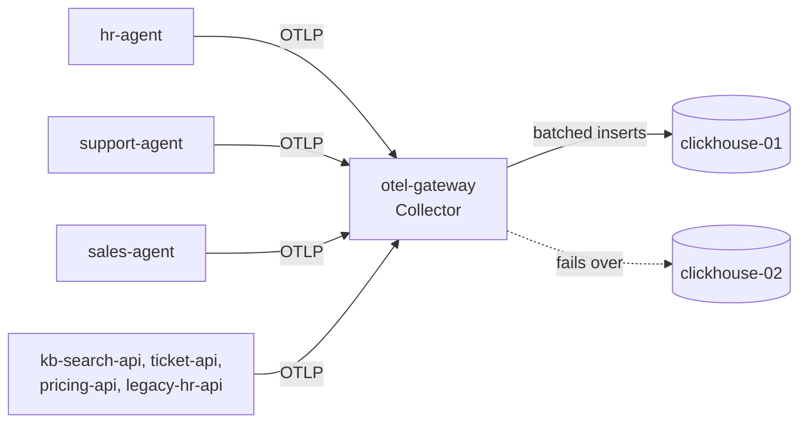

# Module 4: The Collector as a gateway (55 min)

## Why this matters

So far, the agents and APIs have produced spans. Something has to carry those
spans to ClickHouse safely, check them, and label them. In this repo, that
something is the **OpenTelemetry Collector**, running as a central **gateway**.
By the end of this module, you'll be able to read `otel-gateway-config.yaml`
line by line, say what happens to a span inside the gateway, and predict what
gets lost when the gateway or ClickHouse goes down.

## Key terms

| Term | Plain meaning |
|---|---|
| **Span** | The record of one timed operation, such as one LLM call or one HTTP request ([module 1](01-otel-core.md)) |
| **Trace** | All the spans of one request, linked into a tree by a shared trace id |
| **Attribute** | A key-value label on a span, such as `http.route = /v1/search` |
| **Resource** | The labels that describe *who* produced a span (service name, owner). The SDK attaches them to every span from that process |
| **Telemetry** | Data a program emits about itself: traces, metrics and logs |
| **SDK** | The OpenTelemetry library inside the app that creates spans and sends them out |
| **OTLP** | OpenTelemetry Protocol: the standard format and wire protocol for sending telemetry |
| **Backend** | Where telemetry is finally stored and queried. Here, ClickHouse |
| **Collector** | A separate program that receives telemetry, processes it, and sends it on |
| **Gateway** | A Collector that runs centrally, and that every app sends to |
| **Receiver** | The part of a Collector that accepts incoming data |
| **Processor** | A step that changes, drops, groups or samples data on its way through |
| **Exporter** | The part that sends data out, for example to ClickHouse |
| **Pipeline** | One wired-up path: receivers, then processors in order, then exporters |
| **Extension** | A helper that isn't on the data path, such as a health check endpoint |
| **Batch** | A group of spans sent together in one request |
| **Sending queue** | A waiting area in front of an exporter, holding batches until they're sent |
| **Retry with backoff** | Trying again after a failure, waiting a bit longer each time |
| **Back-pressure** | Telling senders "slow down, I'm full" instead of silently falling over |
| **OTTL** | OpenTelemetry Transformation Language: short conditions and statements that processors use |
| **Upsert** | "Update or insert": set the value, overwriting it if it's already there |

## Idea

### Why put anything between the apps and the database?

The SDK in each app could, in theory, write spans straight into ClickHouse.
Picture what that would mean for the HR agent, the support agent, the sales
agent and the four APIs in this repo:

- **Every app needs the database address and password.** Rotate the password,
  and you redeploy every app.
- **Every app needs insert logic.** ClickHouse is happiest with few, large
  inserts (module 6). Each app would have to batch spans itself.
- **Every app has to handle outages.** If ClickHouse is down for two minutes,
  each app must hold its spans in memory and retry. Short-lived processes,
  like our agents, often exit before that works.
- **There's no single place for rules.** "Every span must say which team owns
  it" would have to be enforced in every codebase.
- **Changing the backend is a huge project.** Moving to a different database
  means touching every app.

A Collector solves this by sitting in the middle. Apps send OTLP to one
address and stop caring what's behind it. The Collector owns the database
credentials, batching, retries, filtering, labeling and routing.

Think of a company mailroom. Staff drop letters in one tray. The mailroom
sorts them, throws out junk, stamps them, bundles them, and hands them to the
courier. Nobody at a desk needs to know the courier's schedule. Here, the
"staff" are the agents and APIs, the "letters" are spans, and the "courier" is
the connection to ClickHouse.



### What the Collector is

The **OpenTelemetry Collector** is a separate program (a single binary, here
run as a Docker container). It receives telemetry, changes it, and sends it
on. It isn't part of your app, and it doesn't need to know what language your
app is written in. It only speaks OTLP (and many other formats, if you add the
right receivers).

### The five building blocks

A Collector config is a list of components, grouped by kind:

| Component | Job | In this repo |
|---|---|---|
| **Receivers** | Accept data. *Push*: apps send to the Collector. *Pull*: the Collector fetches, as with Prometheus scraping | `otlp`, listening on port 4317 (gRPC) and 4318 (HTTP) |
| **Processors** | Change, drop, group or sample data, one after another, in order | `memory_limiter`, `filter/require_org_labels`, `resource/org_platform`, `batch` |
| **Exporters** | Send data out | `clickhouse` (the real destination) and `debug` (prints a summary to the log) |
| **Connectors** | Act as the exporter of one pipeline *and* the receiver of another, for example turning spans into metrics | none |
| **Extensions** | Things that aren't data: health checks, authentication, disk storage | `health_check` on port 13133 |

gRPC and HTTP are two ways to carry OTLP over the network. The Python SDK in
this repo uses HTTP (`OTLPSpanExporter` from the `...proto.http...` package in
`agent/telemetry.py`). Your laptop reaches the gateway on `localhost:14318`,
because `compose.yaml` maps host port 14318 to container port 4318.

### Pipelines: nothing runs until it's wired

Defining a component does nothing by itself. It's like buying kitchen
appliances and leaving them in boxes. A **pipeline**, under `service:`, says
which ones are plugged in and in what order:

```yaml
service:
  pipelines:
    traces:                     # this pipeline handles spans (not metrics or logs)
      receivers: [otlp]         # where spans come in
      processors: [memory_limiter, filter/require_org_labels, resource/org_platform, batch]
      exporters: [clickhouse, debug]   # every span goes to both
```

Two things to notice:

- **Names are `type/name`.** `filter/require_org_labels` is a processor of type
  `filter`, with the name `require_org_labels`. The name lets you have several
  of the same type, for example two different filters.
- **Processor order matters.** Data flows left to right. The rules of thumb:
  - `memory_limiter` goes **first**, so it can refuse data before any other
    step spends memory on it.
  - Things that **drop** data (`filter`) go **early**, so later steps don't
    waste work on spans that will be thrown away.
  - `batch` goes **last**, after everything that drops or rewrites spans, so
    batches contain only the final spans.

### One span's trip through the gateway

Follow one real request. A user asks the HR agent "I need a new laptop."
The agent looks up an employee with its `lookup_employee` tool, and the tool
calls `GET /employees/{employee_id}` on `legacy-hr-api`. That produces, among
others, these two spans:

- a **client** span from `hr-agent`: "I called the HR API". Its resource has
  `org.owner = people-tech` and `org.service = hr-agent`.
- a **server** span from `legacy-hr-api`: "I answered that call". This old
  service puts `org.owner` and `org.service` on the *span attributes*, not on
  the *resource*.

Both arrive at the gateway. Here is what happens to each:

```text
                       hr-agent client span          legacy-hr-api server span
                       --------------------          -------------------------
otlp receiver          accepted                      accepted
memory_limiter         memory OK, passes             memory OK, passes
filter/require_org_    resource has owner and        resource has no owner or service
  labels               service: passes               label: DROPPED here
resource/org_platform  stamped org.env=dev,
                       org.region=local, ...
batch                  waits with other spans
                       (up to 1000, or 5 s)
clickhouse exporter    written as one row in
                       otel.otel_traces
debug exporter         counted in a log line
```

You'll see exactly this in the lab.

### OTTL: the condition language

Some processors, such as `filter`, `transform` and `routing`, take rules written
in **OTTL**, the OpenTelemetry Transformation Language. A rule reads like a
line of code:

```yaml
filter/require_org_labels:
  error_mode: ignore                 # if a rule can't be evaluated, log it and keep going
  traces:
    span:                            # evaluate this rule once per span
      - resource.attributes["org.owner"] == nil or resource.attributes["org.service"] == nil
```

Read it piece by piece:

- `resource.attributes["org.owner"]` is the value of the `org.owner` label on
  the span's resource.
- `== nil` means "is missing".
- The whole rule is true when **either** label is missing.

In the `filter` processor, **a span that matches a rule is dropped**. That's
easy to get backwards, so say it out loud: "drop spans whose resource lacks the
owner or the service label". That's why `legacy-hr-api` server spans never
reach ClickHouse: its labels are on the span, not on the resource.

### Batching

Sending spans one at a time would mean thousands of tiny network requests and
thousands of tiny inserts. ClickHouse writes every insert as a new **part** (a
chunk of files on disk) and merges parts together later in the background
(module 6). Many tiny inserts mean many tiny parts and a lot of merging.

The `batch` processor collects spans and sends them as a group when **either**
1000 spans are waiting **or** 5 seconds have passed, whichever comes first.
On a quiet system, the 5-second timer usually fires first. On a busy system,
the 1000-span size does.

### The sending queue, retries and back-pressure

Networks fail and databases restart. The Collector handles that with settings
that every exporter shares, called the **exporter helper**:

| Setting | What it does | In this repo |
|---|---|---|
| `timeout` | How long one send may take before it counts as failed | `10s` |
| `retry_on_failure` | Retry failed sends, waiting longer each time (exponential backoff) | First wait 5 s, growing to at most 30 s between tries; give up on a batch after 300 s in total |
| `sending_queue` | A waiting area between the pipeline and the exporter. Several workers ("consumers") take batches from it and send them | Not set, so the defaults apply: on, in memory, up to 1000 batches, 10 consumers |
| `sending_queue.storage` | Keep the queue on disk (via a `file_storage` extension), so it survives a restart | Not used |

Here's what happens, step by step, when ClickHouse becomes slow or unreachable:

1. The exporter's sends start failing. Each failed batch is retried with
   backoff.
2. New batches keep arriving and pile up in the **sending queue**.
3. If the queue fills up, new batches can't be added and are dropped.
4. Meanwhile, the gateway's memory use grows. When it passes the
   `memory_limiter` threshold, the gateway **refuses new data** from the apps.
   That's back-pressure: it tells the senders "not now".
5. The SDK in each app gets that refusal (or a connection error), retries, and
   holds spans in its own in-memory queue (2048 spans by default in the Python
   SDK). If that fills up too, or the app exits, those spans are lost.
6. If ClickHouse comes back within the retry window, the queue drains and
   nothing is lost. If a batch keeps failing for 300 s, it's dropped.

```text
app SDK ──▶ receiver ──▶ memory_limiter ──▶ filter ──▶ resource ──▶ batch ──▶ [ sending queue ] ──▶ exporter ──X  ClickHouse down
   ▲                          │                                                     │                 │
   │                          │ memory high:                                        │ fills up        │ retries: 5 s, ..., 30 s
   │                          │ refuse new data                                     │                 │ gives up after 300 s
   └──── refusal ─────────────┘                                                                        ▼
   SDK retries; its own queue fills;                                                            batch is lost
   spans are lost if it fills or the app exits
```

### Three places data can be lost

Know all three, because each needs a different fix:

1. **In the app's SDK.** Its queue is full, or the process exits before it
   could send. Our agents are short-lived processes, so this matters here.
2. **In the Collector's memory.** The sending queue is full, the Collector
   restarts (an in-memory queue is lost on restart), or `memory_limiter`
   refuses data.
3. **At the exporter.** The retry window (`max_elapsed_time`, 300 s here) runs
   out for a batch.

### Distributions: which Collector binary

The Collector comes in several builds, called **distributions**. The core build,
`otelcol`, has only a few components. **`otelcol-contrib`**, used here, has
hundreds, including the ClickHouse exporter and the tail sampling processor
(module 5). In production, teams often build their own slim distribution with
the **OpenTelemetry Collector Builder** (`ocb`), containing only the
components they use. Fewer components means a smaller binary and fewer
things to patch.

### Agent and gateway patterns

Collectors can run in two places, and big systems often use both:

| Pattern | Where it runs | Good for |
|---|---|---|
| **Agent** (a sidecar container next to each app, or one per machine, which Kubernetes calls a DaemonSet) | Next to the app | Fast local hand-off, so the app can offload spans and exit quickly; adding host details |
| **Gateway** | A central pool of Collectors behind a load balancer | Credentials, org-wide rules, tail sampling, one place to change the backend |
| Both | App to local agent to central gateway | Most large deployments |

This repo runs only a **gateway**, a single container called `otel-gateway`.
The word "agent" here means a Collector deployment style. It has nothing to do
with the AI agents in this repo.

### Config tricks used in this repo

- **`${env:ORG_ENV}`** is replaced, when the Collector starts, by the value of
  the `ORG_ENV` environment variable. That's how the same config file can say
  `dev` on a laptop and `prod` in production.
- **Several `--config` files are merged.** Module 5 turns on tail sampling by
  passing a second file that adds one processor and restates the pipeline's
  processor list. When files are merged, maps (key: value sections) are merged
  together, but lists (like `processors: [...]`) are replaced as a whole.

## Remember it

> **The Collector is a mailroom. Receivers are the in-tray. Processors are
> the sorting desk, worked in order: check you have room, throw out junk mail,
> stamp what's left, then bundle it. Exporters are the couriers, and the sending
> queue is the loading dock. If the couriers can't leave, the dock fills up, and
> then the mailroom stops accepting letters.**

## In this repo

### `otel-gateway-config.yaml`, block by block

This is the whole gateway configuration. Read it top to bottom.

**Receivers: how spans come in.**

```yaml
receivers:
  otlp:                         # the OTLP receiver
    protocols:
      grpc:
        endpoint: 0.0.0.0:4317  # listen for OTLP over gRPC on all network interfaces
      http:
        endpoint: 0.0.0.0:4318  # listen for OTLP over HTTP; the Python SDK uses this one
```

`0.0.0.0` means "accept connections from anywhere", which is needed inside a
container. From your laptop, use the mapped ports 14317 and 14318.

**Processors: what happens to spans on the way.** Four are defined here. They
run in the order the pipeline lists them, not the order they appear in the file.

```yaml
processors:
  memory_limiter:
    check_interval: 1s          # measure the gateway's memory use every second
    limit_mib: 512              # the hard ceiling, in mebibytes (1 MiB = 1,048,576 bytes)
```

`memory_limiter` protects the gateway from running out of memory and crashing.
It refuses new data a little *before* the 512 MiB ceiling. By default, it keeps
20% headroom, so refusals start around 410 MiB. A refusal goes back to the
sender as an error, and the SDK retries later. Crashing would lose everything
in memory; refusing loses nothing yet.

```yaml
  batch:
    timeout: 5s                 # send whatever has collected after 5 seconds...
    send_batch_size: 1000       # ...or as soon as 1000 spans are waiting
```

`batch` groups spans so ClickHouse gets fewer, larger inserts.

```yaml
  # Spans whose resource lacks the mandatory owner and service labels are dropped.
  filter/require_org_labels:
    error_mode: ignore
    traces:
      span:
        - resource.attributes["org.owner"] == nil or resource.attributes["org.service"] == nil
```

The filter enforces a labeling rule: every span must say, on its resource,
which team owns it (`org.owner`) and which service it came from
(`org.service`). Spans that break the rule are dropped. Without the rule, you'd
end up with spans nobody can be paged about or billed for. The agents set
these labels in `agent/run.py`, and the APIs in `agent/apis.py`, except
`legacy-hr-api`, which deliberately puts them in the wrong place.

```yaml
  # Platform labels describe where the gateway runs, so the gateway sets them, not the service.
  resource/org_platform:
    attributes:
      - { key: org.region, value: "${env:ORG_REGION}", action: upsert }
      - { key: org.platform, value: "${env:ORG_PLATFORM}", action: upsert }
      - { key: org.cluster, value: "${env:ORG_CLUSTER}", action: upsert }
      - { key: org.env, value: "${env:ORG_ENV}", action: upsert }
```

The `resource` processor edits resource labels. Each line sets one label from
an environment variable, and `upsert` means "set it, and overwrite it if the
app already sent one". Why should the gateway, not the app, stamp these? An
app doesn't reliably know which region, cluster or environment it's running
in, and it might get it wrong. The gateway in each environment knows. So
**apps set what only they know** (owner, service) and **the platform sets what
only it knows** (where things run).

The values come from `compose.yaml`, with these defaults:

| Label | Environment variable | Default |
|---|---|---|
| `org.region` | `ORG_REGION` | `local` |
| `org.platform` | `ORG_PLATFORM` | `docker` |
| `org.cluster` | `ORG_CLUSTER` | `agent-tracing` |
| `org.env` | `ORG_ENV` | `dev` |

In ClickHouse, these appear in `ResourceAttributes` and as ready-made columns
such as `org_env` and `org_region` (defined in `clickhouse/schema.sql`).

**Exporters: where spans go.**

```yaml
exporters:
  clickhouse:
    endpoint: tcp://clickhouse-01:9000,clickhouse-02:9000?dial_timeout=10s
    database: otel
    username: default
    password: demo
    traces_table_name: otel_traces
    # Tables come from clickhouse/schema.sql, applied by clickhouse-init.
    create_schema: false
    timeout: 10s
    retry_on_failure:
      enabled: true
      initial_interval: 5s
      max_interval: 30s
      max_elapsed_time: 300s
```

Line by line:

- `endpoint`: both ClickHouse servers, using ClickHouse's own network protocol
  (`tcp://`, port 9000). Listing both lets the exporter connect to the second
  if the first is down. `dial_timeout=10s` is how long to wait for a
  connection to open.
- `database`, `username`, `password`: where to write and how to log in. Only
  the gateway knows these; no app does. (The password `demo` is fine for a
  local demo, never for real use.)
- `traces_table_name`: spans go into `otel.otel_traces`.
- `create_schema: false`: don't create tables automatically. The tables come
  from `clickhouse/schema.sql`, which the one-off `clickhouse-init` container
  applies before the gateway starts. That way, the table design is under our
  control (module 10).
- `timeout`: one insert may take at most 10 seconds.
- `retry_on_failure`: after a failed insert, wait 5 s and try again. The wait
  grows each time (by default about 1.5x, with some randomness), up to 30 s
  between tries. After 300 s of failing, give up on that batch.
- There's no `sending_queue` block, so the defaults apply: an in-memory queue
  of up to 1000 batches, drained by 10 consumers.

```yaml
  debug:
    verbosity: basic            # one short log line per batch: how many spans
```

The `debug` exporter writes to the gateway's own log. It's handy for checking
that data flows, without opening ClickHouse.

**Extensions: helpers off the data path.**

```yaml
extensions:
  health_check:
    endpoint: 0.0.0.0:13133     # answers HTTP requests with "healthy" or not
```

`./stack.sh up` waits for this endpoint (`curl http://localhost:13133`) before
starting the traffic loop.

**Service: what's actually turned on.**

```yaml
service:
  telemetry:                    # the gateway's OWN metrics, not your app's
    metrics:
      level: detailed
      readers:
        - pull:
            exporter:
              prometheus:
                host: 0.0.0.0
                port: 8888      # mapped to localhost:18888 by compose.yaml
  extensions: [health_check]    # turn the health check on
  pipelines:
    traces:
      receivers: [otlp]
      processors: [memory_limiter, filter/require_org_labels, resource/org_platform, batch]
      exporters: [clickhouse, debug]
```

- `telemetry` makes the gateway report on itself: spans received, refused,
  filtered, queued, sent and failed. You can read them at
  <http://localhost:18888/metrics>. Module 12 explains which ones to watch.
- `extensions` turns on the health check defined above.
- `pipelines.traces` wires it all up. Defined-but-unlisted components would be
  ignored.

### `compose.yaml`

The `otel-gateway` service uses the image
`otel/opentelemetry-collector-contrib:0.146.1`. It mounts
`otel-gateway-config.yaml` into the container and passes it with `--config`. It
sets the four `ORG_*` environment variables (defaults above) and maps the ports:
14317 and 14318 for OTLP, 13133 for the health check, and 18888 for the
gateway's metrics. It starts only after `clickhouse-init` has created the
tables.

## Lab (20 min)

Run SQL in <http://localhost:8123/play> (user `default`, password `demo`), and
shell commands from the repo root. The stack should be running with traffic on
(`./stack.sh up`).

1. **See the filter work.** The HR agent calls the legacy API, so both a
   client span (from `hr-agent`) and a server span (from `legacy-hr-api`) are
   created. This query counts what actually reached ClickHouse for that call:

   ```sql
   SELECT ServiceName, SpanKind, count() FROM otel.otel_traces
   WHERE SpanName LIKE 'GET /employees%' GROUP BY ALL;
   ```

   You'll see `hr-agent | Client` only. The `legacy-hr-api | Server` spans were
   dropped by `filter/require_org_labels`, because that service puts its labels
   on the span instead of the resource.

   The gateway also counts what it filters. Run this a couple of times, 30
   seconds apart:

   ```bash
   curl -s localhost:18888/metrics | grep '^otelcol_processor_filter_spans_filtered_total'
   ```

   The number goes up with each traffic round. Those are the dropped legacy
   spans.

2. **Platform labels are the gateway's job.** Restart the gateway as if it ran
   in a staging environment. No app is changed or restarted:

   ```bash
   ORG_ENV=staging docker compose up -d otel-gateway
   sleep 40
   docker exec clickhouse-01 clickhouse-client --password demo -q \
     "SELECT org_env, org_region, count() FROM otel.otel_traces WHERE Timestamp > now() - INTERVAL 30 SECOND GROUP BY ALL"
   docker compose up -d otel-gateway      # back to dev
   ```

   The first command recreates the gateway container with `ORG_ENV=staging`.
   The query looks at spans from the last 30 seconds. Every new span says
   `staging`, though no app changed. The last command puts the default (`dev`)
   back.

3. **Watch batches leave the gateway.** The `debug` exporter logs one line per
   batch:

   ```bash
   docker logs --since 1m otel-gateway 2>&1 | grep '"spans"'
   ```

   Each line includes a `"spans"` count: how many spans were in that batch.
   With traffic every 30 seconds, you'll see a burst of lines after each round.

4. **Break the gateway** and see what the apps lose. With traffic on, stop the
   gateway for 45 seconds, start it again, then look at the traffic loop's log:

   ```bash
   docker stop otel-gateway; sleep 45; docker start otel-gateway
   grep -E 'Transient error|Failed to export' .run/traffic.log | tail -3
   ```

   ```text
   Transient error ... Connection refused ... retrying in 0.96s.
   Transient error ... Connection refused ... retrying in 2.10s.
   Failed to export spans batch due to timeout, max retries or shutdown.
   ```

   The first lines are the SDK retrying, with growing waits. The last line is
   the SDK giving up on a batch of spans.

   Then count agent turns in 10-second buckets around the outage. Each turn
   has one `agent_turn` root span:

   ```sql
   SELECT toStartOfInterval(Timestamp, INTERVAL 10 SECOND) AS t, count() AS turns
   FROM otel.otel_traces WHERE SpanName = 'agent_turn' AND Timestamp > now() - INTERVAL 5 MINUTE
   GROUP BY t ORDER BY t;
   ```

   Turns that ran while the gateway was down are **missing**: there's a gap in
   the buckets. The agents are short-lived processes. They retried, then shut
   down, and their unsent spans went with them. That's loss in place 1 (the
   SDK). Compare with module 6, where ClickHouse is down but the gateway is
   up: there, the gateway's sending queue holds the data and nothing is lost.

## Explain it back

> "The Collector is a pipeline of receivers, processors and exporters. Apps
> send it OTLP and don't need to know anything about ClickHouse. Our gateway
> receives OTLP, protects itself with a memory limiter, drops spans whose
> resource lacks owner and service labels, stamps platform labels from its own
> environment, batches, and writes to ClickHouse. Exporters have a sending
> queue and retries with backoff, so a backend outage of a few minutes is
> absorbed. The queue is in memory, though, so a gateway restart loses it, and
> when the gateway itself is down, the SDKs only retry briefly. For more
> safety, you'd add a persistent queue or a local agent collector."

## Recap

- A Collector sits between apps and the backend, so apps don't carry
  credentials, batching, retries or org-wide rules.
- Receivers take data in, processors work on it in order, exporters send it
  out. Only components listed in a `service.pipelines` entry run.
- Order: `memory_limiter` first, filters early, `batch` last.
- The filter drops spans whose **resource** lacks `org.owner` or
  `org.service`. The resource processor stamps `org.region`, `org.platform`,
  `org.cluster` and `org.env` from the gateway's environment.
- The sending queue and retries absorb short backend outages. Data can still
  be lost in the SDK, in the Collector's memory, or when retries run out.

## Check yourself

<details><summary>Why is <code>memory_limiter</code> first and <code>batch</code> last?</summary>

`memory_limiter` has to refuse data before other processors use memory on
it. `batch` should group what's left after filtering, sampling and rewriting;
batching earlier wastes work and makes batches uneven.
</details>

<details><summary>Should a service set <code>org.env</code> itself?</summary>

No. Where something runs is a fact about the platform, so the gateway in that
environment stamps it (`upsert` overwrites whatever the app sent). Apps set
what only they know: owner and service.
</details>

<details><summary>ClickHouse is down for 10 minutes. What's lost?</summary>

With `max_elapsed_time: 300s`, batches that can't be written within 5 minutes
are dropped, and while the queue is full, new data is refused. You'd raise
`max_elapsed_time`, size the queue, and use `sending_queue.storage` with a
`file_storage` extension to survive longer outages and restarts.
</details>

<details><summary>A new service sends <code>org.owner</code> on its resource but forgets <code>org.service</code>. What happens to its spans?</summary>

They're all dropped by `filter/require_org_labels`. The rule uses `or`, so a
missing value for either label is enough to match, and matching spans are
dropped. You'd notice as a rise in the filter's dropped-spans counter on port
18888, and no rows for that service in ClickHouse.
</details>

<details><summary>You add a <code>clickhouse</code> exporter block but forget to list it in the pipeline. What happens?</summary>

Nothing is written to ClickHouse. Components only run when a pipeline under
`service:` lists them. The spans would still reach any exporter that *is*
listed, such as `debug`.
</details>

<details><summary>Why does the gateway, not each app, hold the ClickHouse password?</summary>

So it's in one place. Rotating it, or moving to a different backend, means
changing one config instead of redeploying every app. Apps only need the
gateway's OTLP address.
</details>

## Read more

- [Collector overview](https://opentelemetry.io/docs/collector/)
- [Collector configuration](https://opentelemetry.io/docs/collector/configuration/)
- [Deployment patterns: agent and gateway](https://opentelemetry.io/docs/collector/deploy/)
- [Exporter helper: queue and retry settings](https://github.com/open-telemetry/opentelemetry-collector/blob/main/exporter/exporterhelper/README.md)
- [Memory limiter processor](https://github.com/open-telemetry/opentelemetry-collector/blob/main/processor/memorylimiterprocessor/README.md)
- [Batch processor](https://github.com/open-telemetry/opentelemetry-collector/blob/main/processor/batchprocessor/README.md)
- [Filter processor](https://github.com/open-telemetry/opentelemetry-collector-contrib/blob/main/processor/filterprocessor/README.md)
- [OTTL](https://github.com/open-telemetry/opentelemetry-collector-contrib/blob/main/pkg/ottl/README.md)
- [ClickHouse exporter](https://github.com/open-telemetry/opentelemetry-collector-contrib/blob/main/exporter/clickhouseexporter/README.md)
- [Collector Builder (ocb)](https://opentelemetry.io/docs/collector/custom-collector/)
