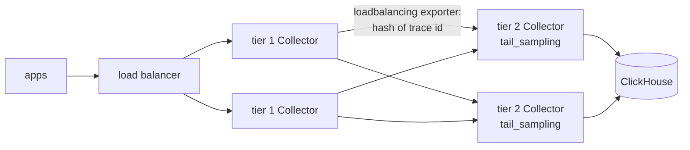
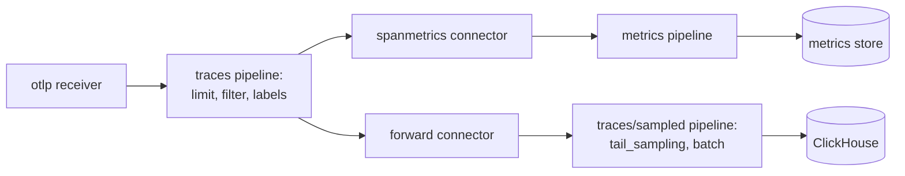
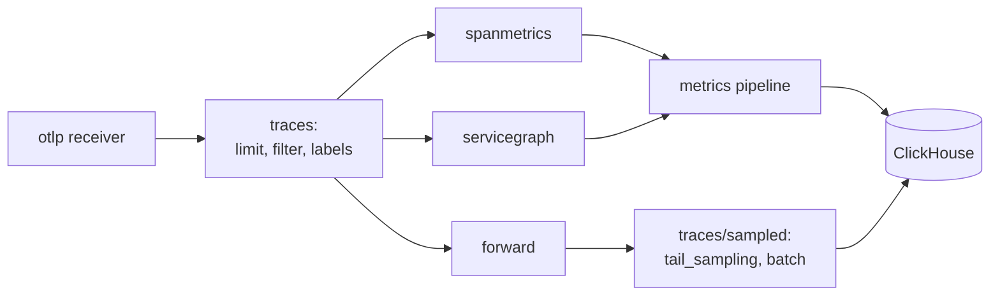

# Module 5: Head and tail sampling (95 min)

## Why this matters

Recording every span of every request costs money: network, gateway memory,
and disk in ClickHouse. **Sampling** means keeping only some traces on purpose.
The hard part is choosing *which* ones without losing the traces you'll need
when something breaks. By the end of this module, you'll be able to say where a
keep-or-drop decision can be made, what each place knows at that moment, what
it costs, and how to turn each kind on in this repo. You'll also build a
sampling plan that keeps every error, keeps slow turns per agent, lets a team
keep more of its own traces, and still finds a slow dependency, without
storing every trace.

## Key terms

From earlier modules you need: a **trace** (all the spans of one request; here,
one agent turn), its **trace id** and **root span** (`agent_turn`), the
**`traceparent`** header that carries them between services, and the SDK's
**sampler** ([module 1](01-otel-core.md)); and the **gateway**, the Collector
that forwards spans to ClickHouse ([module 4](04-collector.md)).

| Term | Plain meaning |
|---|---|
| **Sampling** | Keeping a subset of traces and dropping the rest, on purpose. Each keep-or-drop choice is a **sampling decision** |
| **Head sampling** | Deciding at the very start of a trace, inside the app's SDK |
| **Tail sampling** | Deciding after the whole trace has finished, inside a Collector |
| **Ratio sampling** | Keeping a fixed fraction, such as 30%, chosen from the trace id |
| **Parent-based sampling** | "Do what my parent did": follow the decision the caller already made |
| **Orphan span** | A span whose parent was never recorded, so it hangs loose outside its tree |
| **Policy** | One rule in tail sampling, such as "keep traces with an error" |
| **Load balancer** | Something that spreads incoming requests across several copies (replicas) of a service |
| **Adjusted count** | How many real traces one stored trace stands for: 1 divided by the chance it was kept |
| **Span metrics** | Counts and latency histograms computed from spans as they pass through the gateway, before any are dropped |
| **Histogram** | A latency summary that counts how many calls fell into each time range ("bucket"), such as 500 ms to 750 ms |
| **Service graph** | Metrics per caller-to-callee pair ("edge"), such as `support-agent` calling `kb-search-api`: calls, failures and latency |
| **Exemplar** | A trace id attached to a metric, as an example of one call it counted |

## Idea

### Why sample at all?

A rough example: 1,000 requests a second at 20 spans each is 20,000 spans a
second, about 1.7 billion a day, all sent, held, written and stored. Most say
the same thing: "it worked, at normal speed". You need:

- **every** trace where something failed,
- **every** trace that was unusually slow,
- **some** normal traces, to know what "normal" looks like.

The key question is **when** you decide, because that sets **what you know**.

### Head and tail: an analogy

Imagine a sports TV network covering hundreds of amateur matches every
weekend.

- **Head sampling**: on Friday, before any match starts, the network picks
  30% of the matches at random and sends camera crews to those only. It's
  cheap: no crew, no footage. But if a match nobody filmed turns out to be the
  upset of the season, it's gone.
- **Tail sampling**: the network films *every* match. On Sunday night, an editor
  watches the finished footage and keeps the upsets, the injuries, the overtime
  thrillers, plus 10% of the rest. Nothing important is missed. But they need
  storage for a whole weekend of footage, and all the footage of one match
  has to end up in the **same** editing room, or nobody can judge the match as a
  whole.

Back to this repo: a "match" is one agent turn (one trace). "Filming" is
recording and sending spans. The "editing room" is a Collector instance.

### Comparing the two

| | Head sampling | Tail sampling |
|---|---|---|
| Decided | When the **root span starts**, in the app's SDK | After the **whole trace has arrived**, in a Collector |
| Knows | Only the trace id and the attributes set at the start | Everything: errors, total duration, every attribute of every span |
| Can keep "all errors" | No: it decides before anything has failed | Yes |
| Cost | Almost nothing: dropped spans are never even sent | Every span is sent and held in Collector memory until the decision |
| Scaling | Trivial: each service decides locally | Every span of a trace must reach **the same** Collector instance |

You can use either one, or both: head sampling cuts the volume first, and
tail sampling chooses among what's left.

### Head sampling in the SDK

A **sampler** runs inside the SDK every time a span starts. It answers one
question: record and send this span, or drop it?

For a **root span** (the start of a new trace), the sampler has to decide on its
own. For a **child span**, it can look at the parent's decision. That decision
travels between services in the `traceparent` header, in the last field (the
flags). The header looks like this:

```text
traceparent: 00-12d64ae6b9afa411e15ca3a7c1726609-201baf240807604d-01
             ^^ ^^^^^^^^^^^^^^^^^^^^^^^^^^^^^^^^ ^^^^^^^^^^^^^^^^ ^^
          version          trace id               parent span id  flags
```

Flags `01` mean the caller sampled (kept) the trace; `00` means it dropped it.
Only the lowest bit means "sampled". Newer versions of the standard use the
next bit for something else (`02` says "this trace id is random"), so `03` also
means sampled. Check the lowest bit, not the whole value.

> **Quick check:** `ticket-api` receives `traceparent: 00-...-...-02`. With the
> default sampler, does it record its span?
>
> <details><summary>Answer</summary>
>
> No. `02` has the lowest bit off, so the caller dropped the trace, and the
> parent-based default follows that. Only the "random trace id" bit is set.
> </details>

The Python SDK picks its sampler from environment variables, so you don't
change any code:

| `OTEL_TRACES_SAMPLER` | Behavior |
|---|---|
| `parentbased_always_on` | **The default.** Root spans are always kept; child spans follow their parent |
| `traceidratio` with `OTEL_TRACES_SAMPLER_ARG=0.3` | Keep 30%, decided from the trace id. **Ignores the parent** |
| `parentbased_traceidratio` with `OTEL_TRACES_SAMPLER_ARG=0.3` | Root spans: keep 30% by trace id. Child spans: follow the parent |
| `always_on` / `always_off` | Keep everything, or nothing, ignoring the parent |

#### Ratio sampling

"Keep 30%" can't mean "flip a coin", because then each service would flip its
own coin and keep different parts of the same trace. Instead, a **ratio
sampler** treats the trace id, which is random, as a number and keeps the trace
if that number falls in the lowest 30% of the range. The same trace id always
gives the same answer.

#### Parent-based sampling

**"Parent-based" is what keeps traces whole.** Follow the HR agent's "I need a
new laptop" turn:

1. The `agent_turn` root span starts in `hr-agent`. With
   `parentbased_traceidratio` at 0.3, it's a root, so the ratio rule decides.
   Say the answer is "drop".
2. The agent still runs its tools normally. Its spans just aren't recorded.
   When a tool calls `ticket-api`, the SDK still sends `traceparent`, now with
   flags `00`.
3. `ticket-api` starts its server span. It has a parent, so the parent-based
   sampler reads the flag, sees "dropped", and drops its span too.

The result: either the whole trace is stored, or none of it is.

Now imagine the API used a sampler that ignores the parent, like
`always_on`. It would record its server span even though the agent dropped the
trace. That span points to a parent span id that was never stored. That's an
**orphan**: a piece of a tree with no tree. Orphans make traces confusing and
still cost storage.

Two services with the same ratio and algorithm happen to agree on the same
trace id, but different ratios or SDKs break that. Use parent-based sampling
in every service that isn't the start of a trace.

> **Quick check:** The HR agent keeps 30% of turns with
> `parentbased_traceidratio`, and `ticket-api` keeps 100% with `always_on`.
> Out of 10 turns, how many `ticket-api` spans are orphans?
>
> <details><summary>Answer</summary>
>
> About 7: the turns the agent dropped. `ticket-api` records them anyway, and
> their parent span was never stored.
> </details>

#### Stateless probabilistic sampling in a Collector

The `probabilistic_sampler` processor sits in between. It keeps a percentage
of traces chosen from the trace id, span by span, without holding traces in
memory ("stateless"). So it saves nothing between apps and Collector (unlike
head sampling) and can't see failures (unlike tail sampling), but it still
keeps whole traces, since every span shares the trace id. Use it when you
can't change the apps' settings. This repo doesn't.

### Tail sampling in the Collector

The `tail_sampling` processor works like this:

1. It groups incoming spans by trace id, in memory.
2. It **waits** for `decision_wait` (10 seconds here) after the first span of a
   trace arrives, so the rest of the trace can catch up.
3. It runs the **policies** against the whole trace.
4. A trace is kept if **any** policy says keep. Kept traces go on to the next
   processor (`batch`) and then to ClickHouse. Dropped traces are discarded.

That's simplified: policies can also be combined with `and` and `composite`,
and some can drop traces explicitly. This lab file only uses "keep if any
matches"; the smart sampling lab later in this module also uses `and`.

Here is the lab file `docs/tutorial/labs/otel-gateway-tail-sampling.yaml`,
block by block.

```yaml
processors:
  tail_sampling:
    decision_wait: 10s        # hold each trace this long so all its spans arrive
    num_traces: 20000         # traces held in memory at once
```

- `decision_wait: 10s`: wait 10 seconds per trace before deciding. An agent turn
  must finish, and its spans must reach the gateway, within that time, or the
  decision is made on an incomplete trace.
- `num_traces: 20000`: the most traces held in memory at once. If more arrive,
  the oldest are removed from memory. If no decision was made for them yet,
  they're lost.

```yaml
    policies:                 # a trace is kept if ANY policy matches
      - name: keep-errors
        type: status_code
        status_code: { status_codes: [ERROR] }
```

**Keep every trace with an error.** If any span in the trace has status
`ERROR`, keep it. In this repo, that catches the pricing API's random 500
errors (it fails 30% of calls) and the support agent's failed search on its
second turn (the traffic loop passes `--fail-turn 2`).

```yaml
      - name: keep-slow
        type: latency
        latency: { threshold_ms: 1500 }
```

**Keep every slow trace.** If the trace took longer than 1500 ms (1.5 seconds),
from the earliest span's start to the latest span's end, keep it.

```yaml
      - name: keep-10-percent-of-the-rest
        type: probabilistic
        probabilistic: { sampling_percentage: 10 }
```

**Keep 10% of everything else**, chosen from the trace id. This gives you a
baseline of normal traces, so you can compare "slow" with "usual".

```yaml
service:
  pipelines:
    traces:
      processors: [memory_limiter, filter/require_org_labels, resource/org_platform, tail_sampling, batch]
```

This file is **merged** on top of `otel-gateway-config.yaml`. When Collector
config files are merged, maps (key: value sections) combine, but lists replace.
So the whole processor list has to be written out again, with `tail_sampling`
inserted. It goes after the filter and the resource processor, and before
`batch`, so only kept traces are batched.

`docs/tutorial/labs/compose.tail-sampling.yaml` is what makes the gateway load
both files: it changes the gateway's command to pass two `--config` flags, and
mounts the lab file into the container.

Other policy types exist: `string_attribute`, `numeric_attribute`,
`boolean_attribute`, `rate_limiting`, `span_count`, `ottl_condition`,
`trace_state`, `and` and `composite`.

> **Quick check:** An HR turn has no errors and takes 0.8 s. Which policy can
> keep it, and how likely is that?
>
> <details><summary>Answer</summary>
>
> Only `keep-10-percent-of-the-rest`, so about a 1 in 10 chance, decided by
> its trace id. `keep-errors` and `keep-slow` don't match.
> </details>

### The trade-offs of tail sampling

**Memory.** Every span of every trace in its wait window sits in the gateway's
memory. Too small a `num_traces` and traces are removed before they're
decided; too big and the gateway hits its `memory_limiter` (remember from
module 4: the guard that refuses data near 410 MiB). The principal engineer's
notes below work out the size.

**Completeness and delay.** The processor judges only what arrived within
`decision_wait`. A longer wait catches slower traces but holds more memory and
delays data in ClickHouse. A span arriving after the decision is "late": once
the trace has left memory, it's judged again on its own, as a fragment.

**Transport cost.** Unlike head sampling, every span still travels from the app
to the gateway. Tail sampling saves the network from the gateway to ClickHouse,
and the storage there, but not the network from the apps to the gateway.

**One trace, one instance.** This is the big one. Behind a plain load
balancer, a trace's spans spread across gateway replicas. One replica sees the
error and keeps its part; another sees only healthy spans and drops its part.
You get fragments.

The fix is two tiers of Collectors:



- **Tier 1** doesn't sample. It uses the **`loadbalancing` exporter** with
  `routing_key: traceID`. That exporter picks a tier 2 instance from the trace
  id, so every span of the same trace goes to the same instance, whichever tier
  1 instance received it.
- **Tier 2** runs `tail_sampling`. Each instance now sees whole traces.

This repo runs a single gateway, so it doesn't need this.

### Sampling changes your counts

After sampling, `count()` in ClickHouse no longer equals the number of
requests. With 10% sampling of normal traffic, 1 stored normal trace stands
for about 10 real ones. And because tail sampling keeps *all* errors but only
*some* successes, the stored error rate looks far higher than the real one.

The numbers you usually want per service are **RED metrics**: rate (requests
counted), errors, and duration (latency). Two ways to keep them right:

- Compute them **before** sampling, inside the gateway. The SDKs still send
  each span once; the split happens in the gateway. It can't be a processor:
  a processor's output is the same kind of data as its input (spans in,
  spans out), and span metrics turn spans into *metrics*. Something that
  takes in one kind and puts out another is a **connector** (module 4): it
  ends one pipeline and starts another. So the first traces pipeline does the
  shared work once (memory limit, filter, labels) and ends in two
  connectors. `spanmetrics` turns every span into RED metrics for a metrics
  pipeline. `forward` passes the same spans, unchanged, to a second traces
  pipeline, which runs `tail_sampling` and writes the kept traces to
  ClickHouse. (The smart sampling lab below sets this up.)
- Or weight each stored trace by its **adjusted count**: 1 divided by the
  probability it was kept. A trace kept at 10% counts as 10; an error trace
  kept at 100% counts as 1. This needs the probability stored with the trace.



In this repo, the `otel.span_red_1m` table (calls, errors and latency per
minute) is filled by a materialized view: a query ClickHouse runs on every
insert into `otel.otel_traces`. It only sees spans that were stored, so it would
undercount if you turned sampling on permanently.

> **Quick check:** With tail sampling on, a minute has 40 stored error traces
> and 50 stored normal ones. Roughly how many turns really ran?
>
> <details><summary>Answer</summary>
>
> About 540: 40 errors at adjusted count 1, plus 50 normal traces at adjusted
> count 10 (kept at 10%). Slow traces, also kept at 100%, would count as 1 each.
> </details>

### Smarter sampling: a plan in layers

The lab policies above use one rule for everyone. Real teams ask for more:
"keep more of my service's traces", "keep every error", "tell me when agents
get slower, and why". One plan can answer all three, in layers:

```text
1. Measure everything     metrics from 100% of spans, before any are dropped
2. Always keep            every error; every turn slower than its agent's normal
3. Keep more on request   a team's higher rate, or a flag on chosen requests
4. Keep a baseline        a small random share of everything else (here 5%)
   (optional) Cap it      a spans-per-second budget across the policies
```

Back to the TV network: the **scoreboard** records the score and length of
every match, filmed or not (layer 1). The editor keeps every upset and every
match that ran unusually long *for that league* (layer 2). A club that pays
for extra coverage gets more of its matches kept (layer 3). And a few ordinary
matches are kept, so there's something to compare against (layer 4).

#### Layer 2: one "slow" line per agent

The `latency` policy measures the whole trace, from the earliest span's start
to the latest span's end; here, one agent turn. But "slow" depends on the
agent. A test run of 10 turns per agent in this repo measured:

| Agent | Median turn | 90th percentile |
|---|---|---|
| `hr-agent` | 738 ms | 831 ms |
| `sales-agent` | 908 ms | 1031 ms |
| `support-agent` | 1483 ms | 1719 ms |

With one 1500 ms line for everyone, about half of the support agent's
*normal* turns count as "slow" and are all kept. Meanwhile the HR agent could
nearly double, from 0.74 s to 1.4 s, without a single turn crossing the line.
So give each agent its own line, at about 1.3 times its normal 90th
percentile, by combining two policies with `and`: "this agent" and "slower
than X".

```yaml
- name: slow-support-agent
  type: and
  and:
    and_sub_policy:
      - { name: is-support-agent, type: string_attribute, string_attribute: { key: service.name, values: [support-agent] } }
      - { name: over-2200ms, type: latency, latency: { threshold_ms: 2200 } }
```

`string_attribute` matches if *any* span in the trace has that value, in its
own attributes or its resource's. Here that's the agent's spans, whose
resource has `service.name = support-agent`.

The thresholds are fixed numbers: the processor can't compute "slower than
this agent's 90th percentile" by itself. Recompute them from the metrics
(lab step 4 shows the query) when an agent changes, for example a new model or
a new tool, and keep one high catch-all line (5 s here) for agents that don't
have their own.

#### Layer 3: letting a team keep more of its traces

Say the `ticket-api` team wants to keep half of the traces that involve their
service, not 5%. There are two places to do it, and only one works well:

- **In the team's own SDK** (head sampling), with
  `OTEL_TRACES_SAMPLER_ARG=0.5`. With parent-based sampling, that rate only
  applies to traces that **start** in `ticket-api`. When an agent calls the
  API, the agent's decision wins, and the 50% does nothing. Switching off
  parent-based to force it creates orphans (lab step 2).
- **At the gateway** (tail sampling), with "touches `ticket-api`" `and`
  "50%":

  ```yaml
  - name: ticket-api-50-percent
    type: and
    and:
      and_sub_policy:
        - { name: touches-ticket-api, type: string_attribute, string_attribute: { key: service.name, values: [ticket-api] } }
        - { name: half, type: probabilistic, probabilistic: { sampling_percentage: 50 } }
  ```

What it costs:

- **The whole trace is kept**, not just the team's spans: the calling agent's
  spans and every other service in those traces are stored too. In this repo,
  every HR turn calls `ticket-api`, so this one policy stores half of all HR
  turns.
- **Storage grows with the traffic that touches the service.** Extra spans
  stored per second is about: traces per second that touch the service x
  (new rate - baseline rate) x spans per trace. For example, 100 traces a
  second, 50% instead of 5%, 20 spans each: 100 x 0.45 x 20 = 900 extra spans
  a second, about 78 million a day.
- **Gateway memory doesn't change.** The tail sampler already holds every
  trace while it decides. The extra cost is in ClickHouse: more inserts, more
  disk.
- **Stored counts get skewed.** That service is now over-represented among
  stored traces, so count from metrics (layer 1), not from stored traces.

Two ways to keep this under control:

- **Cap the total.** A `composite` policy gives each sub-policy a share of a
  spans-per-second budget, so one team turning their rate up can't flood
  ClickHouse. Sub-policies are checked in `policy_order`, and the first one
  that matches decides. If that one has already used its share in the
  current second, the trace is dropped, even if a later sub-policy still has
  room; so give errors the biggest share. It's a hard cap only if every
  policy sits inside the composite, because any policy outside it can still
  keep the trace. The budget applies per gateway instance, so divide your
  total by the number of gateways.

  ```yaml
  - name: budgeted
    type: composite
    composite:
      max_total_spans_per_second: 20000
      policy_order: [errors, slow, baseline]
      composite_sub_policy:
        - { name: errors, type: status_code, status_code: { status_codes: [ERROR] } }
        - { name: slow, type: latency, latency: { threshold_ms: 5000 } }
        - { name: baseline, type: probabilistic, probabilistic: { sampling_percentage: 5 } }
      rate_allocation:
        - { policy: errors, percent: 50 }
        - { policy: slow, percent: 30 }
        - { policy: baseline, percent: 20 }
  ```

  (This snippet starts on the gateway version this repo uses, but the lab
  doesn't run it.)
- **Keep more of chosen requests only.** Instead of a permanent rate, the app
  sets an attribute such as `org.sampling.force = true` on a canary release, a
  tenant under investigation, or a debug session, and a `boolean_attribute`
  policy keeps those traces. `org.sampling.force` is a name you'd choose; it's
  not a standard attribute, and the agents in this repo don't set it.

#### Head sampling plus every error

Head sampling decides before anything has failed, so on its own it can't keep
every error. The standard way to get "a small sample plus every error" is:

1. Every SDK sends everything (the default, `parentbased_always_on`).
2. The gateway tail-samples: every error, every slow turn, plus a small
   random share. That random share *is* the "head bucket": the `probabilistic`
   policy decides from the trace id, so every gateway agrees.

The cost is sending and holding 100% of spans; storage is only for what's
kept. If one very busy, low-value service can't afford to send everything,
head-sample just that service (say 20%) and tail-sample the rest. Accept that
only errors in its 20% are kept, and that the gateway's metrics see only that
20% too: for exact counts, that service needs metrics computed inside the app.

#### Finding latency problems without keeping every trace

Split the job into three questions, each answered by a different tool:

| Question | Answered by | Based on |
|---|---|---|
| Is something getting slower? Which agent, span or model? | Span metrics | Every span |
| Which dependency is slow? | Service graph | Every call between services |
| Why: which step of the turn grew? | Slow stored traces compared with baseline ones | Kept traces |



- **Span metrics** (`spanmetrics` connector): for every service, span name,
  span kind and status, a call count and a latency **histogram**, here also
  split by `gen_ai.operation.name`, `gen_ai.request.model` and
  `gen_ai.tool.name`. It sees every span, so a 95th percentile computed from
  it is right whatever you sample. A percentile from a histogram is only as
  precise as its buckets: you learn "95% of turns took at most 2 s", not
  "1,873 ms". Choose buckets around your normal latencies.
- **Service graph** (`servicegraph` connector): it pairs each client span
  (the caller's "I called X") with the server span it reached (X's "I was
  called"), and records calls, failures and latency per edge:
  `support-agent -> kb-search-api`, `ticket-api -> postgresql`. A call that
  never reaches an instrumented service, like a database or an LLM provider,
  still becomes an edge to a **virtual node**, named from an attribute of the
  client span (`db.system.name`, `gen_ai.provider.name`). If none is set, the
  node is called `unknown`. In this repo, that's `legacy-hr-api`: the gateway
  drops its spans (module 4), so the HR agent's calls to it never meet a
  server span.
- **Slow traces compared with baseline traces**: layer 2 keeps the slow
  turns, layer 4 keeps some normal ones. Average each span name's duration in
  both groups. Every span *above* the cause gets slower too, since parents
  include their children's time; the cause is the **deepest** span that
  gained the time.
- **Exemplars** link the two worlds: each histogram stores a few trace ids
  as examples. An example from a normal minute probably points at a dropped
  trace. An example from a slow bucket probably points at a kept one, because
  the slow-turn policy kept it. In a test run, 1 of 14 exemplars from a run
  of normal turns pointed at a stored trace, and 15 of 17 during a slowdown.

To notice a slowdown **before** users complain, watch trends rather than
single minutes. Compare each agent's 95th percentile with the same hour last
week, and watch the causes that usually come first: more LLM or tool calls
per turn (span metrics counts both), a new model name appearing (it's a
dimension), or a dependency edge getting slower. Growing prompt sizes are
another early sign. Span metrics don't sum token attributes, so that needs
in-app metrics, such as the GenAI convention's `gen_ai.client.token.usage`
histogram ([module 3](03-genai-semconv.md)), or queries on stored traces.

> **Quick check:** The support agent's 95th percentile jumps from 2 s to 3 s.
> The service graph shows `support-agent -> kb-search-api` went from 150 ms to
> 1,150 ms, and every other edge is flat. In the slow stored traces, the
> `invoke_agent researcher` span is 1 s slower than usual. Is the researcher
> agent the problem?
>
> <details><summary>Answer</summary>
>
> No. The researcher span includes its children's time, and its child, the
> `kb-search-api` call, gained the same second. The deepest span with the extra
> time, `GET /v1/search` in `kb-search-api`, is the cause.
> </details>

## Remember it

> **Head sampling picks which matches to film before kickoff: cheap, but blind
> to the upset. Tail sampling films everything and an editor keeps the best
> after the final whistle, which only works if all footage of one match
> reaches the same editing room.**

And: **parent-based means "do what your parent did"**, which is what keeps
traces whole.

## In this repo

- **Head sampling**: nothing in code. `TracerProvider` in `agent/telemetry.py`
  is created without a sampler, so the SDK reads `OTEL_TRACES_SAMPLER` and
  `OTEL_TRACES_SAMPLER_ARG` from the environment. With neither set, it uses
  `parentbased_always_on`: everything is kept.
- **Tail sampling**: `docs/tutorial/labs/otel-gateway-tail-sampling.yaml`,
  merged into the gateway by `docs/tutorial/labs/compose.tail-sampling.yaml`.
  It's off unless you start the gateway with that compose file.
- **Smart sampling**: `docs/tutorial/labs/otel-gateway-smart-sampling.yaml`
  (span metrics, service graph, per-agent slow lines, the `ticket-api` opt-in,
  a 5% baseline), merged by `docs/tutorial/labs/compose.smart-sampling.yaml`.
  Its metrics go to `otel.otel_metrics_sum` and `otel.otel_metrics_histogram`,
  created by `docs/tutorial/labs/metrics-tables.sql`.
- **A slow dependency on demand**: `SLOW_SERVICE=<api> SLOW_MS=<ms>` makes
  one of the APIs in `agent/apis.py` that much slower.

## Principal engineer's notes

**Touch points**
- Head sampling's contract is the `traceparent` sampled bit (touch point 1 in
  the [module 0 map](00-setup.md#the-touch-points-map)). Any service whose
  sampler ignores it breaks traces for everyone downstream.
- Two-tier tail sampling adds a Collector-to-Collector OTLP hop. Tier 1 must
  know the list of tier 2 instances (a static list, DNS, or Kubernetes
  lookup in the `loadbalancing` exporter); that list is the new contract.

**At scale**
- Tail sampling memory is about **traces per second x `decision_wait` x
  average trace size**. Worked example: 1,000 turns a second, a 10 s wait,
  20 spans per turn at about 1 KB each: 10,000 traces in flight x 20 KB =
  200 MB, before the Collector's own overhead (budget roughly double). That
  already crowds this gateway's 410 MiB refusal point. `num_traces` must also
  exceed traces in flight (10,000 here); the lab's 20,000 gives 2x headroom.
- Agent turns are long. Child spans arrive as they finish, but the root
  `agent_turn` span arrives only after the turn ends, plus up to 5 s in the
  SDK's batch. `decision_wait` must cover the longest normal turn plus that
  delay. A 30 s LLM-heavy turn needs about 40 s, which quadruples memory.
- When tier 2 grows or shrinks, the `loadbalancing` exporter's hash ring
  moves some trace ids to a different instance. Traces in flight at that
  moment are split and decided twice, so you get fragments for about one
  `decision_wait`. Scale tier 2 in quiet periods, not in the middle of an incident.
- The service graph has the same "one trace, one instance" need: it pairs a
  client span with its server span in one instance's memory (`store`, up to
  `max_items` waiting for `ttl`). With several gateways, run it in tier 2,
  behind trace-id routing.
- Span metrics cost grows with **series**: every distinct combination of
  service, span name, kind, status and dimension values is its own row every
  flush. Model and tool names are fine; a request id or a user id as a
  dimension would create a series per request. `aggregation_cardinality_limit`
  caps it.

**Operational issues**
- Watch for traces evicted before a decision
  (`otelcol_processor_tail_sampling_sampling_trace_dropped_too_early`) and late
  spans; both mean `num_traces` or `decision_wait` is too small. More gateway
  signals: [module 12](12-operations.md) and the
  [metrics appendix](appendix-metrics-reference.md).
- Head and tail together compound: at 10% head sampling, tail's "keep all
  errors" only sees errors in that 10%.

**Design trade-offs**
- This repo stores everything by default and computes RED metrics with a
  materialized view on stored spans. With permanent sampling, move RED to
  before sampling (`spanmetrics`, as the smart sampling lab does) so
  dashboards stay exact.
- Per-team rates are a cost decision for everyone in the trace, so keep them
  in the gateway config and change them by review, with a `composite` budget
  as the ceiling. Prefer a flag on chosen requests over a permanent higher
  rate when the need is temporary.
- **Consistent probability sampling** is the standard way to keep counts
  correct: each sampler writes the probability it used into the `tracestate`
  header, so every stage agrees and any backend can compute the adjusted
  count. Choose it when several stages sample, or when you need weighted
  counts from stored traces.

## Lab (50 min)

Each experiment sets `OTEL_RESOURCE_ATTRIBUTES=lab.run=...`. The SDK adds that
label to the resource of every span, so you can find exactly that experiment's
spans afterwards with `ResourceAttributes['lab.run']`.

Run SQL in <http://localhost:8123/play> (user `default`, password `demo`).

1. **Head sampling at 30%.** First pause the background traffic, so it doesn't
   mix with your experiment:

   ```bash
   ./stack.sh traffic off
   cd agent
   OTEL_RESOURCE_ATTRIBUTES=lab.run=head30 \
   OTEL_TRACES_SAMPLER=parentbased_traceidratio OTEL_TRACES_SAMPLER_ARG=0.3 \
     .venv/bin/python simulate.py --turns 10
   ```

   `simulate.py` starts the four APIs and runs 10 turns in each of the three
   agents. The APIs are started by `simulate.py`, so they inherit the same
   environment variables: the same sampler and the same `lab.run` label.

   Now count what was kept, per service:

   ```sql
   SELECT ServiceName, countIf(SpanName = 'agent_turn') AS turns_kept, uniqExact(TraceId) AS traces
   FROM otel.otel_traces WHERE ResourceAttributes['lab.run'] = 'head30'
   GROUP BY ServiceName ORDER BY ServiceName;
   ```

   `turns_kept` counts root spans (one per kept turn) and `traces` counts
   distinct trace ids. Out of 30 turns (10 per agent), about 9 are kept; a test
   run kept 11. The exact number varies, because trace ids are random. The
   APIs have spans only for kept traces, because they follow the parent.
   (`legacy-hr-api` won't appear at all; the gateway filter drops it, as in
   module 4.)

2. **Inconsistent sampling makes orphans.** Still in the `agent` folder, start
   one API that keeps everything, and an agent that samples 30% *without*
   parent-based sampling:

   ```bash
   OTEL_RESOURCE_ATTRIBUTES=lab.run=orphans OTEL_TRACES_SAMPLER=always_on \
     .venv/bin/python apis.py --service kb-search-api &
   sleep 2
   OTEL_RESOURCE_ATTRIBUTES=lab.run=orphans OTEL_TRACES_SAMPLER=traceidratio OTEL_TRACES_SAMPLER_ARG=0.3 \
     .venv/bin/python run.py --agent support-agent --turns 10
   pkill -f 'apis.py --service'
   ```

   The first command starts `kb-search-api` in the background with
   `always_on`: it records every request, whatever the caller decided. The
   second runs 10 support-agent turns with `traceidratio`. The last stops the
   API.

   This query counts, per service, the traces and the server spans whose
   parent span was never stored in this experiment:

   ```sql
   SELECT ServiceName, uniqExact(TraceId) AS traces,
          countIf(SpanKind = 'Server' AND ParentSpanId NOT IN
                  (SELECT SpanId FROM otel.otel_traces WHERE ResourceAttributes['lab.run'] = 'orphans')) AS orphans
   FROM otel.otel_traces WHERE ResourceAttributes['lab.run'] = 'orphans' GROUP BY ServiceName;
   ```

   A test run: the agent kept 4 traces; the API recorded 10, and 6 of them are
   orphans pointing at parents that don't exist. Those 6 are the turns the
   agent dropped but the API recorded anyway.

3. **Tail sampling at the gateway.** Go back to the repo root and turn the
   traffic on with a round every 10 seconds instead of the default 30, so the
   numbers are big enough to compare. Wait 2 minutes for a baseline, then
   restart the gateway with the tail sampling config:

   ```bash
   cd ..
   TRAFFIC_INTERVAL=10 ./stack.sh traffic on
   sleep 120
   docker compose -f compose.yaml -f docs/tutorial/labs/compose.tail-sampling.yaml up -d otel-gateway
   ```

   Wait 2 more minutes, then compare traces per minute before and after the
   switch. `traces` counts all stored traces; `with_errors` counts those with
   at least one error span:

   ```sql
   SELECT toStartOfMinute(Timestamp) AS m, uniqExact(TraceId) AS traces,
          uniqExactIf(TraceId, StatusCode = 'Error') AS with_errors
   FROM otel.otel_traces WHERE Timestamp > now() - INTERVAL 10 MINUTE
   GROUP BY m ORDER BY m;
   ```

   In a test run with `TRAFFIC_INTERVAL=10`, traces went from about 36 per
   minute to about 15, and most of the kept ones had errors (the pricing API
   fails 30% of the time) or were slow. Your numbers will differ a little; with
   the default 30-second interval they'd be much lower.

   Now check that every kept trace is **complete**. This query takes the
   traces whose root span started between 90 and 30 seconds ago (old enough to
   be decided, and after the switch), and for each one counts root spans and
   spans whose parent is missing from the same trace:

   ```sql
   SELECT count() AS traces, countIf(roots = 1) AS with_root,
          countIf(missing_parents = 0) AS no_missing_parent
   FROM (
     SELECT TraceId, countIf(ParentSpanId = '') AS roots,
            groupArray(SpanId) AS ids, groupArray(ParentSpanId) AS parents,
            arrayCount(p -> p != '' AND NOT has(ids, p), parents) AS missing_parents
     FROM otel.otel_traces
     WHERE TraceId IN (SELECT TraceId FROM otel.otel_traces WHERE ParentSpanId = ''
                       AND Timestamp BETWEEN now() - INTERVAL 90 SECOND AND now() - INTERVAL 30 SECOND)
     GROUP BY TraceId);
   ```

   All three numbers should be equal: every kept trace has its one root span,
   and no span points at a parent that wasn't stored. The sampler kept or
   dropped each trace as a whole. (Compare lab step 2, where `missing_parents`
   would be non-zero for the orphans.)

   Turn tail sampling off again, and put the traffic back to its default
   interval:

   ```bash
   docker compose up -d otel-gateway
   ./stack.sh traffic off && ./stack.sh traffic on
   ```

4. **Smart sampling, and finding a slow dependency (25 min).** Create the
   two metrics tables, restart only the gateway with the smart sampling config,
   and run traffic every 10 seconds:

   ```bash
   docker exec -i clickhouse-01 clickhouse-client --password demo --multiquery < docs/tutorial/labs/metrics-tables.sql
   docker compose -f compose.yaml -f docs/tutorial/labs/compose.smart-sampling.yaml up -d --no-deps otel-gateway
   ./stack.sh traffic off && TRAFFIC_INTERVAL=10 ./stack.sh traffic on
   ```

   The first command prints one line per server for each table; that's
   `ON CLUSTER` reporting success. `--no-deps` restarts only the gateway and
   leaves ClickHouse alone.

   **a. What was stored, compared with what really ran.** Wait 3 minutes. The
   first half of this query counts real turns from span metrics; the second
   counts stored turns:

   ```sql
   SELECT agent, real_turns, stored_turns
   FROM (SELECT ServiceName AS agent, sum(Value) AS real_turns FROM otel.otel_metrics_sum
         WHERE MetricName = 'traces.span.metrics.calls' AND Attributes['span.name'] = 'agent_turn'
           AND TimeUnix > now() - INTERVAL 3 MINUTE GROUP BY agent) AS m
   LEFT JOIN (SELECT ServiceName AS agent, count() AS stored_turns FROM otel.otel_traces
              WHERE SpanName = 'agent_turn' AND Timestamp > now() - INTERVAL 3 MINUTE GROUP BY agent) AS s
   USING agent ORDER BY agent;
   ```

   The two halves don't line up exactly at the edges of the window (metrics
   arrive every 15 seconds, sampling decisions 10 seconds after a turn), so
   treat the numbers as approximate. Over a longer test run, the shares
   stored were about:

   | Agent | Stored | Kept by |
   |---|---|---|
   | `hr-agent` | 51% | `ticket-api-50-percent`: every HR turn files a ticket |
   | `sales-agent` | 51% | `keep-errors`: `pricing-api` fails 30% of calls, and a turn makes several |
   | `support-agent` | 37% | `keep-errors` for the deliberate failed turn in each round, plus the 5% baseline |

   That's 46% overall, and only because this demo fails on purpose so often.
   With a real error rate of 1 or 2%, the same policies would store a much
   smaller share. Note that HR's half is the cost of one team's opt-in.

   **b. Make a dependency slower.** Restart the traffic with `kb-search-api`
   adding 1 second to every request:

   ```bash
   ./stack.sh traffic off && SLOW_SERVICE=kb-search-api SLOW_MS=1000 TRAFFIC_INTERVAL=10 ./stack.sh traffic on
   ```

   Wait 3 minutes, then ask the three questions in order.

   **c. Is something slower, and which agent?** This turns each minute's
   histogram buckets into a 95th percentile. `sumForEach` adds up the bucket
   counts of the rows in that minute, and `arrayCumSum` makes them a running
   total. The first bucket where the running total reaches 95% of the turns
   holds the 95th percentile, and its upper bound (from `ExplicitBounds`) is
   the answer:

   ```sql
   SELECT minute, agent, turns, if(i > length(bounds), inf, bounds[i]) AS p95_at_most_ms
   FROM (SELECT toStartOfMinute(TimeUnix) AS minute, ServiceName AS agent, sum(Count) AS turns,
                any(ExplicitBounds) AS bounds,
                arrayFirstIndex(c -> c >= 0.95 * turns, arrayCumSum(sumForEach(BucketCounts))) AS i
         FROM otel.otel_metrics_histogram
         WHERE MetricName = 'traces.span.metrics.duration' AND Attributes['span.name'] = 'agent_turn'
           AND TimeUnix > now() - INTERVAL 8 MINUTE
         GROUP BY minute, agent)
   ORDER BY agent, minute;
   ```

   (`inf` means the last bucket: slower than the highest bound, 10 s.) In a
   test run, `support-agent` went from "at most 2000 ms" to "at most 3000 ms"
   in the minute the slowdown started and stayed there, while `hr-agent` stayed
   at 1000 ms and `sales-agent` moved between 1000 and 1500 ms, as before.

   To set the per-agent slow lines from layer 2, run the same query over a
   normal hour with `0.9` instead of `0.95`, and without `minute`.

   **d. Which dependency?** Average latency per service-graph edge, in the
   last 3 minutes against the 3 minutes before. The `client` metric is the
   latency the caller saw:

   ```sql
   SELECT Attributes['client'] AS client, Attributes['server'] AS server,
          round(1000 * sumIf(Sum, TimeUnix <= now() - INTERVAL 3 MINUTE) / sumIf(Count, TimeUnix <= now() - INTERVAL 3 MINUTE)) AS before_ms,
          round(1000 * sumIf(Sum, TimeUnix > now() - INTERVAL 3 MINUTE) / sumIf(Count, TimeUnix > now() - INTERVAL 3 MINUTE)) AS last_3_min_ms
   FROM otel.otel_metrics_histogram
   WHERE MetricName = 'traces_service_graph_request_client' AND TimeUnix > now() - INTERVAL 6 MINUTE
   GROUP BY client, server ORDER BY last_3_min_ms - before_ms DESC;
   ```

   The service graph records latency in seconds, hence `1000 *`. A test run:

   ```text
   client          server          before_ms   last_3_min_ms
   support-agent   kb-search-api         272            1165
   hr-agent        unknown               352             371
   support-agent   fakechatmodel         232             241
   sales-agent     pricing-api            88              84
   hr-agent        ticket-api             62              58
   ...every other edge also flat
   ```

   One edge moved, by about the second you added. (Its "before" is above the
   ~150 ms of a clean run, because the 3 minutes before also caught the first
   slow requests.) `fakechatmodel` is the LLM provider and `postgresql` the
   ticket database: virtual nodes. `unknown` is `legacy-hr-api`, whose spans
   the gateway drops.

   **e. Why: which span grew?** Compare the support agent's stored slow turns
   with its stored normal ones, leaving out error turns, which end early:

   ```sql
   WITH turns AS (
     SELECT TraceId, Duration / 1e6 > 2200 AS slow FROM otel.otel_traces
     WHERE ServiceName = 'support-agent' AND SpanName = 'agent_turn' AND Timestamp > now() - INTERVAL 8 MINUTE
       AND TraceId NOT IN (SELECT TraceId FROM otel.otel_traces WHERE StatusCode = 'Error' AND Timestamp > now() - INTERVAL 8 MINUTE))
   SELECT s.ServiceName, s.SpanName, countIf(t.slow) AS slow_spans, countIf(NOT t.slow) AS normal_spans,
          round(avgIf(s.Duration / 1e6, t.slow)) AS slow_ms, round(avgIf(s.Duration / 1e6, NOT t.slow)) AS normal_ms,
          slow_ms - normal_ms AS extra_ms
   FROM otel.otel_traces AS s INNER JOIN turns AS t ON s.TraceId = t.TraceId
   WHERE s.SpanName != 'agent_turn'
   GROUP BY s.ServiceName, s.SpanName ORDER BY extra_ms DESC LIMIT 6;
   ```

   A test run (23 slow turns, 5 normal ones from the baseline):

   ```text
   ServiceName     SpanName                             slow_ms   normal_ms   extra_ms
   support-agent   invoke_workflow support_supervisor      2570        1459       1111
   support-agent   invoke_agent researcher                 1584         588        996
   kb-search-api   GET /v1/search                          1167         199        968
   support-agent   GET /v1/search                          1175         219        956
   support-agent   execute_tool search_knowledge_base      1175         219        956
   support-agent   chat fake-writer                         585         456        129
   ```

   Read it from the bottom of the tree up. The workflow, the researcher agent,
   the tool and the HTTP client call all gained about a second, but each only
   because its child did. The deepest span with the extra second is
   `kb-search-api`'s own server span, `GET /v1/search`: the time is spent
   inside that API. The LLM calls barely changed. With only 5 normal turns,
   small differences like the writer's 129 ms are noise.

   **f. Do the exemplars lead somewhere?** For the support agent's turn
   histogram, count the exemplar trace ids that were stored:

   ```sql
   SELECT TimeUnix > now() - INTERVAL 3 MINUTE AS during_slowdown, count() AS exemplars,
          countIf(trace_id IN (SELECT TraceId FROM otel.otel_traces)) AS stored
   FROM otel.otel_metrics_histogram ARRAY JOIN Exemplars.TraceId AS trace_id
   WHERE MetricName = 'traces.span.metrics.duration' AND ServiceName = 'support-agent'
     AND Attributes['span.name'] = 'agent_turn' AND TimeUnix > now() - INTERVAL 6 MINUTE
   GROUP BY during_slowdown;
   ```

   In a test run, 30 of 31 exemplars during the slowdown led to a stored
   trace, because the slow-turn policy kept those turns. Before it, 20 of 38
   did, mostly the error turns, which are always kept.

   Put everything back: normal traffic, and the gateway without sampling. The
   metrics tables can stay; nothing writes to them without the lab config.

   ```bash
   ./stack.sh traffic off && ./stack.sh traffic on
   docker compose up -d --no-deps otel-gateway
   ```

## Explain it back

> "Head sampling decides in the SDK when the root span starts: free, but blind
> to failures. Children follow the `traceparent` flag, so traces stay whole.
> Tail sampling decides in the Collector after the whole trace arrives, so it
> keeps all errors and slow traces; it costs memory, and needs every span of a
> trace on one instance. Compute metrics before sampling, or weight them.
> For a balanced plan: measure everything, keep every error and every turn
> slower than its agent's normal, keep more on request, and keep a small
> baseline to compare against."

## Recap

- Sampling keeps a useful subset of traces to cut network, memory and storage
  cost.
- Head sampling decides at the start, in the SDK: cheap, but blind to the
  outcome. Tail sampling decides at the end, in a Collector: it can keep all
  errors and slow traces, but holds every trace in memory while it waits.
- Ratio sampling decides from the trace id. Parent-based sampling makes every
  downstream service follow the root's decision, so traces stay whole and
  there are no orphans.
- This repo's tail policies keep errors, traces slower than 1.5 s, and 10% of
  the rest, after a 10-second wait.
- With several gateways, tail sampling needs a first tier that routes by trace
  id. And after any sampling, raw `count()` no longer equals real traffic.
- A balanced plan has layers: metrics from every span, keep every error and
  every turn slower than *its agent's* normal, keep more on request, and a
  small baseline. "Head sampling plus every error" is really this: send
  everything, decide at the gateway.
- A team's higher rate belongs at the gateway (`and` of "touches my service"
  and a percentage). It keeps whole traces, so it costs storage for every
  service in them; cap it with a `composite` budget.
- Latency problems are found in three steps: span metrics say what got slower,
  the service graph says which dependency, and slow stored traces compared
  with baseline ones say which span.

## Check yourself

<details><summary>Why can't head sampling keep 100% of errors?</summary>

The decision is made when the root span starts, before anything has failed.
Only something that sees the finished trace, like a tail sampler, can choose
by outcome.
</details>

<details><summary>You run 3 gateway replicas behind a round-robin load balancer with tail sampling. What goes wrong?</summary>

Each replica sees roughly a third of each trace's spans and decides on its
own: one may keep the error part while another drops the rest. You get
fragments. Put a `loadbalancing` exporter tier in front, routing by trace id.
</details>

<details><summary>What does <code>decision_wait: 10s</code> trade off?</summary>

Longer waits catch slow, late spans, but hold more traces in memory and add
delay before data is visible. Too short, and long traces are decided before
their last spans arrive; those late spans then arrive after the decision and
can end up as fragments.
</details>

<details><summary>You turn on tail sampling with <code>decision_wait: 10s</code>. The gateway's <code>otelcol_receiver_refused_spans_total</code> (module 4) starts rising during busy minutes. What's happening, and what are your options?</summary>

The traces held for their 10 s wait push gateway memory past the
`memory_limiter` threshold, so it refuses new data and SDKs retry. Options:
give the gateway more memory and raise `limit_mib`, shorten `decision_wait`
(at the risk of incomplete traces), or add tier 2 instances behind a
`loadbalancing` tier so each holds fewer traces.
</details>

<details><summary>With tail sampling on, the stored error rate jumps from 5% to 40%. Did the service get worse?</summary>

Probably not. The `keep-errors` policy keeps every error trace, while
`keep-10-percent-of-the-rest` keeps only a tenth of the normal ones. Errors
are over-represented in what's stored. Compute error rates before sampling
(for example with the `spanmetrics` connector), or weight the counts.
</details>

<details><summary>The <code>ticket-api</code> team sets <code>OTEL_TRACES_SAMPLER=parentbased_traceidratio</code> with <code>OTEL_TRACES_SAMPLER_ARG=0.5</code> in their service, but nothing changes. Why, and what should they do instead?</summary>

`ticket-api` is always called by an agent, so its spans are never roots: the
parent-based sampler follows the agent's decision and the ratio is never used.
Add a gateway policy instead: `and` of "a span with `service.name =
ticket-api`" and `probabilistic` 50%.
</details>

<details><summary>Every turn of one agent normally takes 3 s; the others take under 1 s. What goes wrong with a single <code>latency</code> policy at 1.5 s?</summary>

Every normal turn of the slow agent is "slow", so all of them are kept, which
costs storage and buries real slowdowns. And a fast agent could double without
crossing 1.5 s. Use one `and` policy per agent, with a line at about 1.3 times
its normal 90th percentile.
</details>

<details><summary>The support agent got slower. Span metrics show it, but how do you tell whether the cause is its LLM, its tool code or an API it calls, without storing every trace?</summary>

Look at the service graph: the edge whose latency grew points at the
dependency (the LLM provider and databases appear as virtual nodes). Then
compare the stored slow turns with stored baseline turns: the deepest span
that gained the time is the cause.
</details>

<details><summary>Why does the tail sampling lab file repeat the whole processor list, instead of just adding <code>tail_sampling</code>?</summary>

When the Collector merges config files, lists are replaced, not appended. The
second file's `processors: [...]` becomes the complete list, so it must include
every processor from the main file plus `tail_sampling`.
</details>

## Next

Whole traces only work if every service joins the same trace: the
`traceparent` header that carries the sampled flag also carries the trace id.
[Module 6](06-cross-environment.md) shows how separate services, and separate
environments with their own gateways, end up in one trace, and what quietly
breaks that.

## Read more

- [Sampling concepts](https://opentelemetry.io/docs/concepts/sampling/)
- [Python SDK sampling](https://opentelemetry-python.readthedocs.io/en/latest/sdk/trace.sampling.html)
- [Tail sampling processor](https://github.com/open-telemetry/opentelemetry-collector-contrib/blob/main/processor/tailsamplingprocessor/README.md)
- [Load-balancing exporter](https://github.com/open-telemetry/opentelemetry-collector-contrib/blob/main/exporter/loadbalancingexporter/README.md)
- [Probabilistic sampler processor](https://github.com/open-telemetry/opentelemetry-collector-contrib/blob/main/processor/probabilisticsamplerprocessor/README.md)
- [Span metrics connector](https://github.com/open-telemetry/opentelemetry-collector-contrib/blob/main/connector/spanmetricsconnector/README.md)
- [Service graph connector](https://github.com/open-telemetry/opentelemetry-collector-contrib/blob/main/connector/servicegraphconnector/README.md)
