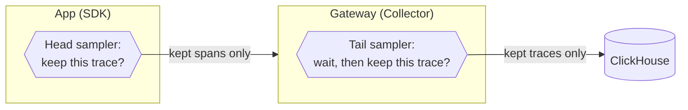
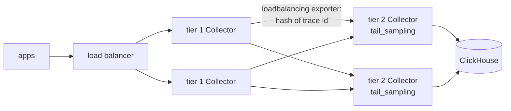
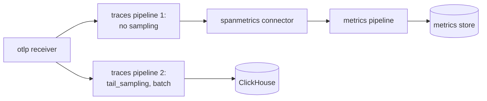

# Module 5: Head and tail sampling (60 min)

## Why this matters

Recording every span of every request costs money: network, gateway memory,
and disk in ClickHouse. **Sampling** means keeping only some traces on purpose.
The hard part is choosing *which* ones without losing the traces you'll need
when something breaks. By the end of this module, you'll be able to say where a
keep-or-drop decision can be made, what each place knows at that moment, what
it costs, and how to turn each kind on in this repo.

## Key terms

From earlier modules you need: a **trace** (all the spans of one request; here,
one agent turn), its **trace id** and **root span** (`agent_turn`), the
**`traceparent`** header that carries them between services, and the SDK's
**sampler** ([module 1](01-otel-core.md)); and the **gateway**, the Collector
that forwards spans to ClickHouse ([module 4](04-collector.md)).

| Term | Plain meaning |
|---|---|
| **Sampling** | Keeping a subset of traces and dropping the rest, on purpose. Each keep-or-drop choice is a **sampling decision** |
| **Head sampling** | Deciding at the very start of a trace, inside the app's SDK |
| **Tail sampling** | Deciding after the whole trace has finished, inside a Collector |
| **Ratio sampling** | Keeping a fixed fraction, such as 30%, chosen from the trace id |
| **Parent-based sampling** | "Do what my parent did": follow the decision the caller already made |
| **Orphan span** | A span whose parent was never recorded, so it hangs loose outside its tree |
| **Policy** | One rule in tail sampling, such as "keep traces with an error" |
| **Load balancer** | Something that spreads incoming requests across several copies (replicas) of a service |

## Idea

### Why sample at all?

Here's a rough, made-up example of the volume involved. A service handles
1,000 requests a second, and each request produces 20 spans. That's 20,000
spans a second, or about 1.7 billion a day. Every one has to be sent over the
network, held in the Collector, written to ClickHouse, and stored on disk.

Most of those traces look the same: a normal request that succeeded at a
normal speed. You don't need a million copies of "it worked". You need:

- **every** trace where something failed,
- **every** trace that was unusually slow,
- **some** normal traces, to know what "normal" looks like.

Sampling is how you keep that useful subset and pay for less. The key question
is **when** you decide, because that decides **what you know** when you decide.

### Head and tail: an analogy

Imagine a sports TV network covering hundreds of amateur matches every
weekend.

- **Head sampling**: on Friday, before any match starts, the network picks
  30% of the matches at random and sends camera crews to those only. It's
  cheap: no crew, no footage. But if a match nobody filmed turns out to be the
  upset of the season, it's gone.
- **Tail sampling**: the network films *every* match. On Sunday night, an editor
  watches the finished footage and keeps the upsets, the injuries, the overtime
  thrillers, plus 10% of the rest. Nothing important is missed. But they need
  storage for a whole weekend of footage, and all the footage of one match
  has to end up in the **same** editing room, or nobody can judge the match as a
  whole.

Back to this repo: a "match" is one agent turn (one trace). "Filming" is
recording and sending spans. The "editing room" is a Collector instance.

### Comparing the two

| | Head sampling | Tail sampling |
|---|---|---|
| Decided | When the **root span starts**, in the app's SDK | After the **whole trace has arrived**, in a Collector |
| Knows | Only the trace id and the attributes set at the start | Everything: errors, total duration, every attribute of every span |
| Can keep "all errors" | No: it decides before anything has failed | Yes |
| Cost | Almost nothing: dropped spans are never even sent | Every span is sent and held in Collector memory until the decision |
| Scaling | Trivial: each service decides locally | Every span of a trace must reach **the same** Collector instance |



You can use either one, or both. If you use both, head sampling cuts the volume
first, and tail sampling chooses among what's left.

### Head sampling in the SDK

A **sampler** runs inside the SDK every time a span starts. It answers one
question: record and send this span, or drop it?

For a **root span** (the start of a new trace), the sampler has to decide on its
own. For a **child span**, it can look at the parent's decision. That decision
travels between services in the `traceparent` header, in the last field (the
flags). The header looks like this:

```text
traceparent: 00-12d64ae6b9afa411e15ca3a7c1726609-201baf240807604d-01
             ^^ ^^^^^^^^^^^^^^^^^^^^^^^^^^^^^^^^ ^^^^^^^^^^^^^^^^ ^^
          version          trace id               parent span id  flags
```

Flags `01` mean the caller sampled (kept) the trace; `00` means it dropped it.
Only the lowest bit means "sampled". Newer versions of the standard use the
next bit for something else (`02` says "this trace id is random"), so `03` also
means sampled. Check the lowest bit, not the whole value.

The Python SDK picks its sampler from environment variables, so you don't
change any code:

| `OTEL_TRACES_SAMPLER` | Behavior |
|---|---|
| `parentbased_always_on` | **The default.** Root spans are always kept; child spans follow their parent |
| `traceidratio` with `OTEL_TRACES_SAMPLER_ARG=0.3` | Keep 30%, decided from the trace id. **Ignores the parent** |
| `parentbased_traceidratio` with `OTEL_TRACES_SAMPLER_ARG=0.3` | Root spans: keep 30% by trace id. Child spans: follow the parent |
| `always_on` / `always_off` | Keep everything, or nothing, ignoring the parent |

#### Ratio sampling

"Keep 30%" can't mean "flip a coin", because then each service would flip its
own coin and keep different parts of the same trace. Instead, a **ratio
sampler** treats the trace id, which is random, as a number and keeps the trace
if that number falls in the lowest 30% of the range. The same trace id always
gives the same answer.

#### Parent-based sampling

**"Parent-based" is what keeps traces whole.** Follow the HR agent's "I need a
new laptop" turn:

1. The `agent_turn` root span starts in `hr-agent`. With
   `parentbased_traceidratio` at 0.3, it's a root, so the ratio rule decides.
   Say the answer is "drop".
2. The agent still runs its tools normally. Its spans just aren't recorded.
   When a tool calls `ticket-api`, the SDK still sends `traceparent`, now with
   flags `00`.
3. `ticket-api` starts its server span. It has a parent, so the parent-based
   sampler reads the flag, sees "dropped", and drops its span too.

The result: either the whole trace is stored, or none of it is.

Now imagine the API used a sampler that ignores the parent, like
`always_on`. It would record its server span even though the agent dropped the
trace. That span points to a parent span id that was never stored. That's an
**orphan**: a piece of a tree with no tree. Orphans make traces confusing and
still cost storage.

Because a ratio sampler decides from the trace id, two services using the same
ratio and the same algorithm happen to make the same decision for the same
trace. Don't rely on that coincidence: different ratios or SDKs break it.
Use parent-based sampling in every service that isn't the start of a trace.

#### Stateless probabilistic sampling in a Collector

There's one more option in between: the `probabilistic_sampler` processor in a
Collector keeps a percentage of traces, chosen from the trace id. It isn't head
sampling: the apps have already recorded and sent every span, so it saves
nothing between the apps and the Collector. It isn't tail sampling either: it
decides span by span as they pass, without holding traces in memory
("stateless"), so it can't know whether a trace failed. Because every span of
a trace has the same trace id, it still keeps or drops whole traces. It's
useful when you can't change the apps' settings. This repo doesn't use it.

### Tail sampling in the Collector

The `tail_sampling` processor works like this:

1. It groups incoming spans by trace id, in memory.
2. It **waits** for `decision_wait` (10 seconds here) after the first span of a
   trace arrives, so the rest of the trace can catch up.
3. It runs the **policies** against the whole trace.
4. A trace is kept if **any** policy says keep. Kept traces go on to the next
   processor (`batch`) and then to ClickHouse. Dropped traces are discarded.

That's simplified: policies can also be combined with `and` and `composite`,
and some can drop traces explicitly. This repo only uses "keep if any matches".

Here is the lab file `docs/tutorial/labs/otel-gateway-tail-sampling.yaml`,
block by block.

```yaml
processors:
  tail_sampling:
    decision_wait: 10s        # hold each trace this long so all its spans arrive
    num_traces: 20000         # traces held in memory at once
```

- `decision_wait: 10s`: wait 10 seconds per trace before deciding. An agent turn
  must finish, and its spans must reach the gateway, within that time, or the
  decision is made on an incomplete trace.
- `num_traces: 20000`: the most traces held in memory at once. If more arrive,
  the oldest are removed from memory. If no decision was made for them yet,
  they're lost.

```yaml
    policies:                 # a trace is kept if ANY policy matches
      - name: keep-errors
        type: status_code
        status_code: { status_codes: [ERROR] }
```

**Keep every trace with an error.** If any span in the trace has status
`ERROR`, keep it. In this repo, that catches the pricing API's random 500
errors (it fails 30% of calls) and the support agent's failed search on its
second turn (the traffic loop passes `--fail-turn 2`).

```yaml
      - name: keep-slow
        type: latency
        latency: { threshold_ms: 1500 }
```

**Keep every slow trace.** If the trace took longer than 1500 ms (1.5 seconds),
from the earliest span's start to the latest span's end, keep it.

```yaml
      - name: keep-10-percent-of-the-rest
        type: probabilistic
        probabilistic: { sampling_percentage: 10 }
```

**Keep 10% of everything else**, chosen from the trace id. This gives you a
baseline of normal traces, so you can compare "slow" with "usual".

```yaml
service:
  pipelines:
    traces:
      processors: [memory_limiter, filter/require_org_labels, resource/org_platform, tail_sampling, batch]
```

This file is **merged** on top of `otel-gateway-config.yaml`. When Collector
config files are merged, maps (key: value sections) combine, but lists replace.
So the whole processor list has to be written out again, with `tail_sampling`
inserted. It goes after the filter and the resource processor, and before
`batch`, so only kept traces are batched.

`docs/tutorial/labs/compose.tail-sampling.yaml` is what makes the gateway load
both files: it changes the gateway's command to pass two `--config` flags, and
mounts the lab file into the container.

Other policy types exist: `string_attribute`, `numeric_attribute`,
`boolean_attribute`, `rate_limiting`, `span_count`, `ottl_condition`,
`trace_state`, `and` and `composite`.

### The trade-offs of tail sampling

**Memory.** Every span of every trace in its wait window sits in the gateway's
memory. Roughly, `num_traces` times the average spans per trace must fit. Size
`num_traces` for your traffic: too small and traces are removed before they're
decided; too big and the gateway hits its `memory_limiter` (module 4) and starts
refusing data.

**Completeness and delay.** The processor can only judge what has arrived by the
end of `decision_wait`. A longer wait catches slower traces, but holds more in
memory and delays when data shows up in ClickHouse. Spans that arrive after the
decision are "late". The processor tries to apply the earlier decision to them,
but once the trace has left memory, a late span can be judged again on its own,
as a fragment.

**Transport cost.** Unlike head sampling, every span still travels from the app
to the gateway. Tail sampling saves the network from the gateway to ClickHouse,
and the storage there, but not the network from the apps to the gateway.

**One trace, one instance.** This is the big one. With several gateway
replicas behind a load balancer, each span is sent to whichever replica is
next. A trace's spans end up spread across replicas, and each replica sees only
part of the trace. One might see the error and keep its part, while another
sees only healthy spans and drops its part. You get fragments.

The fix is two tiers of Collectors:



- **Tier 1** doesn't sample. It uses the **`loadbalancing` exporter** with
  `routing_key: traceID`. That exporter picks a tier 2 instance from the trace
  id, so every span of the same trace goes to the same instance, whichever tier
  1 instance received it.
- **Tier 2** runs `tail_sampling`. Each instance now sees whole traces.

This repo runs a single gateway, so it doesn't need this.

### Sampling changes your counts

After sampling, `count()` in ClickHouse no longer equals the number of
requests. With 10% sampling of normal traffic, 1 stored normal trace stands
for about 10 real ones. And because tail sampling keeps *all* errors but only
*some* successes, the stored error rate looks far higher than the real one.

The numbers you usually want per service are **RED metrics**: rate (requests
counted), errors, and duration (latency). Two ways to keep them right:

- Compute them **before** sampling. A connector (module 4) can't sit "ahead of"
  a processor inside one pipeline, so you use two pipelines that both receive
  from `otlp`, and each gets every span. The first exports to the
  `spanmetrics` connector, which turns every span into RED metrics and feeds
  them to a metrics pipeline. The second runs `tail_sampling` and writes the
  kept traces to ClickHouse. (Not in this repo.)
- Or weight each stored trace by its sampling rate when you count.



In this repo, the `otel.span_red_1m` table (calls, errors and latency per
minute) is filled by a materialized view: a query ClickHouse runs on every
insert into `otel.otel_traces`. It only sees spans that were stored, so it would
undercount if you turned sampling on permanently.

## Remember it

> **Head sampling is a bouncer at the door: fast, cheap, but judges you before
> the party. Tail sampling is a reviewer after the party: knows who caused
> trouble, but has to watch everyone, and everyone from the same group has to
> be watched by the same reviewer.**

And: **parent-based means "do what your parent did"**, which is what keeps
traces whole.

## In this repo

- **Head sampling**: nothing in code. `TracerProvider` in `agent/telemetry.py`
  is created without a sampler, so the SDK reads `OTEL_TRACES_SAMPLER` and
  `OTEL_TRACES_SAMPLER_ARG` from the environment. With neither set, it uses
  `parentbased_always_on`: everything is kept.
- **Tail sampling**: `docs/tutorial/labs/otel-gateway-tail-sampling.yaml`,
  merged into the gateway by `docs/tutorial/labs/compose.tail-sampling.yaml`.
  It's off unless you start the gateway with that compose file.

## Lab (25 min)

Each experiment sets `OTEL_RESOURCE_ATTRIBUTES=lab.run=...`. The SDK adds that
label to the resource of every span, so you can find exactly that experiment's
spans afterwards with `ResourceAttributes['lab.run']`.

Run SQL in <http://localhost:8123/play> (user `default`, password `demo`).

1. **Head sampling at 30%.** First pause the background traffic, so it doesn't
   mix with your experiment:

   ```bash
   ./stack.sh traffic off
   cd agent
   OTEL_RESOURCE_ATTRIBUTES=lab.run=head30 \
   OTEL_TRACES_SAMPLER=parentbased_traceidratio OTEL_TRACES_SAMPLER_ARG=0.3 \
     .venv/bin/python simulate.py --turns 10
   ```

   `simulate.py` starts the four APIs and runs 10 turns in each of the three
   agents. The APIs are started by `simulate.py`, so they inherit the same
   environment variables: the same sampler and the same `lab.run` label.

   Now count what was kept, per service:

   ```sql
   SELECT ServiceName, countIf(SpanName = 'agent_turn') AS turns_kept, uniqExact(TraceId) AS traces
   FROM otel.otel_traces WHERE ResourceAttributes['lab.run'] = 'head30'
   GROUP BY ServiceName ORDER BY ServiceName;
   ```

   `turns_kept` counts root spans (one per kept turn) and `traces` counts
   distinct trace ids. Out of 30 turns (10 per agent), about 9 are kept; a test
   run kept 11. The exact number varies, because trace ids are random. The
   APIs have spans only for kept traces, because they follow the parent.
   (`legacy-hr-api` won't appear at all; the gateway filter drops it, as in
   module 4.)

2. **Inconsistent sampling makes orphans.** Still in the `agent` folder, start
   one API that keeps everything, and an agent that samples 30% *without*
   parent-based sampling:

   ```bash
   OTEL_RESOURCE_ATTRIBUTES=lab.run=orphans OTEL_TRACES_SAMPLER=always_on \
     .venv/bin/python apis.py --service kb-search-api &
   sleep 2
   OTEL_RESOURCE_ATTRIBUTES=lab.run=orphans OTEL_TRACES_SAMPLER=traceidratio OTEL_TRACES_SAMPLER_ARG=0.3 \
     .venv/bin/python run.py --agent support-agent --turns 10
   pkill -f 'apis.py --service'
   ```

   The first command starts `kb-search-api` in the background with
   `always_on`: it records every request, whatever the caller decided. The
   second runs 10 support-agent turns with `traceidratio`. The last stops the
   API.

   This query counts, per service, the traces and the server spans whose
   parent span was never stored in this experiment:

   ```sql
   SELECT ServiceName, uniqExact(TraceId) AS traces,
          countIf(SpanKind = 'Server' AND ParentSpanId NOT IN
                  (SELECT SpanId FROM otel.otel_traces WHERE ResourceAttributes['lab.run'] = 'orphans')) AS orphans
   FROM otel.otel_traces WHERE ResourceAttributes['lab.run'] = 'orphans' GROUP BY ServiceName;
   ```

   A test run: the agent kept 4 traces; the API recorded 10, and 6 of them are
   orphans pointing at parents that don't exist. Those 6 are the turns the
   agent dropped but the API recorded anyway.

3. **Tail sampling at the gateway.** Go back to the repo root and turn the
   traffic on with a round every 10 seconds instead of the default 30, so the
   numbers are big enough to compare. Wait 2 minutes for a baseline, then
   restart the gateway with the tail sampling config:

   ```bash
   cd ..
   TRAFFIC_INTERVAL=10 ./stack.sh traffic on
   sleep 120
   docker compose -f compose.yaml -f docs/tutorial/labs/compose.tail-sampling.yaml up -d otel-gateway
   ```

   Wait 2 more minutes, then compare traces per minute before and after the
   switch. `traces` counts all stored traces; `with_errors` counts those with
   at least one error span:

   ```sql
   SELECT toStartOfMinute(Timestamp) AS m, uniqExact(TraceId) AS traces,
          uniqExactIf(TraceId, StatusCode = 'Error') AS with_errors
   FROM otel.otel_traces WHERE Timestamp > now() - INTERVAL 10 MINUTE
   GROUP BY m ORDER BY m;
   ```

   In a test run with `TRAFFIC_INTERVAL=10`, traces went from about 36 per
   minute to about 15, and most of the kept ones had errors (the pricing API
   fails 30% of the time) or were slow. Your numbers will differ a little; with
   the default 30-second interval they'd be much lower.

   Now check that every kept trace is **complete**. This query takes the
   traces whose root span started between 90 and 30 seconds ago (old enough to
   be decided, and after the switch), and for each one counts root spans and
   spans whose parent is missing from the same trace:

   ```sql
   SELECT count() AS traces, countIf(roots = 1) AS with_root,
          countIf(missing_parents = 0) AS no_missing_parent
   FROM (
     SELECT TraceId, countIf(ParentSpanId = '') AS roots,
            groupArray(SpanId) AS ids, groupArray(ParentSpanId) AS parents,
            arrayCount(p -> p != '' AND NOT has(ids, p), parents) AS missing_parents
     FROM otel.otel_traces
     WHERE TraceId IN (SELECT TraceId FROM otel.otel_traces WHERE ParentSpanId = ''
                       AND Timestamp BETWEEN now() - INTERVAL 90 SECOND AND now() - INTERVAL 30 SECOND)
     GROUP BY TraceId);
   ```

   All three numbers should be equal: every kept trace has its one root span,
   and no span points at a parent that wasn't stored. The sampler kept or
   dropped each trace as a whole. (Compare lab step 2, where `missing_parents`
   would be non-zero for the orphans.)

   Turn tail sampling off again, and put the traffic back to its default
   interval:

   ```bash
   docker compose up -d otel-gateway
   ./stack.sh traffic off && ./stack.sh traffic on
   ```

## Explain it back

> "Head sampling decides in the SDK when the root span starts, usually as a
> ratio of trace ids; it's free, but it can't know whether the trace will fail.
> Children use parent-based sampling, so they follow the decision in the
> `traceparent` flags and traces stay whole. Tail sampling decides in the
> Collector after waiting for the whole trace, so it can keep all errors and
> slow traces plus a percentage of the rest; the cost is memory, and every span
> of a trace has to reach the same Collector, which at scale means a
> load-balancing tier keyed by trace id. Either way, compute your metrics
> before sampling, or weight them."

## Recap

- Sampling keeps a useful subset of traces to cut network, memory and storage
  cost.
- Head sampling decides at the start, in the SDK: cheap, but blind to the
  outcome. Tail sampling decides at the end, in a Collector: it can keep all
  errors and slow traces, but holds every trace in memory while it waits.
- Ratio sampling decides from the trace id. Parent-based sampling makes every
  downstream service follow the root's decision, so traces stay whole and
  there are no orphans.
- This repo's tail policies keep errors, traces slower than 1.5 s, and 10% of
  the rest, after a 10-second wait.
- With several gateways, tail sampling needs a first tier that routes by trace
  id. And after any sampling, raw `count()` no longer equals real traffic.

## Check yourself

<details><summary>Why can't head sampling keep 100% of errors?</summary>

The decision is made when the root span starts, before anything has failed.
Only something that sees the finished trace, like a tail sampler, can choose
by outcome.
</details>

<details><summary>You run 3 gateway replicas behind a round-robin load balancer with tail sampling. What goes wrong?</summary>

Each replica sees roughly a third of each trace's spans and decides on its
own: one may keep the error part while another drops the rest. You get
fragments. Put a `loadbalancing` exporter tier in front, routing by trace id.
</details>

<details><summary>What does <code>decision_wait: 10s</code> trade off?</summary>

Longer waits catch slow, late spans, but hold more traces in memory and add
delay before data is visible. Too short, and long traces are decided before
their last spans arrive; those late spans then arrive after the decision and
can end up as fragments.
</details>

<details><summary>The agent uses <code>parentbased_traceidratio</code> at 0.3. What should the APIs it calls use, and why?</summary>

A parent-based sampler, such as the default `parentbased_always_on` or
`parentbased_traceidratio`. Their spans always have a parent (the agent's
client span), so they just follow the agent's decision from the `traceparent`
flags. A sampler that ignores the parent, like `always_on`, creates orphans, as
in lab step 2.
</details>

<details><summary>With tail sampling on, the stored error rate jumps from 5% to 40%. Did the service get worse?</summary>

Probably not. The `keep-errors` policy keeps every error trace, while
`keep-10-percent-of-the-rest` keeps only a tenth of the normal ones. Errors
are over-represented in what's stored. Compute error rates before sampling
(for example with the `spanmetrics` connector), or weight the counts.
</details>

<details><summary>Why does the tail sampling lab file repeat the whole processor list, instead of just adding <code>tail_sampling</code>?</summary>

When the Collector merges config files, lists are replaced, not appended. The
second file's `processors: [...]` becomes the complete list, so it must include
every processor from the main file plus `tail_sampling`.
</details>

## Next

Whole traces only work if every service joins the same trace: the
`traceparent` header that carries the sampled flag also carries the trace id.
[Module 6](06-cross-environment.md) shows how separate services, and separate
environments with their own gateways, end up in one trace, and what quietly
breaks that.

## Read more

- [Sampling concepts](https://opentelemetry.io/docs/concepts/sampling/)
- [Python SDK sampling](https://opentelemetry-python.readthedocs.io/en/latest/sdk/trace.sampling.html)
- [Tail sampling processor](https://github.com/open-telemetry/opentelemetry-collector-contrib/blob/main/processor/tailsamplingprocessor/README.md)
- [Load-balancing exporter](https://github.com/open-telemetry/opentelemetry-collector-contrib/blob/main/exporter/loadbalancingexporter/README.md)
- [Probabilistic sampler processor](https://github.com/open-telemetry/opentelemetry-collector-contrib/blob/main/processor/probabilisticsamplerprocessor/README.md)
- [Span metrics connector](https://github.com/open-telemetry/opentelemetry-collector-contrib/blob/main/connector/spanmetricsconnector/README.md)
