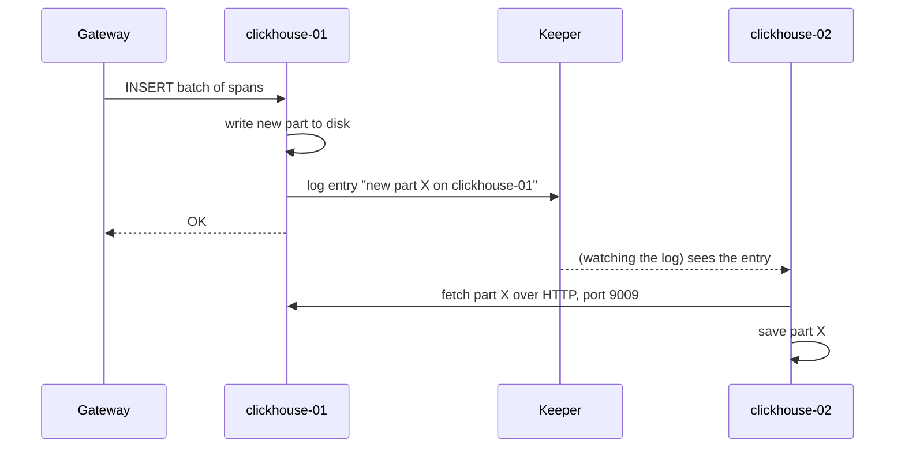

# Module 6: ClickHouse storage, replicas and Keeper (45 min)

## Why this matters

Every span the agents produce ends up as a row in ClickHouse, the database
this repo uses to store traces. To understand why queries are fast, why
the gateway sends spans in batches, and what breaks when a server goes
down, you need a picture of how ClickHouse writes data to disk and how
it keeps two copies in sync.

**What you'll be able to do after this module:**

- Explain what a column-oriented database is and why it suits traces.
- Describe what happens on disk when the gateway inserts a batch of spans:
  parts, merges, partitions, the sorting key.
- Explain how two ClickHouse servers keep the same data, and why that
  needs a third service, ClickHouse Keeper.
- Predict what you'll see when Keeper, one server, or both servers fail,
  and then check it by breaking them on purpose.

## Key terms

| Term | Plain meaning |
|---|---|
| Column-oriented database (column store) | A database that stores each column in its own file, instead of storing whole rows together |
| Table engine | The part of ClickHouse that decides how a table's data is stored on disk. `MergeTree` is the main one |
| MergeTree | ClickHouse's main table engine: data arrives in small sorted chunks that are merged in the background |
| Part | One immutable (never edited) chunk of a table on disk. Every insert creates a new part |
| Merge | A background job that combines several small parts into one bigger part |
| Sorting key (`ORDER BY`) | The columns a table's rows are sorted by inside each part |
| Primary key / sparse index | A small index with one entry per 8192 rows, used to skip data that can't match a filter |
| Granule | A block of 8192 rows: the smallest unit ClickHouse reads |
| Mark | One index entry, pointing to the start of one granule |
| Cardinality | How many distinct values a column has. `SpanKind` has a handful (low); `TraceId` has millions (high) |
| Partition | A group of parts for one value of the partition key; here, one day of spans |
| TTL (time to live) | A rule that deletes data automatically once it reaches a certain age |
| Materialized view | A trigger that runs a query on every insert and writes the result to another table |
| Replica | A full copy of a table on another server |
| ClickHouse Keeper | A small coordination service that replicas use to agree on which parts exist. It stores no span data |
| Raft, quorum | The voting method Keeper uses: a change counts only once a majority (the quorum) of Keeper servers has saved it |
| Macro | A per-server variable in ClickHouse config, like `{replica}` = `clickhouse-01` |

## Idea

### The running example

Take one request. A user asks the HR assistant, "I need a new laptop." The
`hr-agent` service starts a trace (the record of the whole request, module
1). It creates an `agent_turn` span (a record of one timed operation,
module 1), then spans for the LangGraph run, the `hr_assistant` agent,
its model call (`chat fake-hr`), and its tool calls (`lookup_employee`,
`create_ticket`). The `create_ticket` tool calls the `ticket-api` HTTP
service, which records its own span in the same trace.

Each of those spans goes over OTLP (the OpenTelemetry Protocol, module 1)
to the gateway (the OpenTelemetry Collector, module 4). The gateway mixes
them with spans from the other agents, and once it has 1000 spans or 5
seconds have passed, sends the batch as a single `INSERT` into the
`otel.otel_traces` table on `clickhouse-01`. The rest of this module follows that insert.

### Why a column store suits traces

**The problem.** A typical tracing question is "what was the slowest
`agent_turn` per service in the last hour?" That touches 4 fields:
time, service, span name and duration. But each span row in this repo has
48 columns, including big ones like the attribute maps. A database that
stores whole rows together has to read all 48 columns from disk just to
look at 4 of them.

**What a column store does.** ClickHouse stores each column in its own
file. A query reads only the files for the columns it uses.

```text
Row store: rows stored one after another     Column store: one file per column
-----------------------------------------    -----------------------------------------------
[09:00:01, trace-a, agent_turn, 900 ms, ...] Timestamp : 09:00:01, 09:00:01, 09:00:02, ...
[09:00:01, trace-a, chat,       400 ms, ...] TraceId   : trace-a,  trace-a,  trace-b,  ...
[09:00:02, trace-b, agent_turn, 700 ms, ...] SpanName  : agent_turn, chat, agent_turn, ...
                                             Duration  : 900 ms,   400 ms,   700 ms,   ...
To read Duration, you read every row.        To read Duration, you read one file.
```

There's a second win: **compression**. Values in one column file are all
the same type and often repeat (`agent_turn`, `agent_turn`, `chat`...), so
they compress very well. You'll measure this in the lab.

The trade-off: column stores are bad at changing single rows. That's fine
for traces: spans are written once and never edited.

### Tables, engines and MergeTree

Every ClickHouse table has a **table engine**, which decides how its data
is stored. Almost every real table uses the **MergeTree** family. Variants
add behavior on top: `ReplicatedMergeTree` keeps copies on several servers,
`ReplacingMergeTree` removes duplicate rows, `AggregatingMergeTree` keeps
running totals. This repo uses all three (module 10 walks through each
table).

### Parts and background merges

**The problem.** Keeping one big sorted file per column, and inserting new
rows into the middle of it, would mean rewriting the file on every insert.
That's far too slow when spans arrive every second.

**What MergeTree does instead.** The life of an insert:

1. Every `INSERT` writes a new **part**: a folder holding the inserted rows,
   column by column, sorted by the table's `ORDER BY`. A part is
   **immutable**: once written, it's never edited.
2. In the background, ClickHouse **merges** small parts into bigger ones.
   Because each part is already sorted, merging is cheap, like merging two
   sorted decks of cards. The merged part replaces the small ones, which are
   deleted shortly after.
3. Each part has a **level**: 0 for a freshly inserted part, and one more
   than the highest of its inputs after each merge.

```text
INSERT (1000 spans) ──▶ part 20261121_5_5_0   level 0
INSERT (1000 spans) ──▶ part 20261121_6_6_0   level 0
INSERT (1000 spans) ──▶ part 20261121_7_7_0   level 0
                               │
                      background merge
                               ▼
                       part 20261121_5_7_1    level 1, 3000 rows, still sorted
```

**Reading a part name.** Names read `partition_minBlock_maxBlock_level`.
Every insert into a partition gets the next **block number**, so a part
covers a range of inserts. For example, `20261121_0_467_107` is the
2026-11-21 partition, holding inserts 0 to 467, after 107 rounds of
merging.

**What goes wrong: "too many parts".** Each insert creates a part, and
merges take time. If clients send many tiny inserts (one span at a time,
say), parts pile up faster than merges can combine them. Queries get slower,
because they have to open many small parts, and eventually ClickHouse
rejects inserts with a **"too many parts"** error.

That's why the gateway **batches**: its `batch` processor collects spans and
sends one insert when 1000 have arrived or 5 seconds have passed, whichever
comes first (`otel-gateway-config.yaml`). For setups
with many small clients and no batching layer, ClickHouse offers
`async_insert`: the server collects small inserts in memory and writes them
as one part.

### The sorting key and the sparse primary index

**The problem.** Even reading only the right columns, you don't want to
read every row of them. For "spans of the `hr-agent` service", you'd like
to jump straight to that service's rows.

**What ClickHouse does.** The table's `ORDER BY` decides how rows are
sorted inside each part:

```sql
ORDER BY (org_owner, org_service, SpanName, toDateTime(Timestamp))
```

Rows are sorted by owner team first, then service within each owner, then
span name, then time (to the second). So all `people-tech` / `hr-agent` /
`agent_turn` rows sit next to each other.

ClickHouse doesn't keep an index entry for every row; that index would be
huge. Instead it splits each part into **granules** of 8192 rows and keeps
one index entry, a **mark**, per granule: the key values of the granule's
first row. This is a **sparse index**. It's like the guide words at the top
of each dictionary page: you don't need an entry per word to find the right
page.

```text
primary index of one part (one mark per 8192 rows)
mark 0 ─▶ ('ai-platform', 'support-agent', 'agent_turn', 09:00:00)
mark 1 ─▶ ('ai-platform', 'support-agent', 'chat ...',   09:00:00)
mark 2 ─▶ ('people-tech', 'hr-agent',      'agent_turn', 09:00:00)   ◀─ hr-agent starts here
mark 3 ─▶ ('people-tech', 'hr-agent',      'execute_tool ...', ...)
mark 4 ─▶ ('sales-eng',   'sales-agent',   'agent_turn', 09:00:00)   ◀─ and has ended by here
```

For `WHERE org_owner = 'people-tech' AND org_service = 'hr-agent'`,
ClickHouse looks at the marks, sees the matching rows can only be in
granules 2 and 3, and reads just those. (The values above are only an
illustration; real granules hold 8192 rows each.)

The index works best for filters on the **start** of the key (owner, then
owner and service, and so on). A filter on a column that isn't in the key
at all, like `TraceId = '...'`, can't use it, and ClickHouse would read
every granule. Module 7 covers the extra indexes that fix that.

**Choosing a key.** Pick it from your most common filters, and put
**low-cardinality columns first** (cardinality is the number of distinct
values). A few owners, then more services, then more span names, then time.
Low-cardinality columns first create long runs of equal values, which
keeps the later columns sorted within each run and makes everything
compress better. This key fits "show me this team's service" queries.

### Partitions and TTL

**The problem.** Spans are only useful for a few days, and this repo keeps
raw spans for 72 hours. Deleting old rows one by one would mean rewriting
parts, which is slow and costly.

**What partitions do.** `PARTITION BY toDate(Timestamp)` puts each day's
spans in separate parts, like keeping one folder per day in a filing
cabinet. The partition is the first part of each part's name (`20261121`).
Two rules follow:

- Parts **never merge across partitions**. A Monday part and a Tuesday part
  always stay separate.
- So a whole day can be dropped by deleting its folders, which is instant.

**TTL** (time to live) automates that:

```sql
TTL toDateTime(Timestamp) + INTERVAL 72 HOUR
SETTINGS ttl_only_drop_parts = 1
```

The first line says "a row expires 72 hours after its timestamp". The
setting says "don't rewrite parts to remove some of their rows; wait until
**every** row in a part has expired, then drop the whole part". Because
each part holds only one day, that happens soon after the day is 72 hours
old.

Partitions are mainly for **managing data**, not for speed. A time filter
can skip whole partitions, but the sorting key does most of the speed work.
Keep partitions coarse: one per day is good. One per hour, or one per
service, multiplies the number of parts and brings back the "too many
parts" problem.

### Materialized views are insert triggers

**The problem.** Some questions are asked all the time: "list today's
requests", "error rate per service per minute". Answering them from raw
spans every time is wasteful.

**What a materialized view does.** In ClickHouse, a materialized view is
**a trigger on insert**. Every time a block of rows is inserted into the
source table, the view runs its `SELECT` on **just those new rows** and
writes the result into a target table. Think of a restaurant order ticket
with a carbon copy: when the order is written, the kitchen and the bill
each get their own copy automatically.

Here, every span insert into `otel_traces` also fills three tables:

| Table | Engine | Purpose |
|---|---|---|
| `otel_traces_trace_id_ts` | ReplicatedMergeTree | Trace id to time range, so a trace lookup can narrow the time range first |
| `trace_entry` | ReplicatedReplacingMergeTree | One row per request (entry or root span): the "trace list" page |
| `span_red_1m` | ReplicatedAggregatingMergeTree | Rate, errors and duration (RED) per service and span name per minute, kept 1 year |

So the HR request's spans land in `otel_traces`, its `agent_turn` span adds
a row to `trace_entry`, and every span updates the per-minute counts in
`span_red_1m`. Module 10 explains each of these tables and engines.

### Replication: why one server isn't enough

**The problem.** With one ClickHouse server, a crash, a restart for an
upgrade, or a broken disk means no new spans can be stored, and possibly
data lost for good.

**What replication does.** A `ReplicatedMergeTree` table keeps a full copy
on each of several servers, called **replicas**. This repo runs two:
`clickhouse-01` and `clickhouse-02`. Both hold all the spans.

Each replica needs two pieces of identity, which come from **macros**
(per-server variables in ClickHouse config). Here is
`clickhouse/macros-01.xml`:

```xml
<macros>
    <cluster>tracing</cluster>         <!-- the cluster this server belongs to -->
    <shard>01</shard>                  <!-- which slice of the data (module 7); only one here -->
    <replica>clickhouse-01</replica>   <!-- this server's name among the replicas -->
</macros>
```

`macros-02.xml` is identical except for `<replica>clickhouse-02</replica>`.
The table registers itself in Keeper at the default path
`/clickhouse/tables/{uuid}/{shard}`. `{uuid}` is the table's unique id,
the same on both servers. So both replicas meet at the same path, and each
signs in under its own `{replica}` name.

**What happens on insert:**



1. The gateway inserts into one replica. Its endpoint lists both
   servers (`tcp://clickhouse-01:9000,clickhouse-02:9000`). It uses
   `clickhouse-01`, and switches to `clickhouse-02` if it can't connect.
2. That replica writes the part to its own disk and adds a "new part" entry
   to the table's **log** in Keeper.
3. The other replica watches the log, sees the entry, and **downloads the
   part directly from its peer** over HTTP (the interserver port, 9009).
   The span data never goes through Keeper; only the short log entry does.

So replication is:

- **Asynchronous**: the insert returns once the first replica has the
  part. The second catches up a moment later.
- **Multi-leader**: any replica can take writes. An insert into
  `clickhouse-02` replicates to `clickhouse-01` the same way.

If you need an insert to wait until several replicas have it, the
`insert_quorum` setting does that, at the cost of slower inserts.

**Insert deduplication.** Suppose the gateway sends a batch, the network
times out before the "OK" comes back, and the gateway sends the same batch
again. Replicated tables keep a hash (a short fingerprint) of each recent
inserted block in Keeper, in a node called `blocks`. If an identical block
arrives again, ClickHouse ignores it. So retries don't create duplicate
spans.

### Keeper: the coordinator

**The problem.** Two replicas that both accept writes and both merge parts
need to agree on things: which parts exist, which merge to do next, which
schema change to apply. Without a referee, they could make different
choices and drift apart.

**What Keeper is.** ClickHouse Keeper is a small coordination service that
holds that shared state. It's compatible with Apache ZooKeeper (an older
tool that does the same job), which is why ClickHouse config calls it
`<zookeeper>` and the system table is `system.zookeeper`. It stores:

- each replicated table's log of new parts, merges and other changes
- the list of parts each replica has
- the hashes of recent insert blocks, for deduplication
- the queue of `ON CLUSTER` commands. A schema change written once with
  `ON CLUSTER tracing` is queued there, and each server picks it up and runs it

It does **not** store span data.

**Raft and quorum.** In production you run several Keeper servers, so that
Keeper itself isn't a single point of failure. They use the **Raft**
consensus algorithm: they elect a leader, and a change counts only once a
**majority** of Keeper servers (the **quorum**) has saved it. That way, two
halves of a broken network can never both accept conflicting changes.
Run 3 Keepers to survive 1 failure, or 5 to survive 2.

This repo runs **one** Keeper, for simplicity. `clickhouse/keeper.xml` lists
a single server in its `raft_configuration`:

```xml
<keeper_server>
    <tcp_port>9181</tcp_port>          <!-- ClickHouse servers connect here -->
    <server_id>1</server_id>           <!-- this Keeper's id -->
    <raft_configuration>
        <server>                       <!-- the only voting member -->
            <id>1</id>
            <hostname>clickhouse-keeper</hostname>
            <port>9234</port>          <!-- Keeper-to-Keeper (Raft) traffic -->
        </server>
    </raft_configuration>
</keeper_server>
```

With one member, the majority is 1, so it works alone. But if it stops,
there's no Keeper at all, so replicated tables can't accept writes.

### Failure modes

| What fails | What you see | What happens to data |
|---|---|---|
| **Keeper** | Replicated tables go **read-only**: `Code: 242 TABLE_IS_READ_ONLY`. Selects still work | Gateway retries; nothing lost if Keeper returns within `max_elapsed_time` (300 s) |
| **One replica** | `active_replicas = 1`. The other replica takes all writes | The returning replica fetches the missing parts from its peer |
| **Both replicas** | Inserts fail | Gateway queue and retries, then data loss after 300 s |
| **Too many small inserts** | `Too many parts` errors | Inserts rejected until merges catch up |
| **Disk full** | Inserts and merges fail | Same as an outage |
| **Lag** | `absolute_delay` and `queue_size` grow in `system.replicas` | Reads from that replica are stale |

Why each one behaves that way:

- **Keeper down.** A replica can't write a part without logging it in
  Keeper; otherwise the other replica would never hear about it. So
  replicated tables refuse writes (read-only). Reading needs only the local
  parts, so selects keep working. The gateway holds failed batches in its
  queue and retries them (`retry_on_failure` in `otel-gateway-config.yaml`,
  for up to 300 seconds), so a short Keeper outage loses nothing.
- **One replica down.** The other replica still has Keeper and takes all
  writes. When the stopped replica returns, it reads the log in Keeper,
  sees the parts it missed, and fetches them from its peer.
- **Both replicas down.** There's nowhere to write. The gateway retries for
  300 seconds; after that, it gives up on those batches and they're lost.
- **Too many small inserts.** See "Parts and background merges" above.
- **Disk full.** A new part can't be written, and a merge can't write its
  output either.
- **Lag.** A replica that's busy or was down has a backlog of parts to fetch
  (`queue_size`) and is behind by some seconds (`absolute_delay`). Queries
  on it see slightly old data until it catches up.

## Remember it

> **Parts are Lego bricks: every insert is a new brick, merges glue small
> bricks into big ones, and too many small bricks jam the machine.**
>
> **Keeper is the notary, not the warehouse.** It records which bricks exist
> and in what order; replicas ship the bricks to each other. If the notary is
> away, nobody may add bricks (read-only), but everyone can still look at them.

## In this repo

- `clickhouse/cluster.xml`: the `tracing` cluster (1 shard, 2 replicas) and
  the Keeper address (`clickhouse-keeper:9181`), plus the Keeper path for the
  `ON CLUSTER` command queue (`/clickhouse/task_queue/ddl`).
- `clickhouse/macros-01.xml`, `macros-02.xml`: the `{shard}` and `{replica}`
  values for each server.
- `clickhouse/keeper.xml`: the single Keeper node.
- `clickhouse/schema.sql`: all tables and materialized views, created with
  `ON CLUSTER tracing` so they appear on both servers.
- `compose.yaml`: the `clickhouse-init` service applies the schema, then
  waits until all four replicated tables are writable on both servers,
  before the gateway starts.
- `otel-gateway-config.yaml`: the `batch` processor (1000 spans or 5 s) and
  the exporter's `retry_on_failure` (up to 300 s).

Module 10 walks through every table's DDL (the `CREATE TABLE` statements),
and shows how to add a replica or copy data to another ClickHouse server.

## Lab (25 min)

Keep the background traffic on for this module (`./stack.sh traffic on`), so
new spans keep arriving. Run the SQL in the Play UI at
<http://localhost:8123/play> (that's `clickhouse-01`). The `system.*` tables
used below are built-in, read-only tables in which ClickHouse describes its
own state.

1. **Parts and merges.** This lists the live parts of `otel_traces`
   (`active` excludes old parts that a merge has already replaced). Run it
   twice, a minute apart:

   ```sql
   SELECT name, partition, rows, formatReadableSize(bytes_on_disk) AS size, level
   FROM system.parts WHERE database = 'otel' AND table = 'otel_traces' AND active ORDER BY name;
   ```

   You'll see one big part with a high `level`, plus a few small `level 0`
   parts, one per gateway batch. The second time, the small ones have been
   merged in, and new small ones have appeared. Read a name or two using the
   `partition_minBlock_maxBlock_level` pattern.

2. **Compression per column.** This compares each column's size on disk
   (compressed) with its size in memory (raw), for the 8 biggest columns:

   ```sql
   SELECT name, formatReadableSize(sum(data_compressed_bytes)) AS compressed,
          formatReadableSize(sum(data_uncompressed_bytes)) AS raw
   FROM system.columns WHERE database = 'otel' AND table = 'otel_traces'
   GROUP BY name ORDER BY sum(data_compressed_bytes) DESC LIMIT 8;
   ```

   `SpanAttributes` compresses about 13 times (3.2 MiB to 250 KiB in a test
   run): its keys and many values repeat from span to span. Random ids
   (`SpanId`) only compress about 2 times: random values have no repeats to
   exploit.

3. **What Keeper holds.** The first query shows this replica's view of
   replication. The second lists what Keeper stores under the table's path:

   ```sql
   SELECT zookeeper_path, replica_name, is_leader, queue_size, absolute_delay, active_replicas
   FROM system.replicas WHERE table = 'otel_traces';

   SELECT name FROM system.zookeeper
   WHERE path = (SELECT zookeeper_path FROM system.replicas WHERE table = 'otel_traces' AND database = 'otel');
   ```

   In the first result, `zookeeper_path` is the
   `/clickhouse/tables/{uuid}/{shard}` path with the values filled in,
   `queue_size` and `absolute_delay` should be near 0, and
   `active_replicas` should be 2. In the second, you'll see `log`, `blocks`,
   `replicas`, `mutations` and more: metadata only, no spans.

4. **Stop Keeper.** This stops the Keeper container, waits for the servers
   to notice, checks whether the tables are read-only, then tries an insert:

   ```bash
   docker stop clickhouse-keeper
   sleep 30
   docker exec clickhouse-01 clickhouse-client --password demo -q \
     "SELECT table, is_readonly FROM system.replicas WHERE database = 'otel'"
   docker exec clickhouse-01 clickhouse-client --password demo -q \
     "INSERT INTO otel.trace_entry (TraceId) VALUES ('x')"
   ```

   All four tables show `is_readonly = 1`, and the insert fails (it can take a
   while to give up):

   ```text
   Code: 242. DB::Exception: Table is in readonly mode: replica_path=/clickhouse/tables/.../01/replicas/clickhouse-01. (TABLE_IS_READ_ONLY)
   ```

   Notice the `replica_path` in the message: it's the Keeper path, plus
   `replicas/clickhouse-01`, this server's `{replica}` name.

   Reads still work; try any `SELECT`. The gateway logs
   `Exporting failed. Will retry the request after interval.` (see it with
   `docker logs otel-gateway`). Now bring Keeper back within 5 minutes, before
   the gateway's 300-second retry limit runs out:

   ```bash
   docker start clickhouse-keeper
   sleep 30
   ```

   Then count spans per minute for the last 10 minutes:

   ```sql
   SELECT toStartOfMinute(Timestamp) AS m, count() FROM otel.otel_traces
   WHERE Timestamp > now() - INTERVAL 10 MINUTE GROUP BY m ORDER BY m;
   ```

   The minutes during the outage have spans: they waited in the gateway's
   queue and were written once Keeper was back. Nothing was lost.

5. **Stop one replica.** This stops `clickhouse-02`, checks the replica
   count from `clickhouse-01`, starts it again, then counts spans on each
   server:

   ```bash
   docker stop clickhouse-02
   sleep 40
   docker exec clickhouse-01 clickhouse-client --password demo -q \
     "SELECT total_replicas, active_replicas FROM system.replicas WHERE table = 'otel_traces'"
   docker start clickhouse-02
   sleep 30
   docker exec clickhouse-01 clickhouse-client --password demo -q \
     "SELECT hostName(), count() FROM clusterAllReplicas('tracing', otel.otel_traces) GROUP BY 1"
   ```

   While it's down: `2  1` (two replicas, one active), and writes continue on
   `clickhouse-01`. `clusterAllReplicas('tracing', ...)` runs the query on
   every replica of the `tracing` cluster and returns all the results
   together. After `clickhouse-02` is back, both servers report the same
   count: the returning replica fetched every part it missed.

## Explain it back

> "ClickHouse stores each column separately and sorted by the table's
> `ORDER BY`, with a sparse index of one mark per 8192 rows, so filters on the
> key prefix skip most of the data. Every insert becomes an immutable part, and
> merges combine parts in the background, which is why we batch inserts. We
> partition by day so TTL can drop whole days. ReplicatedMergeTree keeps two
> replicas: an insert to either one is logged in Keeper, and the other replica
> fetches the part directly. Keeper only holds metadata, using Raft. If Keeper
> is down, tables go read-only, but reads still work and the gateway retries;
> if one replica is down, the other carries on, and the first catches up when
> it returns."

## Recap

- A column store reads only the columns a query uses, and compresses each
  column well. Tracing queries touch few columns over many rows, so it fits.
- Every insert creates an immutable, sorted part. Background merges combine
  parts. Too many small inserts cause "too many parts", so the gateway
  batches.
- `ORDER BY` sorts rows inside each part. The sparse index (one mark per
  8192-row granule) skips granules for filters on the start of the key.
- Partitions (one per day here) never merge with each other, so TTL can drop
  a whole day at once.
- Materialized views run on each insert and fill summary tables.
- Replicas are full copies. Keeper holds the log of parts, not the data;
  replicas fetch parts from each other.
- Keeper down: read-only, reads OK. One replica down: the other carries on.
  Both down: the gateway retries for 300 seconds, then drops data.

## Check yourself

<details><summary>Does the data go through Keeper during replication?</summary>

No. Keeper holds the log entry "part X exists on replica A"; replica B
downloads the part from replica A directly (the interserver HTTP port, 9009).
</details>

<details><summary>Why does the gateway batch spans instead of inserting each one as it arrives?</summary>

Every insert creates a new part. One span per insert would create parts far
faster than merges can combine them, slowing queries and finally triggering
"too many parts" errors. Batching (1000 spans or 5 seconds) turns many spans
into one part.
</details>

<details><summary>A query filters on <code>TraceId</code> only. Can the primary index help?</summary>

No. `TraceId` isn't in the sorting key, so the marks say nothing about
where a trace id might be, and ClickHouse would have to read every granule.
Module 7 covers the bloom filter index and the lookup table that fix this.
</details>

<details><summary>Why would partitioning by <code>ServiceName</code> be a bad idea?</summary>

Parts never merge across partitions, so many services times many days means
many small parts, slower merges and "too many parts" errors. Partition by
time, for retention; put the service in the sorting key, for speed.
</details>

<details><summary>Why run 3 Keepers in production, not 2?</summary>

Raft needs a majority. With 2 nodes, the majority is 2, so losing either one
stops the cluster, which is no better than having 1. With 3, the majority is
2, so the cluster survives one failure.
</details>

<details><summary>Keeper is down. Can you still run dashboards on the spans?</summary>

Yes. Reads only need the parts already on each server's disk. Only writes
(and merges, which must be logged) stop until Keeper returns.
</details>

<details><summary>The gateway times out mid-insert and retries the same batch. Do you get duplicate spans?</summary>

Usually not. Replicated tables keep hashes of recent insert blocks in Keeper
and ignore an identical block. This only works if the retried batch is
byte-for-byte the same.
</details>

## Read more

- [MergeTree engine](https://clickhouse.com/docs/engines/table-engines/mergetree-family/mergetree)
- [Sparse primary indexes: a practical guide](https://clickhouse.com/docs/guides/best-practices/sparse-primary-indexes)
- [Table parts](https://clickhouse.com/docs/parts)
- [Table partitions](https://clickhouse.com/docs/partitions)
- [Data replication](https://clickhouse.com/docs/engines/table-engines/mergetree-family/replication)
- [ClickHouse Keeper](https://clickhouse.com/docs/guides/sre/keeper/clickhouse-keeper)
- [Materialized views](https://clickhouse.com/docs/materialized-view/incremental-materialized-view)
- [Asynchronous inserts](https://clickhouse.com/docs/optimize/asynchronous-inserts)
- [Insert deduplication](https://clickhouse.com/docs/guides/developer/deduplicating-inserts-on-retries)
