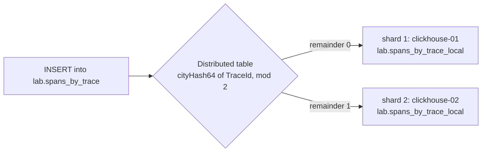

# Module 7: Sharding, trace locality and indexes (25 min)

## Why this matters

Module 6 showed how two replicas keep the **same** data for safety. That
doesn't help when you have more spans than one server can store or write.
For that you split the data across servers, called **sharding**, and the
way you split it decides whether a trace stays in one place or ends up
scattered. This module also covers the extra indexes that make lookups like
"find this trace id" fast, even though the trace id isn't in the table's
sorting key.

**What you'll be able to do after this module:**

- Draw the difference between replicas and shards.
- Explain what a `Distributed` table does on insert and on select.
- Explain why sharding by `cityHash64(TraceId)` keeps every trace on one
  shard, and why that matters.
- Pick a skip index (bloom filter, `minmax`, `set`) for a filter, and check
  with `EXPLAIN` that it actually skips data.

## Key terms

| Term | Plain meaning |
|---|---|
| Replica | A full **copy** of the data on another server (module 6) |
| Shard | A **slice** of the data. Each shard holds different rows |
| Cluster | A named list of servers, grouped into shards and replicas, in `clickhouse/cluster.xml` |
| Local table | The ordinary table on each server that actually stores that shard's rows |
| `Distributed` table | A table that stores nothing. It forwards inserts to shards and collects query results from them |
| Sharding key | An expression computed for each row that decides which shard it goes to |
| Hash function | A function that turns a value (like a trace id) into a number. Same input, same number, every time |
| Trace locality | All spans of one trace stored on the same shard |
| Hot shard | One shard getting much more data or traffic than the others |
| Skip index | An extra index that stores a small summary per block of granules, so ClickHouse can skip blocks that can't match |
| Bloom filter | A compact summary that answers "definitely not here" or "maybe here" for a value |
| False positive rate | How often a bloom filter says "maybe" for a value that isn't there; `0.001` means about 1 in 1000 |
| Granule | 8192 rows, the smallest unit ClickHouse reads (module 6) |
| Mutation | A background job that rewrites existing parts, for example to build a new index for old data |
| Projection | A hidden second copy of the data inside each part, sorted another way |

## Idea

### Shards and replicas

**The problem.** Replication (module 6) gives you copies. Two replicas each
hold *all* the spans, so adding replicas makes the system safer and adds
read capacity, but every replica still has to store and write everything.
Once spans outgrow one server's disk or write speed, more copies don't
help.

**The fix: sharding.** Split the rows into slices and put each slice on a
different server. Each server then stores and writes only its share.

| | Replica | Shard |
|---|---|---|
| Is | A **copy** of the same data | A **slice** of the data |
| Adds | Availability and read capacity | Storage and write capacity |
| Here | `tracing`: 1 shard, 2 replicas | `lab_2shards` (lab only): the same 2 servers seen as 2 shards |

A picture of the three set-ups:

```text
Replication only: "tracing" cluster in this repo (1 shard x 2 replicas)
  clickhouse-01  [ all spans ]
  clickhouse-02  [ all spans ]          same data twice: safe, but no extra space

Sharding only: "lab_2shards" in this module's lab (2 shards x 1 replica)
  clickhouse-01  [ traces A, C, E ... ]
  clickhouse-02  [ traces B, D, F ... ] each holds about half: more space, no copies

Both: a typical production cluster (3 shards x 2 replicas = 6 servers)
                 shard 1        shard 2        shard 3
  replica a    [ slice 1 ]    [ slice 2 ]    [ slice 3 ]
  replica b    [ slice 1 ]    [ slice 2 ]    [ slice 3 ]
```

A real cluster usually has both: shards for size, and replicas of each
shard for safety.

Both clusters are defined in `clickhouse/cluster.xml`. `tracing` has one
`<shard>` with two `<replica>` entries. `lab_2shards` has two `<shard>`
entries with one `<replica>` each, pointing at the same two servers. That
works because a cluster definition is only a list of addresses; the lab
creates separate tables for it.

### The Distributed table

**The problem.** With several shards, someone has to decide which shard
each new span goes to, and every query has to ask all shards and combine
the answers. You don't want the gateway or every query writer doing that
by hand.

**What it is.** A `Distributed` table stores nothing itself. It's a router
sitting in front of a **local table** with the same columns on each shard,
like a mail sorting office that never keeps letters:

- **Insert**: for each row, compute the **sharding key**, divide it by the
  total shard weight and take the remainder (modulo), and send the row to
  that shard's local table. With two shards of weight 1, remainder 0 means
  shard 1 and remainder 1 means shard 2.
- **Select**: send the query to every shard, let each one work on its own
  slice, and merge the partial results into one answer.



The lab creates one like this:

```sql
CREATE TABLE lab.spans_by_trace AS lab.spans_by_trace_local
ENGINE = Distributed(lab_2shards, lab, spans_by_trace_local, cityHash64(TraceId));
```

Reading it piece by piece:

- `AS lab.spans_by_trace_local`: copy the column list from the local table.
- `Distributed(`: the router engine. Its four arguments are:
  - `lab_2shards`: the cluster, which lists the shards.
  - `lab`: the database of the local table on each shard.
  - `spans_by_trace_local`: the local table that really stores the rows.
  - `cityHash64(TraceId)`: the sharding key. `cityHash64` is a fast hash
    function that turns the trace id string into a 64-bit number.

Two details you'll meet in the lab and config:

- By default, a `Distributed` insert returns right away and forwards rows to
  the shards in the background. The lab sets
  `distributed_foreground_insert = 1`, so the insert waits until every row
  has reached its shard, and the counts you query right after are complete.
- `<internal_replication>true</internal_replication>` in `cluster.xml`
  means: when a shard has several replicas, write each row to just one of
  them and let replication (module 6) copy it. Without it, the
  `Distributed` table would write to every replica itself.

**Why this repo has no `Distributed` tables.** The `tracing` cluster has one
shard, so there's nothing to route between. The gateway writes straight
into `otel_traces`, and replication copies it. The comment at the top of
`clickhouse/schema.sql` says the same.

### Why `cityHash64(TraceId)` keeps a trace together

Follow the HR example from module 6. One user question to the HR assistant
produces spans from `hr-agent` (the turn, the agent, the model and tool
calls) and from `ticket-api` (its HTTP span). They arrive at the gateway
separately, from two different services, possibly seconds apart and in
different batches. But they all carry the same trace id.

The shard is a pure function of the trace id: same trace id, same hash,
same remainder, same shard. So every span of a trace lands on the **same
shard**, whichever service sent it and whenever it arrived. That gives you
three things:

1. **Trace lookups hit one shard.** With `optimize_skip_unused_shards = 1`,
   ClickHouse computes the shard from `WHERE TraceId = '...'` and asks only
   that one, instead of every shard.
2. **Per-trace work stays local.** Building a span tree (which span is the
   parent of which), or computing a trace's total duration, needs no data
   from other shards.
3. **Even spread.** Trace ids are random, so their hashes are spread
   evenly, and each shard gets about the same share.

Compare the alternatives:

- **A random key** (`rand()`) also spreads rows evenly, but scatters every
  trace over all shards. Every trace query then has to ask every shard and
  stitch the pieces together.
- **The service name** keeps a service's spans together, but a trace crosses
  services, so traces get split. And one busy service overloads its shard
  (a **hot shard**).

**A production variant.** Instead of inserting through a `Distributed`
table, a gateway tier can route by trace id itself (the `loadbalancing`
exporter, from module 5) and write straight to each shard's local table.
The principle is the same: **shard by trace id**.

### Indexes you can add

**The problem.** Module 6 showed the sorting key
`(org_owner, org_service, SpanName, toDateTime(Timestamp))`. It makes
"this team's service" queries fast. But the most common trace query,
"show me trace `4bf9...`", filters on `TraceId`, which isn't in the key.
On its own, the primary index can't help, and ClickHouse would read the
`TraceId` column for every granule of every part.

You can only have one sorting key, because rows can only be physically
sorted one way. For other filters, ClickHouse offers several tools:

| Tool | What it does | Use for |
|---|---|---|
| **Sorting key** (`ORDER BY`) | Sparse primary index; the only physical order | Your most common filters (here: owner, service, span name, time) |
| **MATERIALIZED column** | Pulls a value out of a map into a real column on insert | Map keys you filter or group by often |
| **Skip index** `minmax` | Min and max per index block | Ranges on values that rise with time or cluster (duration) |
| **Skip index** `set(N)` | Up to N distinct values per block | Low-cardinality columns (agent name) |
| **Skip index** `bloom_filter` | "Definitely not here" or "maybe here" per block | Equality on high-cardinality ids (trace id, request id, tenant) |
| `tokenbf_v1`, `ngrambf_v1` | Bloom filters over words or n-grams (short runs of characters) | Searching inside text |
| **Projection** | A second, hidden copy of the data inside each part, in another order | A second access pattern, e.g. `ORDER BY TraceId` |
| **Lookup table + MV** | A small table fed by a materialized view | Here, `otel_traces_trace_id_ts`: trace id to time range |

(A MATERIALIZED column is explained fully in module 10; MV means
materialized view, the insert trigger from module 6.)

### How a skip index works

A **skip index** stores a small summary for each block of granules. At
query time, ClickHouse checks each summary first. If the summary proves the
block can't contain a match, it skips the block without reading it. It's
like labels on moving boxes: the label "kitchen" tells you the box can't
hold your shoes, so you don't open it. It never tells you *which* box holds
your shoes; it only rules boxes out.

The three main kinds, with what the summary holds:

- **`minmax`**: the smallest and largest value in the block. For
  `WHERE Duration > 5 seconds`, a block whose largest duration is 2 seconds
  is skipped. This repo has one on `Duration`.
- **`set(N)`**: the list of distinct values in the block, if there are at
  most N. For `WHERE gen_ai_agent_name = 'quoter'`, a block whose set
  doesn't include `quoter` is skipped. If a block has more than N distinct
  values, it stores nothing for that block, and can't skip it.
- **`bloom_filter`**: a compact bit array. For each value in the block,
  ClickHouse runs a few hash functions and switches on the matching bits.
  To check a trace id, it computes the same bits: if any is off, the id is
  **definitely not** in the block; if all are on, it **might** be. The
  number in `bloom_filter(0.001)` is the false positive rate: about 1 "maybe"
  in 1000 is wrong, and those blocks get read for nothing. A lower rate
  means a bigger filter. This repo has bloom filters on `TraceId`, the
  request id, the tenant, the conversation id, and the keys and values of
  both attribute maps.

An index's `GRANULARITY` sets the block size, in granules: `GRANULARITY 1`
means one summary per granule (8192 rows); `GRANULARITY 4` means one
summary per 4 granules (4 x 8192 rows).

**When a skip index helps, and when it doesn't.** It only helps if the value
you search for is **rare or clustered**: present in a few blocks and absent
from the rest. A trace id appears in a handful of granules out of thousands,
so a bloom filter skips nearly everything. An agent name that appears in
every granule can't be ruled out anywhere, so the index skips nothing and
just costs time. Always check with `EXPLAIN indexes = 1` that the index
actually skips something.

**Adding an index to an existing table** only affects parts written after
that. To build it for old parts, run `MATERIALIZE INDEX`, which starts a
**mutation**: a background job that rewrites the existing parts with the new
index. You can follow it in `system.mutations`.

## Remember it

> **Hash the trace id, and the whole family moves into the same house.**
> Any shard can tell you everything about a trace it holds, and you know which
> house to knock on.
>
> **A skip index is a "not here" sign on a box of granules.** It never points
> to the right box; it lets you skip the wrong ones.

## In this repo

- `clickhouse/cluster.xml`: `tracing` (1 shard x 2 replicas, with
  `internal_replication`) and `lab_2shards` (2 shards x 1 replica, the same
  two servers).
- `clickhouse/schema.sql`: the comment explains why there are no Distributed
  tables (one shard); the `INDEX` lines on `otel_traces` (bloom filters and a
  `minmax`); the `otel_traces_trace_id_ts` lookup table.
- `docs/tutorial/labs/sharding.sql`: the two-shard experiment.

## Lab (15 min)

1. **Sharding by trace id against random sharding.** The script
   `docs/tutorial/labs/sharding.sql` creates a `lab` database on both
   servers, a local table on each, and two `Distributed` tables in front of
   them: one sharded by `cityHash64(TraceId)`, one by `rand()`. It copies
   the real spans in through both, then counts where they landed. Run it
   from the repo root:

   ```bash
   docker exec -i clickhouse-01 clickhouse-client --password demo --multiquery \
     < docs/tutorial/labs/sharding.sql
   ```

   The `ON CLUSTER` statements print one row per host first (each server
   confirming it ran the command). Then:

   ```text
   ┌─sharding────┬─shard─┬─spans─┬─traces─┐
   │ by trace id │     1 │ 12281 │    980 │
   │ by trace id │     2 │ 13783 │   1099 │
   │ random      │     1 │ 12980 │   2079 │
   │ random      │     2 │ 13084 │   2077 │
   ┌─sharding────┬─traces─┬─traces_split_across_shards─┐
   │ by trace id │   2079 │                          0 │
   │ random      │   2079 │                       2077 │
   ┌─spans_in_trace─┐
   │             16 │
   ```

   How to read it (your numbers will differ):

   - **First table**: spans and distinct traces per shard. Both keys spread
     spans about evenly. With the trace-id key, each shard holds about
     half of the traces (980 + 1099 = 2079). With `rand()`, each shard
     holds pieces of almost every trace (2079 and 2077).
   - **Second table**: how many traces have spans on more than one shard.
     With the trace-id key, **none are split**. With `rand()`, almost every
     trace is on both shards.
   - **Third table**: a single-shard trace lookup on the trace-id table
     worked, and found that trace's 16 spans. (`shardNum()`, used in the
     script, returns the number of the shard a row came from.)

   Now try the single-shard lookup on the random table.
   `force_optimize_skip_unused_shards = 1` turns "couldn't work out which
   shard to ask" into an error, instead of quietly asking all shards:

   ```sql
   SELECT count() FROM lab.spans_random
   WHERE TraceId = (SELECT any(TraceId) FROM otel.otel_traces)
   SETTINGS optimize_skip_unused_shards = 1, force_optimize_skip_unused_shards = 1;
   ```

   ```text
   Code: 507. DB::Exception: Sharding key is not deterministic. (UNABLE_TO_SKIP_UNUSED_SHARDS)
   ```

   "Not deterministic" means the key doesn't give the same answer for the
   same input: `rand()` can't tell ClickHouse which shard holds a trace.

   `any(TraceId)` is ClickHouse's "give me some value from the group, I don't
   care which": a cheap way to pick one trace to look at. Don't confuse it
   with OTLP's `AnyValue`, the protobuf type that lets an attribute value be a
   string, number, boolean, list or map.

   Clean up: `DROP DATABASE lab ON CLUSTER lab_2shards SYNC`.

2. **See the trace-id bloom filter skip granules.** `EXPLAIN indexes = 1`
   doesn't run the query; it shows which indexes ClickHouse would use, and
   how many parts and granules each one leaves to read:

   ```sql
   EXPLAIN indexes = 1
   SELECT * FROM otel.otel_traces
   WHERE TraceId = (SELECT any(TraceId) FROM otel.otel_traces);
   ```

   The output lists the index steps in order (partition, primary key, then
   skip indexes), each with how many parts and granules are still selected
   out of the total. The `PrimaryKey` step can't narrow anything, because
   `TraceId` isn't in the sorting key. Under `Skip`, `Name: idx_trace_id`
   shows far fewer parts and granules; a test run read 1 of 6 parts and 3
   of 9 granules.

3. **Add your own index, measure it, drop it.** This adds a `set(100)`
   index on the agent name to both servers, builds it for existing parts,
   checks the mutation finished, looks at the plan, and removes the index
   again:

   ```sql
   ALTER TABLE otel.otel_traces ON CLUSTER tracing
     ADD INDEX idx_agent_name gen_ai_agent_name TYPE set(100) GRANULARITY 4;
   ALTER TABLE otel.otel_traces ON CLUSTER tracing MATERIALIZE INDEX idx_agent_name;
   SELECT command, is_done FROM system.mutations WHERE table = 'otel_traces' ORDER BY create_time DESC LIMIT 1;

   EXPLAIN indexes = 1 SELECT count() FROM otel.otel_traces WHERE gen_ai_agent_name = 'quoter';

   ALTER TABLE otel.otel_traces ON CLUSTER tracing DROP INDEX idx_agent_name;
   ```

   Wait for `is_done = 1` before running the `EXPLAIN`. With only a few
   thousand spans per part, the index skips little (6 of 7 granules read in
   a test run). Agent names appear in every granule here, so the index can't
   rule many out. **That's the lesson**: an index only pays off when the
   value is rare or clustered across granules. Compare with a filter on the
   sorting key:

   ```sql
   EXPLAIN indexes = 1 SELECT count() FROM otel.otel_traces
   WHERE org_owner = 'sales-eng' AND org_service = 'sales-agent';
   ```

   This one is handled by `PrimaryKey`, with no extra index needed: owner and
   service are the first two columns of the sorting key.

## Explain it back

> "Replicas are copies, shards are slices. A Distributed table routes each
> inserted row to a shard by a sharding key, and fans queries out to all
> shards. We shard by `cityHash64(TraceId)`, so every span of a trace lands on
> the same shard, wherever it came from. Trace lookups can then go to just one
> shard, and per-trace work stays local. A random key would scatter traces
> over every shard. Inside a shard, the sorting key is the main index; skip
> indexes like bloom filters on ids and sets on low-cardinality columns only
> let ClickHouse skip granules, so I check with `EXPLAIN indexes = 1` that
> they actually skip something."

## Recap

- Replicas add safety and read capacity; shards add storage and write
  capacity. Real clusters use both.
- A `Distributed` table stores nothing: it routes inserts by the sharding
  key and merges query results from all shards.
- Sharding by a hash of the trace id keeps each trace on one shard, spreads
  load evenly, and lets a trace lookup ask just one shard.
- This repo has one shard, so it has no `Distributed` tables; the lab uses
  `lab_2shards` to show the idea.
- The sorting key is the only physical order. For other filters, use skip
  indexes (`bloom_filter` for ids, `minmax` for ranges, `set` for few
  values), projections, or a lookup table.
- Skip indexes only rule blocks out. Check with `EXPLAIN indexes = 1`, and
  run `MATERIALIZE INDEX` to build a new index for old parts.

## Check yourself

<details><summary>You add a second replica. Can the cluster now store twice as many spans?</summary>

No. A replica is a full copy, so each server still stores everything. To
store more, add shards.
</details>

<details><summary>Why not shard by service name?</summary>

A trace crosses services, so its spans would be scattered over shards. And
one busy service would overload one shard (a hot shard).
</details>

<details><summary>A bloom filter on <code>TraceId</code> says "maybe" for a granule. Does that granule contain the trace?</summary>

Not necessarily. "Maybe" can be a false positive (about 1 in 1000 for
`bloom_filter(0.001)`), so ClickHouse reads the granule to check. "No" is
always right, which is what makes skipping safe.
</details>

<details><summary>A bloom filter on <code>TraceId</code> is in place. Why also keep the <code>otel_traces_trace_id_ts</code> table?</summary>

The bloom filter still has to be checked for every part in every partition.
The lookup table is sorted by trace id, so it answers "when did this trace
happen?" in a few granules. The main query can then add a tight `Timestamp`
range and skip whole partitions and parts.
</details>

<details><summary>You add a skip index and queries get no faster. What do you check?</summary>

`EXPLAIN indexes = 1`: are granules actually skipped? Was the index
materialized for old parts (`system.mutations`)? Is the value present in
nearly every granule (then no index helps; consider the sorting key or a
projection)? Is `GRANULARITY` too coarse?
</details>

## Read more

- [Distributed table engine](https://clickhouse.com/docs/engines/table-engines/special/distributed)
- [Sharding and replication: horizontal scaling](https://clickhouse.com/docs/architecture/horizontal-scaling)
- [Data skipping indexes](https://clickhouse.com/docs/optimize/skipping-indexes)
- [Projections](https://clickhouse.com/docs/data-modeling/projections)
- [`EXPLAIN`](https://clickhouse.com/docs/sql-reference/statements/explain)
- [Schema design for observability (ClickHouse)](https://clickhouse.com/docs/use-cases/observability/schema-design)
