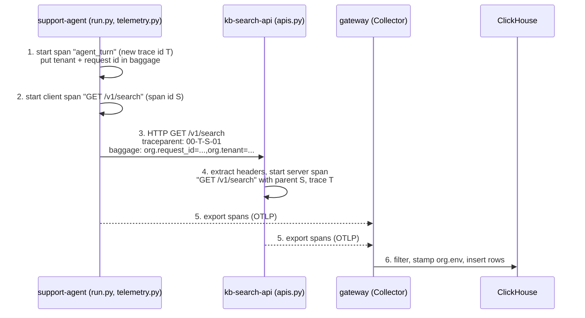

# Module 8: Joining services and environments into one trace (35 min)

## Why this matters

A real request rarely stays inside the agent. The agent calls plain HTTP APIs,
those APIs call databases, and some of them run in a different environment
(dev versus prod, another cluster, another cloud account). If each of those
pieces records its own disconnected trace, you can't answer the basic question
"why was this request slow?". This module shows how separate services, and
separate environments, end up in **one** trace, and what quietly breaks that.

**What you'll be able to do:**

- Follow one request across two services and say exactly which header carries
  the trace from one to the other.
- Name what each service must do (inject on the way out, extract on the way in).
- Spot the usual ways the chain breaks: a proxy stripping headers, a service
  whose spans are dropped, a database that can't emit spans.
- Run two gateways for two environments and see one trace in ClickHouse.

## Key terms

| Term | Plain meaning |
|---|---|
| **Span** | The record of one timed operation, such as "call the search API" ([module 1](01-otel-core.md)). |
| **Trace** | All the spans of one request, linked into a tree. |
| **Trace id** | A random 32-character hex id shared by every span in the trace. It is the "order number" that ties them together. |
| **Span id / parent span id** | Each span has its own 16-character id, and stores the id of the span that caused it (its parent). That's how the tree is built. A span with an empty parent id is a **root span**: the start of a trace. |
| **Client span / server span** | The caller records a *client* span ("I sent a request and waited"). The service that receives it records a *server* span ("I handled a request"). The server span's parent is the client span. |
| **Context** | The "current trace id and span id" a running program holds in memory, so new spans know where they belong. |
| **Header** | A `name: value` line sent with an HTTP request, alongside the body. |
| **Propagation** | Copying the context out of one process and into another, here through HTTP headers. |
| **Inject / extract** | *Inject*: the caller writes its context into outgoing headers. *Extract*: the receiver reads those headers back into a context. |
| **`traceparent`** | The standard header (from the W3C Trace Context spec) that carries the trace id, the caller's span id, and a "sampled" flag. |
| **Baggage** | A second standard header, `baggage`, carrying extra key=value pairs (here the tenant and request id) to every downstream service. |
| **Resource** | Labels describing *who* produced a span (service name, owner, environment), as opposed to labels on one span. |
| **Gateway** | The OpenTelemetry Collector in this repo: it receives spans over OTLP (the OpenTelemetry Protocol), filters and labels them, and writes them to ClickHouse ([module 4](04-collector.md)). |
| **Environment** | One place the software runs: a cluster, cloud account, or region. Here labeled `org.env` (`dev`, `prod`). |
| **Orphan span** | A span whose parent never arrived in storage, so it hangs on its own instead of sitting in the tree. |
| **Span link** | A pointer from one span to a span in *another* trace. Used when you want "related to" rather than "child of". |
| **Auto-instrumentation** | A library or agent that creates spans and handles inject/extract for common frameworks, without you writing that code. |

## Idea

### The story of one request

The running example: a user asks the support assistant a question. The agent
decides to call its knowledge-base search tool, and that tool calls the
`kb-search-api` service over HTTP. Two processes, one request. Here is what
happens, step by step, using the real code in this repo.



**Step 1: the agent starts the trace.** `run.py` opens an `agent_turn` span.
It has no parent, so the SDK (the OpenTelemetry library inside the process)
creates a fresh trace id. Before that, `run.py` puts two values into
**baggage**, so services further down can see them:

```python
# agent/run.py
ctx = baggage.set_baggage("org.request_id", request_id)
if tenant:
    ctx = baggage.set_baggage("org.tenant", tenant, ctx)
```

**Step 2: the tool opens a client span.** The search tool calls `call_api` in
`agent/telemetry.py`. That function starts a span of kind `CLIENT` named
`GET /v1/search`. It is a child of the agent's tool span, and its own span id
(call it `S`) is what the API will point back to.

**Step 3: the caller injects context into headers.** Still inside `call_api`,
one line copies the current context into the outgoing headers:

```python
# agent/telemetry.py, inside call_api
headers = {"Content-Type": "application/json"}
propagate.inject(headers)
```

After that line, `headers` contains two extra entries. They look like this
(example values):

```text
traceparent: 00-12d64ae6b9afa411e15ca3a7c1726609-201baf240807604d-01
             │  │                                │                └ flags: 01 = sampled
             │  │                                └ parent id: the client span's id (S)
             │  └ trace id (T), the same for the whole request
             └ version of the format
baggage: org.request_id=<uuid>,org.tenant=<tenant>
```

Think of `traceparent` as a luggage tag: it says which trip this bag belongs
to (trace id) and which counter checked it in (parent span id).

**Step 4: the service extracts context and starts its server span.** In
`agent/apis.py`, the request handler reads the headers back into a context,
then starts its server span *from* that context:

```python
# agent/apis.py, inside the request handler
parent = propagate.extract({key.lower(): value for key, value in self.headers.items()})
...
with tracer.start_as_current_span(name, context=parent, kind=SpanKind.SERVER, ...)
```

`context=parent` is the important part. It makes the new span reuse trace id
`T` and record `S` as its parent. The handler also reads `org.tenant` and
`org.request_id` out of baggage and copies them onto the server span as
attributes (labels on one span).

**Step 5: both processes export their spans.** Each process sends its own spans
to a gateway over OTLP. Nobody sends the "whole trace" anywhere; each side only
knows its own spans.

**Step 6: the gateway writes them to ClickHouse.** The gateway checks the
mandatory labels, stamps the environment labels, and inserts rows into
`otel.otel_traces`.

**There is no merge step.** The spans from two processes are one trace simply
because they carry the same trace id, and the server span's parent id points
at the client span. Here is a real trace from this stack, showing only the
spans that matter for the hop:

```sql
SELECT ServiceName, SpanName, SpanKind, SpanId, ParentSpanId
FROM otel.otel_traces WHERE TraceId = '<a trace id>' ORDER BY Timestamp;
```

```text
ServiceName    SpanName        SpanKind  SpanId            ParentSpanId
support-agent  agent_turn      Internal  4996cbf4e5c2bf8d
support-agent  GET /v1/search  Client    201baf240807604d  fdbe2a0e597f422d
kb-search-api  GET /v1/search  Server    88fd3c4762745915  201baf240807604d
```

What to notice:

- `agent_turn` has an empty `ParentSpanId`: it is the root of the trace.
- The client span's parent (`fdbe...`) is the agent's tool span, left out here
  to keep the output short.
- The server span from `kb-search-api`, a different process, has
  `ParentSpanId = 201baf240807604d`, which is exactly the client span's
  `SpanId`. That one matching value is the whole "join".

### What each service must do

The same pattern applies to any service with no LLM in it: an HTTP API, a
database client, a batch job. In this repo, `kb-search-api`, `ticket-api` and
`pricing-api` are such services. Five things must all be true for a service's
spans to sit inside the agent's trace:

| # | Condition | In this repo | If it doesn't hold |
|---|---|---|---|
| 1 | The caller **injects** context into the request | `propagate.inject(headers)` in `call_api` writes `traceparent` and `baggage` | The callee starts a new, unrelated trace |
| 2 | The service **extracts** it and starts its server span from it | `propagate.extract(...)` in `apis.py` | Same: a new trace per request |
| 3 | Every hop in between **forwards the headers** | Direct calls on localhost | Separate traces (`STRIP_TRACE_HEADERS=1`, lab step 3) |
| 4 | The service's spans **reach the same store** and pass its rules | Gateway requires `org.owner` and `org.service` on the resource | Only the caller's client span appears (`legacy-hr-api`, lab step 4) |
| 5 | The service samples **parent-based** (follows the caller's "sampled" flag) | The SDK default | Orphan spans, or missing halves ([module 5](05-sampling.md)) |

For a real service you rarely write conditions 1 and 2 yourself.
**Auto-instrumentation** does it for common frameworks and HTTP clients:
`opentelemetry-instrument python app.py` with the Flask, FastAPI or requests
instrumentation packages in Python; the Java agent jar; or
`@opentelemetry/auto-instrumentations-node` for Node. This repo writes the two
calls by hand so you can see them.

**Callees you can't instrument.** Some services can't emit spans at all: a
database, a SaaS API, a legacy system you don't own. You still get the
caller's **client span**, with its duration, status and error, but nothing
inside the callee. `INSERT tickets` from `ticket-api` to Postgres is such a
span here: `ticket-api` records how long the insert took, and that's all.
Beyond that, the fallback is matching on a business id the callee logs (such
as `org.request_id`). That's a workaround, not a trace.

### What breaks the chain

Each failure below leaves a recognizable mark in ClickHouse.

**1. Something in between strips the headers.** Proxies, API gateways, load
balancers and WAFs (web application firewalls) sometimes drop headers they
don't recognize. The request still arrives, but without `traceparent` and
`baggage`. The service extracts an empty context, so its server span becomes
the root of a brand-new trace, and the tenant from baggage is gone.

This repo can fake that proxy. In `agent/apis.py`:

```python
if os.environ.get("STRIP_TRACE_HEADERS") == "1":
    # Simulates a proxy between environments that drops traceparent and baggage.
    parent = propagate.extract({})
else:
    parent = propagate.extract({key.lower(): value for key, value in self.headers.items()})
```

With `STRIP_TRACE_HEADERS=1`, the service extracts from an empty dict, so it
behaves exactly as if a proxy had removed the headers. Lab step 3 runs it.

```text
Healthy:   agent ──traceparent──▶ proxy ──traceparent──▶ api      one trace
Stripped:  agent ──traceparent──▶ proxy ───(nothing)───▶ api      two traces
```

**2. The service's spans never reach storage.** Propagation worked, but the
spans were dropped on the way. Here, the gateway drops any span whose
*resource* lacks `org.owner` or `org.service`. `legacy-hr-api` puts those
labels on the span instead of the resource, so every one of its spans is
filtered out. The agent's client span is stored, but nothing appears under it.

**3. Orphan spans.** If the server span is stored but its parent (the
client span) isn't, the server span is an orphan: it has a `ParentSpanId`
that matches no row. The usual cause is sampling that disagrees, such as the
caller deciding "don't keep" while the callee keeps its own spans anyway.
Parent-based sampling avoids this, because the callee follows the `01` /
`00` flag in `traceparent`.

**4. The database emits nothing.** Not really a breakage: the client span is
all you will ever get for an uninstrumented callee.

### Across environments

Now put the agent in one environment (say, `dev`) and the APIs in another
(`prod`), each with its own gateway. Everything above still applies, and four
more things have to hold, each of which fails in its own way.

| # | Requirement | Typical way it breaks | Fix |
|---|---|---|---|
| 1 | **Context crosses the boundary** | A proxy, API gateway or WAF drops or rewrites `traceparent` and `baggage`; a message queue carries no headers; an async job starts later | Allow-list the W3C headers on every hop; inject context into message headers; use **span links** for async or batch work |
| 2 | **Spans end up queryable together** | Each environment writes to its own backend | Forward to one central store, **or** query across stores by trace id |
| 3 | **Sampling decisions agree** | Each side samples independently | Parent-based sampling everywhere; tail sampling (deciding after the whole trace has arrived) only where all spans of a trace meet |
| 4 | **You can tell environments apart** | Same service name in both; no environment label | Each environment's gateway stamps `org.env`, `org.region` and so on |

Requirement 4 is why the environment labels are set by the gateway, not by
the services. A service doesn't need to know where it runs; the gateway in
each environment knows, and stamps every span passing through.

Two more practical points:

- **Clock skew.** Each host timestamps its own spans with its own clock. If
  two clocks differ by a few milliseconds, a child can appear to start before
  its parent. Trust the parent/child ids over the timestamps.
- **Trust boundaries.** At a public edge, you may *not* want to continue a
  caller's trace: an outside client could force sampling on, or send made-up
  ids. Start a new trace there, and add a **span link** to the incoming
  context so the relationship is still recorded.

### Architecture patterns

**A. Central collection** (simplest to query). Each environment has its own
gateway, and they all forward to one central gateway and one ClickHouse:

```text
env A apps ─▶ env A gateway ─┐
                             ├─ OTLP ─▶ central gateway ─▶ one ClickHouse
env B apps ─▶ env B gateway ─┘
```

Each environment's gateway stamps its own `org.env` and region, then exports
with the `otlp` exporter (the Collector's "send to another Collector" output)
to the central tier. The trace ids already match, because context was
propagated, so nothing needs to be "merged": the spans simply land in the same
table. If ClickHouse were split into shards (servers that each hold a slice of
the data) by `cityHash64(TraceId)`, all spans of a trace would even land on the
same shard ([module 7](07-sharding-indexes.md)).

**B. Store per environment, combine at query time.** The data stays in each
environment, for example because of data-residency rules. You ask both stores
for the same trace id and glue the results together. ClickHouse's `remote()`
function queries another server's table from inside a query:

```sql
SELECT * FROM otel.otel_traces WHERE TraceId = '...'
UNION ALL
SELECT * FROM remote('clickhouse.env-b.internal', otel.otel_traces, 'reader', '...') WHERE TraceId = '...';
```

A `Distributed` table (a ClickHouse table that forwards queries to a list of
servers) over a cluster that lists both environments' servers does the same
thing permanently. Either way, the trace id is the join key.

**C. Propagation was lost: correlate after the fact.** If something on the
way drops the trace headers, the two halves have different trace ids, and no
storage trick can rejoin them reliably. You can correlate on a business id
that survives (an `X-Request-Id` header the proxy keeps, an order id), but
it's a workaround. **Fix the propagation.**

## Remember it

> **A trace crosses environments only if its passport (`traceparent`) gets
> through every border, and all its travel photos end up in one album, or
> albums you can flip through together.**
>
> Merge happens at the **trace id**, never by time or service name.

## In this repo

| What | Where | What it does |
|---|---|---|
| Inject | `call_api` in `agent/telemetry.py` | `propagate.inject(headers)` adds `traceparent` and `baggage` to every API call |
| Baggage values | `agent/run.py` | Puts `org.request_id` and `org.tenant` into baggage for each turn |
| Extract | request handler in `agent/apis.py` | `propagate.extract(...)`, then starts the server span with `context=parent` and copies baggage values onto it |
| Fake header-stripping proxy | `agent/apis.py` | `STRIP_TRACE_HEADERS=1` makes the APIs ignore incoming `traceparent` and `baggage` |
| Environment labels | `otel-gateway-config.yaml` (`resource/org_platform`), `compose.yaml` | The gateway stamps `org.env`, `org.region`, `org.platform` and `org.cluster` from its own environment variables (`ORG_ENV` defaults to `dev`) |
| Mandatory labels | `otel-gateway-config.yaml` (`filter/require_org_labels`) | Drops spans whose resource lacks `org.owner` or `org.service` |
| Database client span | `_create_ticket` in `agent/apis.py` | `ticket-api` records an `INSERT tickets` client span; Postgres records nothing |

`org.env` is also stored as its own column, `org_env`, in `otel.otel_traces`,
so you can filter and group on it directly.

## Lab (15 min)

Pause the background traffic first, so the lab's spans are easy to find:
`./stack.sh traffic off`.

Every command below tags its spans with a `lab.run` resource attribute
through `OTEL_RESOURCE_ATTRIBUTES` (a standard environment variable the SDK
reads to add resource labels). That lets each query pick out just that run.

1. **Two environments, one trace.** Start a second gateway, the "prod"
   environment, on host port 24318, writing to the same ClickHouse.
   `docker compose run` starts an extra container from the existing
   `otel-gateway` service definition; `-e` overrides its environment labels
   and `-p` publishes its OTLP HTTP port:

   ```bash
   docker compose run -d --name otel-gateway-prod -e ORG_ENV=prod -e ORG_REGION=eu-west \
     -p 24318:4318 otel-gateway
   ```

   Now run the APIs in "prod" (they send to port 24318, the prod gateway) and
   the agent in "dev" (it uses its default endpoint, `http://localhost:14318`,
   the normal gateway).
   `OTEL_EXPORTER_OTLP_ENDPOINT` is the standard variable that tells the SDK
   where to send spans:

   ```bash
   cd agent
   for s in kb-search-api ticket-api pricing-api legacy-hr-api; do
     OTEL_EXPORTER_OTLP_ENDPOINT=http://localhost:24318 OTEL_RESOURCE_ATTRIBUTES=lab.run=twoenv \
       .venv/bin/python apis.py --service $s >/dev/null 2>&1 &
   done
   sleep 2
   OTEL_RESOURCE_ATTRIBUTES=lab.run=twoenv .venv/bin/python run.py --agent support-agent --turns 2
   pkill -f 'apis.py --service'
   ```

   Group the run's spans by trace id, listing which environments and services
   appear in each trace:

   ```sql
   SELECT TraceId, groupArray(DISTINCT org_env) AS envs, groupArray(DISTINCT ServiceName) AS services
   FROM otel.otel_traces WHERE ResourceAttributes['lab.run'] = 'twoenv' GROUP BY TraceId;
   ```

   ```text
   6a309b7aae07ec370bfa682264ff2aba  ['dev','prod']  ['support-agent','kb-search-api']
   1610a5185b7ffa730e406977730fc887  ['dev','prod']  ['support-agent','kb-search-api']
   ```

   Each row is one trace that contains spans from both environments. The
   agent's spans went through the dev gateway and the API's spans through the
   prod gateway, yet they share a trace id, so they form one trace. Clean up
   the extra gateway: `docker rm -f otel-gateway-prod`.

2. **Query another store by trace id.** In this stack there's only one
   ClickHouse cluster, so `clickhouse-02` stands in for "another
   environment's ClickHouse". The first half counts rows on the server you're
   connected to; the second half uses `remote()` to count the same rows on
   `clickhouse-02`:

   ```sql
   SELECT hostName() AS host, count() FROM otel.otel_traces WHERE ResourceAttributes['lab.run'] = 'twoenv' GROUP BY host
   UNION ALL
   SELECT 'remote clickhouse-02', count() FROM remote('clickhouse-02', otel.otel_traces, 'default', 'demo')
   WHERE ResourceAttributes['lab.run'] = 'twoenv';
   ```

   You should see the same count twice. That's expected here: the two servers
   are replicas (copies of the same data, [module 6](06-clickhouse.md)). With a
   genuinely separate environment, the remote half would return that
   environment's spans, and `UNION ALL` would combine both halves of a trace.

3. **Break propagation.** Run some traffic with the APIs dropping the trace
   headers, like a proxy would:

   ```bash
   STRIP_TRACE_HEADERS=1 OTEL_RESOURCE_ATTRIBUTES=lab.run=stripped .venv/bin/python simulate.py --turns 3
   ```

   For each service, count how many traces its spans belong to, and how many
   of its spans are roots (empty parent id):

   ```sql
   SELECT ServiceName, uniqExact(TraceId) AS traces, countIf(ParentSpanId = '') AS root_spans
   FROM otel.otel_traces WHERE ResourceAttributes['lab.run'] = 'stripped'
   GROUP BY ServiceName ORDER BY ServiceName;
   ```

   ```text
   hr-agent       3  3
   kb-search-api  3  3
   pricing-api    8  8
   ...
   ```

   For the agents, three turns means three traces with one root each, as
   normal. But the APIs should have **zero** root spans: their server spans
   ought to be children of the agents' client spans. Instead, every API span
   is the **root of its own trace**, and the tenant from baggage is gone too
   (`SpanAttributes['org.tenant']` is empty on `kb-search-api`). This is what
   a header-stripping proxy does to you.

   Then turn the background traffic back on: `cd .. && ./stack.sh traffic on`.

4. **Find callees that never joined the trace.** This query lists every
   outgoing call (client span) and counts how often no server span sits under
   it. The `LEFT JOIN` looks for a server span in the same trace whose parent
   is the client span; when none exists, the joined `SpanId` comes back empty:

   ```sql
   SELECT c.ServiceName AS caller, c.SpanName, count() AS calls, countIf(s.SpanId = '') AS no_server_span
   FROM otel.otel_traces AS c
   LEFT JOIN (SELECT TraceId, SpanId, ParentSpanId FROM otel.otel_traces WHERE SpanKind = 'Server') AS s
     ON s.TraceId = c.TraceId AND s.ParentSpanId = c.SpanId
   WHERE c.SpanKind = 'Client' AND c.SpanName NOT LIKE 'chat%' AND c.Timestamp > now() - INTERVAL 1 HOUR
   GROUP BY caller, c.SpanName ORDER BY caller;
   ```

   (`NOT LIKE 'chat%'` skips the LLM calls, which go to an external model and
   never have a server span here.)

   ```text
   hr-agent     GET /employees/{employee_id}   459   459
   hr-agent     POST /v1/tickets               459     3
   sales-agent  GET /v1/prices/{sku}          1163     8
   support-agent GET /v1/search                477     3
   ticket-api   INSERT tickets                 460   460
   ```

   Read it row by row:
   - `GET /employees/...`: **always** missing. `legacy-hr-api` sends spans,
     but the gateway drops them because `org.owner` and `org.service` are on
     the span, not the resource (condition 4).
   - `INSERT tickets`: always missing, and that's expected. It's a database
     call, and Postgres doesn't emit spans; the client span is all you get.
   - The few misses on the other routes are the stripped-headers runs from
     step 3 (condition 3).

## Recap

- Spans from different services form one trace because they share a **trace
  id** and each server span points at its caller's client span. Nothing is
  merged afterwards.
- The caller **injects** `traceparent` (and `baggage`) into request headers;
  the callee **extracts** them and starts its server span from that context.
- Anything that drops those headers (a proxy, a queue, `STRIP_TRACE_HEADERS=1`)
  splits the request into unrelated traces, with the callee's span as a new root.
- A client span with no server span under it means: the callee isn't
  instrumented, its spans were dropped (like `legacy-hr-api`), or propagation
  broke.
- Across environments, each gateway stamps `org.env` and friends; spans are
  queried together either in one central store or with `remote()` by trace id.

## Explain it back

> "To see one trace across environments, the W3C trace headers have to survive
> every hop: proxies, gateways and queues. Then the spans have to be queryable
> together, either by forwarding every environment's gateway to a central
> store, or by querying each store by trace id at read time. Each environment's
> gateway stamps its own environment labels, so you can tell the halves apart.
> Sampling must be parent-based, so both sides agree. There's no merge step:
> the shared trace id *is* the merge. If propagation breaks, you get two
> unrelated traces, and the only way back is correlating on a business id."

## Check yourself

<details><summary>A plain REST service with no LLM is called by an agent. What does it need to show up inside the agent's trace?</summary>

It has to extract `traceparent` from incoming requests and start its server
span from that context; auto-instrumentation does this for common frameworks.
It also needs the resource labels the gateway requires, an exporter pointing
at the gateway, and parent-based sampling. Nothing is merged afterwards: the
shared trace id makes it part of the trace.
</details>

<details><summary>What exactly is in the <code>traceparent</code> header, and which part links the server span to the client span?</summary>

A format version (`00`), the trace id, the parent id, and flags (`01` means
sampled). The parent id is the caller's client span id. The callee stores it
as its server span's `ParentSpanId`, which is the link.
</details>

<details><summary>An agent's client span has no server span under it. What are the possible causes?</summary>

The callee isn't instrumented (a database, a SaaS API). Or it's instrumented
but didn't receive or extract the headers. Or its spans were dropped on the
way, by the gateway's filter or by a sampler. Or they went to a different
backend.
</details>

<details><summary>Spans from both environments are in the same table, but the trace shows as two. Why?</summary>

The two halves have different trace ids: context didn't cross the boundary
(stripped headers, a queue without context, or a new trace started at an
edge). Look at the first server span on the far side: an empty
`ParentSpanId` means it started a new trace.
</details>

<details><summary>With <code>STRIP_TRACE_HEADERS=1</code>, why is <code>org.tenant</code> missing on <code>kb-search-api</code> spans as well?</summary>

The tenant travels in the `baggage` header, which is stripped along with
`traceparent`. The API copies `org.tenant` from baggage onto its server span,
so with no baggage there is nothing to copy.
</details>

<details><summary>Why not tail sample in each environment's gateway?</summary>

Each gateway sees only its environment's part of the trace, so they'd make
different decisions, and you'd keep fragments. Tail sample at the central tier
where the whole trace meets, or use head sampling, parent-based, end to end.
</details>

<details><summary>When should a service deliberately <em>not</em> continue an incoming trace?</summary>

At a trust boundary, such as a public API. Start a new trace and record a span
link to the caller's context. That keeps the relationship visible without
letting outside callers control your trace ids or sampling.
</details>

## Read more

- [Context propagation](https://opentelemetry.io/docs/concepts/context-propagation/)
- [W3C Trace Context (the `traceparent` header)](https://www.w3.org/TR/trace-context/)
- [W3C Baggage](https://www.w3.org/TR/baggage/)
- [Span links](https://opentelemetry.io/docs/concepts/signals/traces/#span-links)
- [Messaging semantic conventions (context in message headers)](https://opentelemetry.io/docs/specs/semconv/messaging/messaging-spans/)
- [Collector deployment: gateway](https://opentelemetry.io/docs/collector/deploy/gateway/)
- [OTLP exporter (Collector to Collector)](https://github.com/open-telemetry/opentelemetry-collector/blob/main/exporter/otlpexporter/README.md)
- [ClickHouse `remote()` table function](https://clickhouse.com/docs/sql-reference/table-functions/remote)
- [W3C Trace Context: privacy and security considerations](https://www.w3.org/TR/trace-context/#privacy-considerations)
