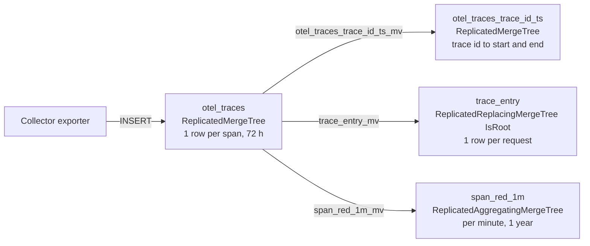

# Module 8: The data model (40 min)

## Why this matters

Remember from [module 7](07-clickhouse.md): every insert becomes a sorted,
immutable part, and a materialized view is an insert trigger. This module
reads `clickhouse/schema.sql` line by line to see how *our* tables use that.


`clickhouse/schema.sql` is the contract between the gateway and everyone who
queries traces. Each column, type and setting in it was chosen for a reason:
to keep spans small on disk, fast to filter, and cheap to delete when they
expire. Once you can read it, you can add your own columns safely and know
which summary table answers which question, and how to read it without
getting wrong numbers.

**What you'll be able to do after this module:**

- Explain what each column of `otel_traces` holds, and why it has its type
  and codec.
- Explain what `LowCardinality`, `Map`, `Nested`, `ZSTD`, `Delta` and
  `MATERIALIZED` mean in the DDL.
- Describe the three summary tables and the materialized views that fill
  them, and read them correctly (`sum`, `-Merge`, `FINAL`).
- Add a promoted column to the span table, and know what happens to old data.

## Key terms

| Term | Plain meaning |
|---|---|
| DDL | Data Definition Language: the `CREATE`, `ALTER` and `DROP` statements that define tables |
| Stock columns | The columns the Collector's ClickHouse exporter writes; the same for every user of that exporter |
| Codec | How a column is compressed on disk, for example `ZSTD(1)` or `Delta` |
| `LowCardinality(String)` | A string column stored as a dictionary of distinct values plus small numbers pointing into it |
| `Map(K, V)` | A column holding a set of key-value pairs per row, like a Python dict |
| `Nested` | A group of arrays of equal length per row, like a small table inside each row |
| `MATERIALIZED` column | A column ClickHouse computes from other columns on insert and stores |
| Aggregation state | A half-finished aggregate (for example, a summary of durations) that can be combined with others later |
| `SimpleAggregateFunction(sum, T)` | A column type that tells `AggregatingMergeTree` to add the values up when rows merge |
| Version column | The column `ReplacingMergeTree` uses to pick which duplicate survives: the highest value wins |

## Idea

### One wide table, one row per span

`otel.otel_traces` stores **one row per span** (a span is the record of one
timed operation, [module 1](01-otel-core.md)). There's no separate "trace"
table: a trace is simply all rows with the same `TraceId`. When a user asks
the HR assistant "I need a new laptop", the `agent_turn` span, the agent,
model and tool spans, and the `ticket-api` span each become one row, all
with the same `TraceId`.

The table has 48 columns, in two groups, followed by a list of indexes:

1. **22 stock columns**, which the exporter fills.
2. **26 MATERIALIZED columns**, which ClickHouse fills on insert by copying
   values out of the attribute maps.

The file starts with a comment and a database:

```sql
CREATE DATABASE IF NOT EXISTS otel ON CLUSTER tracing;
```

`IF NOT EXISTS` makes the file safe to run twice (the comment calls it
"idempotent"). `ON CLUSTER tracing` runs the statement on every server of
the `tracing` cluster ([module 7](07-clickhouse.md)). Every statement in the
file has both.

### A short guide to the types and codecs

Before the columns, the vocabulary they use:

| In the DDL | What it means | Why it's used here |
|---|---|---|
| `String` | Text of any length | Ids and free text |
| `LowCardinality(String)` | Text stored as a dictionary: each distinct value is stored once, and each row holds a small number pointing to it | Columns with few distinct values (service names, span kinds); a good fit up to roughly 10,000. Bad for unique values like ids, where the dictionary would be as big as the data |
| `DateTime64(9)` | A timestamp with 9 decimal places of seconds: nanoseconds | OpenTelemetry records times in nanoseconds |
| `DateTime` | A timestamp to the second | Enough for sorting, time ranges and TTL |
| `UInt64`, `UInt32`, `UInt16`, `UInt8` | Whole numbers, never negative, in 8, 4, 2 or 1 bytes | Durations, token counts, HTTP status codes, yes/no flags |
| `Map(LowCardinality(String), String)` | Key-value pairs per row. Keys use the dictionary trick; values are plain text | Attributes: any number of them, with any names |
| `Nested(...)` | Several arrays of equal length per row | A span's list of events or links |
| `AggregateFunction(...)` | A stored aggregation state, not a final value | Latency percentiles in the per-minute rollup |
| `SimpleAggregateFunction(sum, UInt64)` | A plain number, plus the rule "add them when rows merge" | Counts in the per-minute rollup |
| `CODEC(ZSTD(1))` | Compress with Zstandard at level 1 (fast, good ratio). Without a codec, ClickHouse uses LZ4 | Smaller on disk than the default for text-heavy data |
| `CODEC(Delta, ZSTD(1))` | First replace each value by its difference from the previous one, then compress | Timestamps next to each other differ by small amounts, which compress far better than full timestamps |

### Group 1: the stock columns

The Collector's ClickHouse exporter ([module 4](04-collector.md)) maps each
OTLP span field to one column. OTLP (the OpenTelemetry Protocol) is how the
SDK sends spans to the gateway. These columns match the exporter's own
default table, so any tool built for that exporter can read this table too.

| OTLP span field | Column | Type | What it holds, and why this type |
|---|---|---|---|
| `start_time_unix_nano` | `Timestamp` | `DateTime64(9)`, `CODEC(Delta, ZSTD(1))` | When the span started, to the nanosecond. Delta works well because neighboring rows have close timestamps |
| `end - start` | `Duration` | `UInt64` | How long the span took, in **nanoseconds**; divide by `1e6` for milliseconds. Never negative, so unsigned |
| `trace_id` | `TraceId` | `String` | The id shared by every span of one request: 32 hex characters. Unique per trace, so a plain `String` |
| `span_id` | `SpanId` | `String` | This span's own id: 16 hex characters |
| `parent_span_id` | `ParentSpanId` | `String` | The id of the span that called this one. `''` (empty) means this is the **root**, the first span of the trace |
| `trace_state` | `TraceState` | `String` | The W3C `tracestate` header, extra vendor data passed along with the trace id. Usually empty |
| `name` | `SpanName` | `LowCardinality(String)` | The operation, like `agent_turn` or `execute_tool create_ticket`. Few distinct names, so `LowCardinality` |
| `kind` | `SpanKind` | `LowCardinality(String)` | The span's role: `Internal`, `Client`, `Server`... A handful of values |
| resource `service.name` | `ServiceName` | `LowCardinality(String)` | The service that made the span, like `hr-agent` or `ticket-api` |
| resource attributes | `ResourceAttributes` | `Map(LowCardinality(String), String)` | All labels describing the service (module 1). **Every value becomes a string** |
| scope name | `ScopeName` | `String` | The instrumentation library that created the span (`agent-tracing`) |
| scope version | `ScopeVersion` | `String` | That library's version |
| span attributes | `SpanAttributes` | `Map(LowCardinality(String), String)` | All labels describing this operation. Same: values are strings |
| `status.code` | `StatusCode` | `LowCardinality(String)` | `Unset`, `Ok` or `Error` |
| `status.message` | `StatusMessage` | `String` | The error description, if any |
| `events[]` | `Events.Timestamp`, `Events.Name`, `Events.Attributes` | `Nested`: parallel arrays | Things that happened during the span. Exceptions are events named `exception` |
| `links[]` | `Links.TraceId`, `Links.SpanId`, `Links.TraceState`, `Links.Attributes` | `Nested` | Span links: pointers to spans in other traces that are related |

That's 15 plain columns plus 3 event columns and 4 link columns: 22.

Three things to notice:

- **Attribute values are always strings.** `Map(LowCardinality(String),
  String)` holds any attribute in one column, whatever its name, but that
  means the number `200` is stored as the text `'200'`. Group 2 turns the
  important ones back into numbers.
- **`Nested` means parallel arrays.** A span with two events has, in that
  row, `Events.Name = ['retry', 'exception']` and
  `Events.Timestamp = [t1, t2]`: the first item of each array belongs
  together, and so on. Lab step 3 unpacks them with `ARRAY JOIN`.
- **Every stock column uses `ZSTD(1)`**, because spans are mostly text that
  repeats a lot. Module 7's lab measured `SpanAttributes` shrinking about
  13 times.

> **Quick check:** A span has `Events.Name = ['retry', 'exception']`. Which
> timestamp belongs to the exception?
>
> <details><summary>Answer</summary>
>
> `Events.Timestamp[2]`, the second item. `Nested` columns are parallel
> arrays, so the same position in each array describes the same event.
> </details>

### Group 2: the MATERIALIZED columns

**The problem.** To filter on `SpanAttributes['gen_ai.agent.name']`,
ClickHouse has to read and decompress the **whole** `SpanAttributes` map
for every row, because a map is stored as one column holding all the keys
and values. It also can't put a map value in the sorting key or index it
on its own, and the value is a string, so you can't sum tokens without
converting first.

**The fix.** This repo adds 26 columns that copy chosen values out of the
maps **on insert**, and store them like any other column:

```sql
org_owner        LowCardinality(String) MATERIALIZED ResourceAttributes['org.owner'],
gen_ai_tokens_in UInt32                 MATERIALIZED toUInt32OrZero(SpanAttributes['gen_ai.usage.input_tokens']),
```

Read the first line as: "`org_owner` is a `LowCardinality(String)` column;
whenever a row is inserted, set it to the `org.owner` resource attribute."
If the key is missing, a map lookup returns `''`. In the second line,
`toUInt32OrZero` converts the text to a number, and gives `0` if the text is
empty or not a number.

A real column is small, compresses well, can be in the sorting key, and can
be indexed. The rule: **promote the attributes you filter or group by; leave
the rest in the maps.**

The 26 columns, in the order `schema.sql` lists them:

**Resource labels (`org.*`, from `ResourceAttributes`).** Every span of a
service carries these. `org.owner` and `org.service` are mandatory, and set
by the service; the gateway drops spans without them. The gateway adds the
other four (`resource/org_platform` in `otel-gateway-config.yaml`).

| Column | Type | Copied from | Holds |
|---|---|---|---|
| `org_owner` | `LowCardinality(String)` | `org.owner` | The owning team, like `people-tech` |
| `org_service` | `LowCardinality(String)` | `org.service` | The service, like `hr-agent` |
| `org_region` | `LowCardinality(String)` | `org.region` | Where the gateway runs (`local` here) |
| `org_platform` | `LowCardinality(String)` | `org.platform` | `docker` here |
| `org_cluster` | `LowCardinality(String)` | `org.cluster` | `agent-tracing` here |
| `org_env` | `LowCardinality(String)` | `org.env` | `dev` here |

**Span labels (`org.*`, from `SpanAttributes`, optional).**

| Column | Type | Copied from | Holds |
|---|---|---|---|
| `org_tenant` | `String` | `org.tenant` | The customer the request was for |
| `org_agent_interface` | `LowCardinality(String)` | `org.agent.interface` | How the user reached the agent: `web` for the HR agent |
| `org_request_id` | `String` | `org.request_id` | One id per user request, on entry spans |

`org_request_id` is a plain `String` because every request has a new id:
`LowCardinality` would only add a huge dictionary. `org_tenant` is also a
plain `String`, which leaves room for many tenants.

**Hot OpenTelemetry attributes.**

| Column | Type | Copied from | Holds |
|---|---|---|---|
| `http_route` | `LowCardinality(String)` | `http.route` | The URL pattern an API matched, like `/v1/search` |
| `http_status` | `UInt16` | `http.response.status_code`, via `toUInt16OrZero` | The HTTP status as a number (0 if absent) |

**GenAI attributes** (the `gen_ai.*` semantic conventions, [module 3](03-genai-semconv.md)).

| Column | Type | Copied from |
|---|---|---|
| `gen_ai_operation` | `LowCardinality(String)` | `gen_ai.operation.name` (`chat`, `execute_tool`, `invoke_agent`...) |
| `gen_ai_provider` | `LowCardinality(String)` | `gen_ai.provider.name` |
| `gen_ai_request_model` | `LowCardinality(String)` | `gen_ai.request.model` |
| `gen_ai_response_model` | `LowCardinality(String)` | `gen_ai.response.model` |
| `gen_ai_finish_reasons` | `String` | `gen_ai.response.finish_reasons` |
| `gen_ai_conversation_id` | `String` | `gen_ai.conversation.id` (unique per conversation, so plain `String`) |
| `gen_ai_agent_name` | `LowCardinality(String)` | `gen_ai.agent.name` (like `hr_assistant`) |
| `gen_ai_agent_id` | `LowCardinality(String)` | `gen_ai.agent.id` |
| `gen_ai_agent_version` | `LowCardinality(String)` | `gen_ai.agent.version` |
| `gen_ai_tool_name` | `LowCardinality(String)` | `gen_ai.tool.name` (like `create_ticket`) |
| `gen_ai_tool_type` | `LowCardinality(String)` | `gen_ai.tool.type` |
| `gen_ai_tokens_in` | `UInt32` | `gen_ai.usage.input_tokens`, via `toUInt32OrZero` |
| `gen_ai_tokens_out` | `UInt32` | `gen_ai.usage.output_tokens`, via `toUInt32OrZero` |
| `gen_ai_tokens_cache_read` | `UInt32` | `gen_ai.usage.cache_read.input_tokens`, via `toUInt32OrZero` |
| `gen_ai_tokens_reasoning` | `UInt32` | `gen_ai.usage.reasoning.output_tokens`, via `toUInt32OrZero` |

Token counts become `UInt32` so you can `sum()` them directly.

Everything else stays only in the maps. For example, the database client
span of `ticket-api` carries `db.system.name = 'postgresql'`, and the agents
carry `org.agent.workflow`; neither is promoted, so you filter on them with
`SpanAttributes['db.system.name'] = 'postgresql'`.

**`DEFAULT`, `MATERIALIZED` and `ALIAS`.** Three column kinds look similar:

| Kind | Computed | Stored | In `SELECT *` | Can be inserted |
|---|---|---|---|---|
| `DEFAULT expr` | On insert, if not given | Yes | Yes | Yes |
| `MATERIALIZED expr` | Always, on insert | Yes | **No** | **No** |
| `ALIAS expr` | At query time | No | No | No |

`MATERIALIZED` is safe here precisely because the exporter doesn't know these
columns exist: it inserts the stock columns, and ClickHouse fills in the rest.
Because they're hidden from `SELECT *`, you name them explicitly in queries
(`SELECT org_owner, ...`).

> **Quick check:** Every dashboard filters on
> `SpanAttributes['db.system.name']`. What would you suggest, and what does
> it cost?
>
> <details><summary>Answer</summary>
>
> Promote it: add a `LowCardinality(String) MATERIALIZED` column (lab step
> 7). Filters then read a tiny column instead of the whole map. The cost is a
> little extra disk per row and a schema change to roll out on every server.
> </details>

### The indexes

The column list ends with nine `INDEX` lines: bloom filters on the trace,
request, tenant and conversation ids and on the keys and values of both
attribute maps, plus a `minmax` on `Duration`. These are **skip indexes**,
which let ClickHouse skip blocks of rows that can't match a filter.
[Module 9](09-sharding-indexes.md) explains each one and when it helps.

### The engine clause, piece by piece

```sql
ENGINE = ReplicatedMergeTree          -- MergeTree, replicated through Keeper (module 7)
PARTITION BY toDate(Timestamp)        -- one partition per day: the retention unit
ORDER BY (org_owner, org_service, SpanName, toDateTime(Timestamp))
                                      -- sort order and sparse primary index (PRIMARY KEY defaults to this)
TTL toDateTime(Timestamp) + INTERVAL 72 HOUR
SETTINGS ttl_only_drop_parts = 1;     -- drop whole expired parts, don't rewrite them
```

[Module 7](07-clickhouse.md) explained each clause in general. Two details
specific to this table: `ReplicatedMergeTree` with no arguments uses the
default Keeper path and the `{replica}` macro, so the same DDL runs unchanged
on every server; and `toDateTime` cuts time to whole seconds in the key,
enough for sorting and time filters.

### The derived tables

**The problem.** Three questions come up all the time: "when did trace X
happen?", "list recent requests", and "what's each service's call rate,
error count and latency per minute?" Scanning raw spans for each is
wasteful, and raw spans are deleted after 72 hours, but you want latency
trends for a year.

**The fix.** Three smaller tables, each filled by a materialized view (an
insert trigger, [module 7](07-clickhouse.md)) on `otel_traces`:



Each view is written as `CREATE MATERIALIZED VIEW ... TO otel.x AS SELECT
...`: it stores nothing itself and forwards its results into `otel.x`. The
one thing to keep in mind for all three: **a view only sees the rows of the
current insert**, never the whole table. That's why the same trace or minute
can end up in several rows.

#### `otel_traces_trace_id_ts`: when did this trace happen?

```sql
CREATE TABLE IF NOT EXISTS otel.otel_traces_trace_id_ts ON CLUSTER tracing
(
    TraceId String,
    Start   DateTime,
    End     DateTime,
    INDEX idx_trace_id TraceId TYPE bloom_filter(0.01) GRANULARITY 1
)
ENGINE = ReplicatedMergeTree
PARTITION BY toDate(Start)
ORDER BY (TraceId, Start)
TTL Start + INTERVAL 72 HOUR
SETTINGS ttl_only_drop_parts = 1;
```

- **Columns**: the trace id, and the earliest and latest span time seen for
  it, to the second.
- **Why**: `otel_traces` is sorted by owner and service, not trace id. This
  small table is sorted **by `TraceId`**, so "when did trace X happen?" reads
  a few granules. With the answer, the real query on `otel_traces` can add a
  tight `Timestamp` range and skip every other day and most parts (module 9).
- **Same partitioning and TTL as the spans**, so lookups expire with them.

The view that fills it:

```sql
SELECT TraceId, min(Timestamp) AS Start, max(Timestamp) AS End
FROM otel.otel_traces
WHERE TraceId != ''
GROUP BY TraceId;
```

A trace whose spans arrive in three batches gets three rows. So when you
query it, take `min(Start)` and `max(End)` for the trace id.

#### `trace_entry`: the list of requests

```sql
CREATE TABLE IF NOT EXISTS otel.trace_entry ON CLUSTER tracing
(
    Start                DateTime64(9),
    TraceId              String,
    org_request_id       String,
    org_agent_interface  LowCardinality(String),
    org_owner            LowCardinality(String),
    org_service          LowCardinality(String),
    org_tenant           String,
    Duration             UInt64,
    StatusCode           LowCardinality(String),
    IsRoot               UInt8,
    INDEX idx_trace_id TraceId TYPE bloom_filter(0.001) GRANULARITY 1
)
ENGINE = ReplicatedReplacingMergeTree(IsRoot)
PARTITION BY toDate(Start)
ORDER BY (org_request_id, TraceId)
TTL toDateTime(Start) + INTERVAL 72 HOUR
SETTINGS ttl_only_drop_parts = 1;
```

(Column alignment simplified from `schema.sql`.) The view copies a span into
it when the span is a request's **entry span** or a trace's **root**, and
records which of the two it is:

```sql
SELECT Timestamp AS Start, TraceId, org_request_id, ..., StatusCode,
       ParentSpanId = '' AS IsRoot
FROM otel.otel_traces
WHERE org_request_id != '' OR ParentSpanId = '';
```

`ParentSpanId = ''` is `1` for a root span and `0` for any other span.

- **Columns**: when the request started, its trace id and request id, how
  the user reached the agent, owner, service, tenant, duration, status, and
  `IsRoot`. Enough for a "recent requests" page, filterable by request id,
  tenant or interface.
- **`ORDER BY (org_request_id, TraceId)`**: sorted by request id, so looking
  up a request is fast. This pair is also the key that duplicates share.
- **Why several rows match.** In the HR example, two spans pass the
  `WHERE`: the agent's `agent_turn` span (the root, `IsRoot = 1`) carries
  `org.request_id`, and so does the `ticket-api` entry span (`IsRoot = 0`;
  it receives the request id through baggage, module 1). The sales agent
  calls `pricing-api` several times per request, which adds more. All of
  them have the same `(org_request_id, TraceId)`.
- **Why `ReplacingMergeTree(IsRoot)`.** A ReplacingMergeTree keeps one row
  per `ORDER BY` key. The column in brackets is the **version column**:
  among duplicates, the row with the **highest** value survives. So the root
  span (`1`) always beats an API span (`0`), and the request's row describes
  the whole turn: its start, its full duration and its final status. Without
  a version column, the row inserted last would win, and that depends on
  which batch reached ClickHouse last. The `agent_turn` span is exported
  only when the turn ends, after its children, but batches from different
  services and gateway retries arrive in any order.

**ReplacingMergeTree replaces eventually.** Duplicates are removed only when
the parts holding them merge. Until then, all copies are visible. Add
`FINAL` to a query to deduplicate at read time (exact, a little slower):
`SELECT ... FROM otel.trace_entry FINAL` returns one row per request, led by
its root span. Lab step 6 shows both.

> **Quick check:** For the HR request, which row survives in `trace_entry`,
> and does it matter which batch arrived first?
>
> <details><summary>Answer</summary>
>
> The `agent_turn` row: it's the root (`IsRoot = 1`), and the `ticket-api`
> row has `IsRoot = 0`. The highest version wins, so arrival order doesn't
> matter.
> </details>

#### `span_red_1m`: the per-minute rollup

RED stands for **Rate, Errors, Duration**: the three standard health numbers
for any service.

```sql
CREATE TABLE IF NOT EXISTS otel.span_red_1m ON CLUSTER tracing
(
    minute       DateTime,
    org_owner    LowCardinality(String),
    org_service  LowCardinality(String),
    SpanName     LowCardinality(String),
    calls        SimpleAggregateFunction(sum, UInt64),
    errors       SimpleAggregateFunction(sum, UInt64),
    duration_q   AggregateFunction(quantiles(0.5, 0.95, 0.99), UInt64)
)
ENGINE = ReplicatedAggregatingMergeTree
PARTITION BY toDate(minute)
ORDER BY (org_owner, org_service, SpanName, minute)
TTL minute + INTERVAL 1 YEAR
SETTINGS ttl_only_drop_parts = 1;
```

And the view:

```sql
SELECT toStartOfMinute(Timestamp) AS minute,
       org_owner, org_service, SpanName,
       count()                       AS calls,
       countIf(StatusCode = 'Error') AS errors,
       quantilesState(0.5, 0.95, 0.99)(Duration) AS duration_q
FROM otel.otel_traces
GROUP BY minute, org_owner, org_service, SpanName;
```

- **Columns**: the minute, who and what (owner, service, span name), how many
  spans (`calls`), how many had status `Error` (`errors`), and a duration
  summary (`duration_q`).
- **`AggregatingMergeTree` combines rows with the same sorting key when parts
  merge**, but only in the way each column's type tells it to:
  - **`calls` and `errors` are `SimpleAggregateFunction(sum, UInt64)`**: on
    merge, the values are added up. Two inserts that each saw 3 and 5 calls
    in the same minute merge into one row with 8. A plain `UInt64` column
    would be wrong here: `AggregatingMergeTree` doesn't know how to combine
    it, so it keeps one row's value and drops the other (3, not 8). Lab
    step 5 shows the difference.
  - **`duration_q` is an aggregation state, not a number.** A percentile
    (p95 = the duration 95% of calls were faster than) can't be computed by
    averaging per-batch percentiles. So the view stores
    `quantilesState(...)`, a compact summary of the durations it saw; merges
    combine summaries, and you finish them with `quantilesMerge(...)` to get
    p50, p95 and p99 for any time range.
- **Kept for a year** (`TTL minute + INTERVAL 1 YEAR`), long after the raw
  spans are gone. A minute per service and span name is a tiny row.

**How to read it.** Each view run (one per insert) writes its own rows, and
merges happen eventually, so one minute of one service and span name may
still be spread over several rows. Always `GROUP BY` and use `sum(calls)`,
`sum(errors)` and `quantilesMerge(...)(duration_q)`; never read single rows
as if they were final. Lab step 4 does this.

> **Quick check:** Why can't you read p95 straight from one row of
> `span_red_1m`?
>
> <details><summary>Answer</summary>
>
> `duration_q` is an aggregation state, not a number, and one minute may
> still be spread over several rows until they merge. Group the rows and
> finish them with `quantilesMerge(0.5, 0.95, 0.99)(duration_q)`.
> </details>

### Changing the schema

- `ALTER TABLE ... ON CLUSTER tracing ADD COLUMN ...` goes through the DDL
  queue in Keeper (module 7) and runs on every server.
- A new `MATERIALIZED` column is **stored only in parts written after the
  `ALTER`**. For older parts, ClickHouse computes it on read, using the
  column's *current* expression. `MATERIALIZE COLUMN` stores it in old parts
  too; it's a **mutation**, a background job that rewrites existing parts.
- Never rename or retype stock columns: the exporter would fail to insert.
  With `create_schema: false`, the exporter never creates or changes tables;
  this schema is yours to maintain.

## Remember it

> **A span is a row; a trace is a `WHERE TraceId = ...`.** Stock columns come
> from the exporter, MATERIALIZED columns are your shortcuts, and the views are
> triggers that keep summaries.
>
> **Summary tables combine eventually: read them with `sum`, `-Merge` or
> `FINAL`, never row by row.**

## In this repo

- `clickhouse/schema.sql`: every table and view, with comments.
- `otel-gateway-config.yaml`: `create_schema: false` and the table name
  (`traces_table_name: otel_traces`).

## Principal engineer's notes

**Touch points**
- The exporter-to-table contract: the gateway's exporter inserts the 22 stock
  columns by name and type, and `create_schema: false` means it trusts that
  they exist. The platform team owns both sides. Exporter releases have
  changed the stock schema before, so before upgrading the Collector, diff its
  default DDL against `schema.sql` and add any new columns first.
- Queries are the other contract. Dashboards depend on the promoted column
  names and on reading the summary tables with `sum`, `-Merge` and `FINAL`.
  Renaming a promoted column breaks them; add the new one, migrate
  the queries, then drop the old.

**At scale**
- Materialized views run **synchronously**, inside every insert, on the
  server that took it. Each gateway batch does four writes, not one. A slow
  view (say, one with a `JOIN`) slows every batch; a failing view fails the
  insert. The rows may already be in `otel_traces`, and a retry can be
  deduplicated there, so the summary tables can miss that batch.
- Measure codecs instead of guessing: `system.columns` gives compressed and
  uncompressed bytes per column (module 7's lab). In a test run, `SpanName`
  and `org_service` shrank over 80 times, `SpanAttributes` 12, `TraceId` 6,
  but `Timestamp` only 1.7 despite `Delta`: rows are sorted by service and
  name first, so neighbors aren't that close in nanoseconds. To try a codec,
  copy a day into a `lab` table with it and compare.
- `LowCardinality` pays off up to roughly 10,000 distinct values. Beyond
  that, the dictionaries get big and it becomes slower than a plain
  `String`. Ids and tenants with unbounded growth stay `String`.

**Operational issues**
- Schema changes without downtime: `ADD COLUMN` is instant, because old parts
  are untouched. But the new column is only stored in new parts, and old parts
  compute it on read with the *current* expression, so changing the
  expression later silently changes history. `MATERIALIZE COLUMN` fixes the
  values, at the price of a mutation that rewrites every part: run it on a
  quiet day, and watch `system.mutations`.
- A skip index added later also covers only new parts until
  `MATERIALIZE INDEX` (module 9).

**Design trade-offs**
- Maps plus promoted columns, versus one column per attribute: maps accept
  any attribute with no schema change, but every lookup reads the whole map.
  Promote a key when it's filtered or grouped on most days, needs to be a
  number, or should be in the sorting key or an index. Each promoted column
  adds files per part and merge work, so promote dozens, not hundreds.

## Lab (15 min)

Run the SQL in the Play UI at <http://localhost:8123/play>, one statement at
a time. For the longer blocks, you can instead open a client with
`docker exec -it clickhouse-01 clickhouse-client --password demo
--multiquery` and paste the whole block. Steps 5 and 6 use tables in a
scratch `lab` database and drop them at the end; nothing touches the `otel`
tables except step 7, which removes its column again.

1. **Column kinds.** `system.columns` describes every column;
   `default_kind` is empty for a normal column, or says `MATERIALIZED`,
   `DEFAULT` or `ALIAS`:

   ```sql
   SELECT default_kind, count() FROM system.columns
   WHERE database = 'otel' AND table = 'otel_traces' GROUP BY 1;
   ```

   22 stock columns (empty `default_kind`) and 26 `MATERIALIZED` ones.

2. **One span as the exporter wrote it.** `FORMAT Vertical` prints one
   column per line, which is easier to read for wide rows:

   ```sql
   SELECT TraceId, ResourceAttributes, SpanAttributes FROM otel.otel_traces
   WHERE ServiceName = 'kb-search-api' LIMIT 1 FORMAT Vertical;
   ```

   Note `'http.response.status_code':'200'`: a number stored as a string in
   the map. The `http_status` column turns it back into a `UInt16`. Also
   find the `org.*` keys in `ResourceAttributes`: those are what the
   `org_*` columns copy.

3. **Events are parallel arrays.** `ARRAY JOIN` turns each array item into
   its own row, so one span with two events becomes two rows. This lists the
   three most recent exceptions:

   ```sql
   SELECT SpanName, e.Name, e.Attributes['exception.message'] AS message
   FROM otel.otel_traces ARRAY JOIN Events AS e
   WHERE e.Name = 'exception' ORDER BY Timestamp DESC LIMIT 3;
   ```

   ```text
   execute_tool search_knowledge_base  exception  127.0.0.1:18081/v1/search returned 504
   invoke_agent researcher             exception  127.0.0.1:18081/v1/search returned 504
   invoke_workflow support_supervisor  exception  127.0.0.1:18081/v1/search returned 504
   ```

   Port 18081 is `kb-search-api`. The same failure shows up on the tool span
   and on each span above it, up to the workflow.

4. **Read the rollup correctly, and check it against the raw spans.** Calls,
   errors and p50/p95/p99 latency of `agent_turn` per agent service over the
   last day. `quantilesMerge` finishes the stored states; `arrayMap(x ->
   round(x / 1e6), ...)` converts each nanosecond result to milliseconds:

   ```sql
   SELECT org_service, sum(calls) AS calls, sum(errors) AS errors,
          arrayMap(x -> round(x / 1e6), quantilesMerge(0.5, 0.95, 0.99)(duration_q)) AS p50_p95_p99_ms
   FROM otel.span_red_1m
   WHERE minute > now() - INTERVAL 1 DAY AND SpanName = 'agent_turn'
   GROUP BY org_service ORDER BY org_service;
   ```

   ```text
   hr-agent       1358    0  [732,939,1005]
   sales-agent    1368  252  [783,1048,1116]
   support-agent  1376  455  [1375,1791,1899]
   ```

   Each row is one agent service: turns in the window, turns that ended in
   error, then p50, p95 and p99 in milliseconds. Now count the same thing
   from the raw spans:

   ```sql
   SELECT org_service, count() AS calls, countIf(StatusCode = 'Error') AS errors
   FROM otel.otel_traces
   WHERE toStartOfMinute(Timestamp) > now() - INTERVAL 1 DAY AND SpanName = 'agent_turn'
   GROUP BY org_service ORDER BY org_service;
   ```

   The numbers match exactly, because `calls` and `errors` add up on merge.
   (Your numbers will differ. The support agent's errors are its
   deliberately failing turns, where `kb-search-api` returns 504; the sales
   agent's are 500s from `pricing-api`.)

5. **Why the column type matters.** Two tiny tables in a scratch `lab`
   database, identical except for the type of `calls`. Each gets two
   inserts for the same minute, then `OPTIMIZE ... FINAL` forces a merge:

   ```sql
   CREATE DATABASE IF NOT EXISTS lab;
   CREATE TABLE lab.red_plain  (minute DateTime, calls UInt64)
     ENGINE = AggregatingMergeTree ORDER BY minute;
   CREATE TABLE lab.red_simple (minute DateTime, calls SimpleAggregateFunction(sum, UInt64))
     ENGINE = AggregatingMergeTree ORDER BY minute;
   INSERT INTO lab.red_plain  VALUES ('2026-11-21 10:00:00', 3);
   INSERT INTO lab.red_plain  VALUES ('2026-11-21 10:00:00', 5);
   INSERT INTO lab.red_simple VALUES ('2026-11-21 10:00:00', 3);
   INSERT INTO lab.red_simple VALUES ('2026-11-21 10:00:00', 5);
   SELECT (SELECT sum(calls) FROM lab.red_plain) AS plain, (SELECT sum(calls) FROM lab.red_simple) AS simple;
   OPTIMIZE TABLE lab.red_plain FINAL;
   OPTIMIZE TABLE lab.red_simple FINAL;
   SELECT (SELECT sum(calls) FROM lab.red_plain) AS plain, (SELECT sum(calls) FROM lab.red_simple) AS simple;
   DROP TABLE lab.red_plain SYNC;
   DROP TABLE lab.red_simple SYNC;
   ```

   Before the merge both show `8`. After it, `plain` shows `3` and `simple`
   still `8`: the plain column kept one row's value and lost the other. In a
   real rollup that undercounts silently, only after merges, so the numbers
   shrink over time.

6. **Replacing is eventual, and the root wins.** First the real table:
   rows as stored, against `FINAL`, and what survives per service:

   ```sql
   SELECT (SELECT count() FROM otel.trace_entry) AS raw,
          (SELECT count() FROM otel.trace_entry FINAL) AS deduplicated;

   SELECT org_service, IsRoot, count() AS requests
   FROM otel.trace_entry FINAL
   GROUP BY org_service, IsRoot ORDER BY org_service, IsRoot;
   ```

   While traffic runs, `raw` is a little larger than `deduplicated`: rows
   for the same request that sit in different parts, not merged yet. Once
   merges catch up the two are equal (a test run showed `4132` and `4132`,
   from 10255 matching spans). The second query, from that run:

   ```text
   hr-agent       1  1358
   kb-search-api  0    10
   kb-search-api  1     6
   pricing-api    0     2
   pricing-api    1     8
   sales-agent    1  1368
   support-agent  1  1376
   ticket-api     0     1
   ticket-api     1     3
   ```

   Every agent request is one row, and it's the root (`IsRoot = 1`); the
   `ticket-api` and `pricing-api` rows of those requests were replaced. The
   few API rows left are traces where only the API's spans reached
   ClickHouse (`IsRoot = 0`), or where an API started its own trace because
   the trace headers were stripped (`IsRoot = 1`, module 6).

   Now see the version column decide. Two small tables, one without a
   version column and one with `IsRoot`, get the root row first and the API
   row second:

   ```sql
   CREATE TABLE lab.entry_last (request_id String, service String, IsRoot UInt8)
     ENGINE = ReplacingMergeTree ORDER BY request_id;
   CREATE TABLE lab.entry_root (request_id String, service String, IsRoot UInt8)
     ENGINE = ReplacingMergeTree(IsRoot) ORDER BY request_id;
   INSERT INTO lab.entry_last VALUES ('req-1', 'hr-agent', 1);
   INSERT INTO lab.entry_last VALUES ('req-1', 'ticket-api', 0);
   INSERT INTO lab.entry_root VALUES ('req-1', 'hr-agent', 1);
   INSERT INTO lab.entry_root VALUES ('req-1', 'ticket-api', 0);
   SELECT 'raw', * FROM lab.entry_root;
   SELECT 'no version', * FROM lab.entry_last FINAL;
   SELECT 'IsRoot', * FROM lab.entry_root FINAL;
   DROP TABLE lab.entry_last SYNC;
   DROP TABLE lab.entry_root SYNC;
   ```

   ```text
   raw         req-1  hr-agent    1
   raw         req-1  ticket-api  0
   no version  req-1  ticket-api  0
   IsRoot      req-1  hr-agent    1
   ```

   Without `FINAL`, both rows are visible. Without a version column, the
   last insert (`ticket-api`) wins; with `IsRoot`, the root wins whatever the
   order.

7. **Add a promoted column, and see what it does with old data.** This adds
   an `http_method` column, queries it, stores it for old parts, then drops
   it again:

   ```sql
   ALTER TABLE otel.otel_traces ON CLUSTER tracing
     ADD COLUMN http_method LowCardinality(String) MATERIALIZED SpanAttributes['http.request.method'];
   SELECT http_method, count() FROM otel.otel_traces WHERE http_method != '' GROUP BY 1;
   ALTER TABLE otel.otel_traces ON CLUSTER tracing MATERIALIZE COLUMN http_method;
   ALTER TABLE otel.otel_traces ON CLUSTER tracing DROP COLUMN http_method;
   ```

   The `SELECT` already returns values for old spans (computed on read); the
   `MATERIALIZE COLUMN` mutation then stores them. Try inserting into a
   materialized column, and you get `Code: 44 ... Cannot insert column`.

## Explain it back

> "Each span is one row in `otel_traces`; a trace is all rows with one trace
> id. The exporter fills the stock columns: ids, name, kind, timestamp,
> duration in nanoseconds, status, attribute maps with string values, and
> events and links as nested arrays. We add MATERIALIZED columns that copy hot
> attributes, like owner, service, agent name and tokens, out of the maps on
> insert, so they're cheap to filter and can be indexed. Materialized views
> act as insert triggers that feed a trace-id lookup table, a request list
> where the root span wins over API spans when duplicates merge, and a
> per-minute rollup whose counts add up on merge and whose latencies are
> stored as aggregation states. Merges happen eventually, so I read those
> tables with `sum`, `quantilesMerge` or `FINAL`."

## Recap

- `otel_traces` has one row per span: 22 stock columns from the exporter and
  26 MATERIALIZED columns copied out of the attribute maps on insert.
- Types and codecs keep it small: `LowCardinality` for repeated strings,
  `ZSTD(1)` everywhere, `Delta` for timestamps, numbers for durations and
  tokens.
- Attribute maps hold every value as a string. Promote the attributes you
  filter or group by into typed columns; the rest stay in the maps.
- Partition by day, sort by owner, service, span name and time, and drop
  whole parts after 72 hours (module 7). Skip indexes are in module 9.
- Three materialized views fill a trace-id lookup table, a request list
  (`ReplacingMergeTree(IsRoot)`: the root survives; use `FINAL`) and a
  per-minute rollup (`AggregatingMergeTree`: `SimpleAggregateFunction(sum)`
  counts and quantile states; read with `sum` and `-Merge`).
- A new MATERIALIZED column is computed on read for old parts until
  `MATERIALIZE COLUMN` stores it.

## Check yourself

<details><summary>Why are attribute values strings, even <code>http.response.status_code</code>?</summary>

The exporter's map type is `Map(LowCardinality(String), String)`, so every
value is stored as text. That keeps one simple column for any attribute. When
you need the number, promote it into a typed column
(`toUInt16OrZero(SpanAttributes['http.response.status_code'])`).
</details>

<details><summary>Why is <code>org_request_id</code> a <code>String</code>, but <code>org_service</code> a <code>LowCardinality(String)</code>?</summary>

There are a few services, so a dictionary of service names is tiny and each
row stores only a small number. Every request has a new id, so a dictionary
would be as large as the data and only add overhead.
</details>

<details><summary>Why does <code>Timestamp</code> use <code>CODEC(Delta, ZSTD(1))</code> while the other columns use only <code>ZSTD(1)</code>?</summary>

Neighboring rows have close timestamps. Storing the small difference from
the previous value, instead of the full nanosecond timestamp, gives ZSTD
much more repetition to compress.
</details>

<details><summary><code>trace_entry</code> returns two rows for one request. Bug?</summary>

No. ReplacingMergeTree removes duplicates when parts merge, which happens
eventually. Use `FINAL`, or `argMax(..., IsRoot)` with `GROUP BY`, for exact
answers now.
</details>

<details><summary>Why are <code>calls</code> and <code>errors</code> <code>SimpleAggregateFunction(sum, UInt64)</code> instead of <code>UInt64</code>?</summary>

`AggregatingMergeTree` merges rows with the same key. It adds up
`SimpleAggregateFunction(sum)` columns, but for a plain column it keeps just
one row's value, so the counts would shrink as parts merge.
</details>

<details><summary>You add a MATERIALIZED column. Do old spans have a value?</summary>

Yes, when you query: ClickHouse computes it on read for parts written before
the column existed. `MATERIALIZE COLUMN` starts a mutation that stores it in
those parts, so reads no longer have to compute it.
</details>

<details><summary>You run the <code>ADD COLUMN ... ON CLUSTER tracing</code> from lab step 7 while <code>clickhouse-02</code> is stopped. What happens? (Uses module 7.)</summary>

`clickhouse-01` adds the column, and the statement waits, then reports a
timeout for `clickhouse-02` after `distributed_ddl_task_timeout` (180 s). The
task stays in Keeper's DDL queue, and `clickhouse-02` runs it when it starts.
Until then the replicas have different schemas.
</details>

## Next

The sorting key makes "this team's service" fast, but the most common trace
query, "show me trace X", filters on `TraceId`, which isn't in it. [Module
9](09-sharding-indexes.md) covers the skip indexes listed at the end of the
column list, and how to split data across servers without splitting traces.

## Read more

- [ClickHouse exporter (stock schema)](https://github.com/open-telemetry/opentelemetry-collector-contrib/blob/main/exporter/clickhouseexporter/README.md)
- [CREATE TABLE: DEFAULT, MATERIALIZED, ALIAS, codecs](https://clickhouse.com/docs/sql-reference/statements/create/table)
- [Map](https://clickhouse.com/docs/sql-reference/data-types/map), [Nested](https://clickhouse.com/docs/sql-reference/data-types/nested-data-structures/nested), [LowCardinality](https://clickhouse.com/docs/sql-reference/data-types/lowcardinality)
- [ReplacingMergeTree](https://clickhouse.com/docs/engines/table-engines/mergetree-family/replacingmergetree)
- [AggregatingMergeTree](https://clickhouse.com/docs/engines/table-engines/mergetree-family/aggregatingmergetree)
- [SimpleAggregateFunction](https://clickhouse.com/docs/sql-reference/data-types/simpleaggregatefunction)
