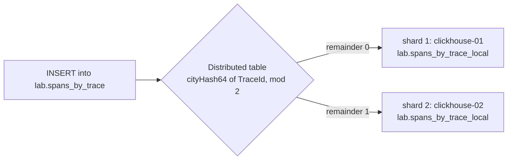

# Module 9: Sharding, trace locality and indexes (38 min)

## Why this matters

[Module 7](07-clickhouse.md) showed how two replicas keep the **same** data
for safety. That doesn't help when you have more spans than one server can
store or write. For that you split the data across servers, called
**sharding**, and the way you split it decides whether a trace stays in one
place or ends up scattered. This module also explains the skip indexes that
[module 8](08-data-model.md) listed at the end of `otel_traces`: they make
lookups like "find this trace id" fast, even though the trace id isn't in
the table's sorting key.

**What you'll be able to do after this module:**

- Draw the difference between replicas and shards.
- Explain what a `Distributed` table does on insert and on select.
- Explain why sharding by `cityHash64(TraceId)` keeps every trace on one
  shard, and why that matters.
- Pick a skip index (bloom filter, `minmax`, `set`) for a filter, and check
  with `EXPLAIN` that it actually skips data.

## Key terms

Reminders from earlier modules: a **replica** is a full copy of the data on
another server, a **granule** is a block of 8192 rows, the smallest unit
ClickHouse reads ([module 7](07-clickhouse.md)), and a **mutation** is a
background job that rewrites existing parts ([module 8](08-data-model.md)).

| Term | Plain meaning |
|---|---|
| Shard | A **slice** of the data. Each shard holds different rows |
| Local table | The ordinary table on each server that actually stores that shard's rows |
| `Distributed` table | A table that stores nothing. It forwards inserts to shards and collects query results from them |
| Sharding key | An expression computed for each row that decides which shard it goes to, usually a hash (a function that turns a value into a number; same input, same number) |
| Trace locality | All spans of one trace stored on the same shard |
| Hot shard | One shard getting much more data or traffic than the others |
| Skip index | An extra index that stores a small summary per block of granules, so ClickHouse can skip blocks that can't match |
| Bloom filter | A compact summary that answers "definitely not here" or "maybe here" for a value. Its false positive rate is how often "maybe" is wrong |
| Projection | A hidden second copy of the data inside each part, sorted another way |

## Idea

### Shards and replicas

**The problem.** Replication (module 7) gives you copies. Two replicas each
hold *all* the spans, so adding replicas makes the system safer and adds
read capacity, but every replica still has to store and write everything.
Once spans outgrow one server's disk or write speed, more copies don't
help.

**The fix: sharding.** Split the rows into slices and put each slice on a
different server. Each server then stores and writes only its share.

| | Replica | Shard |
|---|---|---|
| Is | A **copy** of the same data | A **slice** of the data |
| Adds | Availability and read capacity | Storage and write capacity |
| Here | `tracing`: 1 shard, 2 replicas | `lab_2shards` (lab only): the same 2 servers seen as 2 shards |

A picture of the three set-ups:

```text
Replication only: "tracing" cluster in this repo (1 shard x 2 replicas)
  clickhouse-01  [ all spans ]
  clickhouse-02  [ all spans ]          same data twice: safe, but no extra space

Sharding only: "lab_2shards" in this module's lab (2 shards x 1 replica)
  clickhouse-01  [ traces A, C, E ... ]
  clickhouse-02  [ traces B, D, F ... ] each holds about half: more space, no copies

Both: a typical production cluster (3 shards x 2 replicas = 6 servers)
                 shard 1        shard 2        shard 3
  replica a    [ slice 1 ]    [ slice 2 ]    [ slice 3 ]
  replica b    [ slice 1 ]    [ slice 2 ]    [ slice 3 ]
```

Both clusters are defined in `clickhouse/cluster.xml`. `tracing` has one
`<shard>` with two `<replica>` entries. `lab_2shards` has two `<shard>`
entries with one `<replica>` each, pointing at the same two servers. That
works because a cluster definition is only a list of addresses; the lab
creates separate tables for it.

> **Quick check:** In the 3 x 2 cluster above, one server in shard 2 dies. Can you still read every trace?
>
> <details><summary>Answer</summary>
>
> Yes. Shard 2's other replica holds the same slice. Lose both servers of shard 2, though, and about a third of all traces are gone, because no other shard has them.
> </details>

### The Distributed table

**The problem.** With several shards, someone has to decide which shard
each new span goes to, and every query has to ask all shards and combine
the answers. You don't want the gateway or every query writer doing that
by hand.

**What it is.** A `Distributed` table stores nothing itself. It's a router
sitting in front of a **local table** with the same columns on each shard,
like a mail sorting office that never keeps letters:

- **Insert**: for each row, compute the **sharding key**, divide it by the
  total shard weight and take the remainder (modulo), and send the row to
  that shard's local table. With two shards of weight 1, remainder 0 means
  shard 1 and remainder 1 means shard 2.
- **Select**: send the query to every shard, let each one work on its own
  slice, and merge the partial results into one answer.



The lab creates one like this:

```sql
CREATE TABLE lab.spans_by_trace AS lab.spans_by_trace_local
ENGINE = Distributed(lab_2shards, lab, spans_by_trace_local, cityHash64(TraceId));
```

`AS` copies the column list from the local table. The four `Distributed`
arguments are the cluster (which lists the shards), the database and name
of the local table on each shard, and the sharding key: `cityHash64`, a
fast hash that turns the trace id into a 64-bit number.

Two details you'll meet in the lab and config:

- By default, a `Distributed` insert returns right away and forwards rows to
  the shards in the background. The lab sets
  `distributed_foreground_insert = 1`, so the insert waits until every row
  has reached its shard, and the counts you query right after are complete.
- `<internal_replication>true</internal_replication>` in `cluster.xml`
  means: when a shard has several replicas, write each row to just one of
  them and let replication (module 7) copy it. Without it, the
  `Distributed` table would write to every replica itself.

**Why this repo has no `Distributed` tables.** The `tracing` cluster has one
shard, so there's nothing to route between. The gateway writes straight
into `otel_traces`, and replication copies it. The comment at the top of
`clickhouse/schema.sql` says the same.

> **Quick check:** A `Distributed` insert without `distributed_foreground_insert` returns OK, and a count straight after is a little low. Were rows lost?
>
> <details><summary>Answer</summary>
>
> Probably not. The insert returned once the rows were queued on the server you wrote to; they reach the shards a moment later. Count again. Rows are only at risk if that queue can't drain, for example while a shard is down.
> </details>

### Why `cityHash64(TraceId)` keeps a trace together

Follow the HR example from module 7. One user question to the HR assistant
produces spans from `hr-agent` (the turn, the agent, the model and tool
calls) and from `ticket-api` (its HTTP span). They arrive at the gateway
separately, from two different services, possibly seconds apart and in
different batches. But they all carry the same trace id.

The shard is a pure function of the trace id: same trace id, same hash,
same remainder, same shard. So every span of a trace lands on the **same
shard**, whichever service sent it and whenever it arrived. That gives you
three things:

1. **Trace lookups hit one shard.** With `optimize_skip_unused_shards = 1`,
   ClickHouse computes the shard from `WHERE TraceId = '...'` and asks only
   that one, instead of every shard.
2. **Per-trace work stays local.** Building a span tree (which span is the
   parent of which), or computing a trace's total duration, needs no data
   from other shards.
3. **Even spread.** Trace ids are random, so their hashes are spread
   evenly, and each shard gets about the same share.

Compare the alternatives:

- **A random key** (`rand()`) also spreads rows evenly, but scatters every
  trace over all shards. Every trace query then has to ask every shard and
  stitch the pieces together.
- **The service name** keeps a service's spans together, but a trace crosses
  services, so traces get split. And one busy service overloads its shard
  (a **hot shard**).

**Changing the number of shards later is painful.** The shard is the hash
modulo the shard count, so going from 2 to 3 shards changes the answer for
about two thirds of all trace ids, not just a third. Existing rows don't move
by themselves: they stay where they were written, and a lookup computed with
the new count asks the wrong shard. To really rebalance you copy almost every
row again ([module 10](10-copying-data.md) covers the copying tools). So
start with enough shards, or give a new shard a higher weight so that new
data fills it while old data ages out with the TTL.

**A production variant.** Instead of inserting through a `Distributed`
table, a gateway tier can route by trace id itself and write straight to
each shard's local table. Remember from [module 5](05-sampling.md): the
`loadbalancing` exporter already routes by trace id so tail sampling sees
whole traces. The principle is the same: **shard by trace id**.

> **Quick check:** You go from 4 shards to 5 by changing the cluster config only. What happens to `WHERE TraceId = '...'` with `optimize_skip_unused_shards = 1` for last week's traces?
>
> <details><summary>Answer</summary>
>
> About four in five return nothing: the new modulo points them at a different shard than the one they were written to. Without the setting the query asks all shards and still works, just slower.
> </details>

### Indexes you can add

**The problem.** Module 7 showed the sorting key
`(org_owner, org_service, SpanName, toDateTime(Timestamp))`. It makes
"this team's service" queries fast. But the most common trace query,
"show me trace `4bf9...`", filters on `TraceId`, which isn't in the key.
On its own, the primary index can't help, and ClickHouse would read the
`TraceId` column for every granule of every part.

You can only have one sorting key, because rows can only be physically
sorted one way. For other filters, ClickHouse offers several tools:

| Tool | What it does | Use for |
|---|---|---|
| **Sorting key** (`ORDER BY`) | Sparse primary index; the only physical order | Your most common filters (here: owner, service, span name, time) |
| **MATERIALIZED column** | Pulls a value out of a map into a real column on insert | Map keys you filter or group by often |
| **Skip index** `minmax` | Min and max per index block | Ranges on values that are clustered by the sorting key or by insert time |
| **Skip index** `set(N)` | Up to N distinct values per block | Equality on a few values that sit together in the sort order, so most blocks lack them |
| **Skip index** `bloom_filter` | "Definitely not here" or "maybe here" per block | Equality on rare values like ids (trace id, request id, conversation id) |
| `tokenbf_v1`, `ngrambf_v1` | Bloom filters over words or n-grams (short runs of characters) | Searching inside text |
| **Projection** | A second, hidden copy of the data inside each part, in another order | A second access pattern, e.g. `ORDER BY TraceId` |
| **Lookup table + MV** | A small table fed by a materialized view | Here, `otel_traces_trace_id_ts`: trace id to time range |

(MATERIALIZED columns and the lookup table were covered in
[module 8](08-data-model.md); MV means materialized view, the insert trigger
from module 7.)

### How a skip index works

A **skip index** stores a small summary for each block of granules. At
query time, ClickHouse checks each summary first. If the summary proves the
block can't contain a match, it skips the block without reading it. It's
like labels on moving boxes: the label "kitchen" tells you the box can't
hold your shoes, so you don't open it. It never tells you *which* box holds
your shoes; it only rules boxes out.

The three main kinds, with what the summary holds:

- **`minmax`**: the smallest and largest value in the block. For
  `WHERE Duration > 5 seconds`, a block whose largest duration is 2 seconds
  is skipped. This repo has one on `Duration`.
- **`set(N)`**: the list of distinct values in the block, if there are at
  most N. For `WHERE gen_ai_agent_name = 'quoter'`, a block whose set
  doesn't include `quoter` is skipped. If a block has more than N distinct
  values, it stores nothing for that block, and can't skip it.
- **`bloom_filter`**: a compact bit array. For each value in the block,
  ClickHouse runs a few hash functions and switches on the matching bits.
  To check a trace id, it computes the same bits: if any is off, the id is
  **definitely not** in the block; if all are on, it **might** be. The
  number in `bloom_filter(0.001)` is the false positive rate: about 1 "maybe"
  in 1000 is wrong, and those blocks get read for nothing. A lower rate
  means a bigger filter.

An index's `GRANULARITY` sets the block size, in granules: `GRANULARITY 1`
means one summary per granule (8192 rows); `GRANULARITY 4` means one
summary per 4 granules (4 x 8192 rows).

### The indexes in `schema.sql`

These are the `INDEX` lines at the end of the `otel_traces` column list:

```sql
INDEX idx_trace_id   TraceId                TYPE bloom_filter(0.001) GRANULARITY 1,
INDEX idx_request_id org_request_id         TYPE bloom_filter(0.001) GRANULARITY 1,
INDEX idx_tenant     org_tenant             TYPE bloom_filter(0.01)  GRANULARITY 1,
INDEX idx_conv_id    gen_ai_conversation_id TYPE bloom_filter(0.001) GRANULARITY 1,
INDEX idx_res_keys   mapKeys(ResourceAttributes)   TYPE bloom_filter(0.01) GRANULARITY 1,
INDEX idx_res_vals   mapValues(ResourceAttributes) TYPE bloom_filter(0.01) GRANULARITY 1,
INDEX idx_span_keys  mapKeys(SpanAttributes)       TYPE bloom_filter(0.01) GRANULARITY 1,
INDEX idx_span_vals  mapValues(SpanAttributes)     TYPE bloom_filter(0.01) GRANULARITY 1,
INDEX idx_duration   Duration               TYPE minmax GRANULARITY 1
```

- The first four are **bloom filters on ids**: trace, request, tenant and
  conversation. `0.001` (1 in 1000) is used for ids you look up exactly;
  `0.01` for the tenant, which makes that filter smaller.
- The next four are bloom filters on **map keys and values**. They help
  queries like `WHERE SpanAttributes['db.system.name'] = 'postgresql'` skip
  granules where that key or value never appears, even for attributes that
  weren't promoted to columns.
- The last is a **`minmax`** on `Duration`: the shortest and longest span per
  granule, so "spans slower than 5 seconds" skips granules of fast spans.
- All use `GRANULARITY 1`: one summary per granule.

The two other indexes in the file sit on the derived tables: a bloom filter
on `TraceId` in `otel_traces_trace_id_ts` and in `trace_entry`.

### When a skip index helps, and when it doesn't

It only helps if the value you search for is **rare or clustered**: present
in a few blocks and absent from the rest.

- **Rare**: a trace id appears in a handful of granules out of thousands, so
  a bloom filter skips nearly everything.
- **Clustered**: rows are stored in sorting-key order, so a value that
  follows the sorting key sits in a few neighboring granules. `minmax` and
  `set` work well on such values, because most blocks have a min, max or
  set of values that excludes it.
- **Neither**: a value spread over most of the data. Here the tenant comes
  close: the support and HR agents pick a tenant at random for every turn,
  all day, so a tenant shows up in most of their granules, and a test run
  of `WHERE org_tenant = ...` still read 8 of 11 granules. When nothing can
  be ruled out, the index just costs time.

The agent name sits in between; lab step 3 measures it. Always check with
`EXPLAIN indexes = 1` that an index actually skips something.

**Adding an index to an existing table** only affects parts written after
that. To build it for old parts, run `MATERIALIZE INDEX`, which starts a
mutation (remember from module 8: a background rewrite of existing parts).
You can follow it in `system.mutations`.

> **Quick check:** Would a `minmax` index on `TraceId` help trace lookups?
>
> <details><summary>Answer</summary>
>
> No. Trace ids are random and not in the sorting key, so every granule's min and max span nearly the whole range of ids and nothing can be ruled out. Rare, unclustered values need a bloom filter.
> </details>

## Remember it

> **Hash the trace id, and the whole family moves into the same house.**
> Any shard can tell you everything about a trace it holds, and you know which
> house to knock on.
>
> **A skip index is a "not here" sign on a box of granules.** It never points
> to the right box; it lets you skip the wrong ones.

## In this repo

- `clickhouse/cluster.xml`: `tracing` (1 shard x 2 replicas, with
  `internal_replication`) and `lab_2shards` (2 shards x 1 replica, the same
  two servers).
- `clickhouse/schema.sql`: the comment explains why there are no Distributed
  tables (one shard); the `INDEX` lines on `otel_traces` (bloom filters and a
  `minmax`); the `otel_traces_trace_id_ts` lookup table.
- `docs/tutorial/labs/sharding.sql`: the two-shard experiment.

## Principal engineer's notes

**Touch points**
- Gateway to ClickHouse (touch point 3 in [module 0](00-setup.md)) is where
  the sharding decision lives. Either the gateway writes to a `Distributed`
  table (simple, ClickHouse owns routing) or it routes by trace id and writes
  to local tables (the platform team owns routing). Pick one owner; if both
  route with different hashes, traces split.
- The shard count is a contract with every reader that sets
  `optimize_skip_unused_shards`. Change it, and their lookups silently miss.

**At scale**
- Don't shard early. One well-sized ClickHouse server can ingest well over
  a hundred thousand spans per second in large batches (it depends on span
  size) and hold tens of terabytes compressed.
  Shard when write throughput or disk outgrows the biggest node you'd run,
  not before: each shard adds servers, replicas and fan-out cost.
- A query on a `Distributed` table is as slow as its **slowest shard**. One
  shard with a long merge backlog or a cold disk slows every fan-out query.
  Trace lookups that hit one shard dodge this; dashboards don't.
- Plan headroom: size shards to stay under ~50-60% disk at full retention, so
  you can grow by adding replicas or bigger disks for a year before
  resharding.

**Operational issues**
- **Skew.** Hashing `TraceId` spreads traces evenly, but one huge trace still
  lands on one shard. Sharding by tenant instead would put a hot tenant on
  one shard. Compare `count()` per `shardNum()` regularly.
- **Background `Distributed` inserts** queue on the receiving server's disk
  when a shard is down. The queue grows, then floods the shard when it comes
  back. Writing to local tables from the gateway avoids this queue; the
  gateway's own retry queue takes its place.
- **Resharding** means copying data ([module 10](10-copying-data.md)) or
  waiting out the TTL with weights. With a 72-hour TTL, waiting is cheap;
  with 13 months of retention, it isn't.

**Design trade-offs**
- **Skip indexes cost insert CPU and disk.** Here the nine indexes on
  `otel_traces` take about 57 KiB against 2.4 MiB of column data (roughly
  2%); `system.data_skipping_indices` shows the sizes. Every insert builds
  them. Keep one only if `EXPLAIN indexes = 1` shows it skipping granules on
  a query people actually run. The tenant index here is tiny but barely
  skips anything, so it earns its keep only if tenants become clustered.
- **Trace locality vs even spread.** This repo would choose `TraceId`. Choose
  a coarser key (tenant, conversation) only if most queries filter on it and
  you can live with skew.

## Lab (20 min)

1. **Sharding by trace id against random sharding.** The script
   `docs/tutorial/labs/sharding.sql` creates a `lab` database on both
   servers, a local table on each, and two `Distributed` tables in front of
   them: one sharded by `cityHash64(TraceId)`, one by `rand()`. It copies
   the real spans in through both, then counts where they landed. Run it
   from the repo root:

   ```bash
   docker exec -i clickhouse-01 clickhouse-client --password demo --multiquery \
     < docs/tutorial/labs/sharding.sql
   ```

   The `ON CLUSTER` statements print one row per host first (each server
   confirming it ran the command). Then:

   ```text
   ┌─sharding────┬─shard─┬─spans─┬─traces─┐
   │ by trace id │     1 │ 25762 │   2068 │
   │ by trace id │     2 │ 25940 │   2087 │
   │ random      │     1 │ 25965 │   4134 │
   │ random      │     2 │ 25737 │   4134 │
   ┌─sharding────┬─traces─┬─traces_split_across_shards─┐
   │ by trace id │   4155 │                          0 │
   │ random      │   4155 │                       4113 │
   ┌─spans_in_trace─┐
   │             10 │
   ```

   How to read it (your numbers will differ):

   - **First table**: spans and distinct traces per shard. Both keys spread
     spans about evenly. With the trace-id key, each shard holds about
     half of the traces (2068 + 2087 = 4155). With `rand()`, each shard
     holds pieces of almost every trace (4134 of 4155 on each).
   - **Second table**: how many traces have spans on more than one shard.
     With the trace-id key, **none are split**. With `rand()`, almost every
     trace is on both shards; the few that aren't are tiny traces that
     landed on one shard by chance.
   - **Third table**: a single-shard trace lookup on the trace-id table
     worked, and found that trace's 10 spans. (`shardNum()`, used in the
     script, returns the number of the shard a row came from.)

   Now try the single-shard lookup on the random table.
   `force_optimize_skip_unused_shards = 1` turns "couldn't work out which
   shard to ask" into an error, instead of quietly asking all shards:

   ```sql
   SELECT count() FROM lab.spans_random
   WHERE TraceId = (SELECT any(TraceId) FROM otel.otel_traces)
   SETTINGS optimize_skip_unused_shards = 1, force_optimize_skip_unused_shards = 1;
   ```

   ```text
   Code: 507. DB::Exception: Sharding key is not deterministic. (UNABLE_TO_SKIP_UNUSED_SHARDS)
   ```

   "Not deterministic" means the key doesn't give the same answer for the
   same input: `rand()` can't tell ClickHouse which shard holds a trace.
   (`any(TraceId)` just picks some trace id, a cheap way to choose one.)

   Clean up the four lab tables:

   ```sql
   DROP TABLE lab.spans_by_trace       ON CLUSTER lab_2shards SYNC;
   DROP TABLE lab.spans_random         ON CLUSTER lab_2shards SYNC;
   DROP TABLE lab.spans_by_trace_local ON CLUSTER lab_2shards SYNC;
   DROP TABLE lab.spans_random_local   ON CLUSTER lab_2shards SYNC;
   ```

   (The script's last comment drops the whole `lab` database instead. That
   also works, but it removes any other scratch tables you keep there.)

2. **See the trace-id bloom filter skip granules.** `EXPLAIN indexes = 1`
   doesn't run the query; it shows which indexes ClickHouse would use, and
   how many parts and granules each one leaves to read:

   ```sql
   EXPLAIN indexes = 1
   SELECT * FROM otel.otel_traces
   WHERE TraceId = (SELECT any(TraceId) FROM otel.otel_traces);
   ```

   The output lists the index steps in order (partition, primary key, then
   skip indexes), each with how many parts and granules are still selected
   out of the total. The `PrimaryKey` step can't narrow anything, because
   `TraceId` isn't in the sorting key. Under `Skip`, `Name: idx_trace_id`
   shows far fewer parts and granules; a test run read 2 of 6 parts and 2
   of 11 granules.

3. **Add your own index, measure it, drop it.** This adds a `set(100)`
   index on the agent name to both servers, builds it for existing parts,
   checks the mutation finished, looks at the plan, and removes the index
   again:

   ```sql
   ALTER TABLE otel.otel_traces ON CLUSTER tracing
     ADD INDEX idx_agent_name gen_ai_agent_name TYPE set(100) GRANULARITY 4;
   ALTER TABLE otel.otel_traces ON CLUSTER tracing MATERIALIZE INDEX idx_agent_name;
   SELECT command, is_done FROM system.mutations WHERE table = 'otel_traces' ORDER BY create_time DESC LIMIT 1;

   EXPLAIN indexes = 1 SELECT count() FROM otel.otel_traces WHERE gen_ai_agent_name = 'quoter';

   ALTER TABLE otel.otel_traces ON CLUSTER tracing DROP INDEX idx_agent_name;
   ```

   The mutation is quick on this small table: run the `system.mutations`
   query again until it shows `is_done = 1` (a few seconds in a test run),
   then run the `EXPLAIN`. Under `Skip`, `Name: idx_agent_name` read 4 of
   11 granules in a test run with traffic paused and parts merged. Run it
   again while traffic is flowing, and the many small new parts, each a mix
   of every agent, can't be skipped.

   Why does it skip anything? `quoter` only runs in `sales-agent`, and the
   service is in the sorting key, so `quoter`'s rows are clustered in the
   sales-agent granules of each big part. Compare with a filter on the
   sorting key itself:

   ```sql
   EXPLAIN indexes = 1 SELECT count() FROM otel.otel_traces
   WHERE org_owner = 'sales-eng' AND org_service = 'sales-agent';
   ```

   This one is handled by `PrimaryKey`, with no extra index (5 of 11
   granules in the same test run): owner and service are the first two
   columns of the sorting key. **That's the lesson**: a `set` or `minmax`
   index pays off only when the value is clustered by the sorting key, and
   when it is, filtering on the sorting key columns usually does the same
   job for free. Drop the index (the last statement above) when you're done.

## Explain it back

> "Replicas are copies, shards are slices. A Distributed table routes each
> inserted row to a shard by a sharding key, and fans queries out to all
> shards. We shard by `cityHash64(TraceId)`, so every span of a trace lands on
> the same shard, wherever it came from. Trace lookups can then go to just one
> shard, and per-trace work stays local. A random key would scatter traces
> over every shard. Changing the shard count later reroutes most trace ids,
> so it means copying the data again. Inside a shard, the sorting key is the
> main index. Skip indexes only let ClickHouse skip granules: bloom filters
> work for rare values like ids, `set` and `minmax` only for values clustered
> by the sort order. I check with `EXPLAIN indexes = 1` that they actually
> skip something."

## Recap

- Replicas add safety and read capacity; shards add storage and write
  capacity. Real clusters use both.
- A `Distributed` table stores nothing: it routes inserts by the sharding
  key and merges query results from all shards.
- Sharding by a hash of the trace id keeps each trace on one shard, spreads
  load evenly, and lets a trace lookup ask just one shard. This repo has one
  shard, so no `Distributed` tables; the lab uses `lab_2shards`.
- Changing the shard count later reroutes most rows. Shard late, but plan
  the count up front.
- The sorting key is the only physical order. For other filters, use skip
  indexes (`bloom_filter` for rare values like ids, `minmax` and `set` for
  values clustered by the sort order), projections, or a lookup table.
- `schema.sql` has bloom filters on four ids and on the attribute maps' keys
  and values, and a `minmax` on `Duration`.
- Skip indexes only rule blocks out. Check with `EXPLAIN indexes = 1`, and
  run `MATERIALIZE INDEX` to build a new index for old parts.

## Check yourself

<details><summary>You add a second replica. Can the cluster now store twice as many spans?</summary>

No. A replica is a full copy, so each server still stores everything. To
store more, add shards.
</details>

<details><summary>Mixing module 5: your gateways tail-sample behind a <code>loadbalancing</code> exporter and write to a sharded cluster. Why do both layers route by trace id?</summary>

For the same reason at different stages. The sampler must see every span of
a trace to decide on the whole trace; the database must keep every span of a
trace on one shard so a lookup asks one shard. Routing by anything else
splits traces in one layer or the other.
</details>

<details><summary>Why not shard by service name?</summary>

A trace crosses services, so its spans would be scattered over shards. And
one busy service would overload one shard (a hot shard).
</details>

<details><summary>A bloom filter on <code>TraceId</code> says "maybe" for a granule. Does that granule contain the trace?</summary>

Not necessarily. "Maybe" can be a false positive (about 1 in 1000 for
`bloom_filter(0.001)`), so ClickHouse reads the granule to check. "No" is
always right, which is what makes skipping safe.
</details>

<details><summary>A bloom filter on <code>TraceId</code> is in place. Why also keep the <code>otel_traces_trace_id_ts</code> table?</summary>

The bloom filter still has to be checked for every part in every partition.
The lookup table is sorted by trace id, so it answers "when did this trace
happen?" in a few granules. The main query can then add a tight `Timestamp`
range and skip whole partitions and parts.
</details>

<details><summary>You add a skip index and queries get no faster. What do you check?</summary>

`EXPLAIN indexes = 1`: are granules actually skipped? Was the index
materialized for old parts (`system.mutations`)? Is the value present in
nearly every granule (then no index helps; consider the sorting key or a
projection)? Is `GRANULARITY` too coarse?
</details>

<details><summary>A two-shard cluster is full, so you add a third shard. Why isn't that just a config change?</summary>

Rows go to `hash mod shard count`. With three shards, about two thirds of
trace ids map to a different shard than before, but their old rows stay
where they were written. Lookups that skip unused shards would then ask the
wrong one. You either copy the data again into the new layout, or weight the
new shard so new data fills it while old data expires.
</details>

## Next

Sharding and replication change where rows live. [Module
10](10-copying-data.md) answers the practical follow-up: how to add a replica
and how to copy spans between ClickHouse servers, with or without a shared
Keeper, without losing late spans.

## Read more

- [Distributed table engine](https://clickhouse.com/docs/engines/table-engines/special/distributed)
- [Sharding and replication: horizontal scaling](https://clickhouse.com/docs/architecture/horizontal-scaling)
- [Data skipping indexes](https://clickhouse.com/docs/optimize/skipping-indexes)
- [Projections](https://clickhouse.com/docs/data-modeling/projections)
- [`EXPLAIN`](https://clickhouse.com/docs/sql-reference/statements/explain)
- [Schema design for observability (ClickHouse)](https://clickhouse.com/docs/use-cases/observability/schema-design)
