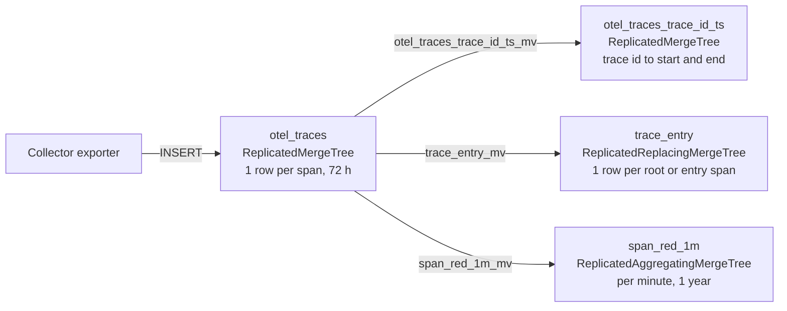

# Module 10: The data model, the DDL, and copying data between ClickHouse servers (35 min)

Do this module after module 6 (or at the end). It reads `clickhouse/schema.sql`
line by line, then shows every way to get data from one ClickHouse into another.

## Why this matters

`clickhouse/schema.sql` is the contract between the gateway and everyone who
queries traces. Each column, type and setting in it was chosen for a reason:
to keep spans small on disk, fast to filter, and cheap to delete when they
expire. Once you can read it, you can add your own columns safely, know which
summary table answers which question, and move data between servers without
losing anything.

**What you'll be able to do after this module:**

- Explain what each column of `otel_traces` holds, and why it has its type
  and codec.
- Explain what `LowCardinality`, `Map`, `Nested`, `ZSTD`, `Delta`,
  `MATERIALIZED` and `TTL` mean in the DDL.
- Describe the three summary tables and the materialized views that fill
  them, and read them correctly.
- Add a replica, copy data to an unrelated ClickHouse server with
  `remote()`, and move partitions with `FETCH` and `ATTACH`.

## Key terms

| Term | Plain meaning |
|---|---|
| DDL | Data Definition Language: the `CREATE`, `ALTER` and `DROP` statements that define tables |
| Stock columns | The columns the Collector's ClickHouse exporter writes; the same for every user of that exporter |
| Exporter | The gateway component that sends spans somewhere; here, the `clickhouse` exporter (module 4) |
| Resource attributes | Labels describing the service that made the span, like `service.name` or `org.owner` (module 1) |
| Span attributes | Labels describing one operation, like `http.route` or `gen_ai.usage.input_tokens` (module 1) |
| Codec | How a column is compressed on disk, for example `ZSTD(1)` or `Delta` |
| `LowCardinality(String)` | A string column stored as a dictionary of distinct values plus small numbers pointing into it |
| `Map(K, V)` | A column holding a set of key-value pairs per row, like a Python dict |
| `Nested` | A group of arrays of equal length per row, like a small table inside each row |
| `MATERIALIZED` column | A column ClickHouse computes from other columns on insert and stores |
| Materialized view (MV) | An insert trigger: runs a `SELECT` on each inserted block and writes the result to another table (module 6) |
| Aggregation state | A half-finished aggregate (for example, a summary of durations) that can be combined with others later |
| TTL | Time to live: when rows get deleted automatically (module 6) |
| Mutation | A background job that rewrites existing parts (module 7) |
| `remote()` | A table function that reads a table on another ClickHouse server, as if it were local |
| Detached folder | A per-table folder where parts sit on disk without being part of the table, until attached |

## Idea, part 1: what a span looks like as a row

### One wide table, one row per span

`otel.otel_traces` stores **one row per span**. There's no separate "trace"
table: a trace is simply all rows with the same `TraceId`. When a user asks
the HR assistant "I need a new laptop", the `agent_turn` span, the agent,
model and tool spans, and the `ticket-api` span each become one row, all
with the same `TraceId`.

The table has 48 columns, in three groups:

1. **22 stock columns**, which the exporter fills.
2. **26 MATERIALIZED columns**, which ClickHouse fills on insert by copying
   values out of the attribute maps.
3. **Indexes** that help find rows quickly.

The file starts with a comment and a database:

```sql
CREATE DATABASE IF NOT EXISTS otel ON CLUSTER tracing;
```

`IF NOT EXISTS` makes the file safe to run twice (the comment calls it
"idempotent"). `ON CLUSTER tracing` runs the statement on every server in
the `tracing` cluster (module 6), so both replicas get the database. Every
statement in the file has both.

### A short guide to the types and codecs

Before the columns, the vocabulary they use:

| In the DDL | What it means | Why it's used here |
|---|---|---|
| `String` | Text of any length | Ids and free text |
| `LowCardinality(String)` | Text stored as a dictionary: each distinct value is stored once, and each row holds a small number pointing to it | Columns with few distinct values (service names, span kinds). Smaller and faster. Bad for unique values like ids, where the dictionary would be as big as the data |
| `DateTime64(9)` | A timestamp with 9 decimal places of seconds: nanoseconds | OpenTelemetry records times in nanoseconds |
| `DateTime` | A timestamp to the second | Enough for sorting, time ranges and TTL |
| `UInt64`, `UInt32`, `UInt16` | Whole numbers, never negative, in 8, 4 or 2 bytes | Durations, token counts, HTTP status codes |
| `Map(LowCardinality(String), String)` | Key-value pairs per row. Keys use the dictionary trick; values are plain text | Attributes: any number of them, with any names |
| `Nested(...)` | Several arrays of equal length per row | A span's list of events or links |
| `AggregateFunction(...)` | A stored aggregation state, not a final value | The per-minute rollup table |
| `CODEC(ZSTD(1))` | Compress with Zstandard at level 1 (fast, good ratio). Without a codec, ClickHouse uses LZ4 | Smaller on disk than the default for text-heavy data |
| `CODEC(Delta, ZSTD(1))` | First replace each value by its difference from the previous one, then compress | Timestamps next to each other differ by small amounts, which compress far better than full timestamps |

### Group 1: the stock columns

The Collector's ClickHouse exporter maps each OTLP span field to one column.
OTLP (the OpenTelemetry Protocol, module 1) is how the SDK sends spans to
the gateway. These columns match the exporter's own default table, so any
tool built for that exporter can read this table too.

| OTLP span field | Column | Type | What it holds, and why this type |
|---|---|---|---|
| `start_time_unix_nano` | `Timestamp` | `DateTime64(9)`, `CODEC(Delta, ZSTD(1))` | When the span started, to the nanosecond. Delta works well because neighboring rows have close timestamps |
| `end - start` | `Duration` | `UInt64` | How long the span took, in **nanoseconds**; divide by `1e6` for milliseconds. Never negative, so unsigned |
| `trace_id` | `TraceId` | `String` | The id shared by every span of one request: 32 hex characters. Unique per trace, so a plain `String` |
| `span_id` | `SpanId` | `String` | This span's own id: 16 hex characters |
| `parent_span_id` | `ParentSpanId` | `String` | The id of the span that called this one. `''` (empty) means this is the **root**, the first span of the trace |
| `trace_state` | `TraceState` | `String` | The W3C `tracestate` header, extra vendor data passed along with the trace id. Usually empty |
| `name` | `SpanName` | `LowCardinality(String)` | The operation, like `agent_turn` or `execute_tool create_ticket`. Few distinct names, so `LowCardinality` |
| `kind` | `SpanKind` | `LowCardinality(String)` | The span's role: `Internal`, `Client`, `Server`... A handful of values |
| resource `service.name` | `ServiceName` | `LowCardinality(String)` | The service that made the span, like `hr-agent` or `ticket-api` |
| resource attributes | `ResourceAttributes` | `Map(LowCardinality(String), String)` | All labels describing the service. **Every value becomes a string** |
| scope name | `ScopeName` | `String` | The instrumentation library that created the span (`agent-tracing`) |
| scope version | `ScopeVersion` | `String` | That library's version |
| span attributes | `SpanAttributes` | `Map(LowCardinality(String), String)` | All labels describing this operation. Same: values are strings |
| `status.code` | `StatusCode` | `LowCardinality(String)` | `Unset`, `Ok` or `Error` |
| `status.message` | `StatusMessage` | `String` | The error description, if any |
| `events[]` | `Events.Timestamp`, `Events.Name`, `Events.Attributes` | `Nested`: parallel arrays | Things that happened during the span. Exceptions are events named `exception` |
| `links[]` | `Links.TraceId`, `Links.SpanId`, `Links.TraceState`, `Links.Attributes` | `Nested` | Span links: pointers to spans in other traces that are related |

That's 15 plain columns plus 3 event columns and 4 link columns: 22.

Three things to notice:

- **Attribute values are always strings.** `Map(LowCardinality(String),
  String)` holds any attribute in one column, whatever its name, but that
  means the number `200` is stored as the text `'200'`. Group 2 turns the
  important ones back into numbers.
- **`Nested` means parallel arrays.** A span with two events has, in that
  row, `Events.Name = ['retry', 'exception']` and
  `Events.Timestamp = [t1, t2]`: the first item of each array belongs
  together, and so on. Lab step 3 unpacks them with `ARRAY JOIN`.
- **Every stock column uses `ZSTD(1)`**, because spans are mostly text that
  repeats a lot. Module 6's lab measured `SpanAttributes` shrinking about
  13 times.

### Group 2: the MATERIALIZED columns

**The problem.** To filter on `SpanAttributes['gen_ai.agent.name']`,
ClickHouse has to read and decompress the **whole** `SpanAttributes` map
for every row, because a map is stored as one column holding all the keys
and values. It also can't put a map value in the sorting key or index it
on its own, and the value is a string, so you can't sum tokens without
converting first.

**The fix.** This repo adds 26 columns that copy chosen values out of the
maps **on insert**, and store them like any other column:

```sql
org_owner        LowCardinality(String) MATERIALIZED ResourceAttributes['org.owner'],
gen_ai_tokens_in UInt32                 MATERIALIZED toUInt32OrZero(SpanAttributes['gen_ai.usage.input_tokens']),
```

Read the first line as: "`org_owner` is a `LowCardinality(String)` column;
whenever a row is inserted, set it to the `org.owner` resource attribute."
If the key is missing, a map lookup returns `''`. In the second line,
`toUInt32OrZero` converts the text to a number, and gives `0` if the text is
empty or not a number.

A real column is small, compresses well, can be in the sorting key, and can
be indexed. The rule: **promote the attributes you filter or group by; leave
the rest in the maps.**

The 26 columns, in the order `schema.sql` lists them:

**Resource labels (`org.*`, from `ResourceAttributes`).** Every span of a
service carries these. `org.owner` and `org.service` are mandatory, and set
by the service; the gateway drops spans without them. The gateway adds the
other four (`resource/org_platform` in `otel-gateway-config.yaml`).

| Column | Type | Copied from | Holds |
|---|---|---|---|
| `org_owner` | `LowCardinality(String)` | `org.owner` | The owning team, like `people-tech` |
| `org_service` | `LowCardinality(String)` | `org.service` | The service, like `hr-agent` |
| `org_region` | `LowCardinality(String)` | `org.region` | Where the gateway runs (`local` here) |
| `org_platform` | `LowCardinality(String)` | `org.platform` | `docker` here |
| `org_cluster` | `LowCardinality(String)` | `org.cluster` | `agent-tracing` here |
| `org_env` | `LowCardinality(String)` | `org.env` | `dev` here |

**Span labels (`org.*`, from `SpanAttributes`, optional).**

| Column | Type | Copied from | Holds |
|---|---|---|---|
| `org_tenant` | `String` | `org.tenant` | The customer the request was for |
| `org_agent_interface` | `LowCardinality(String)` | `org.agent.interface` | How the user reached the agent: `web` for the HR agent |
| `org_request_id` | `String` | `org.request_id` | One id per user request, on entry spans |

`org_request_id` is a plain `String` because every request has a new id:
`LowCardinality` would only add a huge dictionary. `org_tenant` is also a
plain `String`, which leaves room for many tenants.

**Hot OpenTelemetry attributes.**

| Column | Type | Copied from | Holds |
|---|---|---|---|
| `http_route` | `LowCardinality(String)` | `http.route` | The URL pattern an API matched, like `/v1/search` |
| `http_status` | `UInt16` | `http.response.status_code`, via `toUInt16OrZero` | The HTTP status as a number (0 if absent) |

**GenAI attributes** (the `gen_ai.*` semantic conventions, module 3).

| Column | Type | Copied from |
|---|---|---|
| `gen_ai_operation` | `LowCardinality(String)` | `gen_ai.operation.name` (`chat`, `execute_tool`, `invoke_agent`...) |
| `gen_ai_provider` | `LowCardinality(String)` | `gen_ai.provider.name` |
| `gen_ai_request_model` | `LowCardinality(String)` | `gen_ai.request.model` |
| `gen_ai_response_model` | `LowCardinality(String)` | `gen_ai.response.model` |
| `gen_ai_finish_reasons` | `String` | `gen_ai.response.finish_reasons` |
| `gen_ai_conversation_id` | `String` | `gen_ai.conversation.id` (unique per conversation, so plain `String`) |
| `gen_ai_agent_name` | `LowCardinality(String)` | `gen_ai.agent.name` (like `hr_assistant`) |
| `gen_ai_agent_id` | `LowCardinality(String)` | `gen_ai.agent.id` |
| `gen_ai_agent_version` | `LowCardinality(String)` | `gen_ai.agent.version` |
| `gen_ai_tool_name` | `LowCardinality(String)` | `gen_ai.tool.name` (like `create_ticket`) |
| `gen_ai_tool_type` | `LowCardinality(String)` | `gen_ai.tool.type` |
| `gen_ai_tokens_in` | `UInt32` | `gen_ai.usage.input_tokens`, via `toUInt32OrZero` |
| `gen_ai_tokens_out` | `UInt32` | `gen_ai.usage.output_tokens`, via `toUInt32OrZero` |
| `gen_ai_tokens_cache_read` | `UInt32` | `gen_ai.usage.cache_read.input_tokens`, via `toUInt32OrZero` |
| `gen_ai_tokens_reasoning` | `UInt32` | `gen_ai.usage.reasoning.output_tokens`, via `toUInt32OrZero` |

Token counts become `UInt32` so you can `sum()` them directly.

**`DEFAULT`, `MATERIALIZED` and `ALIAS`.** Three column kinds look similar:

| Kind | Computed | Stored | In `SELECT *` | Can be inserted |
|---|---|---|---|---|
| `DEFAULT expr` | On insert, if not given | Yes | Yes | Yes |
| `MATERIALIZED expr` | Always, on insert | Yes | **No** | **No** |
| `ALIAS expr` | At query time | No | No | No |

`MATERIALIZED` is safe here precisely because the exporter doesn't know these
columns exist: it inserts the stock columns, and ClickHouse fills in the rest.
Because they're hidden from `SELECT *`, you name them explicitly in queries
(`SELECT org_owner, ...`).

### Group 3: the indexes

The `INDEX` lines add skip indexes (module 7): small summaries per granule
(8192 rows) that let ClickHouse skip granules that can't match.

```sql
INDEX idx_trace_id   TraceId                TYPE bloom_filter(0.001) GRANULARITY 1,
INDEX idx_request_id org_request_id         TYPE bloom_filter(0.001) GRANULARITY 1,
INDEX idx_tenant     org_tenant             TYPE bloom_filter(0.01)  GRANULARITY 1,
INDEX idx_conv_id    gen_ai_conversation_id TYPE bloom_filter(0.001) GRANULARITY 1,
INDEX idx_res_keys   mapKeys(ResourceAttributes)   TYPE bloom_filter(0.01) GRANULARITY 1,
INDEX idx_res_vals   mapValues(ResourceAttributes) TYPE bloom_filter(0.01) GRANULARITY 1,
INDEX idx_span_keys  mapKeys(SpanAttributes)       TYPE bloom_filter(0.01) GRANULARITY 1,
INDEX idx_span_vals  mapValues(SpanAttributes)     TYPE bloom_filter(0.01) GRANULARITY 1,
INDEX idx_duration   Duration               TYPE minmax GRANULARITY 1
```

- The first four are **bloom filters on ids**: trace, request, tenant and
  conversation. They answer "this id is definitely not in this granule".
  The number is the false positive rate: `0.001` (1 in 1000) for ids you
  look up exactly, `0.01` for the rest, which makes those filters smaller.
- The next four are bloom filters on **map keys and values**. They help
  queries like `WHERE SpanAttributes['gen_ai.tool.name'] = 'create_ticket'`
  skip granules where that key or value never appears, even for attributes
  that weren't promoted.
- The last is a **`minmax`** on `Duration`: the shortest and longest span per
  granule, so "spans slower than 5 seconds" skips granules of fast spans.
- `GRANULARITY 1` means one summary per granule.

### The engine clause, piece by piece

```sql
ENGINE = ReplicatedMergeTree          -- storage engine; replicated through Keeper (module 6)
PARTITION BY toDate(Timestamp)        -- one partition per day: retention unit
ORDER BY (org_owner, org_service, SpanName, toDateTime(Timestamp))
                                      -- sort order and sparse primary index (PRIMARY KEY defaults to this)
TTL toDateTime(Timestamp) + INTERVAL 72 HOUR
SETTINGS ttl_only_drop_parts = 1;     -- drop whole expired parts, don't rewrite them
```

Line by line:

- **`ENGINE = ReplicatedMergeTree`**: a MergeTree table (inserts become
  sorted parts, merged in the background) whose parts are copied to every
  replica, coordinated by Keeper.
- **`PARTITION BY toDate(Timestamp)`**: one partition per calendar day, so
  each part holds one day's spans.
- **`ORDER BY (...)`**: rows inside each part are sorted by owner, service,
  span name, then time to the second. With no separate `PRIMARY KEY`, this is
  also the sparse primary index. Time is converted with `toDateTime`, to
  whole seconds, which is enough precision for sorting and time filters.
- **`TTL ... + INTERVAL 72 HOUR`**: a row expires 72 hours after its start
  time.
- **`ttl_only_drop_parts = 1`**: wait until every row in a part has expired,
  then drop the whole part, instead of rewriting parts to cut out single
  rows. With daily partitions, that drops one day at a time.

`ReplicatedMergeTree` with no arguments uses the server's default Keeper path
`/clickhouse/tables/{uuid}/{shard}` and replica name `{replica}`. `{uuid}` is
the table's UUID (a unique id ClickHouse gives each table), and `{shard}`
and `{replica}` come from `macros-0N.xml`. Both replicas have the same UUID,
because the table was created with `ON CLUSTER`, so they share one path in
Keeper.

### The derived tables

**The problem.** Three questions come up all the time: "when did trace X
happen?", "list recent requests", and "what's each service's call rate,
error count and latency per minute?" Scanning raw spans for each is
wasteful, and raw spans are deleted after 72 hours, but you want latency
trends for a year.

**The fix.** Three smaller tables, each filled by a materialized view (an
insert trigger, module 6) on `otel_traces`:



Each materialized view runs on every inserted **block** and writes to its
`TO` table. A view defined as `CREATE MATERIALIZED VIEW ... TO otel.x AS
SELECT ...` stores nothing itself; it just forwards its results into
`otel.x`. Each view only ever sees the rows of the current insert, never
the whole table.

#### `otel_traces_trace_id_ts`: when did this trace happen?

```sql
CREATE TABLE IF NOT EXISTS otel.otel_traces_trace_id_ts ON CLUSTER tracing
(
    TraceId String,
    Start   DateTime,
    End     DateTime,
    INDEX idx_trace_id TraceId TYPE bloom_filter(0.01) GRANULARITY 1
)
ENGINE = ReplicatedMergeTree
PARTITION BY toDate(Start)
ORDER BY (TraceId, Start)
TTL Start + INTERVAL 72 HOUR
SETTINGS ttl_only_drop_parts = 1;
```

- **Columns**: the trace id, and the earliest and latest span time seen for
  it, to the second.
- **Why**: `otel_traces` is sorted by owner and service, not trace id. This
  small table is sorted **by `TraceId`**, so "when did trace X happen?" reads
  a few granules. With the answer, the real query on `otel_traces` can add a
  tight `Timestamp` range and skip every other day and most parts (module 7).
- **Same partitioning and TTL as the spans**, so lookups expire with them.

The view that fills it:

```sql
SELECT TraceId, min(Timestamp) AS Start, max(Timestamp) AS End
FROM otel.otel_traces
WHERE TraceId != ''
GROUP BY TraceId;
```

Because it runs per insert, a trace whose spans arrive in three batches gets
three rows. So when you query it, take `min(Start)` and `max(End)` for the
trace id.

#### `trace_entry`: the list of requests

```sql
CREATE TABLE IF NOT EXISTS otel.trace_entry ON CLUSTER tracing
(
    Start                DateTime64(9),
    TraceId              String,
    org_request_id       String,
    org_agent_interface  LowCardinality(String),
    org_owner            LowCardinality(String),
    org_service          LowCardinality(String),
    org_tenant           String,
    Duration             UInt64,
    StatusCode           LowCardinality(String),
    INDEX idx_trace_id TraceId TYPE bloom_filter(0.001) GRANULARITY 1
)
ENGINE = ReplicatedReplacingMergeTree
PARTITION BY toDate(Start)
ORDER BY (org_request_id, TraceId)
TTL toDateTime(Start) + INTERVAL 72 HOUR
SETTINGS ttl_only_drop_parts = 1;
```

(Column alignment simplified from `schema.sql`.) The view copies these
columns from a span when it's a request's **entry span** or a trace's
**root**:

```sql
WHERE org_request_id != '' OR ParentSpanId = ''
```

- **Columns**: when the request started, its trace id and request id, how
  the user reached the agent, owner, service, tenant, duration and status.
  Enough for a "recent requests" page, filterable by request id, tenant or
  interface.
- **`ORDER BY (org_request_id, TraceId)`**: sorted by request id, so looking
  up a request is fast.
- **Why `ReplacingMergeTree`**: in the HR example, two spans match the
  `WHERE`: the agent's `agent_turn` span carries `org.request_id`, and so
  does the `ticket-api` entry span (it receives the request id through
  baggage, module 1). Both give the same `(org_request_id, TraceId)`. A
  **ReplacingMergeTree** keeps only one row per `ORDER BY` key, so the
  request ends up as one row.

**ReplacingMergeTree replaces eventually.** Duplicates are removed only when
the parts holding them merge. Until then, both copies are visible. With no
version column (none is given here), the merge keeps the row that was
inserted last. Add `FINAL` to a query to remove duplicates at read time
(slower), or group by the key yourself. Lab step 5 shows the difference.

#### `span_red_1m`: the per-minute rollup

RED stands for **Rate, Errors, Duration**: the three standard health numbers
for any service.

```sql
CREATE TABLE IF NOT EXISTS otel.span_red_1m ON CLUSTER tracing
(
    minute       DateTime,
    org_owner    LowCardinality(String),
    org_service  LowCardinality(String),
    SpanName     LowCardinality(String),
    calls        UInt64,
    errors       UInt64,
    duration_q   AggregateFunction(quantiles(0.5, 0.95, 0.99), UInt64)
)
ENGINE = ReplicatedAggregatingMergeTree
PARTITION BY toDate(minute)
ORDER BY (org_owner, org_service, SpanName, minute)
TTL minute + INTERVAL 1 YEAR
SETTINGS ttl_only_drop_parts = 1;
```

And the view:

```sql
SELECT toStartOfMinute(Timestamp) AS minute,
       org_owner, org_service, SpanName,
       count()                       AS calls,
       countIf(StatusCode = 'Error') AS errors,
       quantilesState(0.5, 0.95, 0.99)(Duration) AS duration_q
FROM otel.otel_traces
GROUP BY minute, org_owner, org_service, SpanName;
```

- **Columns**: the minute, who and what (owner, service, span name), how many
  spans (`calls`), how many had status `Error` (`errors`), and a duration
  summary (`duration_q`).
- **`duration_q` is an aggregation state, not a number.** A percentile (p95
  = the duration 95% of calls were faster than) can't be computed by
  averaging per-batch percentiles. So the view stores
  `quantilesState(...)`, a compact summary of the durations it saw, and you
  combine summaries later with `quantilesMerge(...)` to get p50, p95 and
  p99 for any time range.
- **`AggregatingMergeTree`** is the engine that knows how to combine those
  stored states when parts merge.
- **Kept for a year** (`TTL minute + INTERVAL 1 YEAR`), long after the raw
  spans are gone. A minute per service and span name is a tiny row.

**How to read it.** Each view run (one per insert) writes its own rows, so
one minute of one service and span name is usually spread over several
rows. Always `GROUP BY` and use `sum(calls)`, `sum(errors)` and
`quantilesMerge(...)(duration_q)`; never read the rows as if they were
final. Lab step 4 does this.

### Changing the schema

- `ALTER TABLE ... ON CLUSTER tracing ADD COLUMN ...` goes through the DDL
  queue in Keeper (`/clickhouse/task_queue/ddl`) and runs on every node.
- A newly added `MATERIALIZED` column is computed **on read** for old parts,
  until you run `MATERIALIZE COLUMN`, which rewrites them as a mutation (a
  background rewrite of existing parts).
- Never rename or retype stock columns: the exporter would fail to insert.
  Since `create_schema: false` in `otel-gateway-config.yaml`, the exporter
  doesn't create or change tables; this table is yours to maintain.

## Idea, part 2: getting data from one ClickHouse into another

**The problem.** Sooner or later you need spans somewhere else: a new
server to replace a broken one, a copy for testing, a second region. Which
method works depends on one question: **do the two servers share a
Keeper?** Servers that share one can use replication. Servers that don't
have to copy rows over the network.

Pick the tool by what the two servers share:

| Goal | How | Shared Keeper needed |
|---|---|---|
| **Add a replica**, or rebuild a lost one | Create the same table (same UUID or path) on the new server with its own `{replica}` macro. It registers in Keeper and **fetches every part** from its peers | Yes |
| **One-off copy from any ClickHouse** | `INSERT INTO t SELECT * FROM remote('host', db.t, 'user', 'password')` (`remoteSecure` for TLS) | No |
| **Keep copying** | Repeat the `remote()` insert for rows newer than your max timestamp; or a refreshable materialized view; or **dual-write** at the gateway (two `clickhouse` exporters) | No |
| Copy partitions between replicated tables | `ALTER TABLE t FETCH PARTITION ... FROM '<keeper path>'`, then `ATTACH PARTITION` | Yes |
| Copy within one server | `ALTER TABLE t ATTACH PARTITION ... FROM other_table` (instant, hard links) | No |
| Snapshot and restore | `BACKUP TABLE ... TO Disk(...)` or `S3(...)`; `RESTORE` | No |
| Turn a single-node `MergeTree` into `ReplicatedMergeTree` | Create a replicated table and `ATTACH PARTITION FROM` the old one; or put a `convert_to_replicated` flag file in the table's data directory and restart | Yes, afterwards |

What each one means:

- **Adding a replica.** A replicated table is identified in Keeper by its
  path. If a new server creates a table that resolves to the **same path**
  (here: the same UUID and `{shard}`), with a **new** `{replica}` name, it
  joins as one more replica. Keeper's log lists every part, so the new
  replica downloads all of them from its peers. You copy no data yourself.
- **`remote()`.** `remote('host', db.table, 'user', 'password')` is a
  *table function*: it reads a table on another server over the normal
  ClickHouse port (9000) as if it were local. `INSERT INTO t SELECT * FROM
  remote(...)` pulls every row across. `remoteSecure` does the same over
  TLS (encrypted connections).
- **Keep copying.** Run the `remote()` insert again on a schedule, only for
  rows newer than what you already have. A *refreshable materialized view*
  is ClickHouse's built-in way to re-run a query on a schedule. Or skip
  copying entirely: give the gateway two `clickhouse` exporters, one per
  destination, so every span is written to both (**dual-write**).
- **`FETCH PARTITION` and `ATTACH PARTITION`.** `FETCH` downloads all parts
  of one partition (one day, here) from another replicated table's replicas,
  using that table's Keeper path, into this table's **detached** folder.
  Detached parts sit on disk but aren't part of the table yet. `ATTACH`
  moves them in, and they become visible.
- **`ATTACH PARTITION ... FROM other_table`** on the same server doesn't copy
  data at all: it creates **hard links**, extra file names pointing to the
  same data on disk. It's instant, but both tables need the same structure
  and partition key.
- **`BACKUP` and `RESTORE`** write a snapshot of tables to a disk or to S3
  storage, and restore it later on any server.

Two things catch people out:

- **`SELECT *` skips `MATERIALIZED` columns**, so a `remote()` copy inserts
  only the stock columns, and the target recomputes the rest. That's what you
  want: the copy is consistent with the target's own schema.
- **Materialized views fire on inserts, not on replication.** Parts fetched by
  a new replica don't run its views, but they don't need to: the target tables
  replicate on their own. A new replica still needs the views, so that inserts
  it receives *directly* fill the derived tables.

## Remember it

> **A span is a row; a trace is a `WHERE TraceId = ...`.** Stock columns come
> from the exporter, MATERIALIZED columns are your shortcuts, and the views are
> triggers that keep summaries.
>
> **Copying between ClickHouse servers: same Keeper? Let replication do it.
> Different Keeper? Pull with `remote()`.**

## In this repo

- `clickhouse/schema.sql`: every table and view, with comments.
- `otel-gateway-config.yaml`: `create_schema: false` and the table name
  (`traces_table_name: otel_traces`).
- `docs/tutorial/labs/compose.replication.yaml`: two extra servers for this lab:
  `clickhouse-03` (a third replica, same Keeper, using
  `docs/tutorial/labs/macros-03.xml`, which sets `{replica}` to
  `clickhouse-03`) and `clickhouse-solo` (standalone, no Keeper; its Play UI
  is on port 8126).
- `docs/tutorial/labs/add-replica.sh`: copies each table's DDL, with its UUID,
  from `clickhouse-01` to `clickhouse-03`. Tables first, then the views that
  write into them.

## Lab (20 min)

Run the SQL in the Play UI at <http://localhost:8123/play> unless a step
says otherwise.

### Part 1: read the model

1. **Column kinds.** `system.columns` describes every column;
   `default_kind` is empty for a normal column, or says `MATERIALIZED`,
   `DEFAULT` or `ALIAS`:

   ```sql
   SELECT default_kind, count() FROM system.columns
   WHERE database = 'otel' AND table = 'otel_traces' GROUP BY 1;
   ```

   22 stock columns (empty `default_kind`) and 26 `MATERIALIZED` ones.

2. **One span as the exporter wrote it.** `FORMAT Vertical` prints one
   column per line, which is easier to read for wide rows:

   ```sql
   SELECT TraceId, ResourceAttributes, SpanAttributes FROM otel.otel_traces
   WHERE ServiceName = 'kb-search-api' LIMIT 1 FORMAT Vertical;
   ```

   Note `'http.response.status_code':'200'`: a number stored as a string in
   the map. The `http_status` column turns it back into a `UInt16`. Also
   find the `org.*` keys in `ResourceAttributes`: those are what the
   `org_*` columns copy.

3. **Events are parallel arrays.** `ARRAY JOIN` turns each array item into
   its own row, so one span with two events becomes two rows. This lists the
   three most recent exceptions:

   ```sql
   SELECT SpanName, e.Name, e.Attributes['exception.message'] AS message
   FROM otel.otel_traces ARRAY JOIN Events AS e
   WHERE e.Name = 'exception' ORDER BY Timestamp DESC LIMIT 3;
   ```

   ```text
   execute_tool search_knowledge_base  exception  127.0.0.1:18081/v1/search returned 504
   invoke_agent researcher             exception  127.0.0.1:18081/v1/search returned 504
   ```

   Port 18081 is `kb-search-api`. The same failure shows up on the tool span
   and on the agent span above it.

4. **Read the rollup correctly (merge the states).** Calls, errors and
   p50/p95/p99 latency of `agent_turn` per agent service over the last
   hour. `quantilesMerge` combines the stored states; `arrayMap(x -> round(x
   / 1e6), ...)` converts each nanosecond result to milliseconds:

   ```sql
   SELECT org_service, sum(calls) AS calls, sum(errors) AS errors,
          arrayMap(x -> round(x / 1e6), quantilesMerge(0.5, 0.95, 0.99)(duration_q)) AS p50_p95_p99_ms
   FROM otel.span_red_1m
   WHERE minute > now() - INTERVAL 1 HOUR AND SpanName = 'agent_turn'
   GROUP BY org_service ORDER BY org_service;
   ```

   ```text
   hr-agent       154   0  [728,927,986]
   sales-agent    153  27  [781,1033,1112]
   support-agent  155  52  [1363,1753,1851]
   ```

   Each row is one agent service: turns in the last hour, turns that ended
   in error, then p50, p95 and p99 in milliseconds.

5. **Replacing is eventual.** This counts `trace_entry` rows as stored, and
   after `FINAL` removes duplicates at read time:

   ```sql
   SELECT (SELECT count() FROM otel.trace_entry) AS raw,
          (SELECT count() FROM otel.trace_entry FINAL) AS deduplicated;
   ```

   A test run showed `2968` and `2965`: three duplicates not yet merged away,
   such as an `agent_turn` row and a `ticket-api` row for the same request
   that sit in different parts.

6. **Add a promoted column, and see what it does with old data.** This adds
   an `http_method` column, queries it, stores it for old parts, then drops
   it again:

   ```sql
   ALTER TABLE otel.otel_traces ON CLUSTER tracing
     ADD COLUMN http_method LowCardinality(String) MATERIALIZED SpanAttributes['http.request.method'];
   SELECT http_method, count() FROM otel.otel_traces WHERE http_method != '' GROUP BY 1;
   ALTER TABLE otel.otel_traces ON CLUSTER tracing MATERIALIZE COLUMN http_method;
   ALTER TABLE otel.otel_traces ON CLUSTER tracing DROP COLUMN http_method;
   ```

   The `SELECT` already returns values for old spans (computed on read); the
   `MATERIALIZE COLUMN` mutation then stores them. Try inserting into a
   materialized column, and you get `Code: 44 ... Cannot insert column`.

### Part 2: copy between servers

Start the two extra servers (from the repo root). Passing two `-f` files
tells Docker Compose to combine them, so the lab file adds services to the
main stack:

```bash
docker compose -f compose.yaml -f docs/tutorial/labs/compose.replication.yaml up -d clickhouse-03 clickhouse-solo
```

7. **Add a third replica.** It copies everything by itself. The script
   creates empty tables with the same UUIDs on `clickhouse-03`; then this
   checks replication status there, and compares row counts:

   ```bash
   docs/tutorial/labs/add-replica.sh
   sleep 15
   docker exec clickhouse-03 clickhouse-client --password demo -q \
     "SELECT table, total_replicas, active_replicas, queue_size FROM system.replicas WHERE database = 'otel'"
   for h in clickhouse-01 clickhouse-03; do
     docker exec $h clickhouse-client --password demo -q "SELECT '$h', count() FROM otel.otel_traces"
   done
   ```

   ```text
   otel_traces              3  3  0
   ...
   clickhouse-01  35003
   clickhouse-03  35003
   ```

   `3  3  0` means three replicas, all three active, and nothing left in the
   fetch queue. The script did nothing but create empty tables with the
   same UUIDs. Keeper told `clickhouse-03` which parts exist, and it fetched
   them from its peers. New spans keep arriving on all three. Writes work in
   any direction: a row inserted on `clickhouse-03` shows up on
   `clickhouse-01`, including in `trace_entry`, via `clickhouse-03`'s own
   view.

8. **Copy into a standalone server with `remote()`.** No shared Keeper, so
   replication can't help; pull the data instead. First create a
   non-replicated copy of the table on `clickhouse-solo`. The pipeline below
   prints the table's DDL from `clickhouse-01` (`TSVRaw` prints it without
   escaping), uses `sed` to replace the `ReplicatedMergeTree(...)` engine
   with a plain `MergeTree`, and runs the result on `clickhouse-solo`:

   ```bash
   docker exec clickhouse-solo clickhouse-client --password demo -q "CREATE DATABASE IF NOT EXISTS otel"
   docker exec clickhouse-01 clickhouse-client --password demo --format TSVRaw -q "SHOW CREATE TABLE otel.otel_traces" \
     | sed -E "s/ReplicatedMergeTree\(.*\)/MergeTree/" \
     | docker exec -i clickhouse-solo clickhouse-client --password demo --multiquery
   ```

   Then, in the solo server's Play UI at <http://localhost:8126/play>:

   ```sql
   -- Full copy
   INSERT INTO otel.otel_traces
   SELECT * FROM remote('clickhouse-01', otel.otel_traces, 'default', 'demo');

   -- Later: copy only what's new (run on a schedule for an ongoing copy)
   INSERT INTO otel.otel_traces
   SELECT * FROM remote('clickhouse-01', otel.otel_traces, 'default', 'demo')
   WHERE Timestamp > (SELECT max(Timestamp) FROM otel.otel_traces);

   -- Verify: same rows, same checksum, same recomputed columns
   SELECT count(), sum(cityHash64(SpanId)) % 1000000, sum(gen_ai_tokens_in) FROM otel.otel_traces;
   ```

   In the incremental copy, the inner `SELECT max(Timestamp)` runs on the
   solo server (the newest span it already has), and the `WHERE` filters
   the remote rows. The verify query counts rows, builds a checksum from the
   span ids, and sums a MATERIALIZED column.

   Run the verify query on <http://localhost:8123/play> too. In a test run,
   both returned `35003  534512  95884`. The token sum matching shows the
   MATERIALIZED columns were rebuilt on the solo server. (If traffic is
   running, `clickhouse-01` may have a few more rows by the time you check;
   run the incremental copy again first.)

9. **The other direction: a single server into the replicated cluster.**
   Insert once on any replica, and replication copies it to the others.
   This creates a small `notes` table on the solo server, a replicated one
   on the cluster, pulls the rows across, and checks every replica has them:

   ```sql
   -- on clickhouse-solo
   CREATE TABLE otel.notes (id UInt32, note String) ENGINE = MergeTree ORDER BY id;
   INSERT INTO otel.notes SELECT number, concat('note ', toString(number)) FROM numbers(1000);

   -- on clickhouse-01
   CREATE TABLE otel.notes ON CLUSTER tracing (id UInt32, note String) ENGINE = ReplicatedMergeTree ORDER BY id;
   INSERT INTO otel.notes SELECT * FROM remote('clickhouse-solo', otel.notes, 'default', 'demo');
   SELECT hostName(), count() FROM clusterAllReplicas('tracing', otel.notes) GROUP BY 1;
   DROP TABLE otel.notes ON CLUSTER tracing SYNC;
   ```

   Every replica of `tracing` reports 1000 rows, though you inserted only
   on `clickhouse-01`.

10. **Fetch a partition from another replicated table** (shared Keeper).
    This creates an empty replicated table with an explicit Keeper path,
    fetches one day of `otel_traces` into its detached folder, attaches it,
    counts it, and drops the table:

    ```sql
    CREATE TABLE otel.otel_traces_restore AS otel.otel_traces
    ENGINE = ReplicatedMergeTree('/clickhouse/tables/lab/otel_traces_restore', '{replica}')
    PARTITION BY toDate(Timestamp) ORDER BY (org_owner, org_service, SpanName, toDateTime(Timestamp));

    -- the source path comes from system.replicas
    ALTER TABLE otel.otel_traces_restore FETCH PARTITION ID '20261121'
      FROM '/clickhouse/tables/<otel_traces uuid>/01';
    ALTER TABLE otel.otel_traces_restore ATTACH PARTITION ID '20261121';
    SELECT count() FROM otel.otel_traces_restore;
    DROP TABLE otel.otel_traces_restore SYNC;
    ```

    Use your own partition id (`SELECT DISTINCT partition_id FROM system.parts
    WHERE table = 'otel_traces'`), and the real source path (`SELECT
    zookeeper_path FROM system.replicas WHERE table = 'otel_traces'`). The
    explicit path for the new table is needed because `{uuid}` only works
    with `ON CLUSTER` or an explicit UUID.

11. **Clean up.** Unregister the extra replica from Keeper *before* removing
    its container. Otherwise the others keep a dead replica in their metadata,
    and you'd have to remove it with `SYSTEM DROP REPLICA 'clickhouse-03' FROM TABLE ...`:

    ```bash
    docker exec clickhouse-03 clickhouse-client --password demo -q "DROP DATABASE otel SYNC"
    docker compose -f compose.yaml -f docs/tutorial/labs/compose.replication.yaml rm -sfv clickhouse-03 clickhouse-solo
    ```

    Dropping a replicated table on one replica only removes **that replica**;
    the data stays on the others (`total_replicas` goes back to 2).

## Explain it back

> "Each span is one row in `otel_traces`; a trace is all rows with one trace
> id. The exporter fills the stock columns: ids, name, kind, timestamp,
> duration in nanoseconds, status, attribute maps with string values, and
> events and links as nested arrays. We add MATERIALIZED columns that copy hot
> attributes, like owner, service, agent name and tokens, out of the maps on
> insert, so they're cheap to filter and can be indexed. Materialized views
> act as insert triggers that feed a trace-id lookup table, a
> one-row-per-trace table that deduplicates eventually, and a per-minute
> rollup that stores aggregation states. To get data into another ClickHouse:
> if it shares Keeper, create the same table with a new replica name and it
> fetches everything; if not, pull it with `INSERT ... SELECT FROM remote()`,
> then incrementally by timestamp; for snapshots, use BACKUP and RESTORE."

## Recap

- `otel_traces` has one row per span: 22 stock columns from the exporter and
  26 MATERIALIZED columns copied out of the attribute maps on insert.
- Types and codecs keep it small: `LowCardinality` for repeated strings,
  `ZSTD(1)` everywhere, `Delta` for timestamps, numbers for durations and
  tokens.
- Attribute maps hold every value as a string. Promote the attributes you
  filter or group by into typed columns.
- Skip indexes: bloom filters on ids and on map keys and values, `minmax` on
  duration.
- Partition by day, sort by owner, service, span name and time, and drop
  whole parts after 72 hours.
- Three materialized views fill a trace-id lookup table, a request list
  (`ReplacingMergeTree`, deduplicates eventually) and a per-minute rollup
  (`AggregatingMergeTree`, read with `sum` and `-Merge`).
- Same Keeper: add a replica, or `FETCH`/`ATTACH` partitions. Different
  Keeper: `remote()`, dual-write, or `BACKUP`/`RESTORE`.

## Check yourself

<details><summary>Why are attribute values strings, even <code>http.response.status_code</code>?</summary>

The exporter's map type is `Map(LowCardinality(String), String)`, so every
value is stored as text. That keeps one simple column for any attribute. When
you need the number, promote it into a typed column
(`toUInt16OrZero(SpanAttributes['http.response.status_code'])`).
</details>

<details><summary>Why is <code>org_request_id</code> a <code>String</code>, but <code>org_service</code> a <code>LowCardinality(String)</code>?</summary>

There are a few services, so a dictionary of service names is tiny and each
row stores only a small number. Every request has a new id, so a dictionary
would be as large as the data and only add overhead.
</details>

<details><summary>Why does <code>Timestamp</code> use <code>CODEC(Delta, ZSTD(1))</code> while the other columns use only <code>ZSTD(1)</code>?</summary>

Neighboring rows have close timestamps. Storing the small difference from
the previous value, instead of the full nanosecond timestamp, gives ZSTD
much more repetition to compress.
</details>

<details><summary>You copied <code>otel_traces</code> with <code>SELECT *</code>. Are the <code>org_*</code> and <code>gen_ai_*</code> columns lost?</summary>

No. `SELECT *` leaves them out, and the target table recomputes them on
insert from its own definitions. If the target defines them differently,
the copy follows the target's definition.
</details>

<details><summary>A new replica's materialized views didn't run for the parts it fetched. Is the derived data missing?</summary>

No. The derived tables are replicated themselves, so the new replica fetches
their parts too. Views only run on inserts the server receives directly.
</details>

<details><summary><code>trace_entry</code> returns two rows for one trace. Bug?</summary>

No. ReplacingMergeTree removes duplicates when parts merge, which happens
eventually. Use `FINAL`, or `argMax`/`GROUP BY`, for exact answers now.
</details>

<details><summary>Why can't you just read <code>duration_q</code> from one row of <code>span_red_1m</code>?</summary>

It's an aggregation state, not a number, and one minute is usually spread
over several rows (one per insert). Group the rows and finish the states
with `quantilesMerge(0.5, 0.95, 0.99)(duration_q)`.
</details>

<details><summary>You need the same spans in two regions with separate Keepers. Which approach?</summary>

Either dual-write at the gateway (two `clickhouse` exporters, one per
region), which costs nothing at query time, or a scheduled incremental
`remote()` copy. Replication needs a shared Keeper, and stretching one across
regions makes every insert depend on cross-region latency.
</details>

## Read more

- [ClickHouse exporter (stock schema)](https://github.com/open-telemetry/opentelemetry-collector-contrib/blob/main/exporter/clickhouseexporter/README.md)
- [CREATE TABLE: DEFAULT, MATERIALIZED, ALIAS, codecs](https://clickhouse.com/docs/sql-reference/statements/create/table)
- [Map](https://clickhouse.com/docs/sql-reference/data-types/map), [Nested](https://clickhouse.com/docs/sql-reference/data-types/nested-data-structures/nested), [LowCardinality](https://clickhouse.com/docs/sql-reference/data-types/lowcardinality)
- [ReplacingMergeTree](https://clickhouse.com/docs/engines/table-engines/mergetree-family/replacingmergetree)
- [AggregatingMergeTree](https://clickhouse.com/docs/engines/table-engines/mergetree-family/aggregatingmergetree)
- [Replication, including converting MergeTree to ReplicatedMergeTree](https://clickhouse.com/docs/engines/table-engines/mergetree-family/replication)
- [`remote` and `remoteSecure`](https://clickhouse.com/docs/sql-reference/table-functions/remote)
- [Manipulating partitions: FETCH, ATTACH, MOVE](https://clickhouse.com/docs/sql-reference/statements/alter/partition)
- [Backup and restore](https://clickhouse.com/docs/operations/backup)
- [SYSTEM statements: DROP REPLICA, RESTORE REPLICA](https://clickhouse.com/docs/sql-reference/statements/system)
