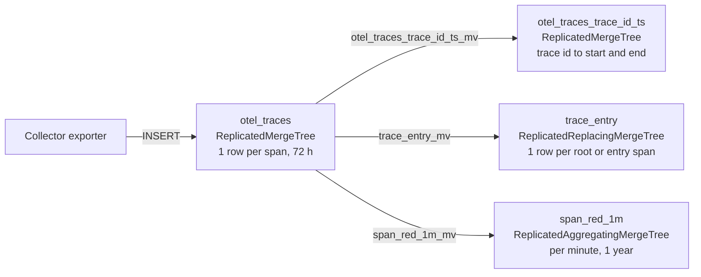

# Module 10: The data model, the DDL, and copying data between ClickHouse servers (35 min)

Do this module after module 6 (or at the end). It reads `clickhouse/schema.sql`
line by line, then shows every way to get data from one ClickHouse into another.

## Idea, part 1: what a span looks like as a row

### One wide table, one row per span

`otel.otel_traces` stores **one row per span**. There's no separate "trace"
table: a trace is simply all rows with the same `TraceId`. The columns come in
three groups.

**1. Stock columns**, written by the Collector's ClickHouse exporter. The
exporter maps each OTLP span field to one column:

| OTLP span field | Column | Type | Note |
|---|---|---|---|
| `start_time_unix_nano` | `Timestamp` | `DateTime64(9)` | Nanosecond precision; `CODEC(Delta, ZSTD)` stores differences between neighbours |
| `end - start` | `Duration` | `UInt64` | **Nanoseconds**; divide by `1e6` for ms |
| `trace_id`, `span_id`, `parent_span_id` | `TraceId`, `SpanId`, `ParentSpanId` | `String` | Hex strings; `ParentSpanId = ''` is the root |
| `trace_state` | `TraceState` | `String` | W3C `tracestate` header |
| `name`, `kind` | `SpanName`, `SpanKind` | `LowCardinality(String)` | `Internal`, `Client`, `Server`... |
| resource `service.name` | `ServiceName` | `LowCardinality(String)` | |
| resource attributes | `ResourceAttributes` | `Map(LowCardinality(String), String)` | **Every value becomes a string** |
| scope name and version | `ScopeName`, `ScopeVersion` | `String` | The instrumentation library (`agent-tracing`) |
| span attributes | `SpanAttributes` | `Map(LowCardinality(String), String)` | Same |
| `status.code`, `status.message` | `StatusCode`, `StatusMessage` | | `Unset`, `Ok`, `Error` |
| `events[]` | `Events.Timestamp`, `Events.Name`, `Events.Attributes` | `Nested`: parallel arrays | Exceptions are events named `exception` |
| `links[]` | `Links.TraceId`, `Links.SpanId`, `Links.TraceState`, `Links.Attributes` | `Nested` | Span links |

**2. MATERIALIZED columns**, added by this repo: 26 columns computed from the
maps **on insert** and stored like any other column:

```sql
org_owner        LowCardinality(String) MATERIALIZED ResourceAttributes['org.owner'],
gen_ai_tokens_in UInt32                 MATERIALIZED toUInt32OrZero(SpanAttributes['gen_ai.usage.input_tokens']),
```

Why bother? Reading `SpanAttributes['x']` reads and decompresses the **whole
map** for every row. A real column is small, compresses well, can be in the
sorting key, and can be indexed. The rule: **promote the attributes you filter
or group by; leave the rest in the maps.**

Three column kinds look similar:

| Kind | Computed | Stored | In `SELECT *` | Can be inserted |
|---|---|---|---|---|
| `DEFAULT expr` | On insert, if not given | Yes | Yes | Yes |
| `MATERIALIZED expr` | Always, on insert | Yes | **No** | **No** |
| `ALIAS expr` | At query time | No | No | No |

`MATERIALIZED` is safe here precisely because the exporter doesn't know these
columns exist: it inserts the stock columns, and ClickHouse fills in the rest.

**3. Indexes**: bloom filters on ids and on map keys and values, and `minmax`
on `Duration` (module 7).

### The engine clause, piece by piece

```sql
ENGINE = ReplicatedMergeTree          -- storage engine; replicated through Keeper (module 6)
PARTITION BY toDate(Timestamp)        -- one partition per day: retention unit
ORDER BY (org_owner, org_service, SpanName, toDateTime(Timestamp))
                                      -- sort order and sparse primary index (PRIMARY KEY defaults to this)
TTL toDateTime(Timestamp) + INTERVAL 72 HOUR
SETTINGS ttl_only_drop_parts = 1;     -- drop whole expired parts, don't rewrite them
```

`ReplicatedMergeTree` with no arguments uses the server's default Keeper path
`/clickhouse/tables/{uuid}/{shard}` and replica name `{replica}`. `{uuid}` is
the table's UUID, `{shard}` and `{replica}` come from `macros-0N.xml`. Both
replicas have the same UUID, because the table was created with
`ON CLUSTER`, so they share one path in Keeper.

### The derived tables



Each materialized view runs on every inserted **block** and writes to its
`TO` table. Two of the target engines behave in special ways:

- **ReplacingMergeTree** keeps one row per `ORDER BY` key, **eventually**:
  duplicates are removed during merges. Until then, both copies are visible.
  Add `FINAL` to a query to deduplicate at read time (slower).
- **AggregatingMergeTree** stores **partial aggregation states**, not values.
  The view writes `quantilesState(...)(Duration)`; merges combine the states;
  queries finish them with `quantilesMerge(...)`. Because each block is
  aggregated separately, you must always `GROUP BY` and `sum()` or `-Merge`
  when reading; never read the rows as if they were final.

### Changing the schema

- `ALTER TABLE ... ON CLUSTER tracing ADD COLUMN ...` goes through the DDL
  queue in Keeper (`/clickhouse/task_queue/ddl`) and runs on every node.
- A newly added `MATERIALIZED` column is computed **on read** for old parts,
  until you run `MATERIALIZE COLUMN`, which rewrites them as a mutation.
- Never rename or retype stock columns: the exporter would fail to insert.
  Since `create_schema: false`, this table is yours to maintain.

## Idea, part 2: getting data from one ClickHouse into another

Pick the tool by what the two servers share:

| Goal | How | Shared Keeper needed |
|---|---|---|
| **Add a replica**, or rebuild a lost one | Create the same table (same UUID or path) on the new server with its own `{replica}` macro. It registers in Keeper and **fetches every part** from its peers | Yes |
| **One-off copy from any ClickHouse** | `INSERT INTO t SELECT * FROM remote('host', db.t, 'user', 'password')` (`remoteSecure` for TLS) | No |
| **Keep copying** | Repeat the `remote()` insert for rows newer than your max timestamp; or a refreshable materialized view; or **dual-write** at the gateway (two `clickhouse` exporters) | No |
| Copy partitions between replicated tables | `ALTER TABLE t FETCH PARTITION ... FROM '<keeper path>'`, then `ATTACH PARTITION` | Yes |
| Copy within one server | `ALTER TABLE t ATTACH PARTITION ... FROM other_table` (instant, hard links) | No |
| Snapshot and restore | `BACKUP TABLE ... TO Disk(...)` or `S3(...)`; `RESTORE` | No |
| Turn a single-node `MergeTree` into `ReplicatedMergeTree` | Create a replicated table and `ATTACH PARTITION FROM` the old one; or put a `convert_to_replicated` flag file in the table's data directory and restart | Yes, afterwards |

Two things catch people out:

- **`SELECT *` skips `MATERIALIZED` columns**, so a `remote()` copy inserts
  only the stock columns, and the target recomputes the rest. That's what you
  want: the copy is consistent with the target's own schema.
- **Materialized views fire on inserts, not on replication.** Parts fetched by
  a new replica don't run its views, but they don't need to: the target tables
  replicate on their own. A new replica still needs the views, so that inserts
  it receives *directly* fill the derived tables.

## Remember it

> **A span is a row; a trace is a `WHERE TraceId = ...`.** Stock columns come
> from the exporter, MATERIALIZED columns are your shortcuts, and the views are
> triggers that keep summaries.
>
> **Copying between ClickHouse servers: same Keeper? Let replication do it.
> Different Keeper? Pull with `remote()`.**

## In this repo

- `clickhouse/schema.sql`: every table and view, with comments.
- `otel-gateway-config.yaml`: `create_schema: false` and the table name.
- `docs/tutorial/labs/compose.replication.yaml`: two extra servers for this lab:
  `clickhouse-03` (a third replica, same Keeper) and `clickhouse-solo`
  (standalone, no Keeper).
- `docs/tutorial/labs/add-replica.sh`: copies each table's DDL, with its UUID,
  to `clickhouse-03`.

## Lab (20 min)

### Part 1: read the model

1. Column kinds:

   ```sql
   SELECT default_kind, count() FROM system.columns
   WHERE database = 'otel' AND table = 'otel_traces' GROUP BY 1;
   ```

   22 stock columns (empty `default_kind`) and 26 `MATERIALIZED` ones.

2. One span as the exporter wrote it:

   ```sql
   SELECT TraceId, ResourceAttributes, SpanAttributes FROM otel.otel_traces
   WHERE ServiceName = 'kb-search-api' LIMIT 1 FORMAT Vertical;
   ```

   Note `'http.response.status_code':'200'`: a number stored as a string in
   the map. The `http_status` column turns it back into a `UInt16`.

3. Events are parallel arrays. Unnest them with `ARRAY JOIN`:

   ```sql
   SELECT SpanName, e.Name, e.Attributes['exception.message'] AS message
   FROM otel.otel_traces ARRAY JOIN Events AS e
   WHERE e.Name = 'exception' ORDER BY Timestamp DESC LIMIT 3;
   ```

   ```text
   execute_tool search_knowledge_base  exception  127.0.0.1:18081/v1/search returned 504
   invoke_agent researcher             exception  127.0.0.1:18081/v1/search returned 504
   ```

4. Read the rollup correctly (merge the states):

   ```sql
   SELECT org_service, sum(calls) AS calls, sum(errors) AS errors,
          arrayMap(x -> round(x / 1e6), quantilesMerge(0.5, 0.95, 0.99)(duration_q)) AS p50_p95_p99_ms
   FROM otel.span_red_1m
   WHERE minute > now() - INTERVAL 1 HOUR AND SpanName = 'agent_turn'
   GROUP BY org_service ORDER BY org_service;
   ```

   ```text
   hr-agent       154   0  [728,927,986]
   sales-agent    153  27  [781,1033,1112]
   support-agent  155  52  [1363,1753,1851]
   ```

5. Replacing is eventual:

   ```sql
   SELECT (SELECT count() FROM otel.trace_entry) AS raw,
          (SELECT count() FROM otel.trace_entry FINAL) AS deduplicated;
   ```

   A test run showed `2968` and `2965`: three duplicates not yet merged away.

6. Add a promoted column, and see what it does with old data:

   ```sql
   ALTER TABLE otel.otel_traces ON CLUSTER tracing
     ADD COLUMN http_method LowCardinality(String) MATERIALIZED SpanAttributes['http.request.method'];
   SELECT http_method, count() FROM otel.otel_traces WHERE http_method != '' GROUP BY 1;
   ALTER TABLE otel.otel_traces ON CLUSTER tracing MATERIALIZE COLUMN http_method;
   ALTER TABLE otel.otel_traces ON CLUSTER tracing DROP COLUMN http_method;
   ```

   The `SELECT` already returns values for old spans (computed on read); the
   `MATERIALIZE COLUMN` mutation then stores them. Try inserting into a
   materialized column, and you get `Code: 44 ... Cannot insert column`.

### Part 2: copy between servers

Start the two extra servers (from the repo root):

```bash
docker compose -f compose.yaml -f docs/tutorial/labs/compose.replication.yaml up -d clickhouse-03 clickhouse-solo
```

7. **Add a third replica.** It copies everything by itself:

   ```bash
   docs/tutorial/labs/add-replica.sh
   sleep 15
   docker exec clickhouse-03 clickhouse-client --password demo -q \
     "SELECT table, total_replicas, active_replicas, queue_size FROM system.replicas WHERE database = 'otel'"
   for h in clickhouse-01 clickhouse-03; do
     docker exec $h clickhouse-client --password demo -q "SELECT '$h', count() FROM otel.otel_traces"
   done
   ```

   ```text
   otel_traces              3  3  0
   ...
   clickhouse-01  35003
   clickhouse-03  35003
   ```

   The script did nothing but create empty tables with the same UUIDs.
   Keeper told `clickhouse-03` which parts exist, and it fetched them from its
   peers. New spans keep arriving on all three. Writes work in any direction:
   a row inserted on `clickhouse-03` shows up on `clickhouse-01`, including in
   `trace_entry`, via `clickhouse-03`'s own view.

8. **Copy into a standalone server with `remote()`.** No shared Keeper, so
   replication can't help; pull the data instead. Create a non-replicated
   copy of the table, using the same DDL with a plain `MergeTree` engine:

   ```bash
   docker exec clickhouse-solo clickhouse-client --password demo -q "CREATE DATABASE IF NOT EXISTS otel"
   docker exec clickhouse-01 clickhouse-client --password demo --format TSVRaw -q "SHOW CREATE TABLE otel.otel_traces" \
     | sed -E "s/ReplicatedMergeTree\(.*\)/MergeTree/" \
     | docker exec -i clickhouse-solo clickhouse-client --password demo --multiquery
   ```

   Then, in the solo server's Play UI at <http://localhost:8126/play>:

   ```sql
   -- Full copy
   INSERT INTO otel.otel_traces
   SELECT * FROM remote('clickhouse-01', otel.otel_traces, 'default', 'demo');

   -- Later: copy only what's new (run on a schedule for an ongoing copy)
   INSERT INTO otel.otel_traces
   SELECT * FROM remote('clickhouse-01', otel.otel_traces, 'default', 'demo')
   WHERE Timestamp > (SELECT max(Timestamp) FROM otel.otel_traces);

   -- Verify: same rows, same checksum, same recomputed columns
   SELECT count(), sum(cityHash64(SpanId)) % 1000000, sum(gen_ai_tokens_in) FROM otel.otel_traces;
   ```

   Run the verify query on <http://localhost:8123/play> too. In a test run,
   both returned `35003  534512  95884`. The token sum matching shows the
   MATERIALIZED columns were rebuilt on the solo server.

9. **The other direction: a single server into the replicated cluster.**
   Insert once on any replica, and replication copies it to the others:

   ```sql
   -- on clickhouse-solo
   CREATE TABLE otel.notes (id UInt32, note String) ENGINE = MergeTree ORDER BY id;
   INSERT INTO otel.notes SELECT number, concat('note ', toString(number)) FROM numbers(1000);

   -- on clickhouse-01
   CREATE TABLE otel.notes ON CLUSTER tracing (id UInt32, note String) ENGINE = ReplicatedMergeTree ORDER BY id;
   INSERT INTO otel.notes SELECT * FROM remote('clickhouse-solo', otel.notes, 'default', 'demo');
   SELECT hostName(), count() FROM clusterAllReplicas('tracing', otel.notes) GROUP BY 1;
   DROP TABLE otel.notes ON CLUSTER tracing SYNC;
   ```

10. **Fetch a partition from another replicated table** (shared Keeper):

    ```sql
    CREATE TABLE otel.otel_traces_restore AS otel.otel_traces
    ENGINE = ReplicatedMergeTree('/clickhouse/tables/lab/otel_traces_restore', '{replica}')
    PARTITION BY toDate(Timestamp) ORDER BY (org_owner, org_service, SpanName, toDateTime(Timestamp));

    -- the source path comes from system.replicas
    ALTER TABLE otel.otel_traces_restore FETCH PARTITION ID '20261121'
      FROM '/clickhouse/tables/<otel_traces uuid>/01';
    ALTER TABLE otel.otel_traces_restore ATTACH PARTITION ID '20261121';
    SELECT count() FROM otel.otel_traces_restore;
    DROP TABLE otel.otel_traces_restore SYNC;
    ```

    Use your own partition id (`SELECT DISTINCT partition_id FROM system.parts
    WHERE table = 'otel_traces'`). The explicit path is needed because
    `{uuid}` only works with `ON CLUSTER` or an explicit UUID.

11. **Clean up.** Unregister the extra replica from Keeper *before* removing
    its container. Otherwise the others keep a dead replica in their metadata,
    and you'd have to remove it with `SYSTEM DROP REPLICA 'clickhouse-03' FROM TABLE ...`:

    ```bash
    docker exec clickhouse-03 clickhouse-client --password demo -q "DROP DATABASE otel SYNC"
    docker compose -f compose.yaml -f docs/tutorial/labs/compose.replication.yaml rm -sfv clickhouse-03 clickhouse-solo
    ```

    Dropping a replicated table on one replica only removes **that replica**;
    the data stays on the others (`total_replicas` goes back to 2).

## Explain it back

> "Each span is one row in `otel_traces`; a trace is all rows with one trace
> id. The exporter fills the stock columns: ids, name, kind, timestamp,
> duration in nanoseconds, status, attribute maps with string values, and
> events and links as nested arrays. We add MATERIALIZED columns that copy hot
> attributes, like owner, service, agent name and tokens, out of the maps on
> insert, so they're cheap to filter and can be indexed. Materialized views
> act as insert triggers that feed a trace-id lookup table, a
> one-row-per-trace table that deduplicates eventually, and a per-minute
> rollup that stores aggregation states. To get data into another ClickHouse:
> if it shares Keeper, create the same table with a new replica name and it
> fetches everything; if not, pull it with `INSERT ... SELECT FROM remote()`,
> then incrementally by timestamp; for snapshots, use BACKUP and RESTORE."

## Check yourself

<details><summary>Why are attribute values strings, even <code>http.response.status_code</code>?</summary>

The exporter's map type is `Map(LowCardinality(String), String)`, so every
value is stored as text. That keeps one simple column for any attribute. When
you need the number, promote it into a typed column
(`toUInt16OrZero(SpanAttributes['http.response.status_code'])`).
</details>

<details><summary>You copied <code>otel_traces</code> with <code>SELECT *</code>. Are the <code>org_*</code> and <code>gen_ai_*</code> columns lost?</summary>

No. `SELECT *` leaves them out, and the target table recomputes them on
insert from its own definitions. If the target defines them differently,
the copy follows the target's definition.
</details>

<details><summary>A new replica's materialized views didn't run for the parts it fetched. Is the derived data missing?</summary>

No. The derived tables are replicated themselves, so the new replica fetches
their parts too. Views only run on inserts the server receives directly.
</details>

<details><summary><code>trace_entry</code> returns two rows for one trace. Bug?</summary>

No. ReplacingMergeTree removes duplicates when parts merge, which happens
eventually. Use `FINAL`, or `argMax`/`GROUP BY`, for exact answers now.
</details>

<details><summary>You need the same spans in two regions with separate Keepers. Which approach?</summary>

Either dual-write at the gateway (two `clickhouse` exporters, one per
region), which costs nothing at query time, or a scheduled incremental
`remote()` copy. Replication needs a shared Keeper, and stretching one across
regions makes every insert depend on cross-region latency.
</details>

## Read more

- [ClickHouse exporter (stock schema)](https://github.com/open-telemetry/opentelemetry-collector-contrib/blob/main/exporter/clickhouseexporter/README.md)
- [CREATE TABLE: DEFAULT, MATERIALIZED, ALIAS, codecs](https://clickhouse.com/docs/sql-reference/statements/create/table)
- [Map](https://clickhouse.com/docs/sql-reference/data-types/map), [Nested](https://clickhouse.com/docs/sql-reference/data-types/nested-data-structures/nested), [LowCardinality](https://clickhouse.com/docs/sql-reference/data-types/lowcardinality)
- [ReplacingMergeTree](https://clickhouse.com/docs/engines/table-engines/mergetree-family/replacingmergetree)
- [AggregatingMergeTree](https://clickhouse.com/docs/engines/table-engines/mergetree-family/aggregatingmergetree)
- [Replication, including converting MergeTree to ReplicatedMergeTree](https://clickhouse.com/docs/engines/table-engines/mergetree-family/replication)
- [`remote` and `remoteSecure`](https://clickhouse.com/docs/sql-reference/table-functions/remote)
- [Manipulating partitions: FETCH, ATTACH, MOVE](https://clickhouse.com/docs/sql-reference/statements/alter/partition)
- [Backup and restore](https://clickhouse.com/docs/operations/backup)
- [SYSTEM statements: DROP REPLICA, RESTORE REPLICA](https://clickhouse.com/docs/sql-reference/statements/system)
