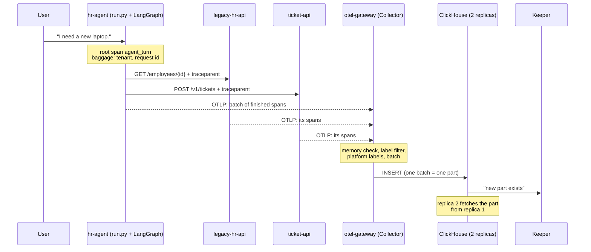

# Module 13: Explain-it-back cheat sheet and glossary (20 min, plus the glossary as a reference)

## Why this matters

You've met a lot of new words across the modules. This page pulls them
together in one place. It retells the whole system as one story, from a
user's question to a row in ClickHouse, and ends with an A to Z glossary of
every term the tutorial uses.

What you'll be able to do: explain the whole pipeline out loud in about five
minutes, answer interview-style questions about it, and look up any term
quickly when you read the other modules again.

## Key terms

These are the words you need to follow the story below. Every other term is
in the [glossary](#glossary-a-to-z).

| Term | Plain meaning |
|---|---|
| **Span** | The record of one timed operation, such as one LLM call or one HTTP request |
| **Trace** | All the spans of one request, linked into a tree |
| **Trace id** | The id every span of one trace shares, like a parcel's tracking number |
| **`traceparent`** | The HTTP header that carries the trace id to the next service |
| **OTLP** | OpenTelemetry Protocol: how spans are sent over the network |
| **Gateway** | The central OpenTelemetry Collector that every app sends its spans to |
| **Part** | One chunk of a ClickHouse table on disk; every insert creates one |
| **Replica** | One of the copies of a ClickHouse table, kept in sync through Keeper |

## How to use this page

Close the other modules. Explain each section out loud, then check yourself
against the text. If you stumble, go back to that module's "Explain it back"
section. Use the glossary whenever a word in any module isn't clear.

## The whole system in one breath

> "Each agent turn is one trace. LangChain callbacks report every graph node,
> model call and tool call with run ids, and our handler turns them into
> OpenTelemetry spans named by the GenAI conventions: `invoke_workflow`,
> `invoke_agent`, `chat`, `execute_tool`. Tools call HTTP APIs and pass
> `traceparent` and `baggage`, so the API spans join the same trace. The SDK
> batches spans and sends OTLP to a Collector gateway, which drops unlabelled
> spans, stamps platform labels, batches, retries, and writes to ClickHouse.
> ClickHouse stores spans as columns in a MergeTree table, sorted by owner,
> service and span name, partitioned by day, and replicated to a second node
> through Keeper. To scale out, we'd shard by a hash of the trace id, so every
> trace stays on one shard."

That's the short version. Below is the same thing slowly, following one
request.

## The whole system in five minutes

Follow one real request through the repo. A user of the HR agent types
**"I need a new laptop."** Think of it as a parcel: it's made, labelled,
shipped, sorted and shelved, and the tracking number (the trace id) stays the
same the whole way.



**1. The turn starts, and the trace is born** ([module 1](01-otel-core.md), [module 2](02-langgraph.md)).
`agent/run.py` opens a span called `agent_turn`. It's the **root span**: it
has no parent, and it gets a fresh **trace id**. Every other span in this
request will share that id, the way every page of a parcel's paperwork shows
the same tracking number. `run.py` also puts the tenant (for example
`acme_corp`) and a request id into **baggage**, data that travels with the
request to other services. The process's **resource** says who is
reporting: `service.name = hr-agent`, `org.owner = people-tech`,
`org.service = hr-agent`.

**2. The agent graph runs, and callbacks become spans** ([module 2](02-langgraph.md), [module 3](03-genai-semconv.md)).
The HR agent is a small **LangGraph** graph called `hr_helpdesk`, with one
node, `hr_assistant`. As it runs, LangChain fires **callbacks** ("I started",
"I finished") with a run id and a parent run id. The repo's
`LangGraphTracer` listens and opens a span for each one that matters, named
by the **GenAI semantic conventions**:

```text
agent_turn                                  root, from run.py
  invoke_workflow hr_helpdesk               the graph run
    invoke_agent hr_assistant               the agent node
      execute_tool lookup_employee          tool call
        GET /employees/{employee_id}        HTTP client span
      chat fake-hr                          LLM call: model, tokens
      execute_tool create_ticket            tool call
        POST /v1/tickets                    HTTP client span
```

Token counts go on the `chat` span only, so totals are never counted twice.

**3. Tools call APIs, and the trace crosses processes** ([module 1](01-otel-core.md), [module 6](06-cross-environment.md)).
`lookup_employee` calls `legacy-hr-api`, and `create_ticket` calls
`ticket-api`. Before each call, the agent **injects** the `traceparent`
header (trace id, plus its own span id as the new parent) and the `baggage`
header. Each API **extracts** them and starts a **server span** as a child of
the agent's **client span**. That's the whole trick of distributed tracing:
no merging later, just the same trace id passed along. `ticket-api` then
records one more client span, `INSERT tickets`, for its database call.

**4. Each process ships its spans** ([module 1](01-otel-core.md)).
Spans are exported when they *end*. The SDK's `BatchSpanProcessor` collects
finished spans in an in-memory queue (2048 spans at most) and, every 5
seconds, sends a batch over **OTLP/HTTP** to the gateway at `localhost:14318`.
When `run.py` finishes, `provider.shutdown()` sends whatever is left.

**5. The gateway sorts them** ([module 4](04-collector.md)).
The gateway is an **OpenTelemetry Collector**, a separate program that acts
like a company mailroom. Its pipeline runs four **processors** in order:

- `memory_limiter`: "do I have room?" If not, it refuses data
  (**back-pressure**), and the app retries.
- `filter/require_org_labels`: drops spans whose resource lacks `org.owner`
  or `org.service`. Here, `legacy-hr-api` puts its labels in the wrong place,
  so its server span is **dropped**. The agent's client span for that call
  survives.
- `resource/org_platform`: stamps where the gateway runs: `org.env`,
  `org.region`, `org.platform`, `org.cluster`.
- `batch`: bundles spans, up to 1000 or 5 seconds, so ClickHouse gets few,
  large inserts.

The `clickhouse` **exporter** then writes the batch. It has a **sending
queue** and retries for up to 300 seconds, so a short ClickHouse outage loses
nothing.

**6. ClickHouse shelves them** ([module 7](07-clickhouse.md), [module 8](08-data-model.md)).
Each span becomes **one row** in `otel.otel_traces`. ClickHouse is a **column
store**: each column is stored and compressed on its own. The insert creates
a new **part**, sorted by `(org_owner, org_service, SpanName, time)`, inside
today's **partition**. Background **merges** later combine small parts into
big ones. **MATERIALIZED columns** copy hot attributes (owner, agent name,
tokens) out of the attribute maps into real columns. Three **materialized
views** fire on the insert and fill a trace-id lookup table, a
one-row-per-trace table (`trace_entry`), and a per-minute summary
(`span_red_1m`). **TTL** deletes raw spans after 72 hours.

**7. The second replica copies it** ([module 7](07-clickhouse.md)).
The gateway wrote to `clickhouse-01`. That server tells **Keeper** "a new
part exists". `clickhouse-02` sees the note and downloads the part straight
from `clickhouse-01`. Keeper is the notary that records which parts exist; it
never holds the data. If Keeper is down, tables go **read-only**: reads still
work, and the gateway queues and retries.

**8. Someone looks at the trace** ([module 9](09-sharding-indexes.md)).
A query asks for `WHERE TraceId = '...'`. The trace id isn't in the sorting
key, so a **bloom filter skip index** on `TraceId` lets ClickHouse skip
blocks that can't contain it, and the lookup table says when the trace
happened, so whole days can be skipped. The result is the span tree from
step 2, with the API spans from step 3 under the right parents.

**9. At larger scale** ([module 5](05-sampling.md), [module 9](09-sharding-indexes.md), [module 11](11-s3-tiering.md)).
You'd **sample** (keep only some traces): decide at the start in the SDK
(head sampling), or after the trace ends in a Collector (tail sampling). You'd
**shard** (split data across servers) by a hash of the trace id, so each
trace stays on one shard. And you'd move older parts to cheap **S3** storage.

**10. Keeping it healthy** ([module 12](12-operations.md)).
`./stack.sh health` checks that spans are fresh, nothing was lost, queues and
parts are under control, replicas are in sync, and Keeper answers.

## Ten one-liners

| Concept | One line |
|---|---|
| Span | A timed operation with attributes, status and a parent |
| Trace | All spans that share one trace id: a tree |
| Context | The current span, carried along inside a process; spans started inside it become its children |
| Propagation | The `traceparent` and `baggage` headers carry context between processes |
| Resource | *Who* sent the span (service, owner); attributes say *what* happened |
| GenAI semconv | Standard `gen_ai.*` names: operation, agent, model, tool, tokens; still in development |
| Collector | Receivers, then processors in order, then exporters; queue and retry in the exporter |
| Head and tail sampling | Decide at the start (cheap, blind), or after the trace ends (smart, costly, one instance per trace) |
| ClickHouse storage | An insert creates a part, parts merge; sparse index on `ORDER BY`; partitions for retention |
| Replication and sharding | Replicas are copies (Keeper holds metadata); shards are slices (hash the trace id) |

## Glossary A to Z

Each term has a plain definition, an everyday comparison where it helps, and
the module where it's explained. Code names are listed under their first
letter, ignoring backticks and symbols.

[A](#a) · [B](#b) · [C](#c) · [D](#d) · [E](#e) · [F](#f) · [G](#g) · [H](#h) · [I](#i) · [K](#k) · [L](#l) · [M](#m) · [N](#n) · [O](#o) · [P](#p) · [Q](#q) · [R](#r) · [S](#s) · [T](#t) · [U](#u) · [V](#v) · [W](#w) · [Z](#z)

### A

| Term | Meaning | Module |
|---|---|---|
| `absolute_delay` | Column in `system.replicas`: how many seconds a replica is behind its peer | [6](07-clickhouse.md), [12](12-operations.md) |
| `active_replicas` | Column in `system.replicas`: how many copies of the table are online now, out of `total_replicas` | [6](07-clickhouse.md) |
| Agent (AI) | A program that uses an LLM to decide what to do next, and calls tools. Here: `support-agent`, `hr-agent`, `sales-agent` | [0](00-setup.md) |
| Agent (Collector pattern) | A Collector running next to the app (a sidecar, or one per machine), so the app hands off spans quickly. Unrelated to AI agents | [4](04-collector.md) |
| `agent_turn` | This repo's root span: one per user turn, opened by `agent/run.py` | [2](02-langgraph.md) |
| AggregatingMergeTree | ClickHouse table engine that stores partial aggregation states (half-finished sums and percentiles) and combines them during merges. Used by `span_red_1m` | [10](08-data-model.md) |
| Alert | An automatic message to a person when a metric crosses a threshold for long enough | [12](12-operations.md) |
| ALIAS column | A ClickHouse column computed when you query it, never stored | [10](08-data-model.md) |
| `any(x)` | ClickHouse aggregate: "some value of `x` from the group, I don't care which". Not the same as OTLP's `AnyValue` | [7](09-sharding-indexes.md) |
| `AnyValue` | The OTLP data type that lets an attribute value be a string, number, boolean, list or map | [7](09-sharding-indexes.md) |
| API (OpenTelemetry) | The `opentelemetry-api` package that libraries call to create spans. Without an SDK installed, it does nothing, so it costs nothing | [1](01-otel-core.md) |
| API (HTTP) | A service that answers HTTP requests. Here: `kb-search-api`, `ticket-api`, `pricing-api`, `legacy-hr-api` | [0](00-setup.md) |
| `ARRAY JOIN` | ClickHouse clause that turns each element of an array (such as a span's events) into its own row | [10](08-data-model.md) |
| `async_insert` | ClickHouse setting where the server collects many small inserts and writes them together, instead of the client batching | [6](07-clickhouse.md) |
| Attribute | A key-value fact on a span, such as `http.response.status_code = 504`. Like a label on a parcel | [1](01-otel-core.md) |
| Auto-instrumentation | Libraries that add spans and header propagation to common frameworks without code changes, such as `opentelemetry-instrument python app.py` | [8](06-cross-environment.md) |

### B

| Term | Meaning | Module |
|---|---|---|
| Back-pressure | A busy component telling the sender "not now, try later" instead of crashing. Like a "full, come back later" sign on a shop door | [4](04-collector.md), [12](12-operations.md) |
| Backend | Where telemetry is finally stored and queried. Here, ClickHouse | [4](04-collector.md) |
| Backoff (exponential) | Waiting longer between each retry (5 s, then about 7 s, and so on, up to 30 s here), so a struggling server isn't hammered | [4](04-collector.md) |
| BACKUP / RESTORE | ClickHouse statements that save a table to a disk or S3 and load it back | [10](08-data-model.md), [12](12-operations.md) |
| Baggage | Key-value data that travels with a request in the `baggage` header, such as `org.tenant`. It isn't put on spans unless a service chooses to copy it. Like luggage you carry but don't unpack | [1](01-otel-core.md) |
| Batch | A group of spans sent together in one request | [1](01-otel-core.md), [4](04-collector.md) |
| `batch` processor | Collector processor that groups spans (here up to 1000, or every 5 s) so ClickHouse gets few, large inserts | [4](04-collector.md) |
| `BatchSpanProcessor` | SDK component that queues finished spans in memory (2048 at most) and exports them in batches (512, every 5 s) from a background thread. Full queue: new spans are dropped | [1](01-otel-core.md) |
| Block (insert block) | A chunk of rows ClickHouse handles as one unit during an insert. Materialized views run once per block; Keeper keeps block hashes to spot duplicates | [6](07-clickhouse.md) |
| Bloom filter | A compact structure that answers "definitely not here" or "maybe here". As a skip index, it lets ClickHouse skip blocks that can't contain an id | [7](09-sharding-indexes.md) |

### C

| Term | Meaning | Module |
|---|---|---|
| Cache (S3 cache disk) | Local disk space that keeps recently read S3 data, so repeated queries on old data don't go to S3 again | [11](11-s3-tiering.md) |
| Callback | A function LangChain calls on every start, end or error of a step (`on_chain_start`, `on_tool_end`...). Our tracer turns them into spans | [2](02-langgraph.md) |
| Cardinality | How many distinct values something has. A span name with an id in it has unbounded cardinality, which breaks grouping and bloats indexes | [1](01-otel-core.md) |
| `chat` span | GenAI span for one LLM call: provider, model, finish reasons and token usage | [3](03-genai-semconv.md) |
| Checkpointer | LangGraph component that saves the graph's state after every step, so the next turn of the same conversation continues. Here `InMemorySaver` | [2](02-langgraph.md) |
| `cityHash64` | A fast hash function. `cityHash64(TraceId)` turns a trace id into a number that picks the shard | [7](09-sharding-indexes.md) |
| ClickHouse | The column-store database that stores the spans here, as two replicas | [6](07-clickhouse.md) |
| `clickhouse-init` | One-off container that applies `clickhouse/schema.sql` and waits until all tables are writable before the gateway starts | [6](07-clickhouse.md) |
| Client span | A span of kind `CLIENT`: "I called someone". Paired with the callee's server span, it shows an edge between two services | [1](01-otel-core.md) |
| Clock skew | Different machines' clocks disagreeing, so a child span can seem to start before its parent. Trust the parent links over the timestamps | [8](06-cross-environment.md) |
| Cluster | A named group of ClickHouse servers. `tracing` here: 1 shard, 2 replicas | [6](07-clickhouse.md) |
| `clusterAllReplicas()` | ClickHouse function that runs a query on every replica of a cluster | [6](07-clickhouse.md) |
| Codec | How a ClickHouse column is compressed, such as `CODEC(Delta, ZSTD(1))` | [10](08-data-model.md) |
| Collector | The OpenTelemetry Collector: a separate program that receives telemetry, processes it, and sends it on. Like a company mailroom | [4](04-collector.md) |
| Column store | A database that stores each column separately, so a query reading 3 of 40 columns reads only those 3 | [6](07-clickhouse.md) |
| Conditional edge | A LangGraph edge that picks the next node at run time, for example from the supervisor's `next` field | [2](02-langgraph.md) |
| Connector | A Collector component that is the exporter of one pipeline and the receiver of another, such as `spanmetrics` (spans to metrics) | [4](04-collector.md) |
| Consumers (queue) | Workers that take batches from the exporter's sending queue and send them; 10 by default | [4](04-collector.md) |
| Context | The "current span" (plus baggage), carried along inside a process. Spans started inside it become its children | [1](01-otel-core.md) |
| `context.attach` | Makes a span current. The tracer does this on tool start, so HTTP calls made by the tool become its children | [2](02-langgraph.md) |
| Conversation id | `gen_ai.conversation.id`: the attribute that links the turns of one session | [3](03-genai-semconv.md) |
| Counter | A metric that only goes up, like a car's odometer. You watch how fast it rises | [12](12-operations.md) |
| `create_schema: false` | Exporter setting: don't create tables automatically; this repo's `schema.sql` defines them | [4](04-collector.md), [10](08-data-model.md) |

### D

| Term | Meaning | Module |
|---|---|---|
| DaemonSet | Kubernetes term for "run one copy on every machine"; a common way to deploy agent Collectors | [4](04-collector.md) |
| DDL | Data definition language: SQL that changes structure (`CREATE`, `ALTER`, `DROP`) rather than data | [10](08-data-model.md) |
| DDL queue | Keeper's list of `ON CLUSTER` commands that every node must run | [6](07-clickhouse.md), [10](08-data-model.md) |
| `debug` exporter | Collector exporter that prints a short summary of each batch to the gateway's log | [4](04-collector.md) |
| `decision_wait` | Tail sampling setting: how long to wait for late spans of a trace before deciding (10 s in the lab) | [5](05-sampling.md) |
| Deduplication (insert) | Replicated tables keep hashes of recent insert blocks in Keeper, so a retried identical batch isn't stored twice | [6](07-clickhouse.md) |
| DEFAULT column | A ClickHouse column filled from an expression on insert, unless the insert gives a value | [10](08-data-model.md) |
| Delayed inserts | ClickHouse slowing inserts down because a partition has too many parts (1000 by default) | [12](12-operations.md) |
| Disk (ClickHouse) | A place bytes can live: the local disk, an S3 bucket, or a cache | [11](11-s3-tiering.md) |
| Distributed table | A ClickHouse table that stores nothing; it routes inserts to shards and fans queries out to all of them | [7](09-sharding-indexes.md) |
| Distribution (Collector) | A build of the Collector with a chosen set of components. This repo uses `otelcol-contrib` | [4](04-collector.md) |
| Dual-write | Sending the same data to two destinations, for example two `clickhouse` exporters for two regions | [10](08-data-model.md) |

### E

| Term | Meaning | Module |
|---|---|---|
| Edge (LangGraph) | A connection that says which node runs next | [2](02-langgraph.md) |
| Endpoint | An address a program answers on: host and port, sometimes a path | [4](04-collector.md), [12](12-operations.md) |
| Environment | A separate place where software runs, such as dev, staging or prod, or another region or cloud account | [8](06-cross-environment.md) |
| `error_mode: ignore` | Filter setting: if a rule can't be evaluated, log it and carry on | [4](04-collector.md) |
| Eval (evaluation) | A quality score for a turn or span ("was the answer good?"), usually added later, with `gen_ai.evaluation.*` attributes | [3](03-genai-semconv.md) |
| Event (span event) | A timestamped point inside a span, such as an `exception` with a stack trace | [1](01-otel-core.md), [10](08-data-model.md) |
| `execute_tool` | GenAI span for one tool call, named `execute_tool {tool name}` | [3](03-genai-semconv.md) |
| `EXPLAIN indexes = 1` | ClickHouse command that shows how many parts and granules each index skipped | [7](09-sharding-indexes.md) |
| Exporter (SDK) | The part of the SDK that sends spans out, here `OTLPSpanExporter` over HTTP | [1](01-otel-core.md) |
| Exporter (Collector) | The part of a Collector that sends data on, such as `clickhouse` | [4](04-collector.md) |
| Exporter helper | Queue, retry and timeout settings that every Collector exporter shares | [4](04-collector.md) |
| Extension | A Collector helper that isn't on the data path, such as `health_check` | [4](04-collector.md) |
| Extract | Reading trace context from incoming headers (`propagate.extract`) so the new span joins the caller's trace | [1](01-otel-core.md) |

### F

| Term | Meaning | Module |
|---|---|---|
| `FakeChatModel` | This repo's stand-in for an LLM: fakes latency and token usage, so no API key is needed | [2](02-langgraph.md) |
| FETCH / ATTACH PARTITION | ClickHouse statements that download a partition from another replicated table, then add it to this one | [10](08-data-model.md) |
| `file_storage` | Collector extension that keeps data on disk; with `sending_queue.storage`, the queue survives restarts | [4](04-collector.md) |
| `filter` processor | Collector processor that drops data matching a rule. Here it drops spans whose resource lacks `org.owner` or `org.service` | [4](04-collector.md) |
| FINAL | ClickHouse query keyword that removes duplicates at read time, for ReplacingMergeTree tables. Exact but slower | [10](08-data-model.md) |
| Finish reasons | `gen_ai.response.finish_reasons`: why the model stopped, such as `stop` or a length limit | [3](03-genai-semconv.md) |
| Flags (trace flags) | The last field of `traceparent`. `01` means sampled; `02` means the trace id is random | [1](01-otel-core.md) |
| Freshness | Age of the newest stored span: the first sign that ingestion has stalled | [12](12-operations.md) |

### G

| Term | Meaning | Module |
|---|---|---|
| `gen_ai.*` | The GenAI part of semantic conventions: operation, agent, model, provider, tool, tokens, conversation | [3](03-genai-semconv.md) |
| Gateway | A Collector that runs centrally, that every app sends to. Here, the `otel-gateway` container | [4](04-collector.md) |
| Gauge | A metric that goes up and down, like a fuel gauge: queue size, memory, free disk | [12](12-operations.md) |
| GenAI semantic conventions | OpenTelemetry's standard names for AI workloads. Status: development, so names can still change | [3](03-genai-semconv.md) |
| Granule | A block of 8192 rows in a ClickHouse part; the smallest unit an index can skip | [6](07-clickhouse.md) |
| GRANULARITY | Skip index setting: how many granules one index entry covers | [7](09-sharding-indexes.md) |
| gRPC | A network protocol for calling services, one of the two ways to send OTLP (port 4317) | [1](01-otel-core.md), [4](04-collector.md) |

### H

| Term | Meaning | Module |
|---|---|---|
| Head sampling | Deciding whether to keep a trace when its root span starts, in the SDK. Cheap, but it can't know whether the trace will fail. Like a bouncer at the door | [5](05-sampling.md) |
| Header (HTTP) | A named value sent with an HTTP request, such as `traceparent` | [1](01-otel-core.md) |
| Health check | An endpoint that says whether a program is alive. The gateway's is on port 13133 | [4](04-collector.md), [12](12-operations.md) |
| Histogram | A metric that counts values in buckets, so you can see their spread | [12](12-operations.md) |
| Hot shard | A shard that gets far more load than the others, for example from sharding by time or service | [7](09-sharding-indexes.md) |

### I

| Term | Meaning | Module |
|---|---|---|
| IAM role | A cloud identity attached to a machine or pod, so programs get credentials without key files | [11](11-s3-tiering.md) |
| Index (ClickHouse) | A structure that lets a query skip data. The main one is the sparse primary index; skip indexes are extra | [6](07-clickhouse.md), [7](09-sharding-indexes.md) |
| Inject | Writing trace context into outgoing headers (`propagate.inject`) | [1](01-otel-core.md) |
| `insert_quorum` | ClickHouse setting that makes an insert wait until N replicas have it | [6](07-clickhouse.md) |
| Instrumentation | Code that creates telemetry, by hand or automatically | [1](01-otel-core.md) |
| Instrumentation scope | The name (and version) of the library that created a span; here `agent-tracing`. Stored as `ScopeName` | [10](08-data-model.md) |
| `invoke_agent` | GenAI span for one agent's run, named `invoke_agent {agent name}` | [3](03-genai-semconv.md) |
| `invoke_workflow` | GenAI span for a whole graph run, named `invoke_workflow {workflow}` | [3](03-genai-semconv.md) |

### K

| Term | Meaning | Module |
|---|---|---|
| Keeper (ClickHouse Keeper) | The coordination service that holds replication metadata (which parts exist, the log, the DDL queue), never the data. Like a notary, not a warehouse | [6](07-clickhouse.md) |
| Kind (span kind) | Who is calling whom: `INTERNAL`, `CLIENT`, `SERVER`, `PRODUCER`, `CONSUMER` | [1](01-otel-core.md) |

### L

| Term | Meaning | Module |
|---|---|---|
| Labels | This repo's word for its `org.*` attributes: resource labels (who and where) and span labels (this request) | [1](01-otel-core.md) |
| Lag | How far behind something is; here, how many seconds a replica is behind its peer | [12](12-operations.md) |
| LangChain | A Python framework that gives models, tools and chains one interface (the Runnable) and reports each step to callbacks | [2](02-langgraph.md) |
| LangGraph | A framework built on LangChain that runs an agent as a state machine of nodes and edges | [2](02-langgraph.md) |
| `LangGraphTracer` | This repo's callback handler in `agent/telemetry.py` that turns LangChain callbacks into spans | [2](02-langgraph.md) |
| Latency | How long something takes | [5](05-sampling.md), [12](12-operations.md) |
| Leader / follower | Roles in a Keeper ensemble: the leader handles writes, followers copy it. A single node is `standalone` | [12](12-operations.md) |
| LLM | Large language model: the AI model the agent sends prompts to. Faked here | [0](00-setup.md) |
| `loadbalancing` exporter | Collector exporter that sends every span of a trace to the same next-tier Collector, by hashing the trace id | [5](05-sampling.md) |
| LowCardinality | ClickHouse type for strings with few distinct values; stores them as a dictionary of codes | [10](08-data-model.md) |

### M

| Term | Meaning | Module |
|---|---|---|
| Macro | A per-server value such as `{shard}` or `{replica}`, from `clickhouse/macros-0N.xml` | [6](07-clickhouse.md) |
| Map column | A ClickHouse column holding key-value pairs. `SpanAttributes` and `ResourceAttributes` are maps, and every value is a string | [10](08-data-model.md) |
| Mark | One entry of the sparse primary index, one per granule | [6](07-clickhouse.md) |
| MATERIALIZE INDEX / COLUMN | Statements that build a new index or column for old parts, as a mutation | [7](09-sharding-indexes.md), [10](08-data-model.md) |
| MATERIALIZED column | A column computed from other columns on insert and stored; it isn't in `SELECT *` and can't be inserted into | [10](08-data-model.md) |
| Materialized view | A ClickHouse insert trigger: runs its `SELECT` on each inserted block and writes the result to another table | [6](07-clickhouse.md), [10](08-data-model.md) |
| `max_elapsed_time` | How long the exporter keeps retrying one batch before dropping it: 300 s here | [4](04-collector.md) |
| `memory_limiter` | First Collector processor: refuses new data when memory is high (limit 512 MiB here) | [4](04-collector.md) |
| Merge | ClickHouse combining small parts into bigger ones in the background. Like gluing small Lego bricks into big ones | [6](07-clickhouse.md) |
| MergeTree | ClickHouse's main family of table engines: inserts write sorted parts that are merged later | [6](07-clickhouse.md) |
| Metric | A named number a program reports about itself, such as "spans sent" or "memory in use" | [12](12-operations.md) |
| `mntr` / `ruok` | Keeper's four-letter commands: `ruok` ("are you OK?") answers `imok`; `mntr` returns metrics | [12](12-operations.md) |
| `move_factor` | Storage policy setting: when the local volume has less than this share free (0.1 = 10%), move the largest parts to the next volume | [11](11-s3-tiering.md) |
| Mutation | A ClickHouse background job that rewrites existing parts | [7](09-sharding-indexes.md), [12](12-operations.md) |

### N

| Term | Meaning | Module |
|---|---|---|
| Namespace (attributes) | The prefix that groups attribute names, such as `gen_ai.` or this repo's own `org.` | [3](03-genai-semconv.md) |
| Nested | ClickHouse type that stores a list of records as parallel arrays; used for span events and links | [10](08-data-model.md) |
| Node (LangGraph) | A function in the graph that takes the state and returns an update, such as `hr_assistant` | [2](02-langgraph.md) |
| Non-agentic service | Any callee without an LLM, such as an HTTP API. It joins the trace by continuing the trace id it receives | [1](01-otel-core.md), [8](06-cross-environment.md) |

### O

| Term | Meaning | Module |
|---|---|---|
| `ocb` | OpenTelemetry Collector Builder: a tool to build your own slim Collector distribution | [4](04-collector.md) |
| ON CLUSTER | Runs a ClickHouse DDL statement on every node of a cluster, through Keeper's DDL queue | [6](07-clickhouse.md), [10](08-data-model.md) |
| OOM | Out of memory: a process used more than allowed, and the operating system killed it | [12](12-operations.md) |
| Operational readiness | Being able to run a system day to day: you see its health, hear about trouble early, and know what to do | [12](12-operations.md) |
| `ORDER BY` (sorting key) | The order of rows inside each ClickHouse part, and the basis of the sparse primary index. Here `(org_owner, org_service, SpanName, time)` | [6](07-clickhouse.md) |
| `org.*` labels | This repo's own attributes: `org.owner`, `org.service` (set by apps), `org.env`, `org.region`, `org.platform`, `org.cluster` (set by the gateway), `org.tenant`, `org.request_id` (per request) | [1](01-otel-core.md), [4](04-collector.md) |
| Orphan span | A span whose parent was never recorded, usually because services sampled inconsistently | [5](05-sampling.md) |
| `otel_traces` | The main table: one row per span; a trace is all rows with one `TraceId` | [10](08-data-model.md) |
| `otel_traces_trace_id_ts` | Lookup table filled by a materialized view: trace id to start and end time, so a trace query can narrow the time range | [6](07-clickhouse.md), [7](09-sharding-indexes.md) |
| `otelcol-contrib` | The Collector distribution with hundreds of components, including the ClickHouse exporter | [4](04-collector.md) |
| OTLP | OpenTelemetry Protocol: the standard format for sending telemetry, as protobuf over HTTP (port 4318) or gRPC (4317) | [1](01-otel-core.md) |
| OTTL | OpenTelemetry Transformation Language: short conditions and statements used by processors such as `filter` | [4](04-collector.md) |

### P

| Term | Meaning | Module |
|---|---|---|
| p95 (percentile) | The value 95% of measurements are below; 1 in 20 is slower | [12](12-operations.md) |
| Parent span id | The id of the span that caused this one; it turns a flat list into a tree. Empty on the root. Like "who's your parent" in a family tree | [1](01-otel-core.md) |
| Parent-based sampler | A sampler that does what the parent did: keep the span if the parent was kept. Keeps traces whole | [5](05-sampling.md) |
| Part | An immutable chunk of a ClickHouse table on disk: a folder of sorted column files. Every insert creates one | [6](07-clickhouse.md) |
| Parts per partition | Number of active parts in one partition. Inserts are delayed at 1000 and rejected at 3000; alert well before | [12](12-operations.md) |
| Partition | A group of parts that's managed together; here one per day (`PARTITION BY toDate(Timestamp)`). Parts never merge across partitions | [6](07-clickhouse.md) |
| Persistent queue | An export queue kept on disk (`sending_queue.storage`), so a gateway restart doesn't lose it | [4](04-collector.md), [12](12-operations.md) |
| Pipeline | One wired-up path in a Collector: receivers, then processors in order, then exporters | [4](04-collector.md) |
| Play UI | ClickHouse's browser page for running SQL, at <http://localhost:8123/play> | [0](00-setup.md) |
| Policy (tail sampling) | A rule that says which traces to keep, such as "has an error" or "slower than 1.5 s" | [5](05-sampling.md) |
| Processor | A Collector step that changes, drops, groups or samples data, in order | [4](04-collector.md) |
| Projection | A hidden second copy of a ClickHouse table's data inside each part, sorted another way | [7](09-sharding-indexes.md) |
| Prometheus | A monitoring system that scrapes metrics from HTTP pages and stores them. The gateway publishes its metrics in Prometheus format | [12](12-operations.md) |
| Propagation | Carrying trace context between processes in request headers (`traceparent`, `baggage`) | [1](01-otel-core.md) |
| Protobuf | Protocol Buffers: a compact binary format; OTLP uses it | [1](01-otel-core.md) |
| `provider.shutdown()` | Flushes and sends any queued spans before a process exits | [1](01-otel-core.md) |
| Provider (GenAI) | `gen_ai.provider.name`: which AI vendor served a model call | [3](03-genai-semconv.md) |

### Q

| Term | Meaning | Module |
|---|---|---|
| Queue | A waiting line for work. A queue that keeps growing means the next step can't keep up | [4](04-collector.md), [12](12-operations.md) |
| `queue_size` (replication) | Column in `system.replicas`: replication tasks a replica still has to do | [6](07-clickhouse.md), [12](12-operations.md) |
| Quorum (majority) | More than half the members. Keeper needs a majority to work: 2 of 3, or 3 of 5 | [6](07-clickhouse.md) |

### R

| Term | Meaning | Module |
|---|---|---|
| Raft | The agreement algorithm Keeper uses so its nodes agree on the same metadata | [6](07-clickhouse.md) |
| Rate | How much a counter grew per second over a time window | [12](12-operations.md) |
| Read-only replica | A table copy that answers queries but refuses inserts, usually because it lost contact with Keeper (`Code: 242 TABLE_IS_READ_ONLY`) | [6](07-clickhouse.md), [12](12-operations.md) |
| Receiver | The part of a Collector that accepts incoming data; here `otlp` | [4](04-collector.md) |
| RED | Rate, errors, duration: the three basic service metrics. `span_red_1m` stores them per minute | [3](03-genai-semconv.md), [10](08-data-model.md) |
| Reducer | LangGraph rule for merging a node's update into the state, such as `add_messages` (append, don't replace) | [2](02-langgraph.md) |
| Refused spans | Spans the gateway's `memory_limiter` turned away; the app must retry | [12](12-operations.md) |
| `remote()` | ClickHouse function that reads a table on another server; `INSERT ... SELECT FROM remote()` copies it | [8](06-cross-environment.md), [10](08-data-model.md) |
| ReplacingMergeTree | ClickHouse engine that keeps one row per sorting key, eventually: duplicates disappear when parts merge. Used by `trace_entry` | [10](08-data-model.md) |
| Replica | One copy of a table. Adds availability and read capacity | [6](07-clickhouse.md), [7](09-sharding-indexes.md) |
| ReplicatedMergeTree | MergeTree that keeps copies on several servers, coordinated by Keeper | [6](07-clickhouse.md) |
| Replication | Keeping copies in sync. Here, a new part is logged in Keeper and the other replica downloads it from its peer | [6](07-clickhouse.md) |
| Resource | Who sent the span: `service.name`, `org.owner`, `org.service`. Set once per process. Resource = who, attributes = what | [1](01-otel-core.md) |
| `resource` processor | Collector processor that edits resource labels; here it stamps the platform labels | [4](04-collector.md) |
| Retry | Trying again after a failure; the SDK and the exporter both do it | [4](04-collector.md) |
| Root span | The span with no parent; the top of the tree. Here `agent_turn` | [1](01-otel-core.md) |
| Run id | The id LangChain gives each step; `parent_run_id` says who called it | [2](02-langgraph.md) |
| Runbook | A written, step-by-step "what to do when X happens" | [12](12-operations.md) |
| Runnable | LangChain's common interface (`.invoke(input, config)`) for models, tools, chains and graphs | [2](02-langgraph.md) |

### S

| Term | Meaning | Module |
|---|---|---|
| S3 | Amazon's object storage service, and the API many other stores copy. Cheap, slower than local disk | [11](11-s3-tiering.md) |
| Sampler | SDK component that decides, when a span starts, whether to record it | [5](05-sampling.md) |
| Sampling | Keeping only some traces to save cost | [5](05-sampling.md) |
| Saturation | How full a resource is: a queue, a disk, memory. Near 100%, the next push fails | [12](12-operations.md) |
| Schema URL | The version of the semantic conventions the telemetry follows, such as `.../schemas/1.44.0` | [3](03-genai-semconv.md) |
| Scrape | When a monitoring system fetches a metrics page on a schedule | [12](12-operations.md) |
| SDK | The OpenTelemetry library inside the app that creates, samples, batches and exports spans | [1](01-otel-core.md) |
| SeaweedFS | A small S3-compatible server used in the tiering lab instead of real S3 | [11](11-s3-tiering.md) |
| Semantic conventions (semconv) | OpenTelemetry's shared dictionary of span names and attribute names, so every team means the same thing | [3](03-genai-semconv.md) |
| `send_failed_spans` | Gateway counter of spans lost after every retry; alert on any increase | [12](12-operations.md) |
| Sending queue | A waiting area in front of a Collector exporter, holding batches until they're sent: 1000 batches, in memory, here | [4](04-collector.md) |
| Server span | A span of kind `SERVER`: "I answered a call". Its parent is the caller's client span | [1](01-otel-core.md) |
| Session | A conversation of many turns, linked by `gen_ai.conversation.id`; not one trace | [3](03-genai-semconv.md) |
| Shard | A slice of the data on its own servers. Adds storage and write capacity | [7](09-sharding-indexes.md) |
| Sharding key | The expression that picks a row's shard, here `cityHash64(TraceId)` | [7](09-sharding-indexes.md) |
| Sidecar | A helper container running next to an app, such as an agent Collector | [4](04-collector.md) |
| Skip index | A ClickHouse index (`minmax`, `set`, `bloom_filter`...) that lets a query skip granules that can't match. It never finds rows; it's a "not here" sign | [7](09-sharding-indexes.md) |
| SLI | Service level indicator: a measurement of what users experience, such as span freshness | [12](12-operations.md) |
| SLO | Service level objective: a target for an SLI, such as "newest span under 2 minutes old 99.9% of the time" | [12](12-operations.md) |
| Span | One timed operation: name, start and end, status, kind, attributes, events, links | [1](01-otel-core.md) |
| Span id | 16 hex characters unique to one span. In the family tree, the first name | [1](01-otel-core.md) |
| Span link | A pointer to a span in another trace, for async, batch or trust-boundary cases; not a parent | [1](01-otel-core.md), [8](06-cross-environment.md) |
| Span name | A short, low-cardinality name such as `GET /v1/prices/{sku}`, never with ids in it | [1](01-otel-core.md) |
| `span_red_1m` | Per-minute rate, errors and duration per service and span name, kept a year | [6](07-clickhouse.md), [10](08-data-model.md) |
| `spanmetrics` connector | Collector connector that turns spans into metrics, best placed before any sampling | [5](05-sampling.md) |
| Sparse index | ClickHouse's primary index: one entry (mark) per granule of 8192 rows, not one per row | [6](07-clickhouse.md) |
| Stability level | How settled a semconv area is: HTTP is stable; GenAI is still in development | [3](03-genai-semconv.md) |
| State (LangGraph) | A typed dict shared by all nodes, like a whiteboard. Here `TurnState` or `HrState` | [2](02-langgraph.md) |
| Status | A span's outcome: `UNSET`, `OK` or `ERROR` | [1](01-otel-core.md) |
| Storage policy | An ordered list of volumes a ClickHouse table may use, such as `tiered`: local first, then S3 | [11](11-s3-tiering.md) |
| Supervisor pattern | One LangGraph node routes; worker nodes do the work and hand control back | [2](02-langgraph.md) |
| Superstep | One round of a LangGraph run, in which the scheduled nodes execute | [2](02-langgraph.md) |
| Synthetic trace | A fake request sent on a schedule, just to check it arrives end to end | [12](12-operations.md) |
| System tables | ClickHouse's built-in tables about itself: `system.parts`, `system.replicas`, `system.metrics`, `system.events`, `system.query_log`... | [6](07-clickhouse.md), [12](12-operations.md) |

### T

| Term | Meaning | Module |
|---|---|---|
| Tail sampling | Deciding whether to keep a trace after all its spans arrived, in a Collector. Can keep all errors, but every span of a trace must reach the same instance. Like a reviewer after the party | [5](05-sampling.md) |
| Telemetry | Data a program emits about itself: traces, metrics and logs | [4](04-collector.md) |
| Tenant | The customer a request is for (`org.tenant`), carried in baggage | [1](01-otel-core.md) |
| Thread id | LangGraph's id for one conversation, so the checkpointer can save and restore its state | [2](02-langgraph.md) |
| Threshold | The value at which a metric counts as bad | [12](12-operations.md) |
| Tiered storage | Keeping new data on fast local disk and moving older data to cheap S3 | [11](11-s3-tiering.md) |
| TLS | Transport Layer Security: encryption for network connections | [12](12-operations.md) |
| Tokens | The units LLMs count and bill text in. `gen_ai.usage.input_tokens` and `output_tokens`, on `chat` spans only | [3](03-genai-semconv.md) |
| Tool | A function an agent can call, such as `lookup_employee`; here tools call HTTP APIs | [2](02-langgraph.md) |
| Too many parts | ClickHouse error when a partition has too many parts; caused by many small inserts | [6](07-clickhouse.md) |
| Trace | All spans that share one trace id, joined into a tree. Like a family tree | [1](01-otel-core.md) |
| Trace id | 32 hex characters shared by every span of one request, across services. In the family tree, the surname | [1](01-otel-core.md) |
| `trace_entry` | Table with one row per trace root or entry span: the "trace list" | [6](07-clickhouse.md), [10](08-data-model.md) |
| `traceparent` | W3C header carrying the version, trace id, parent span id and flags. Like a letter of introduction you carry into the next service | [1](01-otel-core.md) |
| Tracer | The object code uses to start spans | [1](01-otel-core.md) |
| `TracerProvider` | The SDK object that holds the resource, sampler and processors, and hands out tracers | [1](01-otel-core.md) |
| `tracestate` | A second W3C header for vendor-specific trace data; stored as `TraceState` | [10](08-data-model.md) |
| Trust boundary | A point where outside callers come in, such as a public API. There you may start a new trace and link to the caller's | [8](06-cross-environment.md) |
| TTL | Time to live: a rule that deletes or moves data once it's old enough. Here, raw spans are deleted after 72 hours | [6](07-clickhouse.md) |
| TTL move | `TTL ... TO VOLUME 'cold'`: a part moves to another volume once its newest row passes the age | [11](11-s3-tiering.md) |
| Turn | One user message and the agent's full response; one trace | [3](03-genai-semconv.md) |

### U

| Term | Meaning | Module |
|---|---|---|
| Upsert | "Update or insert": set the value, overwriting it if it's already there | [4](04-collector.md) |
| `url.template` | Attribute holding the route pattern, such as `/v1/prices/{sku}`, used for low-cardinality span names | [1](01-otel-core.md) |
| Usage attributes | `gen_ai.usage.*`: input, output, cached and reasoning token counts | [3](03-genai-semconv.md) |

### V

| Term | Meaning | Module |
|---|---|---|
| Volume | A group of disks inside a storage policy, such as `default` (local) or `cold` (S3) | [11](11-s3-tiering.md) |

### W

| Term | Meaning | Module |
|---|---|---|
| W3C Trace Context | The web standard that defines the `traceparent` and `tracestate` headers. W3C is the World Wide Web Consortium | [1](01-otel-core.md) |
| WAF | Web application firewall: a filter in front of web services that can strip unknown headers | [8](06-cross-environment.md) |

### Z

| Term | Meaning | Module |
|---|---|---|
| Znode | One entry in Keeper's tree of metadata, like a file in a folder tree | [12](12-operations.md) |
| ZooKeeper | An older coordination service. Keeper speaks the same protocol, which is why ClickHouse tables mention `zookeeper` | [6](07-clickhouse.md) |

## Memory hooks

Each picture ties back to something real in the repo:

- **Parcel route**: make, label, ship, sort, shelve (SDK, resource, OTLP, Collector, ClickHouse).
- **Family tree**: trace id is the surname, span id the first name, parent id the parent.
- **Letter of introduction**: `traceparent` is the letter you carry into the next service.
- **Luggage**: baggage travels with you, but nobody unpacks it unless they choose to.
- **Post office**: drop the junk mail first, bundle last; the loading dock is the queue (the gateway's processors and sending queue).
- **Bouncer and reviewer**: head sampling judges at the door; tail sampling after the party.
- **Lego bricks**: each insert is a brick (a part); merges glue them; too many small bricks jam it.
- **Notary, not warehouse**: Keeper records which parts exist; replicas ship the parts to each other.
- **Same house**: hash the trace id, and the whole family lives on one shard.
- **"Not here" sign**: a skip index skips granules; it never finds rows.
- **Passport**: a trace crosses environments only if `traceparent` gets through every border.
- **Coffee shop**: the queue is the line, back-pressure is the "come back later" sign, lag is how far the second barista is behind (module 12).

## Where things fail, and what you lose

When something breaks, this is what you'll see and what you lose. "Loss"
means spans that never reach ClickHouse.

| Failure | Symptom | Loss |
|---|---|---|
| SDK queue full, or the process exits while the gateway is down | `Failed to export spans batch` in the app's log | Those spans (module 4 lab) |
| Gateway down | Apps retry briefly | Spans from short-lived processes |
| ClickHouse or Keeper down, less than 5 min | `Code: 242` (table is read-only), gateway retries | Nothing (module 7 lab) |
| ClickHouse down, more than `max_elapsed_time` | Gateway drops batches | Batches past the retry window |
| One replica down | `active_replicas = 1` | Nothing; it catches up |
| Proxy strips headers | Every API span is a root | The trace's continuity |
| Non-parent-based sampler downstream | Orphan spans | Trace completeness |
| Tail sampling across replicas without trace-id routing | Fragmented traces | Trace completeness |

## Commands you should know by heart

The stack controls. `up` starts everything (add `--no-traffic` to skip the
background traffic), `down --wipe` also deletes the data, `status` shows
spans per service, `demo` runs one round of traffic, `queries` runs the saved
SQL, `logs` follows the traffic loop, and `health` runs the module 12 check:

```bash
./stack.sh up | down [--wipe] | status | demo | queries | logs | traffic on|off | health
```

Head sampling is set from the environment only. This keeps 30% of new
traces, and children follow their parent:

```bash
OTEL_TRACES_SAMPLER=parentbased_traceidratio OTEL_TRACES_SAMPLER_ARG=0.3 .venv/bin/python simulate.py
```

Tail sampling on, by merging a second config file into the gateway, and then
off again:

```bash
docker compose -f compose.yaml -f docs/tutorial/labs/compose.tail-sampling.yaml up -d otel-gateway
docker compose up -d otel-gateway
```

Four queries worth knowing. The first lists one trace's spans in time order;
`Duration` is in nanoseconds, so dividing by `1e6` gives milliseconds. The
second shows each replicated table's health: read-only, replication tasks
waiting, seconds behind, copies online. The third counts parts per day (keep
it well under 1000). The fourth shows whether an index actually skips data:

```sql
-- One trace as a tree, in order
SELECT ServiceName, SpanKind, SpanName, Duration / 1e6 AS ms FROM otel.otel_traces WHERE TraceId = '...' ORDER BY Timestamp;

-- Replication health
SELECT table, is_readonly, queue_size, absolute_delay, active_replicas FROM system.replicas WHERE database = 'otel';

-- Parts and merges
SELECT partition, count() AS parts, sum(rows) FROM system.parts WHERE table = 'otel_traces' AND active GROUP BY partition;

-- Does my index skip anything?
EXPLAIN indexes = 1 SELECT count() FROM otel.otel_traces WHERE ...;
```

## Recap

- One user turn is one trace, rooted at `agent_turn`; the trace id travels to
  APIs in `traceparent`.
- LangChain callbacks become GenAI spans: `invoke_workflow`, `invoke_agent`,
  `chat`, `execute_tool`.
- The SDK batches spans and sends OTLP to the gateway; the gateway checks
  memory, drops unlabelled spans, stamps platform labels, batches, and writes
  with a queue and retries.
- ClickHouse stores one row per span in sorted, compressed parts, partitioned
  by day; Keeper coordinates the two replicas.
- At scale: sample consistently, shard by trace id, tier old data to S3, and
  watch the pipeline's own health.

## Interview-style questions

Answer them without notes, then check.

<details><summary>How does an API in another process know which trace it belongs to?</summary>

The caller's client span injects `traceparent` (trace id, its own span id,
sampled flag) into the HTTP headers; the API extracts it and starts its
server span as a child of that client span.
</details>

<details><summary>Where should token counts go, and why there?</summary>

On `chat` spans only, as `gen_ai.usage.*`. Recording them once, where they
happen, means sums over agents or turns don't count anything twice.
</details>

<details><summary>Your tail sampler keeps half-traces. What's the likely cause?</summary>

Spans of one trace are reaching different Collector instances. Route by trace
id with the `loadbalancing` exporter in front of the tail-sampling tier.
</details>

<details><summary>Why does the gateway batch spans before ClickHouse?</summary>

Every insert creates a part. Many small inserts create parts faster than
merges can combine them, leading to "too many parts" errors and slow queries.
</details>

<details><summary>Keeper goes down. Can people still look at traces?</summary>

Yes. Reads work; only writes to replicated tables stop (read-only). The
gateway queues and retries, so if Keeper returns within the retry window,
nothing is lost.
</details>

<details><summary>Why shard by trace id and not by time or service?</summary>

Every span of a trace then lands on one shard, so trace lookups go to one
shard and per-trace work stays local, while random trace ids still spread
load evenly. Time-based sharding makes a hot shard for "now"; service-based
sharding splits traces and creates hot shards.
</details>

<details><summary>In the HR agent's turn, why is there a <code>GET /employees/{employee_id}</code> client span but no matching server span in ClickHouse?</summary>

`legacy-hr-api` puts `org.owner` and `org.service` on its span attributes
instead of its resource. The gateway's `filter/require_org_labels` processor
drops spans whose resource lacks those labels, so only the agent's client
span is stored.
</details>

<details><summary>What's the difference between the resource and an attribute?</summary>

The resource says who sent the span (service name, owner), and is set once
per process. Attributes say what happened in this one operation (status code,
model, tool name).
</details>

<details><summary>The gateway's accepted and sent counters match, but a turn is missing in ClickHouse. Where was it lost?</summary>

Before the gateway: in the app's SDK. Its queue filled while the gateway was
unreachable, or the process exited before sending. No gateway counter can
see that, which is why freshness checks and synthetic traces matter.
</details>

## Where to go next

- Add a real model: replace `chat_model` in `agent/graph.py` with a real
  LangChain chat model. The tracer doesn't change.
- Add metrics: a `spanmetrics` connector in the gateway, ahead of any sampling.
- Make the gateway queue durable: a `file_storage` extension plus
  `sending_queue.storage`.
- Run 3 Keepers and see the cluster survive one Keeper failure.
- Put a UI on top: Grafana with the ClickHouse data source, or ClickStack
  (HyperDX).

## Read more

- [OpenTelemetry concepts](https://opentelemetry.io/docs/concepts/)
- [OpenTelemetry glossary](https://opentelemetry.io/docs/concepts/glossary/)
- [GenAI semantic conventions](https://opentelemetry.io/docs/specs/semconv/gen-ai/)
- [Collector overview](https://opentelemetry.io/docs/collector/)
- [ClickHouse: Observability with OpenTelemetry](https://clickhouse.com/docs/observability/integrating-opentelemetry)
- [ClickHouse glossary](https://clickhouse.com/docs/concepts/glossary)
